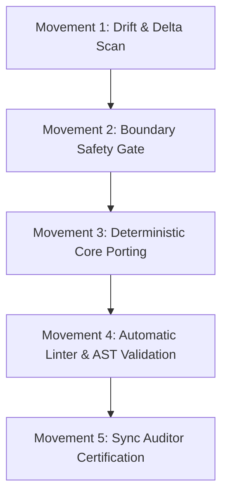

# Master Synchronization Orchestra (`Sync Skill`)

This is the **single master entrypoint** for synchronizing `AF/Bulletin` from canonical `AF/Business`.
It is invoked strictly when the user requests **"Sync Skill"**.

---

## The 5 Movements of the Synchronization Orchestra



### Movement 1: Drift & Delta Scan
Run the canonical sync report against upstream `Business`:
```bash
python3 tools/cross_repo_sync.py --sibling /home/malpersaz/Desktop/projects/htdocs/AF/Business --json
```
- Parse the exact list of `DRIFT` files (`policy: mirror`).
- Identify `MISSING_LOCALLY` files.
- Strictly ignore `ADAPTED_DIFF` and `DOMAIN_LOCAL` items.

### Movement 2: Boundary Safety Gate
Verify that none of the candidate files belong to forbidden commercial, appointment, reservation, or test modules (`mod_product`, `mod_service`, `mod_test`, etc.).
```bash
python3 tools/module_boundary_guard.py
```
If any candidate file touches a forbidden module, immediately reject that file and log it.

### Movement 3: Deterministic Core Porting
For each confirmed shared-core drift:
1. Read the canonical file from `/home/malpersaz/Desktop/projects/htdocs/AF/Business/<path>`.
2. Port changes directly to `AF/Bulletin/<path>`.
*(Note: PreToolUse hook automatically blocks any accidental forbidden modules or inline styles).*

### Movement 4: Automatic Linter & AST Validation
Immediately validate all touched files:
1. Run PHP syntax validation: `php -l <path>` on all ported PHP files.
2. Run code separation validation: `python3 tools/code_separation_guard.py`.
3. Auto-remediate any formatting or syntax discrepancy.

### Movement 5: Sync Auditor Certification
Invoke the `sync-auditor` subagent to perform the final independent read-only diff audit.
Re-run `python3 tools/cross_repo_sync.py --sibling /home/malpersaz/Desktop/projects/htdocs/AF/Business` to certify that drift is cleared.

Present a concise, clean summary report to the user in Kurmanji.
