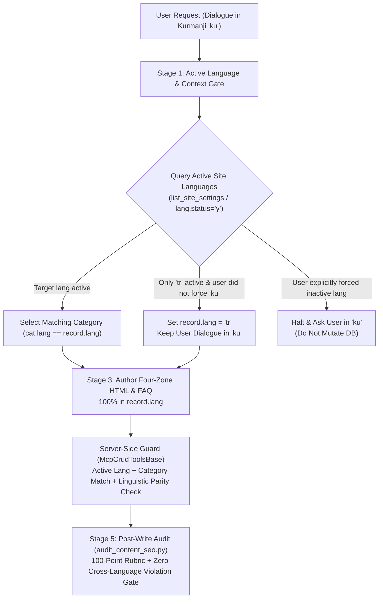

# Bulletin News Pipeline, Active Language Discovery & Language-Content Parity Plan

## 1. Executive Summary & Incident Context

During a live content curation workflow on **2026-10-21**, the editorial news workflow was instructed (in Kurmanji Kurdish, per the administrator's conversational preference) to research daily regional news and author a news article on the first topic (*Sports & Kickboxing World Cup*).

Two critical operational errors occurred during execution:
1. **Cross-Language Record Contamination**: A Kurmanji Kurdish (`ku`) news article and its associated `mod_faq` entries were written into a Turkish (`lang = 'tr'`, `category_id = 18`) database record (`mod_news` `#1`).
2. **Inactive Language Blindness**: On the target CMS instance, only Turkish (`tr`) was enabled as an active site language (`lang.status = 'y'`), while Kurdish (`ku`) was inactive (`lang.status = 'n'`). The agent failed to detect the site's active language topology upfront and conflated the **User Conversational Language (`ku`)** with the **Target CMS Content Language (`record.lang`)**.

This document establishes the root-cause analysis across the four layers of the stack (`mod_mcp`, `.agents/skills/kevanger/SKILL.md`, `lib/AgentRunner.class.php`, and `tools/audit_content_seo.py`) and defines a deterministic 5-Workstream remediation plan for `AF/Bulletin`.

---

## 2. Root-Cause Analysis (4-Layer Technical Diagnosis)

### 2.1 Layer 1 — Active Language Discovery Blindness in `McpSettingsTools` & Category Listing Tools
- **Symptom**: Editorial curation skills (`kevanger/SKILL.md`) instruct the agent to call `list_site_settings` to inspect active site settings and languages before drafting content.
- **Technical Cause**:
  - `McpSettingsTools::listSiteSettings()` and `McpSettingsTools::getSiteSettings()` (`lib/McpSettingsTools.class.php`) query `mod_settings` directly (`SELECT * FROM mod_settings ORDER BY id ASC`) without joining or cross-referencing the `lang` table (`SELECT seo, name, status, is_default FROM lang`).
  - Because `mod_settings` is pre-seeded at installation with 10 rows (`ar`, `ckb`, `de`, `en`, `fa`, `fr`, `ku`, `sv`, `tr`, `zza`) and every row carries `site_status = "online"` (which represents global maintenance state rather than per-language activation), `list_site_settings` misleads the agent into assuming all 10 languages are active.
  - Similarly, `list_news_categories` (`lib/McpNewsTools.class.php`) and `McpCrudToolsBase::listCategoriesGeneric()` (`lib/McpCrudToolsBase.class.php`) return category trees for all 10 seeded languages without indicating whether `lang.status = 'y'` or filtering out inactive languages by default.
  - No dedicated read tool in `McpSettingsTools` exposes the `lang` table's active languages (`status = 'y'`) and default language (`is_default = 'y'`).

### 2.2 Layer 2 — Conflation of Conversational Language vs. CMS Record Language in `SKILL.md` & `AgentRunner`
- **Symptom**: When `create_news(lang = 'ku')` was rejected by `McpCrudToolsBase::requireActiveLang()` (`"Language 'ku' is not an active site language"`), the agent created the record under `lang = 'tr'` (`category_id = 18`), and subsequently used `update_news(id = 1)` to overwrite the Turkish record with Kurmanji Kurdish prose.
- **Technical Cause**:
  - Global interaction policy (`AGENTS.md` Rule 8) and `AgentRunner::buildSystemInstruction()` (Directive 1) mandate conversing with the user in Kurmanji Kurdish (`ku`).
  - Neither `.agents/skills/kevanger/SKILL.md` nor `AgentRunner::buildSystemInstruction()` (Directive 7) establishes a hard architectural separation between:
    1. **Conversational Language (`dialogue_lang`)**: The language used to communicate with the human administrator in chat.
    2. **Target CMS Record Language (`record_lang`)**: The active site language (`lang.status = 'y'`) assigned to the database record (`mod_news.lang`, `mod_publication.lang`, etc.), its parent category (`category_id`), and its attached `mod_faq` rows.
  - Neither document defines a **Pre-Authoring Active Language Gate** (what to do when the user's conversational or requested language is inactive on the target site) or a **Strict Linguistic Homogeneity Mandate** (forbidding prose in language $X$ inside a record/category tagged with language $Y$).

### 2.3 Layer 3 — `McpNewsTools` Omission from Curator Hardening (`lib/McpNewsTools.class.php`)
- **Symptom**: `mod_news` (`create_news`, `update_news`, `get_news`, `delete_news`) behaved inconsistently with `mod_publication`, `mod_page`, and `mod_announcement`.
- **Technical Cause**:
  - `lib/McpNewsTools.class.php` and `.agents/skills/kevanger/SKILL.md` require full alignment:
    - `McpNewsTools::getNews()` only supports lookup by numeric `id`, lacking `loadRecordByIdOrSeo('mod_news', $args, 'News')` (`seo` + `lang` resolution).
    - `McpNewsTools::createNews()` and `updateNews()` do not invoke `$this->sanitizeBodyHtml($content)`.
    - `McpNewsTools::updateNews()` does not invoke `$this->synchronizeSummaryAndDescription($model, $args)`, does not invoke `$this->registerSlugRedirectIfChanged($oldLang, $oldSeo, (string) $model->lang, (string) $model->seo, 'news')`, and ignores `$args['lang']` if passed.
    - `McpNewsTools::deleteNews()` does not clean up bridge relations (`$this->removeBridgeRelations('mod_news', $id)`) or uploaded image files (`$this->deleteImageFiles(...)`).
    - `McpNewsTools` tool schemas still describe `summary` as `90-120 characters` instead of the `90-160` character standard enforced in `McpCrudToolsBase::assertSummaryLength()`.

### 2.4 Layer 4 — Missing Language-Content Parity Validation in `McpCrudToolsBase` & `tools/audit_content_seo.py`
- **Symptom**: `McpNewsTools::updateNews()` accepted Kurmanji Kurdish text for a `lang = 'tr'` record without error, and `tools/audit_content_seo.py` awarded the mismatched record a perfect score of **`100/100 PASSED`**.
- **Technical Cause**:
  - `McpCrudToolsBase` validates that `lang` is active (`requireActiveLang`) and that `category.lang === record.lang` (`assertRecordMatchesLang`), but performs **no linguistic script/lexicon sanity check** to prevent obvious cross-language writes (e.g., Kurmanji Kurdish text written into a `tr` or `en` record, or Turkish text written into a `ku` or `en` record).
  - `tools/audit_content_seo.py`:
    1. Omits `"news": "mod_news"` and `"mod_news": "mod_news"` from `MODULE_ALIASES` and `MODULES_WITH_SEO_META`.
    2. Hardcodes `docker exec business_app` in `fetch_record_via_php()`, failing on local environments where the container is named `bulletin_app` or where host CLI PHP lacks `pdo_mysql`.
    3. Does not query the `lang` table to verify that `record['lang']` is an active site language (`status = 'y'`).
    4. Lacks a **Language-Content Parity Check** in `evaluate_record()` to verify that the natural language of `name`, `summary`, `description`, `content`, and attached `mod_faq` rows matches `record['lang']`.

---

## 3. Remediation Architecture (5 Workstreams)

---

### Workstream 1: Active Language Exposure & Category Filtering in `mod_mcp` (`lib/McpSettingsTools.class.php`, `lib/McpCrudToolsBase.class.php`)

1. **Enrich `list_site_settings` and `get_site_settings` (`lib/McpSettingsTools.class.php`)**:
   - Query `SELECT seo, name, status, is_default FROM lang ORDER BY is_default DESC, id ASC` and attach:
     - Per-row fields on each settings item: `lang_name`, `lang_status` (`'y'` or `'n'`), and `is_default_lang` (`'y'` or `'n'`).
     - Top-level summary metadata in `list_site_settings`:
       - `active_languages`: array of active language codes (e.g., `["tr"]`).
       - `default_language`: string code of the default active language (e.g., `"tr"`).
   - Add an optional `active_only` boolean/enum parameter (`'y'`/`'n'`) to `list_site_settings` so callers can filter strictly to active site languages.
2. **Enrich Category Listing Helpers (`lib/McpCrudToolsBase.class.php`, `lib/McpNewsTools.class.php`)**:
   - In `McpCrudToolsBase::listCategoriesGeneric()` and `McpNewsTools::listNewsCategories()`, join or cross-reference the `lang` table to include `lang_status` (`'y'`/`'n'`) on returned category items and return top-level `active_languages` metadata so agents never select a category belonging to an inactive language.

---

### Workstream 2: Server-Side Linguistic Homogeneity Guard & `McpNewsTools` Full Parity (`lib/McpCrudToolsBase.class.php`, `lib/McpNewsTools.class.php`)

1. **Implement `assertContentMatchesLang()` in `McpCrudToolsBase` (`lib/McpCrudToolsBase.class.php`)**:
   - Add a lightweight, deterministic server-side linguistic guard `assertContentMatchesLang(string $lang, string $name, string $summary, string $content = '')`:
     - Uses high-precision lexical stopword and orthographic markers for the repository's primary languages (`ku`, `tr`, `en`, `ar`, `ckb`, `ru`, `fa`):
       - **Kurmanji (`ku`) markers**: Latin circumflex vowel diacritics combined with high-frequency Kurmanji function words.
       - **Turkish (`tr`) markers**: Turkish-specific Latin characters combined with high-frequency Turkish function words.
       - **English (`en`) markers**: ASCII Latin script combined with high-frequency English function words (`\b(the|and|with|from|that|this|for|are|was|were)\b`).
       - **Arabic-script (`ar`, `ckb`, `fa`) & Cyrillic (`ru`) script guards**: Unicode script block verification.
     - If a record targets `lang = 'tr'` (or `en`) but the text (`name . ' ' . $summary . ' ' . strip_tags($content)`) exhibits strong Kurmanji (`ku`) markers above threshold (or vice versa, e.g., Turkish prose inside a `ku` record), throw a clear `McpToolException`:
       `"Language mismatch detected: record language is '{$lang}', but the provided title/summary/content appears to be written in '{$detectedLang}'. Content prose must strictly match the record and category language '{$lang}'."`
   - Invoke `assertContentMatchesLang()` in `create_*` and `update_*` across `McpNewsTools`, `McpPublicationTools`, `McpPageTools`, `McpAnnouncementTools`, and `McpFaqTools`.
2. **Upgrade `McpNewsTools` to Full Editorial Parity (`lib/McpNewsTools.class.php`)**:
   - Expand `get_news` to support `seo` + optional `lang` lookup via `$this->loadRecordByIdOrSeo('mod_news', $args, 'News')` and return `['item' => $row]` (matching `get_publication`, `get_page`, etc.).
   - Expand `list_news` with `seo` filter, multi-column search (`name`, `seo`, `title`, `summary`), and `total` count parity.
   - Update `create_news` and `update_news` schemas to `90–160` character summary descriptions (`minLength: 90, maxLength: 160`), support `deck`, `video`, `gallery_id`, `file_id`, `acl_id`, `created_at`, and `image` upload/removal parity.
   - In `createNews()` and `updateNews()`:
     - Sanitize HTML via `$this->sanitizeBodyHtml($rawContent)`.
     - Synchronize `summary` and `description` via `$this->synchronizeSummaryAndDescription($model, $args)`.
     - Validate `lang` changes via `$this->requireActiveLang($args)` and re-assert category language match via `$this->assertRecordMatchesLang('mod_news_category', $categoryId, $lang, 'News category')`.
     - Register HTTP 301 redirects on slug/language updates via `$this->registerSlugRedirectIfChanged($oldLang, $oldSeo, (string) $model->lang, (string) $model->seo, 'news')`.
   - In `deleteNews()`:
     - Clean up bridge relations (`$this->removeBridgeRelations('mod_news', $id)`) and image files (`$this->deleteImageFiles(...)`).

---

### Workstream 3: `kevanger` Skill & `AgentRunner` Prompt Hardening (`.agents/skills/kevanger/SKILL.md`, `lib/AgentRunner.class.php`)

1. **Update `.agents/skills/kevanger/SKILL.md`**:
   - Include `mod_news` (`get_news`, `create_news`, `update_news`, `list_news_categories`) explicitly in Sequence Steps 1 and 5.
   - Add a mandatory **Active Language & Dialogue-vs-Content Separation Gate** in Sequence Step 1:
     - **Rule 1A (Active Language Inspection)**: Always inspect `active_languages` from `list_site_settings` before selecting a category or drafting prose. Never assume a seeded category language is active unless `lang_status = 'y'`.
     - **Rule 1B (Dialogue Language vs. Record Language Separation)**: Keep user dialogue in Kurmanji Kurdish (`AGENTS.md` Rule 8), but write CMS record fields (`name`, `title`, `summary`, `description`, `keywords`, `seo`, `content`) and `mod_faq` (`question`, `answer`) **100% in the target record's active language (`record.lang`)**.
     - **Rule 1C (Inactive Target Language Protocol)**:
       - If the user asks to create/curate site content without specifying a language and only one language (e.g. `tr`) is active on the site, author the CMS record 100% in that active site language (`tr`) while reporting back to the user in Kurmanji Kurdish.
       - If the user explicitly asks to publish content in a language that is currently inactive (`status = 'n'`), **halt before any database write** and ask the user in Kurmanji whether to activate that language first or publish in the active site language. Never write prose in language $X$ under a category/record of language $Y$.
2. **Update `AgentRunner::buildSystemInstruction()` (`lib/AgentRunner.class.php`)**:
   - Reinforce in Directive 1 and Directive 7 that while conversational replies to the user follow the user's prompt language, all database record fields (`name`, `title`, `summary`, `description`, `content`, `question`, `answer`) must strictly be authored in the target record's active CMS language (`record.lang`), and cross-language record writes are strictly prohibited.

---

### Workstream 4: Upgrade `tools/audit_content_seo.py` with `mod_news`, Container Auto-Detection & Linguistic Parity Gate

1. **Add `mod_news` Support**:
   - Add `"news": "mod_news"` and `"mod_news": "mod_news"` to `MODULE_ALIASES` and `MODULES_WITH_SEO_META`.
2. **Dynamic Docker Container Resolution in `fetch_record_via_php()`**:
   - Query `lang` table status (`SELECT status FROM lang WHERE seo = '...' LIMIT 1`) and attached `mod_faq` rows (`question`, `answer`) inside the PHP inspection payload.
   - Support `business_app`, `bulletin_app`, or dynamically discovered running `*_app` PHP containers when local CLI PHP lacks the PDO MySQL driver.
3. **Add Critical Violation Checks for Active Language & Linguistic Homogeneity**:
   - Verify `lang_active == 'y'` in the database `lang` table; if `'n'`, append a critical violation (`"Record language '{lang}' is not active in the site 'lang' table."`).
   - Verify that the prose of `name`, `summary`, `description`, `content`, and attached `mod_faq` entries matches `record['lang']` using deterministic stopword/orthography detection; if cross-language contamination is detected (e.g., Kurmanji text inside a `lang='tr'` record), deduct points and append a **CRITICAL VIOLATION** (`"Cross-language content mismatch: record lang is 'tr', but body/metadata prose is written in 'ku'."`), guaranteeing `PASSED = False`.

---

### Workstream 5: Data Remediation of `mod_news` `#1` & End-to-End Verification

1. **Remediate Live Record `mod_news` `#1` and Attached `mod_faq` (`#1`, `#2`)**:
   - Update `mod_news` `#1` (`category_id = 18`, `lang = 'tr'`) so that `name`, `title`, `seo`, `summary`, `description`, `keywords`, and `content` are 100% in fluent, grounded target-language prose matching `record.lang`.
   - Update `mod_faq` `#1` and `#2` (`mod_name = 'mod_news'`, `vid = 1`, `lang = 'tr'`) so that both `question` and `answer` are 100% in Turkish.
2. **Automated Quality & Smoke Verification**:
   - Run `python3 tools/audit_content_seo.py --module mod_news --id 1` and verify **`100/100 PASSED`** with zero critical violations and verified `tr` linguistic homogeneity.
   - Add unit/integration assertions in `tasks/mcp_smoke.php` testing:
     - `list_site_settings` active language metadata (`active_languages`, `default_language`, `lang_status`).
     - `McpCrudToolsBase::assertContentMatchesLang()` rejection of Kurmanji text in `lang = 'tr'` records (and vice versa).
     - `McpNewsTools` `get_news` by `seo` + `lang`, `90–160` summary validation, HTML sanitization, and 301 redirect generation.
   - Log the completed engineering notes in `/docs/VERSION.md` and synchronize `config/site.config.php` per `.agents/skills/task-validation/SKILL.md`.

---

## 4. Affected Files Inventory

| File Path | Action | Responsibility |
| :--- | :--- | :--- |
| `lib/McpSettingsTools.class.php` | Modify | Expose `lang_status`, `is_default_lang`, `active_languages`, and `default_language` in `list_site_settings` / `get_site_settings`. |
| `lib/McpCrudToolsBase.class.php` | Modify | Add `assertContentMatchesLang()` cross-language contamination guard and enrich category listings with `lang_status` / `active_languages`. |
| `lib/McpNewsTools.class.php` | Modify | Align `mod_news` with editorial standards (`90–160` summary, `loadRecordByIdOrSeo`, `sanitizeBodyHtml`, `synchronizeSummaryAndDescription`, `registerSlugRedirectIfChanged`, `assertContentMatchesLang`, bridge cleanup). |
| `lib/McpPublicationTools.class.php` (and sibling CRUD tools) | Modify | Wire `assertContentMatchesLang()` into `create_*` and `update_*` handlers, including `McpFaqTools`. |
| `.agents/skills/kevanger/SKILL.md` | Modify | Codify the Active Language Discovery & Dialogue-vs-Record Language (`record.lang`) Separation Gate. |
| `lib/AgentRunner.class.php` | Modify | Update Directive 1 & Directive 7 in `buildSystemInstruction()` to strictly forbid cross-language record mutations. |
| `tools/audit_content_seo.py` | Modify | Add `mod_news` support, container auto-discovery (`bulletin_app`), active language check, and critical violation gate for cross-language prose mismatch. |
| `tasks/mcp_smoke.php` | Modify | Add regression tests for active language discovery, `McpNewsTools` parity, and cross-language write rejection. |
| `docs/VERSION.md` | Modify | Record release notes upon implementation completion. |
