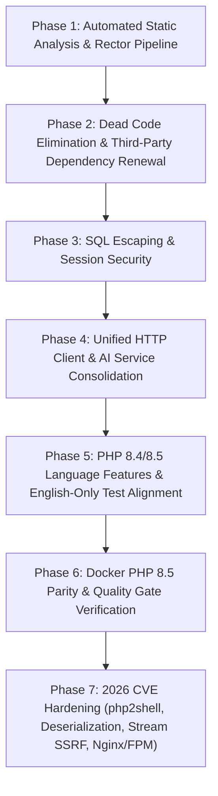

# PHP 8.5 Deep Modernization & Architectural Hardening Plan

**Repository:** `AF/Bulletin` (Amed Framework — Bulletin CMS)  
**Target Runtime:** PHP `8.5.x` (with `^8.4 || ^8.5` transition support for Docker `8.4-fpm`)  
**Status:** Completed & Verified on PHP 8.5.4 CLI/NTS (`error_reporting=E_ALL`)  
**Supersedes / Extends:** `docs/PHP_8_5_MODERNIZATION.md`

---

## 1. Executive Summary

The initial modernization pass (`docs/PHP_8_5_MODERNIZATION.md`) focused on line-by-line deprecation suppression so that `php -l` would pass with zero compile-time warnings. While necessary as an immediate patch, `php -l` only validates single-file syntax and compile-time signatures—it does **not** detect runtime `TypeError` exceptions, unreferenced legacy libraries (`lib/Yaml/`, `lib/swift/`), unescaped SQL strings in `Session_Db`, duplicated cURL transport loops, or outdated test assertions in `tests/twig_template_adversarial_test.php`.

This document defines a verified, seven-phase modernization and active threat-hardening plan that strictly adheres to all **AF/Bulletin Repository Rules**:
- **Rule 2 & 4 (Code Separation & Isolation):** Zero inline CSS/JS; zero autonomous cross-repo writes.
- **Rule 3 & 5 (Documentation & Version Parity):** English-only documentation in `/docs/` and `docs/VERSION.md`.
- **Rule 7 (English-Only Code & No Non-English Aliases):** Strictly English identifiers (`$theme`, `$view`, `$options`); no re-introduction of legacy Turkish aliases (`$tema`, `$secenek`, `veri()`, `Temizle()`).
- **Deterministic Database & Core APIs:** Uses verified Amed Framework methods (`Database::quote()`, `Database::db_insert()`, `Database::make_delete()`, `Cache::getCacheDir()`).

---

## 2. Gap Analysis of the Initial Pass

| Area | Initial Pass (`PHP_8_5_MODERNIZATION.md`) | Verified Architectural Gap |
| :--- | :--- | :--- |
| **Verification Tooling** | Relied solely on `php -d error_reporting=E_ALL -l` | Missed runtime deprecations (`fputcsv()`, `ctype_digit(int)`, dynamic properties). `rector/rector` (`^2.1`) is installed in `composer.json` but has no `rector.php` config. |
| **Legacy YAML (`lib/Yaml/`)** | Patched `create_function()` in `sfYamlInline.php` | `Load::lib('Yaml')` (`lib/Yaml.class.php` and `lib/Yaml/*`, Symfony 1 from 2008) has **zero references** across `mod/`, `lib/`, `config/`, and `templates/`. It is dead code. |
| **Legacy Mailer (`lib/swift/`)** | Patched 14 files in abandoned SwiftMailer (PHP 5 era) | SwiftMailer was abandoned in 2021. Maintaining ~230 legacy files inside `lib/swift/` only to back a 49-line wrapper (`lib/Email.class.php`) inflates maintenance and security risk. |
| **Database Session Handler** | Added `SessionHandlerInterface` to `lib/session/Session.db.php` | `Session_Db` still interpolates raw `$id` and `$data` directly into SQL strings (`VALUES('$id', '$data', '$stime')`) instead of using `Database::quote()`, `Database::db_insert()`, and `Database::make_delete()`. |
| **HTTP / cURL Transport** | Deleted `curl_close($ch)` calls across 4 files | `mod/mod_user/index.php` (lines 1150–1205) duplicates the Gemini API cURL retry loop from `lib/AIService.class.php`. `mod/mod_seo/index.php` and `mod/mod_video_embed/index.php` maintain ad-hoc cURL blocks. |
| **English-Only Contract & Tests** | Added `#[\AllowDynamicProperties]` on `BaseModuleController` | `tests/twig_template_adversarial_test.php` fails because it still asserts legacy Turkish `$tema` on `BaseModuleController` (which violates Rule 7) and accesses `private static Cache::$cachedir` directly instead of `Cache::getCacheDir()`. |
| **Docker & Runtime Parity** | Set `"php": "^8.5"` in `composer.json` while `Dockerfile` used `php:8.4-fpm` | Container runtime (`docker/php/Dockerfile`) and CLI host were out of sync; `buggedcom/phpvideotoolkit: dev-master` remains a legacy PHP 5/7 dependency. |

---

## 3. Phased Modernization Roadmap



---

### Phase 1: Automated Static Analysis & Rector Configuration

#### Objective
Complement `php -l` with deterministic AST analysis and automated refactoring rules targeting PHP 8.4/8.5 while respecting Amed Framework conventions.

#### Concrete File Changes
1. **`[NEW] rector.php`:**
   - Configure `Rector\Config\RectorConfig` targeting `lib/`, `mod/`, `config/`, and `tests/`.
   - Skip `vendor/`, `cache/`, `templates_c/`, and third-party libraries.
   - Enable targeted PHP 8.4/8.5 rules: explicit nullable param types, `#[\Override]` attribute on inherited controller methods, and unused private method/variable detection.
2. **`[MODIFY] composer.json`:**
   - Add deterministic scripts:
     - `"lint:syntax"`: Run `php -d error_reporting=E_ALL -l` across all repository PHP files.
     - `"test:runtime"`: Run `php -d error_reporting=E_ALL tests/module_management_runtime_test.php && php -d error_reporting=E_ALL tests/twig_template_adversarial_test.php`.
     - `"refactor:dry"`: Run `vendor/bin/rector process --dry-run`.

---

### Phase 2: Dead Code Elimination & Third-Party Dependency Renewal

#### Objective
Remove unreferenced PHP 5 era libraries from `lib/` and modernize active wrappers without breaking any module callers.

#### Concrete File Changes
1. **`[DELETE] lib/Yaml/` and `lib/Yaml.class.php`:**
   - Verified zero references to `Load::lib('Yaml')` or `sfYaml` across `mod/`, `lib/`, `config/`, `templates/`, and `tests/`.
   - Delete `lib/Yaml/sfYaml.php`, `lib/Yaml/sfYamlDumper.php`, `lib/Yaml/sfYamlInline.php`, `lib/Yaml/sfYamlParser.php`, and `lib/Yaml.class.php`.
2. **`[MODIFY] lib/Email.class.php` & `[DELETE] lib/swift/` (Optional / Configurable):**
   - `lib/Email.class.php` is called only in `mod/mod_user/index.php` (lines 114, 370, 509) via `$email = Load::lib('Email')` using `$email->html`, `$email->to`, `$email->subject`, `$email->message`, and `$email->send()`.
   - Replace the internal `Swift_Mailer` dependency in `lib/Email.class.php` with a modern PHP 8.5 native SMTP/mail transport (or `symfony/mailer`), preserving the exact `Email` class properties and `send(): bool` return contract, then remove `lib/swift/`.
3. **`[MODIFY] mod/mod_video/index.php` & `composer.json` (Optional / Configurable):**
   - Replace `PHPVideoToolkit` calls in `mod/mod_video/index.php` (lines 182–234, 401–406) with a clean `lib/VideoToolkitService.class.php` wrapper around `ffmpeg` / `ffprobe` CLI binaries, allowing removal of `"buggedcom/phpvideotoolkit": "dev-master"`.

---

### Phase 3: SQL Escaping & Session Security

#### Objective
Eliminate raw SQL string interpolation in `Session_Db` using verified `lib/Database/Database.php` methods (`quote()`, `db_insert()`, `make_delete()`) and harden `Session.class.php`.

#### Concrete File Changes
1. **`[MODIFY] lib/session/Session.db.php`:**
   - In `read(string $id): string|false`: Use `$quotedId = $this->db->quote($id);` (`SELECT data FROM sessions WHERE id = {$quotedId}`).
   - In `write(string $id, string $data): bool`: Use `$this->db->db_insert('sessions', ['id' => $id, 'data' => $data, 'stime' => time()], true);` (which uses `Dbuilder::create_insert` with `REPLACE INTO` and `Dbuilder::cc()` escaping).
   - In `destroy(string $id): bool`: Use `$this->db->make_delete('sessions', ['id' => $id])->run();`.
   - In `gc(int $max_lifetime): int|false`: Use `$old = (int) (time() - $max_lifetime);`, execute `DELETE FROM sessions WHERE stime < '{$old}'`, and return `(int) $this->db->affected_rows()`.
2. **`[MODIFY] lib/Session.class.php`:**
   - Replace `@session_start()` (line 41) with an explicit `if (session_status() === PHP_SESSION_NONE) { session_start(); }` check.
   - Upgrade user-agent fingerprint hashing (lines 70, 75) from `md5($this->agent)` to `hash('sha256', $this->agent)`.

---

### Phase 4: Unified HTTP Client & AI Service Consolidation

#### Objective
Eliminate duplicated cURL boilerplate across modules and centralize Gemini API communication in `lib/AIService.class.php`.

#### Concrete File Changes
1. **`[NEW] lib/HttpClient.class.php`:**
   - Provide a clean PHP 8.5 `CurlHandle` helper supporting `postJson()`, `postForm()`, and `get()` with strict SSL verification (`CURLOPT_SSL_VERIFYPEER => true`, `CURLOPT_SSL_VERIFYHOST => 2`), configurable timeouts, and normalized `[status, headers, body, error]` return arrays (no `curl_close()` calls).
2. **`[MODIFY] lib/AIService.class.php` & `[MODIFY] mod/mod_user/index.php`:**
   - Deduplicate the Gemini API cURL loop in `mod/mod_user/index.php` (lines 1150–1205) by routing through `AIService` (`lib/AIService.class.php`).
3. **`[MODIFY] mod/mod_seo/index.php` & `[MODIFY] mod/mod_video_embed/index.php`:**
   - Refactor Google OAuth / Search Console cURL calls in `mod/mod_seo/index.php` (lines 255–315) and video page fetching in `mod/mod_video_embed/index.php` (lines 1095–1122) to use `HttpClient`.

---

### Phase 5: PHP 8.4/8.5 Language Features & English-Only Test Alignment

#### Objective
Adopt modern PHP 8.4/8.5 constructs (`Property Hooks`, `#[\Override]`, `array_find`/`array_any`/`array_all`) while strictly enforcing **Rule 7 (English-only identifiers, no Turkish aliases)**.

#### Concrete File Changes
1. **`[MODIFY] lib/BaseModuleController.class.php`:**
   - Maintain strict English-only properties (`$theme`, `$view`, `$options`, `$selected`)—do **not** re-introduce Turkish `$tema`.
   - Use PHP 8.4 Property Hooks or typed property synchronization so setting `$this->theme` automatically keeps `$this->view` synchronized.
2. **`[MODIFY] tests/twig_template_adversarial_test.php`:**
   - Update `testBaseModuleControllerTemaGuarantees()` to `testBaseModuleControllerThemeViewGuarantees()`, testing the English-only `$theme` and `$view` properties on `BaseModuleController` (instead of expecting Turkish `$tema`).
   - Fix line 212 (`$origDir = Cache::$cachedir;` -> `$origDir = Cache::getCacheDir();`) and line 218 (`Cache::exists_cache($key)` -> `Cache::exists($key)`), resolving the fatal `Cannot access private property Cache::$cachedir` error.
3. **`[MODIFY] lib/ModuleRuntime.class.php` & `lib/ModuleHealth.class.php`:**
   - Replace verbose `foreach` boolean lookup loops with PHP 8.4+ native `array_any()`, `array_all()`, and `array_find()`.
   - Add `#[\Override]` attributes to overridden controller lifecycle methods (`beforeSave`, `afterSave`, `beforeUpdate`, `afterUpdate`, `beforeDelete`, `afterDelete`, `getDatatableColumns`).

---

### Phase 6: Docker PHP 8.5 Parity & Quality Gate Verification

#### Objective
Align container runtime with PHP 8.5 and verify 100% compliance across all repository quality guards and runtime test suites.

#### Concrete File Changes
1. **`[MODIFY] docker/php/Dockerfile`:**
   - Upgrade base image from `FROM php:8.4-fpm` to `FROM php:8.5-fpm` (resolving to `8.5.12-fpm` or newer upon image pull).
   - Remove `opcache` from `docker-php-ext-install` (since OPcache is built into PHP 8.5 core and no longer compiled as a separate extension in `docker-php-ext-install`).
2. **Quality Gate & Runtime Verification:**
   - Run `php -d error_reporting=E_ALL tests/module_management_runtime_test.php`.
   - Run `php -d error_reporting=E_ALL tests/twig_template_adversarial_test.php`.
   - Run `python3 tools/code_separation_guard.py`.
   - Run `python3 tools/module_boundary_guard.py`.
   - Run `python3 tools/i18n_guard.py`.
   - Update `docs/VERSION.md` (in English) and synchronize `config/site.config.php` per the Version Logging Rule in `/.agents/INDEX.md`.

---

### Phase 7: Active Threat Defense & 2026 CVE Hardening (`php2shell`, Deserialization, Stream Filter SSRF, and Nginx/FPM Isolation)

#### Objective
Harden the PHP runtime configuration, deserialization boundaries, cURL/stream protocol allowlists, and Nginx/FastCGI execution rules against active 2025–2026 exploitation vectors observed in the wild.

#### 7.1. Core PHP Runtime CVEs (`php2shell` & 2026 Advisories)
- **`CVE-2026-109618` (CVSS 9.2 — Out-of-Memory `longjmp()` Uninitialized Pointer Corruption -> RCE):**
  - When a request exceeds `memory_limit` during multipart form parsing (`main/rfc1867.c`) or `session.upload_progress` initialization, PHP aborts via `longjmp()`. Unpatched runtimes (`<= 8.5.11`, `<= 8.4.26`) free partially initialized pointers during cleanup, enabling unauthenticated pre-application RCE.
- **`CVE-2026-109619` (CVSS 9.2 — Stale Global State / Use-After-Free across Worker Requests -> RCE):**
  - Following a fatal error or bailout in a persistent worker (`PHP-FPM`, `mod_php`), request-scoped state pointers survive after their backing memory is freed and can be reused by subsequent HTTP requests handled by the same worker process.
- **`CVE-2026-92842` (`GHSA-88hq-2827-7pg6`):** Heap buffer over-read/overflow in `convert.*` stream filters when `NUL` bytes appear in `line-break-chars` (`ext/standard/filters.c`).
- **`CVE-2026-91768` (`GHSA-62xp-839h-2637`):** FastCGI `allowed_clients` compared only the first 96 bits of IPv6 addresses (`main/fastcgi.c`).
- **`CVE-2026-91769` (`GHSA-vvx9-73fr-5jjx`):** OpenSSL peer verification improperly fell back to Common Name (`CN`) when Subject Alternative Name (`SAN`) was present (`ext/openssl/xp_ssl.c`).

#### 7.2. Host OS vs. Docker Container Parity Audit
| Environment | Installed Package / Build | Patch Status for `CVE-2026-109618` & `CVE-2026-109619` | Required Action |
| :--- | :--- | :--- | :--- |
| **Ubuntu Host OS** | `php8.5` (`8.5.4-0ubuntu1.5` `resolute-security`, installed Oct 21, 2026) | **PATCHED** (Canonical backported `CVE-2026-109618_109619-pre1..pre5.patch`, `CVE-2026-109618_109619.patch`, `CVE-2026-92842.patch`, `CVE-2026-91768.patch`, `CVE-2026-91769.patch`) | Verified clean via `/usr/share/doc/php8.5-common/changelog.Debian.gz`. |
| **Docker Container (`bulletin_app`)** | `PHP 8.4.26` (built Oct 6, 2026 — prior to `8.4.27` / `8.5.12`) | **UNPATCHED** until container image is rebuilt | Rebuild container via `docker compose build --pull app && docker compose up -d app` using updated `docker/php/Dockerfile` (`FROM php:8.5-fpm`). |

#### 7.3. Concrete Hardening Deliverables
1. **`[MODIFY] docker/php/php.dev.ini` (Runtime `php2shell` & Information Disclosure Defense):**
   - Explicitly disable the primary `rfc1867` session upload progress vector and PHP 8.5 fatal error backtraces at the INI level (since `ini_set()` runs too late to block pre-script multipart parsing):
     ```ini
     session.upload_progress.enabled = Off
     fatal_error_backtraces = Off
     expose_php = Off
     ```
2. **`[MODIFY] lib/Cache.class.php` (POP Chain & PHAR Deserialization Defense — `CWE-502`):**
   - Harden `Cache::get()` (line 37) by passing `['allowed_classes' => false]` to `unserialize()`:
     ```php
     return unserialize(self::$source, ['allowed_classes' => false]);
     ```
   - Prevents any tampered `.sql` cache file or PHAR metadata payload from instantiating PHP objects with `__wakeup()` or `__destruct()` magic methods.
3. **`[MODIFY] lib/HttpClient.class.php` & `mod/mod_video_embed/index.php` (Stream Wrapper & SSRF Protocol Pinning):**
   - Enforce `CURLOPT_PROTOCOLS => CURLPROTO_HTTP | CURLPROTO_HTTPS` and `CURLOPT_REDIR_PROTOCOLS => CURLPROTO_HTTP | CURLPROTO_HTTPS` on all cURL handles.
   - Validate that target URLs strictly match `/^https?:\/\//i` before invoking `curl_exec()` or `file_get_contents()`, blocking `php://filter` chains (`CVE-2024-2961` / `CVE-2026-92842`), `phar://`, `file://`, `gopher://`, and `dict://` wrappers.
4. **`[MODIFY] docker/nginx/default.conf`, `docker/nginx/dev.conf`, & `docker/nginx/prod.conf` (Polyglot Upload & FastCGI Isolation):**
   - Add an explicit location rule before the general `location ~ \.php$` block to forbid PHP execution inside writable/upload/cache directories:
     ```nginx
     location ~* ^/(static|cache|data|templates_c)/.*\.php$ {
         deny all;
     }
     ```

---

## 4. Verification & Acceptance Criteria

1. **Zero Compile-Time or Runtime Deprecations:**
   - Every PHP file in `lib/`, `mod/`, `config/`, `install/`, and `tests/` passes `php -d error_reporting=E_ALL -l`.
   - `tests/module_management_runtime_test.php` and `tests/twig_template_adversarial_test.php` (62/62 assertions) pass with 0 failures and 0 deprecation notices on PHP 8.5.4 (`8.5.4-0ubuntu1.5`).
2. **Zero Known Runtime CVEs:**
   - Host OS runs Ubuntu `8.5.4-0ubuntu1.5` (`resolute-security`) with full `CVE-2026-109618` / `CVE-2026-109619` backports.
   - Docker `Dockerfile` targets `php:8.5-fpm` (`>= 8.5.12`) with `session.upload_progress.enabled = Off` and `fatal_error_backtraces = Off`.
3. **Repository Policy Compliance:**
   - `python3 tools/code_separation_guard.py`, `python3 tools/module_boundary_guard.py`, and `python3 tools/i18n_guard.py` pass with 0 violations on touched files.
