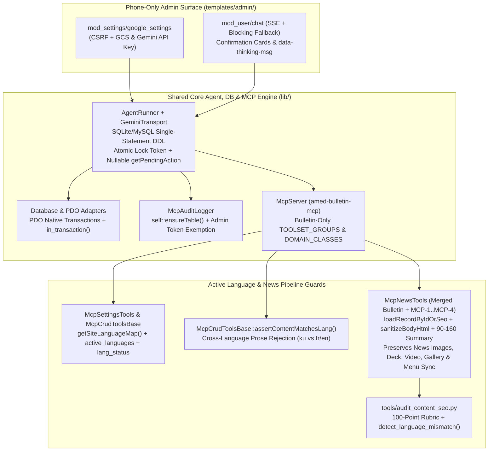

# Agent Chat (`mod_user/chat`) Runtime Hardening, Google Services Hub Decoupling & Active-Language News Pipeline Synchronization Plan (`v1.0.3.79` Adaptation)

## 1. Executive Summary & Architectural Scope

This plan adapts the shared-core, admin-surface, and MCP editorial hardening changes delivered in `AF/Business` **`v1.0.3.79 (2026-10-24)`** (along with its required database transaction and background worker prerequisites from `v1.0.3.74`–`v1.0.3.78`) to the `AF/Bulletin` newsroom repository while strictly enforcing **Bulletin Domain Boundaries** (`AGENTS.md` Rule 4 & `tools/module_boundary_guard.py`).

Every file path, class/interface name, method signature, language pack inventory, and existing repository feature in this document has been deterministically verified against the live `AF/Bulletin` and `AF/Business` codebases (`python3 tools/cross_repo_sync.py --sibling /home/malpersaz/Desktop/projects/htdocs/AF/Business`).

### 1.1 Boundary Filtering Matrix (`AF/Business` `v1.0.3.79` vs. `AF/Bulletin`)

| Upstream Component (`AF/Business` `v1.0.3.79`) | `AF/Bulletin` Disposition | Rationale & Empirical Verification |
| :--- | :--- | :--- |
| `lib/Database/Database.php`, `lib/Database/Adapter/PDO_MYSQL.php`, `lib/Database/Adapter/PDO_POSTGRESQL.php`, `lib/Database/Adapter/PDO_SQLITE.php` | **SYNC** | Prerequisite (`v1.0.3.75`) for `McpMenuTools::reparentMenuItemsByName()` and `batchUpdateMenuItems()` dry-run transaction previews (`$_transaction_depth`, `in_transaction()`, native PDO `beginTransaction()`/`commit()`/`rollBack()`). |
| `lib/AgentRunner.class.php`, `lib/GeminiTransport.php`, `lib/McpAuditLogger.class.php`, `tasks/agent_worker.php`, `tasks/agent_timeout_smoke.php` | **SYNC & ADAPT** | Shared core AI Agent execution engine (`interface GeminiTransport`, `class CurlGeminiTransport`), SQLite/MySQL single-statement DDL safety, atomic concurrency lock tokens, human-in-the-loop confirmation gate, and rate/token budget auditing. Strip all foreign commercial intent domains/tools (`content`, `product`, `service`, `project`, `appointment`, `reservation`, `hr`, `corporate`, `test`). |
| `lib/McpServer.class.php`, `lib/McpPromptManager.class.php`, `lib/McpResourceManager.class.php`, `lib/McpOAuth.class.php` | **SYNC & ADAPT** | Shared MCP Streamable HTTP server (`SERVER_NAME = 'amed-bulletin-mcp'`), domain-delegated `definitions()` registry, OAuth 2.1 rate limiting, and URI resource/prompt managers scoped strictly to Bulletin modules (`cms://news/{id}`, `cms://publication/{id}`, `cms://page/{id}`, `cms://announcement/{id}`). |
| `lib/McpCrudToolsBase.class.php`, `lib/McpSettingsTools.class.php`, `lib/Amed.class.php` | **SYNC & MERGE** | Active language discovery (`getSiteLanguageMap()`, `active_languages`, `default_language`, `lang_status`), server-side cross-language prose guard (`assertContentMatchesLang()`), and `MCP-1`..`MCP-3` helpers. In `lib/Amed.class.php`, port only `checkRedirects()` (`$safeLangUrl` matching) while preserving Bulletin's `'amida'` default theme and `$brandAssetFields` fallback. |
| `lib/McpNewsTools.class.php` | **MERGE (PRESERVE BULLETIN FEATURES)** | Merge `definitions()`, `loadRecordByIdOrSeo()`, `sanitizeBodyHtml()`, `synchronizeSummaryAndDescription()`, `assertContentMatchesLang()`, `90–160` summary validation, and `registerSlugRedirectIfChanged(..., 'news')` into Bulletin's existing `McpNewsTools.class.php` **without** regressing Bulletin-specific newsroom features (`NEWS_IMAGE_SIZES`, `CATEGORY_IMAGE_SIZES`, `resolveImageArgument`, `deleteImageFiles`, `deck`, `video`, `gallery_id`, `file_id`, `acl_id`, `created_at`, `user_id`/`username`, `total` in `listNews`, `syncCategoryMenuOnUpdate`, and recursive `deleteCategoryTree`). |
| `lib/McpPublicationTools.class.php`, `lib/McpPageTools.class.php`, `lib/McpAnnouncementTools.class.php`, `lib/McpFaqTools.class.php`, `lib/McpSeoTools.class.php`, `lib/McpMenuTools.class.php`, `lib/McpAclTools.class.php`, `lib/McpAttachmentTools.class.php`, `lib/McpDocumentTools.class.php`, `lib/McpGalleryTools.class.php`, `lib/McpHeadlineTools.class.php`, `lib/McpImageCategoryTools.class.php`, `lib/McpPopupTools.class.php`, `lib/McpRedirectTools.class.php`, `lib/McpSliderTools.class.php`, `lib/McpSurveyTools.class.php`, `lib/McpVideoTools.class.php` | **SYNC** | Wire `assertContentMatchesLang()` into Bulletin-owned `create_*` and `update_*` handlers, add `definitions()` self-registration, support `dry_run` menu previews, mask `gemini_api_key` in `get_google_settings`, and align `get_google_settings` / `update_google_settings` ACL with `mod_settings`. |
| `lib/McpContentTools.class.php`, `lib/McpProjectTools.class.php`, `lib/McpServiceTools.class.php`, `lib/McpProductTools.class.php`, `lib/McpAppointmentTools.class.php`, `lib/McpReservationTools.class.php`, `lib/McpHrTools.class.php`, `lib/McpCorporateTools.class.php`, `lib/McpTestTools.class.php` | **FORBIDDEN (DO NOT SYNC)** | Commercial, catalog, CRM, and assessment modules forbidden in `AF/Bulletin` by `tools/module_boundary_guard.py`. |
| `mod/mod_settings/index.php`, `mod/mod_settings/lang/*.php`, `mod/mod_seo/index.php`, `templates/admin/mod_settings/google_settings.twig`, `templates/admin/partials/header.twig` | **SYNC** | Decouple Google Cloud Storage & Gemini API configuration (`google_settings`) from `mod_seo` into `mod_settings::google_settings()` with CSRF validation, phone-only admin template (`e.g. af-bulletin-news-cms-media`), backward-compatible redirect in `mod_seo::google_settings()`, header modal URL update (`mod_settings/google_settings`), and localization across all 10 `mod/mod_settings/lang/*.php` files. (`mod/management/lang/*.php` already contains `google_services_hub` across all 9 files.) |
| `mod/mod_user/index.php`, `mod/mod_user/lang/*.php`, `templates/admin/mod_user/chat.twig`, `templates/admin/assets/js/mod_user_agent.js`, `templates/admin/assets/css/mod_user_agent.css` | **SYNC & ADAPT** | Upgrade `mod_user/chat` (`ajax_agent_chat`, `ajax_agent_stream`, `ajax_agent_job_*`, `ajax_agent_csrf`) to use `AgentRunner` and `McpAuditLogger`, port the complete 27-key `$lang['mod_user']['agent']` block across all 10 `mod/mod_user/lang/*.php` files, and move `google_settings` in `_build_panel_categories()` and `_assert_panel_language_keys()` from `mod_seo` to `mod_settings`. |
| `.agents/skills/kevanger/SKILL.md`, `tools/audit_content_seo.py`, `tasks/mcp_smoke.php` | **SYNC & ADAPT** | Map upstream active-language & dialogue-vs-record language separation rules into `.agents/skills/kevanger/SKILL.md`, port `tools/audit_content_seo.py` scoped strictly to Bulletin modules (`mod_news`, `mod_publication`, `mod_page`, `mod_announcements`) and `bulletin_app`, and expand `tasks/mcp_smoke.php`. |

---

## 2. Architecture & Execution Flow

---

## 3. Workstream Breakdown

### Workstream 1: Database Transaction Parity, `AgentRunner`, `GeminiTransport`, `McpAuditLogger` & `mod_user/chat` Runtime Hardening

1. **Port Database Transaction Tracking (`lib/Database/Database.php`, `lib/Database/Adapter/PDO_{MYSQL,POSTGRESQL,SQLITE}.php`)**:
   - Synchronize `$_transaction_depth` and `in_transaction(): bool` in `lib/Database/Database.php` so `start_transaction()`, `commit()`, and `rollback()` delegate to the underlying PDO adapter's `begin_transaction()`, `commit()`, and `rollback()` methods instead of raw MySQL-only `SET AUTOCOMMIT=0` queries.
   - Add `in_transaction(): bool` to `PDO_MYSQL.php`, `PDO_POSTGRESQL.php`, and `PDO_SQLITE.php`.
2. **Port `lib/GeminiTransport.php` and `lib/McpAuditLogger.class.php`**:
   - Port `lib/GeminiTransport.php` (`interface GeminiTransport` and `class CurlGeminiTransport implements GeminiTransport`) with `AgentRunner::normalizePayloadForGemini()` defense-in-depth so empty `functionCall.args` and `properties` always serialize as JSON objects `{}` rather than `[]`.
   - Port `lib/McpAuditLogger.class.php` with `self::ensureTable()` guards inside `log()`, `getDailyTokenUsage()`, and `queryLogs()`, and administrator (`groupId === 1`) exemption in `checkDailyTokenBudget(int $userId = 0, int $groupId = 0)`.
3. **Port & Adapt `lib/AgentRunner.class.php` (Strictly Scoped to Bulletin Domain)**:
   - Ensure `Obuilder` (`lib/Orm/Obuilder.php`) is explicitly required at the top of `lib/AgentRunner.class.php`.
   - **SQLite Multi-Statement DDL Fix**: Execute each `CREATE TABLE` and `CREATE [UNIQUE] INDEX` statement in `ensureStateTable()` (`mod_agent_state`) and `ensureJobTable()` (`mod_agent_jobs`) individually via `$pdo->exec(...)`, inspect `PRAGMA index_list(mod_agent_state)` for `uk_agent_state_user_kind_key`, and deduplicate any pre-existing `(user_id, kind, state_key)` rows before creating the unique index.
   - **Atomic Lock Acquisition & Nullable `getPendingAction()`**:
     - Use atomic conditional conflict/expiration checks in `acquireLock(int $userId, int $ttlSeconds = 45)` so concurrent requests cannot overwrite an active lock token.
     - Define `getPendingAction(int $userId, ?string $confirmationId = null): ?array` with automatic `'latest'` pointer dereferencing to prevent `ArgumentCountError` on 1-argument fallback calls.
   - **Bulletin Domain Scoping in `AgentRunner`**:
     - In `INTENT_KEYWORDS` and `classifyIntentDomains()`:
       - Remove foreign domains (`content`, `service`, `product`, `project`, `appointment`, `reservation`, `test`, `corporate`, `hr`).
       - Map general article/editorial terms (`article`, `articles`, `haber`, `makale`, `gotar`, `nûçe`, `yazı`) to `'news'`.
       - Set the default fallback domain list in `classifyIntentDomains()` to `['news', 'menu', 'page', 'settings']` (replacing `['content', 'menu', 'page', 'settings']`).
       - Set the `'seo'` intent expansion list to `['news', 'publication', 'headline', 'announcement', 'page', 'faq', 'redirect', 'gallery', 'attachment']`.
     - Scope `buildSystemInstruction()` (Directives 1–7) and preview helpers strictly to Bulletin modules.
     - Complete all 10 language translations in `getLocalizedMessage()` (including `token_budget_exhausted` and `concurrent_run`) and `getConfirmationMessage()`.
4. **Port Background Worker & Deterministic Smoke Suite (`tasks/agent_worker.php`, `tasks/agent_timeout_smoke.php`)**:
   - Port `tasks/agent_worker.php` (updated with `Amed Bulletin Agent Worker` banner) and `tasks/agent_timeout_smoke.php` (using `'tool' => 'delete_news'` in Test S3.6).
5. **Synchronize `mod/mod_user/index.php`, `mod/mod_user/lang/*.php`, `templates/admin/mod_user/chat.twig` & `templates/admin/assets/js/mod_user_agent.js`**:
   - Upgrade `mod/mod_user/index.php` (`chat()`, `ajax_agent_chat()`, `ajax_agent_stream()`, `ajax_agent_job_start()`, `ajax_agent_job_status()`, `ajax_agent_job_cancel()`, `ajax_agent_csrf()`) to delegate execution to `AgentRunner` and `McpAuditLogger` with shutdown lock release hooks (`register_shutdown_function`).
   - **Verified Language Pack Update (`mod/mod_user/lang/*.php`)**:
     - `AF/Bulletin/mod/mod_user/lang/` contains 10 files: `ar.php`, `ckb.php`, `de.php`, `en.php`, `fr.php`, `ku.php`, `ru.php`, `sv.php`, `tr.php`, `zza.php`.
     - Currently, 9 of those 10 files (`ar`, `ckb`, `de`, `en`, `fr`, `ku`, `sv`, `tr`, `zza`) lack the `$lang['mod_user']['agent']` array entirely, and `ru.php` only has 11 legacy keys.
     - Port the complete 27-key `$lang['mod_user']['agent']` block (`title`, `subtitle`, `welcome_message`, `placeholder`, `send`, `clear_history`, `thinking`, `error_empty`, `api_key_missing`, `rate_limit_exceeded`, `csrf_error`, `history_cleared`, `confirm_clear`, `action_cancelled`, `action_expired`, `confirm_warning_title`, `confirm_btn_yes`, `confirm_btn_no`, `timeout_error`, `general_error`, `chat`, `job_started`, `job_failed`, `job_cancelled`, `tools_read_only_time_exhausted`, `tools_read_only_api_error`, `concurrent_run`) into all 10 `mod/mod_user/lang/*.php` files.
   - Update `templates/admin/mod_user/chat.twig`, `templates/admin/assets/css/mod_user_agent.css`, and `templates/admin/assets/js/mod_user_agent.js` (`data-thinking-msg`, `data-concurrent-error`, SSE streaming client, and chained `requires_confirmation` support in `handleConfirmationFlow()`).

---

### Workstream 2: Google Services Hub Migration from `mod_seo` to `mod_settings`

1. **Implement `mod_settings::google_settings()` (`mod/mod_settings/index.php`)**:
   - Migrate `data/google_settings.json` (`bucket_name`, `gemini_api_key`) and `data/credentials.json` management from `mod_seo` into `mod_settings_mod::google_settings()` with session CSRF token generation and validation (`google_settings_csrf`), service-account JSON validation (`private_key` and `client_email`), and template cache clearing (`templates_c/`).
2. **Create Mobile-First Template `templates/admin/mod_settings/google_settings.twig`**:
   - Port `templates/admin/mod_settings/google_settings.twig` adhering strictly to the phone-only admin layout contract (`AGENTS.md` Rule 6) and strict code separation (`AGENTS.md` Rule 2 — zero inline `style` or `<script>` blocks), using placeholder `e.g. af-bulletin-news-cms-media`.
3. **Backward-Compatible Redirect in `mod_seo::google_settings()` (`mod/mod_seo/index.php`)**:
   - Replace the legacy form handler in `mod_seo_mod::google_settings()` with a clean redirect (`Helper::redirect($this->site['saddress'] . 'mod_settings/google_settings', 0);`). Retain `templates/admin/mod_seo/google_settings.twig` for cross-repo structural parity with `AF/Business`.
4. **Update Admin Navigation & Language Dictionaries (`mod/mod_settings/lang/*.php`, `mod/mod_user/index.php`, `templates/admin/partials/header.twig`)**:
   - Add `google_settings`, `google_services_desc`, `json_invalid`, and `google.*` (`title`, `subtitle`, `gcs_title`, `bucket_name`, `bucket_help`, `credentials_json`, `credentials_active`, `credentials_Missing`, `credentials_help`, `gemini_title`, `gemini_api_key`, `gemini_help`, `save`) across all 10 `mod/mod_settings/lang/*.php` files (`ar`, `ckb`, `de`, `en`, `fr`, `ku`, `ru`, `sv`, `tr`, `zza`). *(Note: `google_services_hub` is already present at line 71 of all 9 `mod/management/lang/*.php` files).*
   - In `mod/mod_user/index.php`:
     - Move the `google_settings` panel link in `_build_panel_categories()` (line 1418) from the `mod_seo` card into the `mod_settings` card (`$this->_panel_link($settings_lang['google_settings'], $base . 'mod_settings/google_settings', 'settings', 'mod_settings', 'list')`).
     - Update `_assert_panel_language_keys()` to validate `[$settings_lang, ['mod_settings', 'google_settings']]` instead of `[$seo_lang, ['mod_seo', 'google_settings']]`.
   - In `templates/admin/partials/header.twig`:
     - Update line 325 of the existing Google Services Hub card from `href="{{ site.saddress }}mod_seo/google_settings"` to `href="{{ site.saddress }}mod_settings/google_settings"`.
5. **Align `lib/McpSeoTools.class.php`**:
   - Update `get_google_settings` and `update_google_settings` tool definitions to check `'module' => 'mod_settings'`, mask `gemini_api_key` in `getGoogleSettings()` (`first 4 + **** + last 4` plus boolean `has_gemini_api_key`), and clear `templates_c/` upon `updateGoogleSettings()`.

---

### Workstream 3: Active Language Discovery, Linguistic Homogeneity Gate & `McpNewsTools` Non-Regressive Merge

1. **Active Language Discovery in `McpCrudToolsBase` & `McpSettingsTools` (`lib/McpCrudToolsBase.class.php`, `lib/McpSettingsTools.class.php`)**:
   - Implement `McpCrudToolsBase::getSiteLanguageMap()` querying `SELECT seo, name, status, is_default FROM lang ORDER BY is_default DESC, seo ASC`.
   - Enrich `McpSettingsTools::listSiteSettings()` and `getSiteSettings()` with per-row `lang_name`, `lang_status` (`'y'`/`'n'`), and `is_default_lang` (`'y'`/`'n'`), top-level `active_languages` and `default_language` metadata, and optional `active_only` (`'y'`/`'n'`) filtering.
   - Enrich `McpCrudToolsBase::listCategoriesGeneric()` and `McpNewsTools::listNewsCategories()` with per-row `lang_status` (`'y'`/`'n'`) and top-level `active_languages` and `default_language`.
2. **Server-Side Linguistic Homogeneity Gate & `MCP-1`..`MCP-3` Helpers (`lib/McpCrudToolsBase.class.php`, `lib/Amed.class.php`)**:
   - Implement `McpCrudToolsBase::assertContentMatchesLang(string $lang, string $name, string $summary = '', string $content = '')` and `detectProseLanguage()` to deterministically detect and reject cross-language prose contamination (e.g., Kurmanji Kurdish text written into a `lang = 'tr'` or `lang = 'en'` record, or Turkish text written into a `lang = 'ku'` record).
   - Port `McpCrudToolsBase` `MCP-1`..`MCP-3` helpers:
     - `assertSummaryLength()` expanded to `90–160` characters.
     - `synchronizeSummaryAndDescription()` for automatic `summary` <-> `description` cross-population.
     - `sanitizeBodyHtml()` to strip inline `style="..."`, `<style>`, `<script>`, and `on*` attributes while downgrading body `<h1>` tags to `<h2>`.
     - `loadRecordByIdOrSeo()` for direct `id` or `seo` + optional `lang` resolution.
     - `registerSlugRedirectIfChanged()` for automatic HTTP 301 redirect creation and chain collapsing in `mod_redirect`.
   - In `lib/Amed.class.php`, update `checkRedirects()` (lines 470–478) to check both `$safeUrl` and `$safeLangUrl` (`$activeLang . '/' . $currentUrl`), while strictly keeping Bulletin's `'amida'` default template and `$brandAssetFields` fallback intact.
3. **Non-Regressive Merge of `lib/McpNewsTools.class.php` and Bulletin MCP Tool Classes**:
   - **Merge into `AF/Bulletin/lib/McpNewsTools.class.php`**:
     - Add `public static function definitions(): array` (including `id` or `seo` + `lang` lookup on `get_news`, `90–160` summary schema, and all Bulletin fields: `deck`, `image`, `video`, `gallery_id`, `file_id`, `acl_id`, `created_at`, `user_id`, `username`).
     - Upgrade `getNews()` to resolve records via `loadRecordByIdOrSeo('mod_news', $args)` while preserving `decodeVideoColumn()` and `fetchCategoryIds()`.
     - Upgrade `createNews()` and `updateNews()` with `sanitizeBodyHtml()`, `synchronizeSummaryAndDescription()`, `assertSummaryLength()`, `assertContentMatchesLang()`, and `registerSlugRedirectIfChanged($id, $oldSeo, $seo, $lang, 'news')`, while preserving `resolveImageArgument()`, `NEWS_IMAGE_SIZES`, `deck`, `serializeVideoRefs()`, `gallery_id`, `file_id`, `acl_id`, `created_at`, and `resolveAuthorFields()`.
     - Upgrade `deleteNews()` to call both `deleteImageFiles((string) ($existing['image'] ?? ''), self::NEWS_IMAGE_SIZES)` and `removeBridgeRelations('mod_news', $id)`.
     - Upgrade `listNewsCategories()`, `createNewsCategory()`, and `updateNewsCategory()` with `lang_status`/`active_languages`/`default_language` metadata and `assertContentMatchesLang()`, while preserving `CATEGORY_IMAGE_SIZES`, `syncCategoryMenuOnUpdate()`, and recursive `deleteCategoryTree()`.
   - Wire `assertContentMatchesLang()` and `definitions()` into Bulletin's remaining MCP tool classes (`McpPublicationTools`, `McpPageTools`, `McpAnnouncementTools`, `McpFaqTools`, `McpSeoTools`, `McpMenuTools`, `McpAclTools`, `McpAttachmentTools`, `McpDocumentTools`, `McpGalleryTools`, `McpHeadlineTools`, `McpImageCategoryTools`, `McpPopupTools`, `McpRedirectTools`, `McpSliderTools`, `McpSurveyTools`, `McpVideoTools`).
   - Refactor `lib/McpServer.class.php` (`SERVER_NAME = 'amed-bulletin-mcp'`) to use modular `definitions()` across Bulletin-owned `DOMAIN_CLASSES` (`news`, `publication`, `announcement`, `settings`, `menu`, `acl`, `attachment`, `document`, `faq`, `gallery`, `headline`, `imagecategories`, `page`, `popup`, `redirect`, `seo`, `slider`, `survey`, `video`), integrate `McpResourceManager` (exposing `cms://news/{id}`, `cms://publication/{id}`, `cms://page/{id}`, `cms://announcement/{id}`) and `McpPromptManager`, and enforce IP rate-limiting in `McpOAuth` and `McpServer::authenticate()` plus IDOR ownership checks in `mod/mod_mcp/index.php`.

---

### Workstream 4: Editorial Skill (`kevanger`), `audit_content_seo.py` & `mcp_smoke.php` Verification

1. **Align `.agents/skills/kevanger/SKILL.md` with Active-Language & Dialogue-vs-Content Separation**:
   - Update `.agents/skills/kevanger/SKILL.md` so Sequence Step 1 mandates calling `list_site_settings(active_only='y')` to inspect `active_languages` and `default_language`, strictly separates **Conversational Language** (Kurmanji Kurdish with the administrator per `AGENTS.md` Rule 8) from **Target CMS Record Language (`record.lang` where `lang.status = 'y'`)**, and halts for user confirmation whenever a requested language is inactive.
2. **Port & Adapt `tools/audit_content_seo.py` for `AF/Bulletin`**:
   - Port `tools/audit_content_seo.py` scoped exclusively to Bulletin modules (`MODULE_ALIASES`: `mod_news`, `mod_publication`, `mod_page`, `mod_announcements`; `MODULES_WITH_SEO_META`: `mod_news`, `mod_publication`, `mod_page`), dynamic Docker container discovery prioritizing `bulletin_app`, `lang.status == 'y'` verification, and `detect_language_mismatch()` across record fields and attached `mod_faq` rows.
3. **Expand `tasks/mcp_smoke.php` & Consolidate Plan Docs**:
   - Update `tasks/mcp_smoke.php` to verify:
     - Active language metadata in `list_site_settings` and `list_news_categories` (`active_languages`, `default_language`, `lang_status`).
     - `McpCrudToolsBase::assertContentMatchesLang()` rejection of cross-language prose contamination.
     - `McpNewsTools` `get_news` by `seo` + `lang`, `90–160` summary validation, HTML sanitization, and 301 redirect generation in `mod_redirect`.
     - Secret masking in `get_google_settings`.
   - Consolidate overlapping items from `docs/CURATOR_LANGUAGE_PARITY_AND_NEWS_PIPELINE_PLAN.md` and record release notes in `docs/VERSION.md`.

---

## 4. Complete Inventory of Files to Sync / Modify in `AF/Bulletin`

| File Path | Action | Scope & Verified Notes |
| :--- | :--- | :--- |
| `lib/Database/Database.php`, `lib/Database/Adapter/PDO_MYSQL.php`, `lib/Database/Adapter/PDO_POSTGRESQL.php`, `lib/Database/Adapter/PDO_SQLITE.php` | Modify | Add `$_transaction_depth`, `in_transaction()`, and PDO native transaction delegation required by `McpMenuTools` dry-run previews. |
| `lib/AgentRunner.class.php` | Create (Port & Adapt) | Shared AI Agent runner with SQLite single-statement DDL fix, atomic locks, nullable `getPendingAction()`, and Bulletin-only domain routing (`news`, `publication`, `headline`, etc.). |
| `lib/GeminiTransport.php` | Create (Port) | `interface GeminiTransport` and `class CurlGeminiTransport` with `normalizePayloadForGemini()` Protobuf struct guard. |
| `lib/McpAuditLogger.class.php` | Create (Port) | Rate limiter and token budget logger with `self::ensureTable()` guards and admin (`groupId === 1`) exemption. |
| `lib/McpPromptManager.class.php` | Create (Port & Adapt) | MCP prompts (`seo_meta_optimizer` aligned with `90–160` summary window) scoped to Bulletin. |
| `lib/McpResourceManager.class.php` | Create (Port & Adapt) | MCP URI resource templates strictly for `cms://news/{id}`, `cms://publication/{id}`, `cms://page/{id}`, and `cms://announcement/{id}`. |
| `lib/Amed.class.php` | Modify (Targeted) | Enhance `checkRedirects()` (`$safeLangUrl` matching) while preserving `'amida'` default theme and `$brandAssetFields` fallback. |
| `lib/McpCrudToolsBase.class.php` | Modify | Add `getSiteLanguageMap()`, `assertContentMatchesLang()`, `loadRecordByIdOrSeo()`, `sanitizeBodyHtml()`, `synchronizeSummaryAndDescription()`, `registerSlugRedirectIfChanged()`, and `90–160` summary validation. |
| `lib/McpSettingsTools.class.php` | Modify | Enrich `list_site_settings` and `get_site_settings` with `lang_status`, `is_default_lang`, `active_languages`, `default_language`, and `active_only`. |
| `lib/McpNewsTools.class.php` | Modify (Merge) | Merge `definitions()`, `MCP-1`..`MCP-4`, and `assertContentMatchesLang()` while preserving Bulletin newsroom image sizes, `deck`, `video`, `gallery_id`, `file_id`, `acl_id`, `total` count, and category menu sync. |
| `lib/McpPublicationTools.class.php`, `lib/McpPageTools.class.php`, `lib/McpAnnouncementTools.class.php`, `lib/McpFaqTools.class.php`, `lib/McpSeoTools.class.php`, `lib/McpMenuTools.class.php`, `lib/McpAclTools.class.php`, `lib/McpAttachmentTools.class.php`, `lib/McpDocumentTools.class.php`, `lib/McpGalleryTools.class.php`, `lib/McpHeadlineTools.class.php`, `lib/McpImageCategoryTools.class.php`, `lib/McpPopupTools.class.php`, `lib/McpRedirectTools.class.php`, `lib/McpSliderTools.class.php`, `lib/McpSurveyTools.class.php`, `lib/McpVideoTools.class.php` | Modify | Synchronize `definitions()`, `assertContentMatchesLang()`, `dry_run` menu previews, and `get_google_settings` key masking across Bulletin-owned MCP tool classes. |
| `lib/McpServer.class.php` & `lib/McpOAuth.class.php` | Modify | Synchronize domain-class registry (`amed-bulletin-mcp`) and OAuth/auth rate-limiting. |
| `mod/mod_mcp/index.php` | Modify | Enforce user ownership (`user_id`) and admin group (`group_id === 1`) authorization checks. |
| `mod/mod_settings/index.php` & `mod/mod_settings/lang/*.php` | Modify | Add `google_settings()` controller action with CSRF validation and translations across all 10 language files (`ar`, `ckb`, `de`, `en`, `fr`, `ku`, `ru`, `sv`, `tr`, `zza`). |
| `templates/admin/mod_settings/google_settings.twig` | Create (Port & Adapt) | Dedicated mobile-first admin view for Google Cloud Storage & Gemini API configuration (`e.g. af-bulletin-news-cms-media`). |
| `mod/mod_seo/index.php` | Modify | Redirect `mod_seo/google_settings` to `mod_settings/google_settings` (retaining `templates/admin/mod_seo/google_settings.twig` for upstream parity). |
| `mod/mod_user/index.php` & `mod/mod_user/lang/*.php` | Modify | Wire `AgentRunner` endpoints, move `google_settings` panel link & language assertion from `mod_seo` to `mod_settings`, and add the full 27-key `$lang['mod_user']['agent']` block across all 10 language files (`ar`, `ckb`, `de`, `en`, `fr`, `ku`, `ru`, `sv`, `tr`, `zza`). |
| `templates/admin/mod_user/chat.twig`, `templates/admin/assets/js/mod_user_agent.js`, `templates/admin/assets/css/mod_user_agent.css` | Modify | Synchronize SSE streaming, confirmation card UI, `data-thinking-msg`, and `data-concurrent-error`. |
| `templates/admin/partials/header.twig` | Modify | Update line 325 of the Google Services Hub card from `mod_seo/google_settings` to `mod_settings/google_settings`. |
| `.agents/skills/kevanger/SKILL.md` | Modify | Enforce pre-authoring active language discovery and dialogue-vs-content language separation. |
| `tools/audit_content_seo.py` | Create (Port & Adapt) | Automated 100-point SEO & linguistic homogeneity auditor supporting `mod_news`, `mod_publication`, `mod_page`, `mod_announcements`, and `bulletin_app`. |
| `tasks/agent_worker.php` & `tasks/agent_timeout_smoke.php` | Create (Port & Adapt) | CLI background worker for queued agent jobs and 11-group deterministic smoke suite for `AgentRunner` and `GeminiTransport`. |
| `tasks/mcp_smoke.php` & `docs/VERSION.md` | Modify | Add regression assertions for `v1.0.3.79` features and document release notes. |

---

## 5. Deterministic Verification Protocol

1. **PHP Syntax Validation**:
   - Run `composer run lint:syntax` (or `php -l` across all modified files in `lib/`, `mod/`, and `tasks/`).
2. **Domain Boundary Enforcement**:
   - Run `python3 tools/module_boundary_guard.py --all` to guarantee zero foreign commercial/catalog/assessment module references leaked into `AF/Bulletin`.
3. **Code Separation & Mobile Admin Surface Guards**:
   - Run `python3 tools/code_separation_guard.py` to verify zero inline `style="..."`, `<style>`, `<script>`, or `on*` attributes in `templates/admin/mod_settings/google_settings.twig`, `templates/admin/mod_user/chat.twig`, and `templates/admin/partials/header.twig`.
4. **Localization & English Codebase Purity Guard**:
   - Run `python3 tools/i18n_guard.py` to verify 100% translation key parity across `mod/mod_user/lang/*.php` and `mod/mod_settings/lang/*.php`.
5. **Runtime & Smoke Verification**:
   - Run `php tasks/agent_timeout_smoke.php`, `php tasks/mcp_smoke.php`, and `python3 tools/audit_content_seo.py` to validate SQLite/MySQL `AgentRunner` lock acquisition, active language discovery, cross-language prose rejection, and `mod_news` `MCP-1`..`MCP-4` parity.
