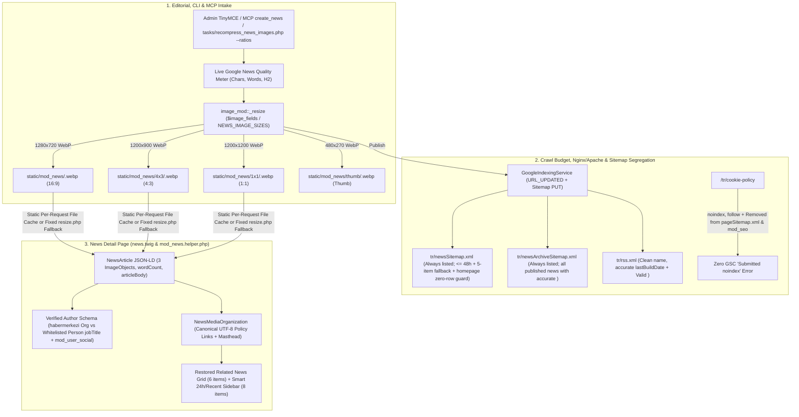

# Google News Top Ranking, Discover Readiness & SERP Dominance Blueprint

**Target Domain:** `https://amedbulten.com`  
**Repository:** `AF/Bulletin`  
**Target Version:** `v1.0.52 (In Progress)`  
**Date:** 2026-11-08  
**Architecture Standard:** Amed Framework Core & Google News / Discover Technical Guidelines  

---

## 1. Architecture & Data Flow Overview



---

## 2. Detailed Implementation Specifications (Execution Order)

### Component 1: Native Multi-Ratio (16:9, 4:3, 1:1) Image Pipeline, CLI Task & Resizer Hardening

1. **[MODIFY] [`mod/mod_news/index.php`](file:///home/malpersaz/Desktop/projects/htdocs/AF/Bulletin/mod/mod_news/index.php#L30-L48)**
   - Update `$image_fields` to generate all four derivatives natively via `Load::mod('image')->_resize()`:
     ```php
     protected $image_fields = [
         [
             'name' => 'image',
             'sizes' => [
                 '/' => [
                     'width' => 1280,
                     'height' => 720,
                     'option' => 'cover',
                     'quality' => 80,
                 ],
                 '/4x3' => [
                     'width' => 1200,
                     'height' => 900,
                     'option' => 'cover',
                     'quality' => 80,
                 ],
                 '/1x1' => [
                     'width' => 1200,
                     'height' => 1200,
                     'option' => 'cover',
                     'quality' => 80,
                 ],
                 '/thumb' => [
                     'width' => 480,
                     'height' => 270,
                     'option' => 'cover',
                     'quality' => 75,
                 ],
             ]
         ]
     ];
     ```
2. **[MODIFY] [`lib/McpNewsTools.class.php`](file:///home/malpersaz/Desktop/projects/htdocs/AF/Bulletin/lib/McpNewsTools.class.php#L10-L14)**
   - Synchronize `NEWS_IMAGE_SIZES` with `mod_news::$image_fields['sizes']`:
     ```php
     private const NEWS_IMAGE_SIZES = [
         '/' => ['width' => 1280, 'height' => 720, 'option' => 'cover', 'quality' => 80],
         '/4x3' => ['width' => 1200, 'height' => 900, 'option' => 'cover', 'quality' => 80],
         '/1x1' => ['width' => 1200, 'height' => 1200, 'option' => 'cover', 'quality' => 80],
         '/thumb' => ['width' => 480, 'height' => 270, 'option' => 'cover', 'quality' => 75],
     ];
     ```
3. **[MODIFY] [`tasks/recompress_news_images.php`](file:///home/malpersaz/Desktop/projects/htdocs/AF/Bulletin/tasks/recompress_news_images.php)**
   - Add `--ratios` support (enabled by default with thumbnail verification, plus `--force` to overwrite) to idempotently generate `static/mod_news/4x3/<image>` (`1200x900` @ quality 80) and `static/mod_news/1x1/<image>` (`1200x1200` @ quality 80) from `static/mod_news/<image>` whenever missing. (The 90 existing news images already have their `4x3` and `1x1` WebP derivatives on disk.)
4. **[MODIFY] [`docker/nginx/default.conf`](file:///home/malpersaz/Desktop/projects/htdocs/AF/Bulletin/docker/nginx/default.conf#L34-L66) & [`resize.php`](file:///home/malpersaz/Desktop/projects/htdocs/AF/Bulletin/resize.php#L111-L115)**
   - In `docker/nginx/default.conf`:
     - Line 34: Change `location ~ ^/r/(.*)/f/(.*)\.(gif|jpeg|jpg|png)$` to `location ~ ^/r/(.*)/f/(.*)\.(gif|jpeg|jpg|png|webp)$`.
     - Line 62: Add `webp` to the static files regex `location ~* \.(jpg|jpeg|png|gif|webp|ico|css|js|svg|woff|woff2|ttf|eot|mp4|webm)$`.
     - Add `rewrite ^/robots\.txt$ /robots.php last;`.
   - In `resize.php`:
     - Ensure `@chmod($cache, 0777)` on directory creation, and when `$c === 1 && $w && $h`, use `$image->cover($w, $h)` when `$u === 1` (and `$image->coverDown($w, $h)` when `$u === 0`) so requested aspect-ratio crops (`1200x900`, `1200x1200`) always output exact target dimensions.
   - Execute `chmod -R 0777 cache/` and reload Nginx inside `bulletin_web` (`docker exec bulletin_web nginx -s reload`).
5. **[MODIFY] [`mod/index/helper/mod_news.helper.php`](file:///home/malpersaz/Desktop/projects/htdocs/AF/Bulletin/mod/index/helper/mod_news.helper.php#L20-L39)**
   - Add `private static array $imageFileCache = [];` for per-request file existence caching.
   - In `_cleanNewsRow()`, resolve `image_16x9`, `image_4x3`, and `image_1x1` pointing to `static/mod_news/<image>`, `static/mod_news/4x3/<image>`, and `static/mod_news/1x1/<image>` when present on disk, with automatic fallback to `r/w-1200/h-900/c-1/q-80/f/mod_news/<image>` and `r/w-1200/h-1200/c-1/q-80/f/mod_news/<image>`.

---

### Component 2: Google News Sitemap 48h Isolation, Empty-Set Guard & Archive Sitemap

1. **[MODIFY] [`.htaccess`](file:///home/malpersaz/Desktop/projects/htdocs/AF/Bulletin/.htaccess#L36), [`robots.txt`](file:///home/malpersaz/Desktop/projects/htdocs/AF/Bulletin/robots.txt#L11-L13), & [`robots.php`](file:///home/malpersaz/Desktop/projects/htdocs/AF/Bulletin/robots.php#L59-L63)**
   - Add `newsArchive` to `.htaccess:36`:
     ```apache
     RewriteRule ^([a-z]{2,3})/(news|newsArchive|publication|event|announcement|video|gallery|category|page)Sitemap\.xml$ index.php [L]
     ```
   - Add `Sitemap: {baseUrl}{lang}/newsArchiveSitemap.xml` to both `robots.php` and static `robots.txt`.
2. **[MODIFY] [`config/url.config.php`](file:///home/malpersaz/Desktop/projects/htdocs/AF/Bulletin/config/url.config.php#L61-L68)**
   - Register `$url['newsArchiveSitemap.xml'] = 'index/newsArchiveSitemap';`.
3. **[MODIFY] [`mod/index/index.php`](file:///home/malpersaz/Desktop/projects/htdocs/AF/Bulletin/mod/index/index.php#L720-L915)**
   - **`sitemapIndex()`:** Always emit both `<loc>{address}{lang}/newsSitemap.xml</loc>` and `<loc>{address}{lang}/newsArchiveSitemap.xml</loc>` with `<lastmod>` computed from the newest published article (`$newsLastmod`).
   - **`newsSitemap($page = 1)`:** Filter by `created_at >= date('Y-m-d H:i:s', time() - 48 * 3600)`. Implement the two-tier empty guard:
     - Tier 1: If 0 rows in 48h, query the latest 5 published articles and output `<url><loc>...</loc><lastmod>...</lastmod><priority>0.80</priority></url>`.
     - Tier 2: If 0 published articles exist in the database, output the language homepage `<url><loc>{address}{lang}/</loc><lastmod>{now}</lastmod><priority>1.00</priority></url>`.
   - **`newsArchiveSitemap($page = 1)`:** Output all published news articles (`status = 'y'`, up to 50,000) with `<loc>`, `<lastmod>`, and `<priority>0.80</priority>` (plus Tier 2 homepage guard if 0 rows exist).
   - **`pageSitemap($page = 1)`:** Remove `cookie-policy` (lines 1253–1256) so marking `/tr/cookie-policy` as `noindex, follow` never triggers a GSC `Submitted URL marked 'noindex'` error.
4. **[MODIFY] [`lib/GoogleIndexingService.class.php`](file:///home/malpersaz/Desktop/projects/htdocs/AF/Bulletin/lib/GoogleIndexingService.class.php#L166-L175) & [`lib/LlmsService.class.php`](file:///home/malpersaz/Desktop/projects/htdocs/AF/Bulletin/lib/LlmsService.class.php#L225-L231)**
   - Add `newsArchiveSitemap.xml` to `pingSitemaps()` and `llms.txt`.

---

### Component 3: Restoring Horizontal Internal Link Equity (`newses` Related Grid & Smart `news_24h` Fallback)

1. **[MODIFY] [`mod/index/helper/mod_news.helper.php`](file:///home/malpersaz/Desktop/projects/htdocs/AF/Bulletin/mod/index/helper/mod_news.helper.php#L182-L225)**
   - **Sidebar Backfill:** If `$news_24h` has `< 5` items from the last 24h, backfill up to 8 items from the latest published news (excluding `$news->id` and existing IDs), set `news_24h_is_backfill = true`, and set `news_24h_count = count($news_24h)` so the sidebar heading and badge remain semantically consistent.
   - **Related News (`newses`):** Query up to 6 published articles from the same `category_id` (backfilling from other allowed categories if `< 6`), run `_cleanNewsRows()`, and set `$this->theme->ctx_set('newses', $related_news)` so `news.twig:461` renders on every article.
   - **Author E-E-A-T & Article Metrics:** Compute plain-text `word_count` and `char_count`; resolve `author_is_org` (`username === 'habermerkezi'` or empty `u_name`), whitelisted `author_job_title` (only when `group_name` is in `['Gazeteci', 'Yazar', 'Editör', 'Editor', 'Muhabir', 'Köşe Yazarı']`), verified `author_avatar_url` (`static/mod_user/thumb/<user_image>`), and `author_same_as` from `mod_user_social` (only valid `https://` URLs).

---

### Component 4: `NewsArticle` JSON-LD Schema, CWV & Headline Parity (`news.twig`)

1. **[MODIFY] [`templates/amed/index/mod_news/news.twig`](file:///home/malpersaz/Desktop/projects/htdocs/AF/Bulletin/templates/amed/index/mod_news/news.twig)**
   - Line 40: `<title>{{ d.title|default(d.name) }} - {{ site.title }}</title>`.
   - `NewsArticle.image`: Emit 3 `ImageObject` entries (`d.image_16x9` `1280x720`, `d.image_4x3` `1200x900`, `d.image_1x1` `1200x1200`) when `d.image` is non-empty, or a single `300x300` `ImageObject` for `news_logo_asset`.
   - Emit `"wordCount": {{ d.word_count }},` when `d.word_count > 0`, and `"articleBody": {{ d.content|striptags|trim|json_ld|raw }}`.
   - Emit verified `author` (`NewsMediaOrganization` when `d.author_is_org` is true; `Person` with whitelisted `jobTitle`, verified `image`, `sameAs`, and `worksFor` when false) and enriched `publisher` (`NewsMediaOrganization` with canonical UTF-8 policy URLs: `masthead` -> `{{ site.saddress }}legal`, `publishingPrinciples` & `correctionsPolicy` -> `{{ site.saddress }}page/Yayın_İlkeleri`, `ethicsPolicy` -> `{{ site.saddress }}page/Basın_Etiği_ve_Uyum`, `actionableFeedbackPolicy` -> `{{ site.saddress }}page/Hakkımızda`, `sameAs` social links, and logo dimensions).
   - Line 525: Use `{{ news_24h_is_backfill ? lang.index.mod_news.latest_news.title : lang.index.mod_news.latest_news.last_24_hours }}`.
   - Line 538: Use `src="{{ site.iaddress }}mod_news/thumb/{{ item.image }}"`.
   - Line 470: Add `width="480" height="270" loading="lazy" decoding="async"`.

---

### Component 5: RSS 2.0 Specification Compliance (`mod/index/index.php`)

1. **[MODIFY] [`mod/index/index.php`](file:///home/malpersaz/Desktop/projects/htdocs/AF/Bulletin/mod/index/index.php#L638-L708) (`rss()`)**
   - Select `['name', 'title', 'summary', 'created_at', 'updated_at', 'seo', 'lang', 'image']`.
   - Compute `<lastBuildDate>` from the newest article timestamp instead of wall-clock `date(DATE_RSS)`.
   - Use clean headline `o['name']` (fallback `o['title']`) with `html_entity_decode()` in `<title>` and `<description>`.
   - Guard `static/mod_news/<image>` with `is_file()` and `filesize() > 0` before emitting `<media:content>` and `<enclosure url="..." type="..." length="..." />`.

---

### Component 6: Crawl Budget Rebalancing (`cookie_policy.twig`, `footer.twig`, `mod_seo`)

1. **[MODIFY] [`templates/amed/index/legal/cookie_policy.twig`](file:///home/malpersaz/Desktop/projects/htdocs/AF/Bulletin/templates/amed/index/legal/cookie_policy.twig#L25)** -> Change robots meta tag to `<meta name="robots" content="noindex, follow">`.
2. **[MODIFY] [`templates/amed/index/footer.twig`](file:///home/malpersaz/Desktop/projects/htdocs/AF/Bulletin/templates/amed/index/footer.twig#L317)** -> Add `rel="nofollow"` on the `cookie-policy` link while keeping `legal` (Künye) `dofollow`.
3. **[MODIFY] [`mod/mod_seo/index.php`](file:///home/malpersaz/Desktop/projects/htdocs/AF/Bulletin/mod/mod_seo/index.php#L415-L425)** -> Remove `cookie-policy` from `getSiteUrls()`.

---

### Component 7: Live Admin Google News Quality Meter & Editorial Pipeline Sync

1. **[MODIFY] [`templates/admin/mod_news/edit.twig`](file:///home/malpersaz/Desktop/projects/htdocs/AF/Bulletin/templates/admin/mod_news/edit.twig#L157-L163), [`templates/admin/partials/wizard_content.twig`](file:///home/malpersaz/Desktop/projects/htdocs/AF/Bulletin/templates/admin/partials/wizard_content.twig), [`templates/admin/assets/js/mod_news.js`](file:///home/malpersaz/Desktop/projects/htdocs/AF/Bulletin/templates/admin/assets/js/mod_news.js), [`templates/admin/assets/css/mod_news.css`](file:///home/malpersaz/Desktop/projects/htdocs/AF/Bulletin/templates/admin/assets/css/mod_news.css), & `mod/mod_news/lang/*.php`**
   - Add a phone-first M3 live Google News Quality bar beneath the TinyMCE editor displaying:
     - Character & Word count (`>= 1,500` chars minimum, `>= 2,500` chars ideal)
     - `<h2>` subheading count (`>= 2` recommended)
     - Live quality status badge
   - Bind real-time TinyMCE content inspection (`editor.on('input change KeyUp SetContent', ...)`) in `mod_news.js` without blocking saves and with strict code separation (zero inline styles or scripts).
2. **[MODIFY] [`.agents/skills/kevseo/SKILL.md`](file:///home/malpersaz/Desktop/projects/htdocs/AF/Bulletin/.agents/skills/kevseo/SKILL.md), [`.agents/skills/kevseo/scripts/audit_seo.py`](file:///home/malpersaz/Desktop/projects/htdocs/AF/Bulletin/.agents/skills/kevseo/scripts/audit_seo.py), [`.agents/skills/kevanger/SKILL.md`](file:///home/malpersaz/Desktop/projects/htdocs/AF/Bulletin/.agents/skills/kevanger/SKILL.md), [`lib/McpCrudToolsBase.class.php`](file:///home/malpersaz/Desktop/projects/htdocs/AF/Bulletin/lib/McpCrudToolsBase.class.php#L396-L402), & [`lib/McpNewsTools.class.php`](file:///home/malpersaz/Desktop/projects/htdocs/AF/Bulletin/lib/McpNewsTools.class.php#L280-L284)**
   - Synchronize headline length validation to `40–70` characters (hard max `70`) and deck summary validation to `90–120` characters across `kevseo`, `kevanger`, MCP tools, and Admin validators.

---

### Component 8: Version History & Documentation Update (`v1.0.52 (In Progress)`)

1. **[MODIFY] [`docs/VERSION.md`](file:///home/malpersaz/Desktop/projects/htdocs/AF/Bulletin/docs/VERSION.md), [`config/site.config.php`](file:///home/malpersaz/Desktop/projects/htdocs/AF/Bulletin/config/site.config.php#L62), & [`config/site.config.example.php`](file:///home/malpersaz/Desktop/projects/htdocs/AF/Bulletin/config/site.config.example.php#L62)**
   - Add a comprehensive `## v1.0.52 (In Progress)` section at the top of `docs/VERSION.md` (written strictly in English per `AGENTS.md` Rule 2 & Rule 4) documenting all changes across Components 1–7, and bump `$site['version'] = '1.0.52';` in `config/site.config.php` and `config/site.config.example.php`.

---

## 3. Deterministic Verification Plan

1. **[TARGET: workspace]** **Syntax & Guard Audits:**
   ```bash
   composer lint:syntax
   python3 tools/code_separation_guard.py
   python3 tools/i18n_guard.py
   python3 tools/module_boundary_guard.py
   ```
2. **[TARGET: local Docker stack]** **Multi-Ratio Image, Nginx Resizer & Cache Writability Gate:**
   - Assert `docker exec -u www-data bulletin_app php -r 'var_dump(is_writable("/var/www/html/cache/img"));'` outputs `bool(true)`.
   - Assert `curl -sI "http://localhost:8080/r/w-1200/h-900/c-1/q-80/f/mod_news/S14LkGCVZD8ROeM.webp"` returns `HTTP/1.1 200 OK` (`Content-Type: image/webp`) with exact `1200x900` pixel dimensions.
   - Verify all 90 news images in `static/mod_news/`, `static/mod_news/4x3/`, `static/mod_news/1x1/`, and `static/mod_news/thumb/` via `php tasks/recompress_news_images.php --ratios --dry-run`.
3. **[TARGET: local Docker stack]** **Sitemap, Robots & RSS XML Validation:**
   - Parse `http://localhost:8080/sitemap.xml`, `/tr/newsSitemap.xml`, `/tr/newsArchiveSitemap.xml`, `/tr/pageSitemap.xml`, and `/tr/rss.xml` with Python `xml.etree.ElementTree` to verify zero XML syntax errors, zero `cookie-policy` URLs in `pageSitemap.xml`, valid `<enclosure length="...">` (`> 0`), and non-empty `<urlset>`.
   - Verify `http://localhost:8080/robots.txt` outputs both `newsSitemap.xml` and `newsArchiveSitemap.xml`.
4. **[TARGET: local Docker stack + post-deploy production `https://amedbulten.com`]** **News Detail Internal Linking, RSS Title Hygiene & Schema Audit:**
   - Verify on local Docker (`http://localhost:8080/tr/news/...`) that news detail pages render both the 6-card Related News grid (`newses`) and the 8-item sidebar (`news_24h` with `"Haberler"` heading when backfilled), and that `NewsArticle` JSON-LD validates with 3 `ImageObject` ratios, whitelisted author `jobTitle` / `NewsMediaOrganization`, and 200 OK canonical UTF-8 policy URLs.
   - After deployment to `https://amedbulten.com`, re-run the RSS `<title>` and `<enclosure length>` check against `https://amedbulten.com/tr/rss.xml`.
