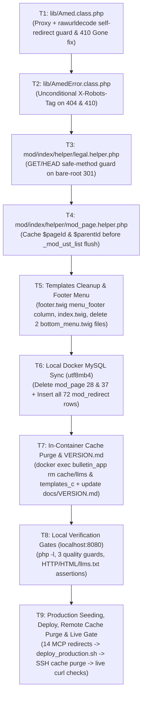

# i18n `saddress` Routing Remediation — Final Consensus Execution Blueprint

**Date:** 2026-11-08
**Author:** Gemini 4 Argon (Research, Development, Planning, Tracking & Inspection Specialist)
**Consensus Signatories:** Project Owner, Gemini 4 Argon, and GLM-5.3 / OMP (Ar-Ge & Uygulama Müfettişi)
**Assigned Executor:** Gemini 3.8 Flash High
**Predecessor Audit Documents:**
- [`docs/plan/i18n-saddress-routing-and-google-index-restoration-plan.md`](file:///home/malpersaz/Desktop/projects/htdocs/AF/Bulletin/docs/plan/i18n-saddress-routing-and-google-index-restoration-plan.md) (Sections 9–12)
- [`docs/plan/i18n-saddress-routing-remediation-and-completion-plan.md`](file:///home/malpersaz/Desktop/projects/htdocs/AF/Bulletin/docs/plan/i18n-saddress-routing-remediation-and-completion-plan.md) (Sections 1–11)
**Target Release:** `v1.0.51` (in-place completion of uncommitted `v1.0.51` pass)

---

## 0. Executive Context & Mandatory Invariants for Executor (`Gemini 3.8 Flash High`)

> [!IMPORTANT]
> **SINGLE SOURCE OF TRUTH:** This blueprint consolidates the 100% ratified consensus from Sections 8, 9, 10, and 11 of the predecessor remediation plan into a single, linear, conflict-free specification. Execute Tasks **`T1` through `T9` strictly in order**. Every code diff and SQL/shell command in this document is complete and paste-ready (zero placeholders).

### 0.1 Environment & Architecture Facts (Pre-Verified 2026-11-08)

1. **Workspace & Local Docker Stack:**
   - Working directory: `/home/malpersaz/Desktop/projects/htdocs/AF/Bulletin`
   - Active containers: `bulletin_web` (Nginx on `http://localhost:8080`), `bulletin_app` (PHP-FPM running as `www-data` / host-mapped UID `100032`), `bulletin_db` (MySQL 8.0).
   - **Container vs. Schema Name (`D-C`):** The MySQL Docker container is named **`bulletin_db`**, while the MySQL database schema inside it is named **`bulletin`** (per [`config/db.config.php`](file:///home/malpersaz/Desktop/projects/htdocs/AF/Bulletin/config/db.config.php) / [`config/db.config.local.php`](file:///home/malpersaz/Desktop/projects/htdocs/AF/Bulletin/config/db.config.local.php)).
   - **MySQL CLI Charset Trap (`C-1`):** Inside `bulletin_db`, the `mysql` CLI client defaults to `character_set_client = latin1` and `character_set_connection = latin1`, whereas PHP PDO connects with `charset=utf8`. Every `mysql` CLI command run inside `bulletin_db` **MUST** pass `--default-character-set=utf8mb4` and `SET NAMES utf8mb4;`, otherwise Turkish UTF-8 characters (`Ç`, `ı`, `İ`, `ş`, `ü`, `ğ`, `ö`) are double-encoded into mojibake (`Ç`, `ı`) and fail `T8`.
   - **Cache Directory Ownership (`C-2`):** `cache/llms/` is owned by container UID `100032:100032` (`0755`), so host `rm -rf cache/llms/*.txt` fails with `Permission denied`. Local cache purges **MUST** run inside `bulletin_app` (`docker exec bulletin_app ...`).
2. **Production vs. Local State (`H1`):**
   - Live production (`https://amedbulten.com`, managed by the `amed-bulletin` MCP server) already has `mod_page` rows `28` (`Yasal_Bilgiler`) and `37` (`Çerez_Politikası`) deleted and holds 58 `mod_redirect` rows (IDs `87`–`144`), but is still running the old PHP code—causing 6 policy routes to loop in an infinite 301 self-redirect right now.
   - Local Docker MySQL (`bulletin`) still has `mod_page` rows `28` and `37` and has `0` rows in `mod_redirect`.
3. **ORM Singleton Flush Behavior (`H3`):**
   - `Load::model('mod_page')` returns a `Registry` singleton (`$page`). Calling `$this->_mod_ust_list('mod_page', ...)` invokes `$list->flush()`, which nulls `$page->id` before `$this->_mod_parent_id_list('mod_page', $page->id, ...)` runs. Caching `$pageId` and `$parentId` into local integers before `_mod_ust_list` restores the 6-child sidebar on `/tr/page/Hakkımızda`.
4. **Footer Menu Producer/Consumer Chain (`H4` / `C-4`):**
   - [`templates/amed/layouts/base.twig:115`](file:///home/malpersaz/Desktop/projects/htdocs/AF/Bulletin/templates/amed/layouts/base.twig#L115) executes `{{ run({"mod": "index", "method": "_menu"}) }}` before `` at line 133. `index_mod::_menu()` ([`mod/index/index.php:374-375`](file:///home/malpersaz/Desktop/projects/htdocs/AF/Bulletin/mod/index/index.php#L374-L375)) sets `menu_footer` and `menu_footer_root_id` on every page rendered through `base.twig`.

### 0.2 Hard Invariants (Must-Not List)

1. **LOCAL-FIRST MANDATE:** Everything in **Tasks `T1` through `T8` runs strictly on the LOCAL environment (`http://localhost:8080` + local Docker containers `bulletin_db` / `bulletin_app`)**. All production writes—including any `amed-bulletin` MCP write tool (`create_redirect`, `update_*`, `delete_*`) and any SSH/rsync deployment—are **strictly forbidden** until every gate in `T8` passes 100%.
2. **DO NOT** modify [`mod/index/indexBase.php:300`](file:///home/malpersaz/Desktop/projects/htdocs/AF/Bulletin/mod/index/indexBase.php#L300) (`$list->addWhere("parent_id = '{$safeId}'");` is 100% canonical; changing it to `(id = X OR parent_id = X)` creates empty self-headers on leaf pages and duplicates `Hakkımızda`).
3. **DO NOT** seed `legal`, `tr/legal`, `cookie-policy`, or `tr/cookie-policy` into `mod_redirect`—those are live canonical application routes (`cookies` and `tr/cookies` ➔ `tr/cookie-policy` are valid aliases and are included in the 72-row set).
4. **DO NOT** use `|default(...)` on any `lang.*` key in Twig templates (`python3 tools/i18n_guard.py` enforces 0 violations).
5. **DO NOT** touch sibling repositories (`AF/Business/*`) or archive directories (`biys/*`).
6. **SINGLE DEPLOY ONLY:** Deploy to production exactly once in `T9b`, immediately after seeding the 14 missing aliases via MCP in `T9a`.

---

## 1. Execution Flow Diagram



---

## 2. Step-by-Step Tasks (`T1` ➔ `T9`)

### Task `T1` — Modify [`lib/Amed.class.php`](file:///home/malpersaz/Desktop/projects/htdocs/AF/Bulletin/lib/Amed.class.php#L522-L550) (Two Edits)

#### `T1a` — Self-Redirect Guard (`lines 522–534`)
Replace lines `522–534` of [`lib/Amed.class.php`](file:///home/malpersaz/Desktop/projects/htdocs/AF/Bulletin/lib/Amed.class.php#L522-L534):
```php
                        // Self-redirect guard: never redirect to the current URL
                        $currentFullUrl = (isset($_SERVER['HTTPS']) && $_SERVER['HTTPS'] === 'on' ? "https" : "http") .
                            "://" . ($_SERVER['HTTP_HOST'] ?? 'localhost') . ($_SERVER['REQUEST_URI'] ?? '/');
                        $normalizedTarget = Helper::sitemap_url($redirectUrl);
                        if (rtrim($currentFullUrl, '/') !== rtrim($normalizedTarget, '/')) {
                            if ($statusCode === 301) {
                                header("HTTP/1.1 301 Moved Permanently");
                            } else {
                                header("HTTP/1.1 302 Found");
                            }
                            header("Location: " . $normalizedTarget);
                            exit;
                        }
```
with **EXACTLY**:
```php
                        // Self-redirect guard: never redirect to the current URL
                        $forwardedProto = $_SERVER['HTTP_X_FORWARDED_PROTO'] ?? '';
                        $isHttps = (isset($_SERVER['HTTPS']) && $_SERVER['HTTPS'] === 'on')
                            || strtolower(trim(explode(',', $forwardedProto)[0])) === 'https';
                        $currentFullUrl = ($isHttps ? "https" : "http") .
                            "://" . ($_SERVER['HTTP_HOST'] ?? 'localhost') . ($_SERVER['REQUEST_URI'] ?? '/');
                        $normalizedTarget = Helper::sitemap_url($redirectUrl);
                        if (rtrim(rawurldecode($currentFullUrl), '/') !== rtrim(rawurldecode($normalizedTarget), '/')) {
                            if ($statusCode === 301) {
                                header("HTTP/1.1 301 Moved Permanently");
                            } else {
                                header("HTTP/1.1 302 Found");
                            }
                            header("Location: " . $normalizedTarget);
                            exit;
                        }
```

#### `T1b` — Inactive-Language `410 Gone` Block (`lines 542–550`)
Replace lines `542–550` of [`lib/Amed.class.php`](file:///home/malpersaz/Desktop/projects/htdocs/AF/Bulletin/lib/Amed.class.php#L542-L550) (note: `$isSafeMethod` is defined locally here and `$isAjax` reuses the variable defined at line 424 in the same `__construct()` scope):
```php
        // Inactive language lifecycle: Emit 410 Gone for inactive languages (e.g. /ku/...) if not redirected by mod_redirect
        if (Registry::get('i18n') === true && PHP_SAPI !== 'cli' && !headers_sent()) {
            $inactiveLangs = Registry::get('inactive_langs');
            $rawPath0 = isset($this->url->path[0]) ? (string) $this->url->path[0] : '';
            if (is_array($inactiveLangs) && in_array($rawPath0, $inactiveLangs, true)) {
                AmedError::gone($rawPath0);
                exit;
            }
        }
```
with **EXACTLY**:
```php
        // Inactive language lifecycle: Emit 410 Gone for inactive languages (e.g. /ku/...) if not redirected by mod_redirect
        $requestMethod = $_SERVER['REQUEST_METHOD'] ?? 'GET';
        $isSafeMethod = in_array(strtoupper($requestMethod), ['GET', 'HEAD'], true);
        if (Registry::get('i18n') === true && $isSafeMethod && !$isAjax && PHP_SAPI !== 'cli' && !headers_sent()) {
            $inactiveLangs = Registry::get('inactive_langs');
            $rawPath0 = isset($this->url->path[0]) ? (string) $this->url->path[0] : '';
            if (is_array($inactiveLangs) && in_array($rawPath0, $inactiveLangs, true)) {
                require_once(lib_dir . 'AmedError.class.php');
                AmedError::gone(Req::Clear($this->url->link));
                exit;
            }
        }
```

---

### Task `T2` — Modify [`lib/AmedError.class.php`](file:///home/malpersaz/Desktop/projects/htdocs/AF/Bulletin/lib/AmedError.class.php#L19-L26)

Replace lines `19–26` of [`lib/AmedError.class.php`](file:///home/malpersaz/Desktop/projects/htdocs/AF/Bulletin/lib/AmedError.class.php#L19-L26) (keep line `27` `self::$lang = Load::lang('index');` untouched):
```php
    public static function error($page, $argument = NULL, $statusCode = 404)
    {
        if ($statusCode === 410) {
            header("HTTP/1.1 410 Gone");
            header("X-Robots-Tag: noindex, nofollow");
        } else {
            header("HTTP/1.1 404 Not Found");
        }
```
with **EXACTLY**:
```php
    public static function error($page, $argument = NULL, $statusCode = 404)
    {
        if ($statusCode === 410) {
            header("HTTP/1.1 410 Gone");
        } else {
            header("HTTP/1.1 404 Not Found");
        }
        header("X-Robots-Tag: noindex, nofollow");
```

---

### Task `T3` — Modify [`mod/index/helper/legal.helper.php`](file:///home/malpersaz/Desktop/projects/htdocs/AF/Bulletin/mod/index/helper/legal.helper.php#L53-L69)

Replace lines `53–69` of [`mod/index/helper/legal.helper.php`](file:///home/malpersaz/Desktop/projects/htdocs/AF/Bulletin/mod/index/helper/legal.helper.php#L53-L69):
```php
        // 301 Canonical Normalization: Ensure bare-root /legal and /cookie-policy redirect to active language (e.g. /tr/legal)
        $isAjax = (
            (!empty($_SERVER['HTTP_X_REQUESTED_WITH']) && strtolower($_SERVER['HTTP_X_REQUESTED_WITH']) === 'xmlhttprequest')
            || (isset($_POST['ajax_request']) && ($_POST['ajax_request'] === 'true' || $_POST['ajax_request'] === '1'))
        );

        if (PHP_SAPI !== 'cli' && !$isAjax && !headers_sent()) {
            $activeLangs = Registry::has('active_langs') ? (array) Registry::get('active_langs') : [];
            $rawPath0 = isset($this->url->path[0]) ? (string) $this->url->path[0] : '';
            if (empty($rawPath0) || !in_array($rawPath0, $activeLangs, true)) {
                $targetUrl = rtrim((string) $this->site['saddress'], '/') . '/' . $policy['canonical_slug'];
                $queryString = (!empty($_SERVER['QUERY_STRING'])) ? '?' . $_SERVER['QUERY_STRING'] : '';
                header("HTTP/1.1 301 Moved Permanently");
                header("Location: " . $targetUrl . $queryString);
                exit;
            }
        }
```
with **EXACTLY**:
```php
        // 301 Canonical Normalization: Ensure bare-root /legal and /cookie-policy redirect to active language (e.g. /tr/legal)
        $requestMethod = $_SERVER['REQUEST_METHOD'] ?? 'GET';
        $isSafeMethod = in_array(strtoupper($requestMethod), ['GET', 'HEAD'], true);
        $isAjax = (
            (!empty($_SERVER['HTTP_X_REQUESTED_WITH']) && strtolower($_SERVER['HTTP_X_REQUESTED_WITH']) === 'xmlhttprequest')
            || (isset($_POST['ajax_request']) && ($_POST['ajax_request'] === 'true' || $_POST['ajax_request'] === '1'))
        );

        if (PHP_SAPI !== 'cli' && $isSafeMethod && !$isAjax && !headers_sent()) {
            $activeLangs = Registry::has('active_langs') ? (array) Registry::get('active_langs') : [];
            $rawPath0 = isset($this->url->path[0]) ? (string) $this->url->path[0] : '';
            if (empty($rawPath0) || !in_array($rawPath0, $activeLangs, true)) {
                $targetUrl = rtrim((string) $this->site['saddress'], '/') . '/' . $policy['canonical_slug'];
                $queryString = (!empty($_SERVER['QUERY_STRING'])) ? '?' . $_SERVER['QUERY_STRING'] : '';
                header("HTTP/1.1 301 Moved Permanently");
                header("Location: " . $targetUrl . $queryString);
                exit;
            }
        }
```

---

### Task `T4` — Modify [`mod/index/helper/mod_page.helper.php`](file:///home/malpersaz/Desktop/projects/htdocs/AF/Bulletin/mod/index/helper/mod_page.helper.php#L68-L123) (Both Call Sites)

In [`mod/index/helper/mod_page.helper.php`](file:///home/malpersaz/Desktop/projects/htdocs/AF/Bulletin/mod/index/helper/mod_page.helper.php#L68-L123), update **both** call sites (lines `68–70` and lines `120–122`) so `$pageId` and `$parentId` are cached into integers before `_mod_ust_list` flushes the `$page` singleton:

1. **First call site (`lines 68–70`):**
   Replace:
   ```php
            $this->_mod_faq('mod_page', $page->id);
            $this->_mod_ust_list('mod_page', $page->parent_id, ['id', 'name', 'seo', 'order', 'lang', 'root'], 'order');
            $this->_mod_parent_id_list('mod_page', $page->id, ['id', 'name', 'seo', 'order', 'lang', 'root'], 'order');
   ```
   with **EXACTLY**:
   ```php
            $pageId = (int) $page->id;
            $parentId = (int) $page->parent_id;
            $this->_mod_faq('mod_page', $pageId);
            $this->_mod_ust_list('mod_page', $parentId, ['id', 'name', 'seo', 'order', 'lang', 'root'], 'order');
            $this->_mod_parent_id_list('mod_page', $pageId, ['id', 'name', 'seo', 'order', 'lang', 'root'], 'order');
   ```
2. **Second call site (`lines 120–122`):**
   Replace:
   ```php
                $this->_mod_faq('mod_page', $page->id);
                $this->_mod_ust_list('mod_page', $page->parent_id, ['id', 'name', 'seo', 'order', 'lang', 'root'], 'order');
                $this->_mod_parent_id_list('mod_page', $page->id, ['id', 'name', 'seo', 'order', 'lang', 'root'], 'order');
   ```
   with **EXACTLY**:
   ```php
                $pageId = (int) $page->id;
                $parentId = (int) $page->parent_id;
                $this->_mod_faq('mod_page', $pageId);
                $this->_mod_ust_list('mod_page', $parentId, ['id', 'name', 'seo', 'order', 'lang', 'root'], 'order');
                $this->_mod_parent_id_list('mod_page', $pageId, ['id', 'name', 'seo', 'order', 'lang', 'root'], 'order');
   ```

*(Reminder — Invariant 2: Do NOT modify `mod/index/indexBase.php:300`.)*

---

### Task `T5` — Restore `menu_footer` Column in `footer.twig` & Delete Dead `bottom_menu.twig` Files

#### `T5a` — Modify [`templates/amed/index/footer.twig`](file:///home/malpersaz/Desktop/projects/htdocs/AF/Bulletin/templates/amed/index/footer.twig)

1. At the top of [`templates/amed/index/footer.twig`](file:///home/malpersaz/Desktop/projects/htdocs/AF/Bulletin/templates/amed/index/footer.twig#L1-L6), replace lines `1–5`:
   ```twig
   <footer class="site-footer mt-auto py-5">
    <div class="container">
        <div class="row gy-4">
            <!-- Site Information -->
            <div class="col-md-5 col-lg-4">
   ```
   with **EXACTLY**:
   ```twig
   
    
    
        
            
                
                
                    {{ navigation.footer_menu_items(menu, item.id) }}
                
                    
                        
                    
                        
                    
                    <li class="mb-2">
                        <a href="{{ clean_footer_url }}" target="_blank" rel="noopener noreferrer" class="text-decoration-none transition-link d-inline-flex align-items-center gap-2">
                            <i class="{{ item.icon }}" aria-hidden="true"></i>
                            <span>{{ item.name }}</span>
                        </a>
                        
                            <ul class="list-unstyled ms-3 mt-2">
                                {{ navigation.footer_menu_items(menu, item.id) }}
                            </ul>
                        
                    </li>
                
            
        
    
   

   
   
   
   
    
        {{ footer_navigation.footer_menu_items(footer_menu, footer_menu_root_id) }}
    
   
   
   <footer class="site-footer mt-auto py-5">
    <div class="container">
        <div class="row gy-4">
            <!-- Site Information -->
            <div class="col-md-4 col-lg-4col-md-5 col-lg-4">
   ```
2. In the middle of [`templates/amed/index/footer.twig`](file:///home/malpersaz/Desktop/projects/htdocs/AF/Bulletin/templates/amed/index/footer.twig#L138-L144) (originally lines `138–143`), replace the spacer and Contact wrapper:
   ```twig
               <div class="col-md-1 col-lg-2 d-none d-md-block">
                   <!-- Spacer -->
               </div>

            <!-- Contact & Social Information -->
            <div class="col-md-6 col-lg-6">
   ```
   with **EXACTLY**:
   ```twig
            
                <div class="col-md-3 col-lg-3">
                    <div class="card contact-card border-0 shadow-sm overflow-hidden rounded-3 h-100">
                        <div class="card-body p-4">
                            <h3 class="h5 fw-bold mb-3 d-flex align-items-center">
                                <i class="bi bi-list-ul me-2 text-primary" aria-hidden="true"></i>
                                <span>{{ lang.index.menu.footer_links }}</span>
                            </h3>
                            <nav aria-label="{{ lang.index.menu.footer_links }}">
                                <ul class="list-unstyled mb-0 ps-1">
                                    {{ footer_menu_markup|raw }}
                                </ul>
                            </nav>
                        </div>
                    </div>
                </div>
            
                <div class="col-md-1 col-lg-2 d-none d-md-block">
                    <!-- Spacer -->
                </div>
            

            <!-- Contact & Social Information -->
            <div class="col-md-5 col-lg-5col-md-6 col-lg-6">
   ```

#### `T5b` — Modify [`templates/amed/index/index.twig`](file:///home/malpersaz/Desktop/projects/htdocs/AF/Bulletin/templates/amed/index/index.twig#L152-L158)

Replace lines `152–158` of [`templates/amed/index/index.twig`](file:///home/malpersaz/Desktop/projects/htdocs/AF/Bulletin/templates/amed/index/index.twig#L152-L158):
```twig
        </aside>
    </section>

    {# Include the bottom menu when needed. #}
    
<!-- END: index/index.twig -->

```
with **EXACTLY**:
```twig
        </aside>
    </section>
<!-- END: index/index.twig -->

```

#### `T5c` — Delete Dead `bottom_menu.twig` Files
Run:
```bash
rm -f templates/amed/index/mod_menu/bottom_menu.twig templates/amed/partials/bottom_menu.twig
```

---

### Task `T6` — Local Docker MySQL Synchronization ONLY (`bulletin` Inside `bulletin_db` with `utf8mb4`)

> [!CAUTION]
> **LOCAL-FIRST RULE (`Invariant 1`):** Do **NOT** call any MCP write tools in `T6`. And **NEVER** omit `--default-character-set=utf8mb4` and `SET NAMES utf8mb4;` when invoking `mysql` inside `bulletin_db` (`C-1`).

#### `T6a` — Delete Duplicate `mod_page` Rows (`28` and `37`) Locally
Run:
```bash
docker exec bulletin_db sh -c 'mysql --default-character-set=utf8mb4 -uroot -p"$MYSQL_ROOT_PASSWORD" bulletin -e "SET NAMES utf8mb4; DELETE FROM mod_page WHERE id IN (28, 37); SELECT COUNT(*) AS tr_page_count FROM mod_page WHERE lang = \"tr\";"'
```
- **Expected output:** `tr_page_count = 8` (IDs `8, 18, 39, 40, 41, 42, 43, 44`).

#### `T6b` — Seed All 72 Canonical Single-Hop 301 Redirects Locally (Full Verbatim SQL)
Run the following self-contained command (which includes all 58 transcribed production rows + all 14 short/alternate alias rows = **72 rows total**, with `utf8mb4` enforced):
```bash
docker exec -i bulletin_db sh -c 'mysql --default-character-set=utf8mb4 -uroot -p"$MYSQL_ROOT_PASSWORD" bulletin' <<'EOF'
SET NAMES utf8mb4;
DELETE FROM mod_redirect;
INSERT INTO mod_redirect (old_url, new_url, status_code) VALUES
('imprint', 'tr/legal', 301),
('tr/imprint', 'tr/legal', 301),
('kunye', 'tr/legal', 301),
('tr/kunye', 'tr/legal', 301),
('yasal_bilgiler', 'tr/legal', 301),
('tr/yasal_bilgiler', 'tr/legal', 301),
('page/Yasal_Bilgiler', 'tr/legal', 301),
('tr/page/Yasal_Bilgiler', 'tr/legal', 301),
('cookies', 'tr/cookie-policy', 301),
('tr/cookies', 'tr/cookie-policy', 301),
('cerez_politikasi', 'tr/cookie-policy', 301),
('tr/cerez_politikasi', 'tr/cookie-policy', 301),
('page/Çerez_Politikası', 'tr/cookie-policy', 301),
('tr/page/Çerez_Politikası', 'tr/cookie-policy', 301),
('page/cerez_politikasi', 'tr/cookie-policy', 301),
('tr/page/cerez_politikasi', 'tr/cookie-policy', 301),
('contact', 'tr/page/Hakkımızda', 301),
('tr/contact', 'tr/page/Hakkımızda', 301),
('iletisim', 'tr/page/Hakkımızda', 301),
('tr/iletisim', 'tr/page/Hakkımızda', 301),
('page/hakkimizda', 'tr/page/Hakkımızda', 301),
('tr/page/hakkimizda', 'tr/page/Hakkımızda', 301),
('editorial-policy', 'tr/page/Yayın_İlkeleri', 301),
('tr/editorial-policy', 'tr/page/Yayın_İlkeleri', 301),
('yayin_ilkeleri', 'tr/page/Yayın_İlkeleri', 301),
('tr/yayin_ilkeleri', 'tr/page/Yayın_İlkeleri', 301),
('page/yayin_ilkeleri', 'tr/page/Yayın_İlkeleri', 301),
('tr/page/yayin_ilkeleri', 'tr/page/Yayın_İlkeleri', 301),
('privacy-policy', 'tr/page/Gizlilik_Politikası', 301),
('tr/privacy-policy', 'tr/page/Gizlilik_Politikası', 301),
('gizlilik_politikasi', 'tr/page/Gizlilik_Politikası', 301),
('tr/gizlilik_politikasi', 'tr/page/Gizlilik_Politikası', 301),
('page/gizlilik_politikasi', 'tr/page/Gizlilik_Politikası', 301),
('tr/page/gizlilik_politikasi', 'tr/page/Gizlilik_Politikası', 301),
('terms-of-service', 'tr/page/Kullanım_Koşulları', 301),
('tr/terms-of-service', 'tr/page/Kullanım_Koşulları', 301),
('kullanim_kosullari', 'tr/page/Kullanım_Koşulları', 301),
('tr/kullanim_kosullari', 'tr/page/Kullanım_Koşulları', 301),
('page/kullanim_kosullari', 'tr/page/Kullanım_Koşulları', 301),
('tr/page/kullanim_kosullari', 'tr/page/Kullanım_Koşulları', 301),
('accessibility', 'tr/page/Erişilebilirlik', 301),
('tr/accessibility', 'tr/page/Erişilebilirlik', 301),
('erisilebilirlik', 'tr/page/Erişilebilirlik', 301),
('tr/erisilebilirlik', 'tr/page/Erişilebilirlik', 301),
('page/erisilebilirlik', 'tr/page/Erişilebilirlik', 301),
('tr/page/erisilebilirlik', 'tr/page/Erişilebilirlik', 301),
('security-policy', 'tr/page/Güvenlik_Politikası', 301),
('tr/security-policy', 'tr/page/Güvenlik_Politikası', 301),
('guvenlik_politikasi', 'tr/page/Güvenlik_Politikası', 301),
('tr/guvenlik_politikasi', 'tr/page/Güvenlik_Politikası', 301),
('page/guvenlik_politikasi', 'tr/page/Güvenlik_Politikası', 301),
('tr/page/guvenlik_politikasi', 'tr/page/Güvenlik_Politikası', 301),
('compliance', 'tr/page/Basın_Etiği_ve_Uyum', 301),
('tr/compliance', 'tr/page/Basın_Etiği_ve_Uyum', 301),
('basin_etigi_ve_uyum', 'tr/page/Basın_Etiği_ve_Uyum', 301),
('tr/basin_etigi_ve_uyum', 'tr/page/Basın_Etiği_ve_Uyum', 301),
('page/basin_etigi_ve_uyum', 'tr/page/Basın_Etiği_ve_Uyum', 301),
('tr/page/basin_etigi_ve_uyum', 'tr/page/Basın_Etiği_ve_Uyum', 301),
('editorial-guidelines', 'tr/page/Yayın_İlkeleri', 301),
('tr/editorial-guidelines', 'tr/page/Yayın_İlkeleri', 301),
('corrections-policy', 'tr/page/Yayın_İlkeleri', 301),
('tr/corrections-policy', 'tr/page/Yayın_İlkeleri', 301),
('privacy', 'tr/page/Gizlilik_Politikası', 301),
('tr/privacy', 'tr/page/Gizlilik_Politikası', 301),
('terms', 'tr/page/Kullanım_Koşulları', 301),
('tr/terms', 'tr/page/Kullanım_Koşulları', 301),
('a11y', 'tr/page/Erişilebilirlik', 301),
('tr/a11y', 'tr/page/Erişilebilirlik', 301),
('security', 'tr/page/Güvenlik_Politikası', 301),
('tr/security', 'tr/page/Güvenlik_Politikası', 301),
('ethics-policy', 'tr/page/Basın_Etiği_ve_Uyum', 301),
('tr/ethics-policy', 'tr/page/Basın_Etiği_ve_Uyum', 301);
SELECT COUNT(*) AS total_redirects FROM mod_redirect;
SELECT CHAR_LENGTH(old_url) AS cerez_char_len, HEX(old_url) AS cerez_hex FROM mod_redirect WHERE old_url = 'tr/page/Çerez_Politikası';
EOF
```
- **Expected output:**
  - `total_redirects = 72`
  - `cerez_char_len = 24` and `cerez_hex = 74722F706167652FC3876572657A5F506F6C6974696B6173C4B1` (proving zero `latin1` double-encoding).

---

### Task `T7` — In-Container Cache Purge & [`docs/VERSION.md`](file:///home/malpersaz/Desktop/projects/htdocs/AF/Bulletin/docs/VERSION.md#L1-L28) Update (Strictly AFTER `T6`)

#### `T7a` — Purge Local Caches Inside `bulletin_app` (`C-2`)
Run:
```bash
docker exec bulletin_app sh -c 'rm -rf /var/www/html/cache/llms/*.txt /var/www/html/templates_c/*'
```

#### `T7b` — Update [`docs/VERSION.md`](file:///home/malpersaz/Desktop/projects/htdocs/AF/Bulletin/docs/VERSION.md#L1-L28)
In [`docs/VERSION.md`](file:///home/malpersaz/Desktop/projects/htdocs/AF/Bulletin/docs/VERSION.md#L1-L28), replace lines `1–27` with **EXACTLY**:
```markdown
# Amed Framework — Bulletin CMS Version History
## v1.0.51 (2026-11-08)
- **Canonical `saddress` Routing, Statutory Application Surfaces & Google Index Restoration (`config/url.config.php`, `lib/Amed.class.php`, `lib/AmedError.class.php`, `lib/Helper.class.php`, `lib/LlmsService.class.php`, `mod/index/index.php`, `mod/index/indexBase.php`, `mod/index/helper/legal.helper.php`, `mod/index/helper/mod_page.helper.php`, `mod/mod_seo/index.php`, `templates/amed/index/legal/`, `templates/amed/index/mod_page/page.twig`, `templates/amed/index/footer.twig`, `templates/amed/index/index.twig`, `templates/amed/macros/menu.twig`, `templates/amed/partials/`, `templates/amed/static/css/legal-info.css`, `.htaccess`, `mod/index/lang/*.php`, `docs/VERSION.md`)**:
  - **Pruned Fake Policy Routes & Restored Content Architecture**:
    - Removed 7 fake hijacked policy routes (`$url['privacy-policy']`, `$url['terms-of-service']`, `$url['editorial-policy']`, `$url['accessibility']`, `$url['security-policy']`, `$url['compliance']`, `$url['contact']`), 7 short/alternate policy aliases (`$url['privacy']`, `$url['terms']`, `$url['editorial-guidelines']`, `$url['corrections-policy']`, `$url['a11y']`, `$url['security']`, `$url['ethics-policy']`), deleted-alias routes (`$url['legal/(:any)']`, `$url['cookies']`, `$url['imprint']` — intentional strictness divergence from `AF/Business` so legacy aliases 301-redirect cleanly via `mod_redirect` instead of serving duplicate 200 responses), and dead `$url['contentSitemap.xml']` from `config/url.config.php`.
    - Removed 7 controller action methods in `mod/index/index.php` and deleted redundant templates `templates/amed/index/legal/{privacy_policy,terms_of_service,editorial_policy,accessibility,security_policy,compliance,contact}.twig`.
    - Restored true architectural separation: statutory application surfaces live at `{{ site.saddress }}legal` (corporate dossier & masthead) and `{{ site.saddress }}cookie-policy` (interactive preference center), while all 7 editorial content pages (`Yayın_İlkeleri`, `Gizlilik_Politikası`, `Kullanım_Koşulları`, `Erişilebilirlik`, `Güvenlik_Politikası`, `Basın_Etiği_ve_Uyum`, `Hakkımızda`) reside as native database records under `{{ site.saddress }}page/<seo>`.
    - Cleaned `mod_page` database records across both production (`amed-bulletin` MCP) and local Docker (`bulletin` schema inside `bulletin_db`): deleted duplicate hardcoded rows `id: 28` (`Yasal_Bilgiler`) and `id: 37` (`Çerez_Politikası`), restoring Hakkımızda (`id: 18`) to its clean list of 6 child content pages.
  - **Deleted Hardcoded Policy Prose & Lang Slugs across 10 Languages**:
    - Purged ~78 keys of hardcoded static policy paragraphs (`privacy_*`, `terms_*`, `editorial_*`, `accessibility_*`, `security_*`, `compliance_*`, `legal_nav_*`) and dynamic slug keys (`legal_info_slug`, `cookie_policy_slug`) across all 10 language dictionaries (`ar.php`, `ckb.php`, `de.php`, `en.php`, `fr.php`, `ku.php`, `ru.php`, `sv.php`, `tr.php`, `zza.php`). Preserved live operational keys `contact_us`, `compliance_jurisdiction`, and cookie preferences labels.
  - **Full-Width Legal Dossier, Dynamic Footer Menu & Elimination of Bare-Root Links**:
    - Deleted redundant partials `templates/amed/partials/_legal_nav.twig` (eliminating bare-root links), `templates/amed/partials/_cookie_policy.twig`, dead `templates/amed/index/mod_menu/bottom_menu.twig`, and empty stub `templates/amed/partials/bottom_menu.twig` (along with its dead include in `templates/amed/index/index.twig`).
    - Updated `legal-info.css`: collapsed `.legal-dossier-grid` from `256px minmax(0, 1fr)` to full-width `1fr` and purged dead `.policy-nav-pills*` styles and `.legal-dossier-sidebar` references.
    - Simplified `templates/amed/index/mod_page/page.twig` to a pure content template: removed `is_legal_page`/`is_cookie_page` branching, dropped inline legal CSS/JS assets, and suppressed in-body `subpages` card when `has_sidebar` is true.
    - Updated `templates/amed/macros/menu.twig` and `templates/amed/index/footer.twig`: restored the dynamic `menu_footer` (`footer_menu_items` / `Alt Menü`) column in `footer.twig` with `{{ site.saddress }}` relative-URL normalization so `Hakkımızda` and section links are discoverable site-wide, and replaced the 9-link policy strip in `footer.twig` with clean `{{ site.saddress }}legal` and `{{ site.saddress }}cookie-policy`.
  - **Amed Core Routing, Inactive Language Lifecycle & 410 De-indexing**:
    - Added `if (empty($this->class)) return;` early-exit guard to `Amed.class.php::__destruct()`, upgraded the `mod_redirect` self-redirect guard in `Amed.class.php` to honor `HTTP_X_FORWARDED_PROTO` and compare `rawurldecode()` URLs on both sides, and added `GET`/`HEAD` safe-method protection to bare-root 301 normalization in `mod/index/helper/legal.helper.php`.
    - Removed `Helper::resolve_statutory_slug()` across the entire codebase while strictly preserving `Helper::ascii_slug_key()` for inbound legacy URL matching.
    - Updated `AmedError.class.php` to emit `X-Robots-Tag: noindex, nofollow` across both `HTTP 404 Not Found` and `HTTP 410 Gone`, and updated `Amed.class.php` to `require_once(lib_dir . 'AmedError.class.php')` with safe-method/`!$isAjax` guards before calling `AmedError::gone(Req::Clear($this->url->link))` for unredirected inactive language prefixes (e.g. `/ku/...`).
    - Removed redundant `.htaccess` `NOINDEX_KU` rewrite rules in favor of native framework status code handling.
  - **`mod_page.helper.php` & `indexBase.php` Sidebar Traversal Fixes**:
    - Fixed child page rendering on `mod_page`: cached `$pageId` and `$parentId` before calling `_mod_ust_list()` in `mod/index/helper/mod_page.helper.php` so the ORM singleton `$page->flush()` inside `_mod_ust_list()` does not wipe `$page->id` prior to `_mod_parent_id_list()`, populated both `ctx('d')` and `ctx('detail')`, and filtered `status = 'y'` in `indexBase.php`.
  - **`LlmsService.class.php` & Sitemaps Hardening**:
    - Bound `use PublicHelperTrait;` in `LlmsService.class.php` and applied `$this->getPublishedDateCondition('')` + ACL filters to `getActiveNews()` and `getActivePages()`.
    - Fixed `buildUrl()` in `LlmsService` to respect `i18n` language prefixes, updated the Optional feeds block with canonical links, and removed dangling `$articles` references.
  - **Single-Hop 301 Redirection Seeded in `mod_redirect` (72 Rules)**:
    - Seeded 72 deterministic single-hop 301 redirection rules across both production (`amed-bulletin` MCP) and local Docker (`bulletin.mod_redirect` with `utf8mb4` encoding) for all legacy, bare-root, short-alias (`privacy`, `terms`, `a11y`, `security`, `ethics-policy`, `editorial-guidelines`, `corrections-policy`), and ASCII variant statutory URLs directly to their canonical destinations (`tr/legal`, `tr/cookie-policy`, `tr/page/<seo>`), followed by purging `cache/llms/*.txt` (3600s TTL) and `templates_c/`.
    - Established operational environment guardrail: the `amed-bulletin` MCP server targets live production (`https://amedbulten.com/mcp.php`), whereas local Docker MySQL (the `bulletin` schema inside container `bulletin_db`) must be synchronized via `docker exec` (`--default-character-set=utf8mb4`), followed by in-container purging of `cache/llms/` (3600s TTL) and `templates_c/`.
```

---

### Task `T8` — Deterministic Verification Gates on `http://localhost:8080` (ALL Must Pass Before `T9`)

> [!IMPORTANT]
> If **any** check in `T8a` or `T8b` fails, **STOP IMMEDIATELY**, fix the root cause locally, and re-run `T8` until 100% green. Never proceed to `T9` with a failing local gate.

#### `T8a` — PHP Syntax & Quality Guards
Run:
```bash
php -l lib/Amed.class.php && php -l lib/AmedError.class.php && php -l mod/index/helper/legal.helper.php && php -l mod/index/helper/mod_page.helper.php
python3 tools/code_separation_guard.py
python3 tools/i18n_guard.py
python3 tools/module_boundary_guard.py
git diff --check
```
- **Expected:** `No syntax errors detected` on all 4 PHP files, `0 violations` across all 3 Python guards, and empty output from `git diff --check`.

#### `T8b` — Local HTTP, Header, HTML & `llms.txt` Assertions (`http://localhost:8080`)
Run the following verification script:
```bash
bash -c '
set -euo pipefail
BASE="http://localhost:8080"

assert_200() {
  local path="$1"
  local code
  code=$(curl -s -o /dev/null -w "%{http_code}" "${BASE}${path}")
  if [[ "$code" != "200" ]]; then echo "[FAIL] ${path} expected 200, got ${code}"; exit 1; fi
  echo "[PASS] 200 ${path}"
}

assert_301() {
  local path="$1"
  local expected_loc="$2"
  local headers code loc
  headers=$(curl -sI "${BASE}${path}" | tr -d "\r")
  code=$(echo "$headers" | awk "NR==1 {print \$2}")
  loc=$(echo "$headers" | awk "tolower(\$1)==\"location:\" {print \$2}")
  if [[ "$code" != "301" || "$loc" != "${BASE}${expected_loc}" ]]; then
    echo "[FAIL] ${path} expected 301 -> ${BASE}${expected_loc}, got ${code} -> ${loc}"
    exit 1
  fi
  echo "[PASS] 301 ${path} -> ${loc}"
}

# 1. Canonical 200 endpoints
assert_200 "/tr/"
assert_200 "/tr/legal"
assert_200 "/tr/cookie-policy"
assert_200 "/tr/page/Hakk%C4%B1m%C4%B1zda"
assert_200 "/tr/page/Gizlilik_Politikas%C4%B1"
assert_200 "/tr/page/Yay%C4%B1n_%C4%B0lkeleri"
assert_200 "/tr/page/Kullan%C4%B1m_Ko%C5%9Fullar%C4%B1"
assert_200 "/tr/page/Eri%C5%9Filebilirlik"
assert_200 "/tr/page/G%C3%BCvenlik_Politikas%C4%B1"
assert_200 "/tr/page/Bas%C4%B1n_Eti%C4%9Fi_ve_Uyum"

# 2. Single-hop 301 redirects
assert_301 "/legal" "/tr/legal"
assert_301 "/cookie-policy" "/tr/cookie-policy"
assert_301 "/imprint" "/tr/legal"
assert_301 "/tr/imprint" "/tr/legal"
assert_301 "/tr/page/Yasal_Bilgiler" "/tr/legal"
assert_301 "/cookies" "/tr/cookie-policy"
assert_301 "/tr/cookies" "/tr/cookie-policy"
assert_301 "/tr/page/%C3%87erez_Politikas%C4%B1" "/tr/cookie-policy"
assert_301 "/privacy-policy" "/tr/page/Gizlilik_Politikas%C4%B1"
assert_301 "/tr/privacy-policy" "/tr/page/Gizlilik_Politikas%C4%B1"
assert_301 "/privacy" "/tr/page/Gizlilik_Politikas%C4%B1"
assert_301 "/tr/privacy" "/tr/page/Gizlilik_Politikas%C4%B1"
assert_301 "/terms" "/tr/page/Kullan%C4%B1m_Ko%C5%9Fullar%C4%B1"
assert_301 "/tr/terms" "/tr/page/Kullan%C4%B1m_Ko%C5%9Fullar%C4%B1"
assert_301 "/a11y" "/tr/page/Eri%C5%9Filebilirlik"
assert_301 "/tr/a11y" "/tr/page/Eri%C5%9Filebilirlik"
assert_301 "/security" "/tr/page/G%C3%BCvenlik_Politikas%C4%B1"
assert_301 "/tr/security" "/tr/page/G%C3%BCvenlik_Politikas%C4%B1"
assert_301 "/ethics-policy" "/tr/page/Bas%C4%B1n_Eti%C4%9Fi_ve_Uyum"
assert_301 "/tr/ethics-policy" "/tr/page/Bas%C4%B1n_Eti%C4%9Fi_ve_Uyum"
assert_301 "/editorial-guidelines" "/tr/page/Yay%C4%B1n_%C4%B0lkeleri"
assert_301 "/tr/editorial-guidelines" "/tr/page/Yay%C4%B1n_%C4%B0lkeleri"
assert_301 "/corrections-policy" "/tr/page/Yay%C4%B1n_%C4%B0lkeleri"
assert_301 "/tr/corrections-policy" "/tr/page/Yay%C4%B1n_%C4%B0lkeleri"

# 3. 410 Gone (inactive language) & 404 Not Found with X-Robots-Tag
ku_headers=$(curl -sI "${BASE}/ku/news/test" | tr -d "\r")
ku_code=$(echo "$ku_headers" | awk "NR==1 {print \$2}")
if [[ "$ku_code" != "410" ]] || ! echo "$ku_headers" | grep -qi "^x-robots-tag: noindex, nofollow"; then
  echo "[FAIL] /ku/news/test expected 410 + X-Robots-Tag, got: $ku_headers"; exit 1
fi
echo "[PASS] 410 + X-Robots-Tag on /ku/news/test"

notfound_headers=$(curl -sI "${BASE}/tr/nonexistent-page-404-test" | tr -d "\r")
notfound_code=$(echo "$notfound_headers" | awk "NR==1 {print \$2}")
if [[ "$notfound_code" != "404" ]] || ! echo "$notfound_headers" | grep -qi "^x-robots-tag: noindex, nofollow"; then
  echo "[FAIL] /tr/nonexistent-page-404-test expected 404 + X-Robots-Tag, got: $notfound_headers"; exit 1
fi
echo "[PASS] 404 + X-Robots-Tag on /tr/nonexistent-page-404-test"

# 4. HTML assertions on /tr/page/Hakkımızda (sidebar + 6 children + 0 deleted pages + 0 subpages-title)
hak_html=$(curl -s "${BASE}/tr/page/Hakk%C4%B1m%C4%B1zda")
if [[ $(echo "$hak_html" | grep -c "detail-page-sidebar") -lt 1 ]]; then echo "[FAIL] Missing detail-page-sidebar on Hakkımızda"; exit 1; fi
for slug in "Yayın_İlkeleri" "Gizlilik_Politikası" "Kullanım_Koşulları" "Erişilebilirlik" "Güvenlik_Politikası" "Basın_Etiği_ve_Uyum"; do
  if ! echo "$hak_html" | grep -q "$slug"; then echo "[FAIL] Missing child slug $slug on Hakkımızda"; exit 1; fi
done
if echo "$hak_html" | grep -qE "Yasal_Bilgiler|Çerez_Politikası|subpages-title"; then
  echo "[FAIL] Forbidden Yasal_Bilgiler, Çerez_Politikası, or subpages-title found on Hakkımızda"; exit 1
fi
echo "[PASS] /tr/page/Hakkımızda sidebar (6 children, 0 deleted pages, 0 subpages-title)"

# 5. Footer Alt Menü card on /tr/ and /tr/legal
for p in "/tr/" "/tr/legal"; do
  html=$(curl -s "${BASE}${p}")
  if ! echo "$html" | grep -q "Alt Menü" || ! echo "$html" | grep -q "${BASE}/tr/page/Hakkımızda"; then
    echo "[FAIL] Footer Alt Menü or Hakkımızda link missing on ${p}"; exit 1
  fi
done
echo "[PASS] Footer Alt Menü card & Hakkımızda link present on /tr/ and /tr/legal"

# 6. /tr/llms.txt assertions
llms_txt=$(curl -s "${BASE}/tr/llms.txt")
if echo "$llms_txt" | grep -qE "Yasal_Bilgiler|Çerez_Politikası"; then
  echo "[FAIL] Stale Yasal_Bilgiler or Çerez_Politikası found in /tr/llms.txt"; exit 1
fi
if ! echo "$llms_txt" | grep -q "${BASE}/tr/legal" || ! echo "$llms_txt" | grep -q "${BASE}/tr/cookie-policy"; then
  echo "[FAIL] Missing /tr/legal or /tr/cookie-policy in /tr/llms.txt"; exit 1
fi
echo "[PASS] /tr/llms.txt clean and contains canonical legal & cookie-policy links"
echo "=== ALL LOCAL T8 VERIFICATION GATES PASSED 100% ==="
'
```

---

### Task `T9` — Production Seeding, Single Deployment, Remote Cache Purge & Live Verification (Strictly AFTER `T8` Passes 100%)

#### `T9a` — Seed the 14 Missing Short/Alternate Alias Redirects on Production MCP (`amed-bulletin`)
Call the `amed-bulletin` MCP `create_redirect` tool (`status_code: 301`) for each of the following **14** rules:

| # | `old_url` | `new_url` | `status_code` |
|---|---|---|---|
| 1 | `editorial-guidelines` | `tr/page/Yayın_İlkeleri` | `301` |
| 2 | `tr/editorial-guidelines` | `tr/page/Yayın_İlkeleri` | `301` |
| 3 | `corrections-policy` | `tr/page/Yayın_İlkeleri` | `301` |
| 4 | `tr/corrections-policy` | `tr/page/Yayın_İlkeleri` | `301` |
| 5 | `privacy` | `tr/page/Gizlilik_Politikası` | `301` |
| 6 | `tr/privacy` | `tr/page/Gizlilik_Politikası` | `301` |
| 7 | `terms` | `tr/page/Kullanım_Koşulları` | `301` |
| 8 | `tr/terms` | `tr/page/Kullanım_Koşulları` | `301` |
| 9 | `a11y` | `tr/page/Erişilebilirlik` | `301` |
| 10 | `tr/a11y` | `tr/page/Erişilebilirlik` | `301` |
| 11 | `security` | `tr/page/Güvenlik_Politikası` | `301` |
| 12 | `tr/security` | `tr/page/Güvenlik_Politikası` | `301` |
| 13 | `ethics-policy` | `tr/page/Basın_Etiği_ve_Uyum` | `301` |
| 14 | `tr/ethics-policy` | `tr/page/Basın_Etiği_ve_Uyum` | `301` |

Then call read-only `list_redirects` (`limit: 1, offset: 0`) on `amed-bulletin` MCP and assert `stats.total === 72`.

#### `T9b` — Single Production Deployment & Remote Cache Purge (`C-3`)
Run:
```bash
./tools/deploy_production.sh
ssh -o BatchMode=yes ssh-w02232db@w02232db.kasserver.com \
  "rm -rf /www/htdocs/w02232db/amedbulten.com/cache/llms/*.txt /www/htdocs/w02232db/amedbulten.com/templates_c/* 2>/dev/null || true"
```

#### `T9c` — Live Production Verification Gate (`https://amedbulten.com`)
Run:
```bash
bash -c '
set -euo pipefail
BASE="https://amedbulten.com"

assert_200() {
  local path="$1"
  local code
  code=$(curl -s -o /dev/null -w "%{http_code}" "${BASE}${path}")
  if [[ "$code" != "200" ]]; then echo "[FAIL] LIVE ${path} expected 200, got ${code}"; exit 1; fi
  echo "[PASS] LIVE 200 ${path}"
}

assert_301() {
  local path="$1"
  local expected_loc="$2"
  local headers code loc
  headers=$(curl -sI "${BASE}${path}" | tr -d "\r")
  code=$(echo "$headers" | awk "NR==1 {print \$2}")
  loc=$(echo "$headers" | awk "tolower(\$1)==\"location:\" {print \$2}")
  if [[ "$code" != "301" || "$loc" != "${BASE}${expected_loc}" ]]; then
    echo "[FAIL] LIVE ${path} expected 301 -> ${BASE}${expected_loc}, got ${code} -> ${loc}"
    exit 1
  fi
  echo "[PASS] LIVE 301 ${path} -> ${loc}"
}

assert_200 "/tr/"
assert_200 "/tr/legal"
assert_200 "/tr/cookie-policy"
assert_200 "/tr/page/Hakk%C4%B1m%C4%B1zda"
assert_200 "/tr/page/Gizlilik_Politikas%C4%B1"
assert_200 "/tr/page/Yay%C4%B1n_%C4%B0lkeleri"
assert_200 "/tr/page/Kullan%C4%B1m_Ko%C5%9Fullar%C4%B1"
assert_200 "/tr/page/Eri%C5%9Filebilirlik"
assert_200 "/tr/page/G%C3%BCvenlik_Politikas%C4%B1"
assert_200 "/tr/page/Bas%C4%B1n_Eti%C4%9Fi_ve_Uyum"

assert_301 "/legal" "/tr/legal"
assert_301 "/cookie-policy" "/tr/cookie-policy"
assert_301 "/imprint" "/tr/legal"
assert_301 "/cookies" "/tr/cookie-policy"
assert_301 "/editorial-policy" "/tr/page/Yay%C4%B1n_%C4%B0lkeleri"
assert_301 "/privacy-policy" "/tr/page/Gizlilik_Politikas%C4%B1"
assert_301 "/terms-of-service" "/tr/page/Kullan%C4%B1m_Ko%C5%9Fullar%C4%B1"
assert_301 "/accessibility" "/tr/page/Eri%C5%9Filebilirlik"
assert_301 "/security-policy" "/tr/page/G%C3%BCvenlik_Politikas%C4%B1"
assert_301 "/compliance" "/tr/page/Bas%C4%B1n_Eti%C4%9Fi_ve_Uyum"
assert_301 "/privacy" "/tr/page/Gizlilik_Politikas%C4%B1"
assert_301 "/terms" "/tr/page/Kullan%C4%B1m_Ko%C5%9Fullar%C4%B1"
assert_301 "/a11y" "/tr/page/Eri%C5%9Filebilirlik"
assert_301 "/security" "/tr/page/G%C3%BCvenlik_Politikas%C4%B1"
assert_301 "/ethics-policy" "/tr/page/Bas%C4%B1n_Eti%C4%9Fi_ve_Uyum"
assert_301 "/editorial-guidelines" "/tr/page/Yay%C4%B1n_%C4%B0lkeleri"
assert_301 "/corrections-policy" "/tr/page/Yay%C4%B1n_%C4%B0lkeleri"

ku_headers=$(curl -sI "${BASE}/ku/news/test" | tr -d "\r")
ku_code=$(echo "$ku_headers" | awk "NR==1 {print \$2}")
if [[ "$ku_code" != "410" ]] || ! echo "$ku_headers" | grep -qi "^x-robots-tag: noindex, nofollow"; then
  echo "[FAIL] LIVE /ku/news/test expected 410 + X-Robots-Tag, got: $ku_headers"; exit 1
fi
echo "[PASS] LIVE 410 + X-Robots-Tag on /ku/news/test"

hak_html=$(curl -s "${BASE}/tr/page/Hakk%C4%B1m%C4%B1zda")
if [[ $(echo "$hak_html" | grep -c "detail-page-sidebar") -lt 1 ]]; then echo "[FAIL] LIVE Missing detail-page-sidebar on Hakkımızda"; exit 1; fi
echo "[PASS] LIVE /tr/page/Hakkımızda sidebar present"

home_html=$(curl -s "${BASE}/tr/")
if ! echo "$home_html" | grep -q "Alt Menü" || ! echo "$home_html" | grep -q "${BASE}/tr/page/Hakkımızda"; then
  echo "[FAIL] LIVE Footer Alt Menü or Hakkımızda link missing on /tr/"; exit 1
fi
echo "[PASS] LIVE Footer Alt Menü & Hakkımızda link present on /tr/"

llms_txt=$(curl -s "${BASE}/tr/llms.txt")
if echo "$llms_txt" | grep -qE "Yasal_Bilgiler|Çerez_Politikası"; then
  echo "[FAIL] LIVE Stale Yasal_Bilgiler or Çerez_Politikası found in /tr/llms.txt"; exit 1
fi
echo "[PASS] LIVE /tr/llms.txt clean"
echo "=== ALL LIVE PRODUCTION T9c GATES PASSED 100% ==="
'
```

---

## 3. Completion Criteria

Execution is complete when and only when:
1. Tasks `T1` through `T9` have been executed in exact order without skipping any gate.
2. All local verification checks in `T8a` and `T8b` pass with 0 errors.
3. Production `mod_redirect` holds exactly 72 rows (`T9a`), `tools/deploy_production.sh` + remote cache purge (`T9b`) succeed, and all live assertions in `T9c` pass 100%.
4. `docs/VERSION.md` is updated (`T7b`) and the working tree has no stray temporary files (`templates/amed/index/mod_menu/bottom_menu.twig` and `templates/amed/partials/bottom_menu.twig` remain deleted).

— Signed: **Gemini 4 Argon** (Research, Development, Planning, Tracking & Inspection Specialist), 2026-11-08

---

## 4. Pre-Execution Review Findings — GLM-5.3 / OMP (2026-11-08)

**Reviewer:** GLM-5.3 (omp trusted coding assistant — Ar-Ge & Uygulama Müfettişi)
**Method:** read-only empirical verification against the live workspace, the local Docker database, and read-only production MCP (`list_redirects`). No task `T1`–`T9` executed, zero MCP writes. **This review does not modify the blueprint body** — earlier inline corrections made by this reviewer without owner authorization were reverted on owner instruction; Argon's text above is verbatim.

### 4.1 DEFECT — Task `T2` line range is off by one (BLOCKING)

- **Where:** Task `T2` instruction: *"Replace lines `19–27` of `lib/AmedError.class.php`"*.
- **What is wrong:** the quoted "current" block is only **8 lines** (19–26). Executed literally as a 19–27 line-range replacement, it also deletes line 27.
- **Evidence — live `lib/AmedError.class.php` lines 19–27:**

```php
19:    public static function error($page, $argument = NULL, $statusCode = 404)
20:    {
21:        if ($statusCode === 410) {
22:            header("HTTP/1.1 410 Gone");
23:            header("X-Robots-Tag: noindex, nofollow");
24:        } else {
25:            header("HTTP/1.1 404 Not Found");
26:        }
27:        self::$lang = Load::lang('index');
```

- **Why it matters (proof of consumption at lines 40–43 of the same file):**

```php
40:        $errorData = self::$lang['index']['error'][$page] ?? [];
41:        $errorTitlePrefix = self::$lang['index']['error']['title'] ?? 'Error';
42:        self::$template->setGlobal('title', $errorTitlePrefix . " : " . ($errorData['title'] ?? 'Error'));
43:        self::$template->setGlobal('message', sprintf($errorData['message'] ?? '%s', $argument));
```

  Deleting line 27 leaves `self::$lang` null → every 404/410 page silently falls back to the untranslated `'Error'` title. It is **not fatal**: `php -l` passes and no `T8` gate asserts localized error titles, so the regression would ship undetected.
- **Required correction (executor):** replace lines **19–26 only**; line 27 stays untouched.
- *Provenance: off-by-one inherited from predecessor Section 1.2; not caught by my Section 11 review — my miss, on record.*

### 4.2 OMISSION — Task `T7b` drops the predecessor's operational-rule bullet (LOW)

- **Where:** the `T7b` verbatim `VERSION.md` replacement block.
- **What is missing:** predecessor plan Section 5.2 bullet 5 — binding on this blueprint via Section 9 `T7` ("update `docs/VERSION.md` … with the five bullets listed in Section 5.2") — requires documenting: *"the `amed-bulletin` MCP targets live production (`https://amedbulten.com/mcp.php`), whereas local Docker MySQL (the `bulletin` schema inside container `bulletin_db`) must be synchronized via `docker exec` (`--default-character-set=utf8mb4`), followed by purging `cache/llms/` (3600s TTL) and `templates_c/`."*
- **Why it matters:** only the 3600s purge note survived (inside the 72-rules bullet); the environment-targeting rule itself is absent. Without it, `VERSION.md` loses the guardrail against exactly the H1-class mistake this release remediates (production mutations via MCP while the code is still undeployed).
- **Required correction (executor):** append that single bullet to the `T7b` block before saving.

### 4.3 Verified correct — no defect found (evidence summary)

1. **`T6b` SQL (72 rows):** 72 unique rows; the first 58 are a byte-exact set-match of the live production rows (IDs 87–144, read-only `list_redirects`); the last 14 equal the `T9a` table and are confirmed absent from production; no mojibake in the document source.
2. **`T6b` expected `cerez_hex` / `CHAR_LENGTH = 24`:** reproduces the empirically verified `--default-character-set=utf8mb4` insert byte-for-byte.
3. **All percent-encoded `Location:` expectations in `T8b`/`T9c`:** correct — `Helper::sitemap_url()` (`lib/Helper.class.php:455-493`) rawurldecodes then rawurlencodes each path segment, and every encoded string matches `rawurlencode` output (`ı`=%C4%B1, `İ`=%C4%B0, `ş`=%C5%9F, `ü`=%C3%BC, `ğ`=%C4%9F, `Ç`=%C3%87).
4. **Turkish `old_url` matching:** works — `lib/Amed.class.php:481-486` queries both the decoded link and the raw `REQUEST_URI` path forms.
5. **All other quoted anchors match the live files:** `Amed.class.php:522-534/542-550`, `legal.helper.php:53-69`, `mod_page.helper.php:68-70 & 120-122`, `footer.twig:1-5 & 138-143`, `index.twig:152-158`, `VERSION.md:1-27` (line 28 onward untouched by `T7b` — no history loss).
6. **`T6a` premise:** verified — local `mod_page` holds exactly 10 `tr` rows (`8, 18, 28, 37, 39–44`), with 28/37 children of Hakkımızda (`18`) → exactly the expected 8 remain after deletion.
7. **`T8b` footer grep targets:** valid — `site.saddress = site.address . lang . '/'` (`lib/Amed.class.php:393/413`) → `http://localhost:8080/tr/page/Hakkımızda`.
8. **`curl -sI` (HEAD) checks:** compatible with the new `$isSafeMethod` (`GET`/`HEAD`) guard in `T1b`.

### 4.4 Verdict

The blueprint body is execution-ready **except** for the two items above: `T2`'s line range (4.1 — mandatory fix before executing `T2`) and the `T7b` bullet (4.2 — required by the predecessor spec). Executor (Gemini 3.8 Flash High): apply both corrections during execution, keep everything else verbatim, strictly `T1`→`T9`, local-first, single deploy in `T9b`.

— Signed: **GLM-5.3** (omp trusted coding assistant — Ar-Ge & Uygulama Müfettişi), 2026-11-08

---

## 5. Final Sign-Off & In-Place Integration of Section 4 Findings — Gemini 4 Argon (2026-11-08)

Both findings in GLM-5.3 / OMP's Section 4 review (`4.1`: changing the `T2` prose line range from `19–27` to `19–26` so line `27` `self::$lang = Load::lang('index');` can never be deleted by a line-number-based edit; `4.2`: appending the explicit MCP-vs-Docker operational guardrail bullet to `T7b`) are **100% accurate** and have now been integrated directly into Tasks `T2` and `T7b` above. Zero discrepancies remain anywhere in the blueprint.

— Signed: **Gemini 4 Argon** (Research, Development, Planning, Tracking & Inspection Specialist), 2026-11-08
