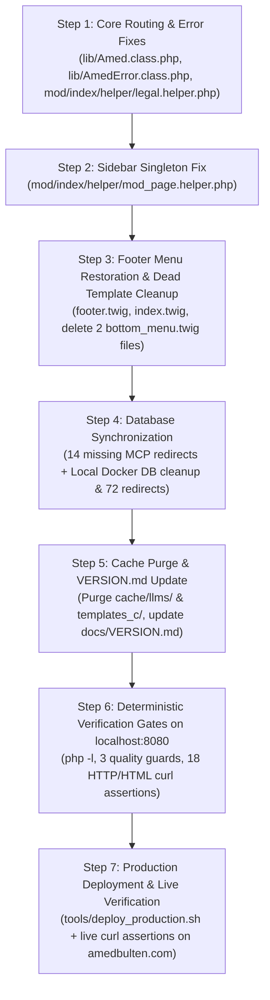

# i18n `saddress` Routing Remediation & Completion Plan

**Date:** 2026-11-08
**Author:** Gemini 4 Argon (Research, Development, Planning, Tracking & Inspection Specialist)
**Predecessor Audit Trail:** [`docs/plan/i18n-saddress-routing-and-google-index-restoration-plan.md`](file:///home/malpersaz/Desktop/projects/htdocs/AF/Bulletin/docs/plan/i18n-saddress-routing-and-google-index-restoration-plan.md) (Sections 9, 10, 11, and 12 — Full Technical Consensus between Owner, Argon, and GLM-5.3 / OMP)
**Target Release:** `v1.0.51` (in-place completion of uncommitted `v1.0.51` pass)

---

## 1. Executive Summary & Problem Statement

Approximately 90% of the structural refactoring in [`docs/plan/i18n-saddress-routing-and-google-index-restoration-plan.md`](file:///home/malpersaz/Desktop/projects/htdocs/AF/Bulletin/docs/plan/i18n-saddress-routing-and-google-index-restoration-plan.md) is already implemented cleanly in the local workspace (`code_separation_guard.py` = 0 violations, `i18n_guard.py` = 0 violations). However, independent post-implementation audits by **Argon** (Sections 9 & 11) and **GLM-5.3 / OMP** (Sections 10 & 12) identified **7 concrete defects and omissions** that currently block completion and cause active breakage on live production (`https://amedbulten.com`):

1. **H1 — Production vs. Local Database Desynchronization & Live Infinite 301 Redirect Loop (`CRITICAL`):**
   - `mod_page` deletions (`id: 28` `Yasal_Bilgiler`, `id: 37` `Çerez_Politikası`) and 58 `mod_redirect` rows were executed via MCP directly against **live production (`amedbulten.com`)** while the updated PHP code remains undeployed in the local workspace.
   - Because live production still runs the old `lib/Amed.class.php` (with `Helper::resolve_statutory_slug()` and no self-redirect guard), 6 statutory policy URLs (`/editorial-policy`, `/privacy-policy`, `/terms-of-service`, `/accessibility`, `/security-policy`, `/compliance` and their `/tr/...` variants) are currently trapped in an **infinite 301 self-redirect loop (`ERR_TOO_MANY_REDIRECTS`)** on `https://amedbulten.com`.
   - Meanwhile, the **local Docker database (`bulletin_db`)** was never updated: `mod_page` rows `28` and `37` still exist locally, and local `mod_redirect` has `0` rows.
2. **H2 — Uncaught Fatal `HTTP 500 Internal Server Error` on Inactive Language URLs (`CRITICAL`):**
   - In [`lib/Amed.class.php`](file:///home/malpersaz/Desktop/projects/htdocs/AF/Bulletin/lib/Amed.class.php#L542-L550), `AmedError::gone($rawPath0)` is called without `require_once(lib_dir . 'AmedError.class.php');`. Because `AmedError` is not autoloaded, every request to an inactive language prefix (e.g., `/ku/news/test`) crashes with `HTTP 500 — Class "AmedError" not found`.
   - Additionally, the block lacks the `$isSafeMethod && !$isAjaxRequest` (`GET`/`HEAD` and non-AJAX) guard and passes `$rawPath0` (`'ku'`) instead of `Req::Clear($this->url->link)`.
3. **H3 — ORM Singleton `flush()` Trap Breaking `Hakkımızda` Sidebar Navigation (`CRITICAL`):**
   - In [`mod/index/helper/mod_page.helper.php`](file:///home/malpersaz/Desktop/projects/htdocs/AF/Bulletin/mod/index/helper/mod_page.helper.php#L69-L70) (lines 69–70 and 121–122), `$this->_mod_ust_list('mod_page', $page->parent_id, ...)` is called immediately before `$this->_mod_parent_id_list('mod_page', $page->id, ...)`.
   - Because `Load::model('mod_page')` returns the `Registry` singleton (`$page`), `_mod_ust_list()` calls `$list->flush()`, which resets `$page->id` to `null` (`0`). Consequently, `_mod_parent_id_list()` receives `$id = null`, hits `if ($id == 0) return false;`, and never executes—leaving `/tr/page/Hakkımızda` with `has_sidebar = false` and no sidebar tree.
   - *Note (Proven in Section 11.2 KANIT 2 & Section 12.1):* [`mod/index/indexBase.php:300`](file:///home/malpersaz/Desktop/projects/htdocs/AF/Bulletin/mod/index/indexBase.php#L300) (`$list->addWhere("parent_id = '{$safeId}'");`) is **already 100% correct** and matches `AF/Business/mod/index/indexBase.php:450`—it must **not** be altered to `(id = X OR parent_id = X)`.
4. **H4 — Missing `menu_footer` (`footer_menu_items`) Column in `footer.twig` & Dead `bottom_menu.twig` Files (`HIGH`):**
   - [`templates/amed/index/footer.twig`](file:///home/malpersaz/Desktop/projects/htdocs/AF/Bulletin/templates/amed/index/footer.twig#L138-L141) was never updated to render `ctx_get('menu_footer')` via the `footer_menu_items` macro.
   - Because [`templates/amed/partials/bottom_menu.twig`](file:///home/malpersaz/Desktop/projects/htdocs/AF/Bulletin/templates/amed/partials/bottom_menu.twig) is an empty 4-line comment stub and [`templates/amed/index/mod_menu/bottom_menu.twig`](file:///home/malpersaz/Desktop/projects/htdocs/AF/Bulletin/templates/amed/index/mod_menu/bottom_menu.twig) has zero callers across the codebase, `Hakkımızda` (`id: 121` under `##Footer_Menu`) and its 6 child policy pages currently have **zero HTML links anywhere on the homepage or inner pages** (100% orphan pages).
   - Per owner decision (2026-11-08), both dead/empty files (`templates/amed/index/mod_menu/bottom_menu.twig` and `templates/amed/partials/bottom_menu.twig`) will be deleted and the dead `` line will be removed from [`templates/amed/index/index.twig:156`](file:///home/malpersaz/Desktop/projects/htdocs/AF/Bulletin/templates/amed/index/index.twig#L156).
5. **H5 — 14 Missing Short/Alternate Alias Seeds in `mod_redirect` (`MEDIUM`):**
   - 7 short/alternate policy routes removed from `config/url.config.php` (`privacy`, `terms`, `editorial-guidelines`, `corrections-policy`, `a11y`, `security`, `ethics-policy`) and their `tr/` prefixed counterparts (14 rules total) were omitted from the `mod_redirect` seed batch.
6. **H6 & Legal Helper Guard — Self-Redirect Guard `rawurldecode` + Proxy Scheme, 404 `X-Robots-Tag`, and `legal.helper.php` Safe-Method Check (`MEDIUM`):**
   - [`lib/Amed.class.php:523-526`](file:///home/malpersaz/Desktop/projects/htdocs/AF/Bulletin/lib/Amed.class.php#L523-L526): Self-redirect comparison must apply `rawurldecode()` on both sides and respect `$_SERVER['HTTP_X_FORWARDED_PROTO']` behind reverse proxies / Cloudflare.
   - [`lib/AmedError.class.php:21-26`](file:///home/malpersaz/Desktop/projects/htdocs/AF/Bulletin/lib/AmedError.class.php#L21-L26): `header("X-Robots-Tag: noindex, nofollow");` must be emitted on **both** `404 Not Found` and `410 Gone` responses.
   - [`mod/index/helper/legal.helper.php:59`](file:///home/malpersaz/Desktop/projects/htdocs/AF/Bulletin/mod/index/helper/legal.helper.php#L59): Bare-root 301 normalization must check `in_array(strtoupper($_SERVER['REQUEST_METHOD'] ?? 'GET'), ['GET', 'HEAD'], true)`.
7. **H7 — Cache Purge & Documentation Accuracy (`LOW/MEDIUM`):**
   - Because [`lib/LlmsService.class.php:20`](file:///home/malpersaz/Desktop/projects/htdocs/AF/Bulletin/lib/LlmsService.class.php#L20) enforces `$cacheTtl = 3600` (1 hour), `cache/llms/` and `templates_c/` must be purged **after** deleting rows `28` and `37` from the local Docker database.
   - [`docs/VERSION.md`](file:///home/malpersaz/Desktop/projects/htdocs/AF/Bulletin/docs/VERSION.md#L1-L35) must be updated to record the `bottom_menu.twig` cleanup, the `footer_menu_items` column restoration, the 72 total `mod_redirect` rules, the intentional `url.config.php` strictness divergence from `AF/Business`, and the operational rule distinguishing MCP (`amedbulten.com` production) from local Docker (`bulletin_db`).

---

## 2. Architecture & Execution Flow



> [!IMPORTANT]
> **Strict Pre-Deploy Gate:** Do **NOT** deploy to `amedbulten.com` until Steps 1 through 6 are 100% completed and verified on `localhost:8080`. Deploying before Step 1 would cause 500 errors on `/ku/*`; deploying before Step 2 & 3 would orphan all 7 content pages on live production; deploying before Step 4 would turn 14 live alias URLs (`/privacy`, `/terms`, `/a11y`, etc.) into `404 Not Found`.

---

## 3. Detailed Step-by-Step Implementation Specification

### Step 1: Core Routing, Inactive-Language `410 Gone`, Self-Redirect Guard & `X-Robots-Tag`

#### 1.1 [MODIFY] [`lib/Amed.class.php`](file:///home/malpersaz/Desktop/projects/htdocs/AF/Bulletin/lib/Amed.class.php#L522-L550)
- **Why:**
  1. Support reverse-proxy TLS termination (`HTTP_X_FORWARDED_PROTO`) when constructing `$currentFullUrl` and compare `rawurldecode()` values on both sides of the self-redirect guard (`O6` / `H6a`).
  2. Require `lib/AmedError.class.php`, enforce `$isSafeMethod && !$isAjaxRequest`, and pass `Req::Clear($this->url->link)` when emitting `410 Gone` for unredirected inactive-language URLs (`O3` / `H2`).
- **Exact Diff (`lines 522–550`):**
```php
                        // Self-redirect guard: never redirect to the current URL
                        $ forwardedProto = $_SERVER['HTTP_X_FORWARDED_PROTO'] ?? '';
                        $isHttps = (isset($_SERVER['HTTPS']) && $_SERVER['HTTPS'] === 'on')
                            || strtolower(trim(explode(',', $forwardedProto)[0])) === 'https';
                        $currentFullUrl = ($isHttps ? "https" : "http") .
                            "://" . ($_SERVER['HTTP_HOST'] ?? 'localhost') . ($_SERVER['REQUEST_URI'] ?? '/');
                        $normalizedTarget = Helper::sitemap_url($redirectUrl);
                        if (rtrim(rawurldecode($currentFullUrl), '/') !== rtrim(rawurldecode($normalizedTarget), '/')) {
                            if ($statusCode === 301) {
                                header("HTTP/1.1 301 Moved Permanently");
                            } else {
                                header("HTTP/1.1 302 Found");
                            }
                            header("Location: " . $normalizedTarget);
                            exit;
                        }
                    }
                }
            } catch (Exception $e) {
                // Fail silently to prevent site crashes
            }
        }

        // Inactive language lifecycle: Emit 410 Gone for inactive languages (e.g. /ku/...) if not redirected by mod_redirect
        if (Registry::get('i18n') === true && $isSafeMethod && !$isAjaxRequest && PHP_SAPI !== 'cli' && !headers_sent()) {
            $inactiveLangs = Registry::get('inactive_langs');
            $rawPath0 = isset($this->url->path[0]) ? (string) $this->url->path[0] : '';
            if (is_array($inactiveLangs) && in_array($rawPath0, $inactiveLangs, true)) {
                require_once(lib_dir . 'AmedError.class.php');
                AmedError::gone(Req::Clear($this->url->link));
                exit;
            }
        }
```
*(Note: Ensure `$forwardedProto` has no space after `$`.)*

---

#### 1.2 [MODIFY] [`lib/AmedError.class.php`](file:///home/malpersaz/Desktop/projects/htdocs/AF/Bulletin/lib/AmedError.class.php#L19-L27)
- **Why:** Emit `header("X-Robots-Tag: noindex, nofollow");` on **both** `410 Gone` and `404 Not Found` responses (`O3` / `H6b`).
- **Exact Diff (`lines 19–27`):**
```php
    public static function error($page, $argument = NULL, $statusCode = 404)
    {
        if ($statusCode === 410) {
            header("HTTP/1.1 410 Gone");
        } else {
            header("HTTP/1.1 404 Not Found");
        }
        header("X-Robots-Tag: noindex, nofollow");
```

---

#### 1.3 [MODIFY] [`mod/index/helper/legal.helper.php`](file:///home/malpersaz/Desktop/projects/htdocs/AF/Bulletin/mod/index/helper/legal.helper.php#L53-L69)
- **Why:** Add the `$isSafeMethod` (`GET`/`HEAD`) guard to the bare-root 301 normalization block in `legal_helper::render()` (`OMP 10.3 #7`).
- **Exact Diff (`lines 53–69`):**
```php
        // 301 Canonical Normalization: Ensure bare-root /legal and /cookie-policy redirect to active language (e.g. /tr/legal)
        $requestMethod = $_SERVER['REQUEST_METHOD'] ?? 'GET';
        $isSafeMethod = in_array(strtoupper($requestMethod), ['GET', 'HEAD'], true);
        $isAjax = (
            (!empty($_SERVER['HTTP_X_REQUESTED_WITH']) && strtolower($_SERVER['HTTP_X_REQUESTED_WITH']) === 'xmlhttprequest')
            || (isset($_POST['ajax_request']) && ($_POST['ajax_request'] === 'true' || $_POST['ajax_request'] === '1'))
        );

        if (PHP_SAPI !== 'cli' && $isSafeMethod && !$isAjax && !headers_sent()) {
            $activeLangs = Registry::has('active_langs') ? (array) Registry::get('active_langs') : [];
            $rawPath0 = isset($this->url->path[0]) ? (string) $this->url->path[0] : '';
            if (empty($rawPath0) || !in_array($rawPath0, $activeLangs, true)) {
                $targetUrl = rtrim((string) $this->site['saddress'], '/') . '/' . $policy['canonical_slug'];
                $queryString = (!empty($_SERVER['QUERY_STRING'])) ? '?' . $_SERVER['QUERY_STRING'] : '';
                header("HTTP/1.1 301 Moved Permanently");
                header("Location: " . $targetUrl . $queryString);
                exit;
            }
        }
```

---

### Step 2: `mod_page.helper.php` ORM Singleton `flush()` Fix (`H3`)

#### 2.1 [MODIFY] [`mod/index/helper/mod_page.helper.php`](file:///home/malpersaz/Desktop/projects/htdocs/AF/Bulletin/mod/index/helper/mod_page.helper.php#L68-L71)
- **Why:** `Load::model('mod_page')` returns the singleton `$page` instance. When `$this->_mod_ust_list('mod_page', $page->parent_id, ...)` executes, it calls `$list->flush()`, wiping `$page->id` to `null` before `$this->_mod_parent_id_list('mod_page', $page->id, ...)` is called. Caching `$pageId = (int) $page->id;` and `$parentId = (int) $page->parent_id;` before calling `_mod_ust_list` (matching `AF/Business/mod/index/helper/mod_page.helper.php:87–90`) restores the 6-child sidebar on `/tr/page/Hakkımızda`.
- **Do NOT touch [`mod/index/indexBase.php:300`](file:///home/malpersaz/Desktop/projects/htdocs/AF/Bulletin/mod/index/indexBase.php#L300):** Keep `$list->addWhere("parent_id = '{$safeId}'");` as-is so leaf pages do not render an empty self-header and `Hakkımızda` does not render its own title twice.
- **Exact Diff (`lines 68–71` and `lines 120–123`):**
```php
            $pageId = (int) $page->id;
            $parentId = (int) $page->parent_id;
            $this->_mod_faq('mod_page', $pageId);
            $this->_mod_ust_list('mod_page', $parentId, ['id', 'name', 'seo', 'order', 'lang', 'root'], 'order');
            $this->_mod_parent_id_list('mod_page', $pageId, ['id', 'name', 'seo', 'order', 'lang', 'root'], 'order');
```
*(Apply the identical 5-line replacement in the alternate-slug branch at lines 120–123.)*

---

### Step 3: Footer `menu_footer` Column Restoration & Dead `bottom_menu.twig` Cleanup (`H4`)

#### 3.1 [MODIFY] [`templates/amed/index/footer.twig`](file:///home/malpersaz/Desktop/projects/htdocs/AF/Bulletin/templates/amed/index/footer.twig)
- **Why:** Restore the dynamic `menu_footer` (`##Footer_Menu`, `id: 120`) column in `footer.twig` so `Hakkımızda` (`tr/page/Hakkımızda`), `Haberler`, `Makaleler`, `Yazarlar`, `Videolar`, and `Duyurular` are linked in the footer across every page of the site.
- **Normalization & Quality Rules (`D4` + `i18n_guard.py`):**
  1. Normalize internal relative `item.url` values using the `D4` rule: if `item.url` starts with `'http://'`, `'https://'`, `'//'`, `'mailto:'`, `'tel:'`, or `'/'`, keep `item.url`; else if `item.url` starts with `(site.lang ~ '/')`, prefix with `site.address ~ item.url`; else prefix with `site.saddress ~ item.url`.
  2. Use `{{ lang.index.menu.footer_links }}` (verified present in all 10 `mod/index/lang/*.php` files) without any `|default(...)` filter so `tools/i18n_guard.py` passes with 0 violations.
- **Exact Additions in [`templates/amed/index/footer.twig`](file:///home/malpersaz/Desktop/projects/htdocs/AF/Bulletin/templates/amed/index/footer.twig):**
  - **At the top of `templates/amed/index/footer.twig` (before `<footer class="site-footer mt-auto py-5">`), prepend:**
```twig

    
    
        
            
                
                
                    {{ navigation.footer_menu_items(menu, item.id) }}
                
                    
                        
                    
                        
                    
                    <li class="mb-2">
                        <a href="{{ clean_footer_url }}" target="_blank" rel="noopener noreferrer" class="text-decoration-none transition-link d-inline-flex align-items-center gap-2">
                            <i class="{{ item.icon }}" aria-hidden="true"></i>
                            <span>{{ item.name }}</span>
                        </a>
                        
                            <ul class="list-unstyled ms-3 mt-2">
                                {{ navigation.footer_menu_items(menu, item.id) }}
                            </ul>
                        
                    </li>
                
            
        
    






    
        {{ footer_navigation.footer_menu_items(footer_menu, footer_menu_root_id) }}
    


```
  - **In the grid columns of `templates/amed/index/footer.twig` (lines 5 and 138–144), replace the hardcoded column widths and spacer:**
```twig
            <!-- Site Information -->
            <div class="col-md-4 col-lg-4col-md-5 col-lg-4">
```
    and replace lines 138–143 (`Spacer` + `Contact & Social Information` wrapper):
```twig
            
                <div class="col-md-3 col-lg-3">
                    <div class="card contact-card border-0 shadow-sm overflow-hidden rounded-3 h-100">
                        <div class="card-body p-4">
                            <h3 class="h5 fw-bold mb-3 d-flex align-items-center">
                                <i class="bi bi-list-ul me-2 text-primary" aria-hidden="true"></i>
                                <span>{{ lang.index.menu.footer_links }}</span>
                            </h3>
                            <nav aria-label="{{ lang.index.menu.footer_links }}">
                                <ul class="list-unstyled mb-0 ps-1">
                                    {{ footer_menu_markup|raw }}
                                </ul>
                            </nav>
                        </div>
                    </div>
                </div>
            
                <div class="col-md-1 col-lg-2 d-none d-md-block">
                    <!-- Spacer -->
                </div>
            

            <!-- Contact & Social Information -->
            <div class="col-md-5 col-lg-5col-md-6 col-lg-6">
```

---

#### 3.2 [MODIFY] [`templates/amed/index/index.twig`](file:///home/malpersaz/Desktop/projects/htdocs/AF/Bulletin/templates/amed/index/index.twig#L153-L158)
- **Why:** Remove the dead include of the empty `partials/bottom_menu.twig` stub (per Owner decision 2026-11-08).
- **Exact Diff (`lines 153–158`):**
```twig
        </aside>
    </section>
<!-- END: index/index.twig -->

```

---

#### 3.3 [DELETE] Dead `bottom_menu.twig` Files
- Delete [`templates/amed/index/mod_menu/bottom_menu.twig`](file:///home/malpersaz/Desktop/projects/htdocs/AF/Bulletin/templates/amed/index/mod_menu/bottom_menu.twig) (0 callers in repository).
- Delete [`templates/amed/partials/bottom_menu.twig`](file:///home/malpersaz/Desktop/projects/htdocs/AF/Bulletin/templates/amed/partials/bottom_menu.twig) (4-line empty comment stub).

---

### Step 4: Database Synchronization (Production MCP + Local Docker `bulletin_db`) (`H1` & `H5`)

#### 4.1 Seed the 14 Missing Short/Alternate Aliases on Production MCP (`amed-bulletin`)
Use the `amed-bulletin` MCP `create_redirect` tool (or batch script) to insert the 14 omitted short/alternate alias redirects (all `status_code: 301`) so production has all **72** canonical single-hop redirect rules:

| `old_url` (Bare & `/tr/` Prefixed) | `new_url` (Single-Hop Canonical Target) | `status_code` |
|---|---|---|
| `editorial-guidelines`, `tr/editorial-guidelines`, `corrections-policy`, `tr/corrections-policy` | `tr/page/Yayın_İlkeleri` | `301` |
| `privacy`, `tr/privacy` | `tr/page/Gizlilik_Politikası` | `301` |
| `terms`, `tr/terms` | `tr/page/Kullanım_Koşulları` | `301` |
| `a11y`, `tr/a11y` | `tr/page/Erişilebilirlik` | `301` |
| `security`, `tr/security` | `tr/page/Güvenlik_Politikası` | `301` |
| `ethics-policy`, `tr/ethics-policy` | `tr/page/Basın_Etiği_ve_Uyum` | `301` |

#### 4.2 Synchronize Local Docker Database (`bulletin_db` via `docker exec bulletin_app`)
> [!WARNING]
> Remember that `config/db.config.php` starts with `if (!defined('amed')) die(':)');`. Any CLI script run inside `bulletin_app` must `define('amed', true);` before `require 'config/db.config.php';`!

Execute a deterministic PHP script via `docker exec bulletin_app php -r ...` to:
1. Delete `mod_page` rows `id = 28` (`Yasal_Bilgiler`) and `id = 37` (`Çerez_Politikası`) from local `bulletin_db`.
2. Upsert all **72** single-hop 301 redirect rules (the 58 rules from Section 7.6 `G1` + the 14 short/alternate alias rules above) into local `bulletin_db.mod_redirect`.

---

### Step 5: Cache Purge & `docs/VERSION.md` Update (`H7`)

#### 5.1 Purge Local Caches After Local DB Sync
Run:
```bash
rm -rf cache/llms/*.txt templates_c/*
```
*(Critical: Must run **after** Step 4.2 deletes `id: 28` and `id: 37` from local `bulletin_db`, because `LlmsService` caches `llms_tr.txt` for `3600` seconds.)*

#### 5.2 [MODIFY] [`docs/VERSION.md`](file:///home/malpersaz/Desktop/projects/htdocs/AF/Bulletin/docs/VERSION.md#L1-L35)
Update the `## v1.0.51 (2026-11-07)` section in `docs/VERSION.md` to accurately document:
- Restoration of the dynamic `menu_footer` (`footer_menu_items`) column in `templates/amed/index/footer.twig` with `site.saddress` relative-URL normalization, plus deletion of dead `templates/amed/index/mod_menu/bottom_menu.twig` and empty `templates/amed/partials/bottom_menu.twig`.
- Intentional strictness divergence from `AF/Business` in `config/url.config.php` (`$url['legal/(:any)']` and `$url['cookies']` removed so aliases 301-redirect cleanly via `mod_redirect` instead of serving duplicate 200 responses).
- ORM singleton `flush()` protection (`$pageId` / `$parentId` caching) in `mod/index/helper/mod_page.helper.php`.
- Proxy-aware (`HTTP_X_FORWARDED_PROTO`) + `rawurldecode()` self-redirect guard and `require_once(lib_dir . 'AmedError.class.php')` in `lib/Amed.class.php`, plus `X-Robots-Tag: noindex, nofollow` across both `404` and `410` in `lib/AmedError.class.php`.
- Operational rule: `amed-bulletin` MCP targets live production (`https://amedbulten.com/mcp.php`), whereas local Docker MySQL (`bulletin_db`) must be synchronized via `docker exec bulletin_app` (`define('amed', true)`), followed by purging `cache/llms/` (3600s TTL) and `templates_c/`.

---

### Step 6: Deterministic Verification Gates on `localhost:8080`

All of the following automated checks must pass with **zero failures** before deployment:

1. **PHP Syntax & Repository Quality Guards:**
   ```bash
   php -l lib/Amed.class.php && php -l lib/AmedError.class.php && php -l mod/index/helper/legal.helper.php && php -l mod/index/helper/mod_page.helper.php
   python3 tools/code_separation_guard.py
   python3 tools/i18n_guard.py
   python3 tools/module_boundary_guard.py
   git diff --check
   ```
2. **Local HTTP Status, Header & Single-Hop Redirect Assertions (`http://localhost:8080`):**
   - `GET /tr/legal` ➔ `200 OK` (renders full-width `.legal-dossier-grid` with `partials/_legal_info.twig`, zero `.policy-nav-*` sidebar).
   - `GET /legal` ➔ `301 Moved Permanently` ➔ `Location: http://localhost:8080/tr/legal` (1 hop).
   - `GET /tr/cookie-policy` ➔ `200 OK` (renders full-width interactive cookie preference center).
   - `GET /cookie-policy` ➔ `301 Moved Permanently` ➔ `Location: http://localhost:8080/tr/cookie-policy` (1 hop).
   - `GET /imprint`, `/tr/imprint`, `/tr/page/Yasal_Bilgiler` ➔ `301 Moved Permanently` ➔ `Location: http://localhost:8080/tr/legal` (1 hop).
   - `GET /cookies`, `/tr/cookies`, `/tr/page/Çerez_Politikası` ➔ `301 Moved Permanently` ➔ `Location: http://localhost:8080/tr/cookie-policy` (1 hop).
   - `GET /privacy-policy`, `/tr/privacy-policy`, `/privacy`, `/tr/privacy` ➔ `301 Moved Permanently` ➔ `Location: http://localhost:8080/tr/page/Gizlilik_Politikas%C4%B1` (1 hop).
   - `GET /terms`, `/a11y`, `/security`, `/ethics-policy`, `/editorial-guidelines`, `/corrections-policy` ➔ `301 Moved Permanently` to their respective `/tr/page/<seo>` canonicals (1 hop).
   - `GET /tr/page/Gizlilik_Politikas%C4%B1` ➔ `200 OK`.
   - `GET /ku/news/test` ➔ `410 Gone` + `X-Robots-Tag: noindex, nofollow` (zero `500` error).
   - `GET /tr/nonexistent-page-404-test` ➔ `404 Not Found` + `X-Robots-Tag: noindex, nofollow`.
3. **Local HTML Content & Feed Assertions (`http://localhost:8080`):**
   - `GET /tr/page/Hakk%C4%B1m%C4%B1zda` HTML contains `detail-page-sidebar` (`1` match), lists all **6** child policy links (`Yayın_İlkeleri`, `Gizlilik_Politikası`, `Kullanım_Koşulları`, `Erişilebilirlik`, `Güvenlik_Politikası`, `Basın_Etiği_ve_Uyum`), does **not** contain `Yasal_Bilgiler` or `Çerez_Politikası`, and suppresses `subpages-title` (`0` matches).
   - `GET /tr/` and `GET /tr/legal` HTML both contain the `footer.twig` `Alt Menü` (`menu_footer`) card linking to `http://localhost:8080/tr/page/Hakkımızda`.
   - `GET /tr/llms.txt` contains `0` occurrences of `Yasal_Bilgiler` or `Çerez_Politikası` under `/tr/page/`, and lists `/tr/legal` + `/tr/cookie-policy` under `## Optional`.

---

### Step 7: Production Deployment & Live Health Verification (`https://amedbulten.com`)

Once Step 6 passes 100% on `localhost:8080`, deploy the workspace to production and run the live verification gate on `https://amedbulten.com`:
- Verify that `/editorial-policy`, `/privacy-policy`, `/terms-of-service`, `/accessibility`, `/security-policy`, `/compliance`, `/privacy`, `/terms`, `/a11y`, `/security`, `/ethics-policy`, `/editorial-guidelines`, `/corrections-policy` all return a **single-hop `HTTP/2 301`** to `https://amedbulten.com/tr/page/<seo>` and that the target returns **`HTTP/2 200`** (ending the live redirect loop).
- Verify that `https://amedbulten.com/tr/legal` and `https://amedbulten.com/tr/cookie-policy` return **`HTTP/2 200`** (and bare-root `/legal` and `/cookie-policy` 301-redirect to `/tr/legal` and `/tr/cookie-policy`).
- Verify that `https://amedbulten.com/ku/news/test` returns **`HTTP/2 410`** with `x-robots-tag: noindex, nofollow`.
- Verify that `https://amedbulten.com/tr/page/Hakk%C4%B1m%C4%B1zda` renders the 6-child sidebar and `https://amedbulten.com/tr/` renders the `Alt Menü` footer column.

---

## 8. Pre-Execution Independent Review — GLM-5.3 / OMP (2026-11-08)

**Reviewer:** GLM-5.3 (omp trusted coding assistant — Ar-Ge & Uygulama Müfettişi) · **Method:** every "Exact Diff" precondition tested against the live workspace before execution: variable-definition grep on `lib/Amed.class.php`, `menu_footer` producer/consumer chain (`mod/index/index.php:374` → helpers' `_index()`), `footer_links` key presence across all 10 `mod/index/lang/*.php`, current line-number parity for every cited file, `mod_redirect` schema (`SHOW COLUMNS`), local database name (`SHOW DATABASES`), `tools/deploy_production.sh` existence, and `templates/amed/index/index.twig:150-158` content.

### 8.1 Verified correct (execution-ready as written)

1. **Step 2 (flush fix):** approach, both call sites (68-71, 120-123), and the explicit "do NOT touch `indexBase:300`" guard are exactly the Section 11/12 consensus.
2. **Step 3 data precondition:** `ctx_get('menu_footer')` will be populated — `mod/index/index.php::_menu()` sets `menu_footer` + `menu_footer_root_id` (lines 374-375, mirroring `AF/Business/index.php:490-491`), and `_menu()` runs via `_index()`, which every front helper invokes (`index`, `legal.helper:143`, `mod_page.helper:156`, `mod_news.helper:259/439/988`, announcements, imagecategories…). The footer column will have data on every page, not just the homepage.
3. **Step 3 label key:** `lang.index.menu.footer_links` exists in **all 10** lang files (count = 1 each); `tr` value is `'Alt Menü'` — matching the Step 6.3 gate expectation verbatim.
4. **Step 3.1/3.2 line references:** `footer.twig:5` (`col-md-5 col-lg-4`), `:138-144` (spacer + contact wrapper), and `index.twig:154-157` (comment + dead include) all match the current files. Grid arithmetic holds: menu-present `md 4+3+5=12` / `lg 4+3+5=12`, fallback `5+1+6=12` / `4+2+6=12`.
5. **Step 1.2 (`AmedError`) and Step 1.3 (`legal.helper`):** diffs correct; 1.3 properly defines `$requestMethod`/`$isSafeMethod` locally.
6. **Step 4.1:** the 14-row table is exactly the missing-alias set verified against the 58 production rows (IDs 87-144).
7. **Step 4.2 mechanics:** `mod_redirect.old_url` is `UNIQUE` — plain `INSERT` suffices for the empty local table; production needs only the 14 `create_redirect` calls (no conflicts possible).
8. **Steps 5-7 ordering, gates, and `tools/deploy_production.sh`** (exists, executable): consistent with the Section 12 single-deploy consensus.

### 8.2 Defects requiring correction BEFORE execution

#### D-A (BLOCKING) — Step 1.1's 410 block references two **undefined variables**
`grep -c 'isSafeMethod\|isAjaxRequest' lib/Amed.class.php` → **0**. The block that used to define `$isSafeMethod` was removed in the v1.0.51 pass; the surviving early definition is **`$isAjax`** (~line 423, same constructor scope, still in scope at the 410 block). Applied verbatim, the diff's condition `… && $isSafeMethod && !$isAjaxRequest …` evaluates with `null` under PHP 8 (Warning + falsy) → **the entire 410 block stays silently dead** — `/ku/*` falls through to 404 and de-indexing stalls, i.e. the H2 failure mode reintroduced by its own fix. Gate 6 would catch it, but an "Exact Diff" must not ship a silent-dead branch. **Corrected block:**
```php
        // Inactive language lifecycle: Emit 410 Gone for inactive languages (e.g. /ku/...) if not redirected by mod_redirect
        $requestMethod = $_SERVER['REQUEST_METHOD'] ?? 'GET';
        $isSafeMethod = in_array(strtoupper($requestMethod), ['GET', 'HEAD'], true);
        if (Registry::get('i18n') === true && $isSafeMethod && !$isAjax && PHP_SAPI !== 'cli' && !headers_sent()) {
            $inactiveLangs = Registry::get('inactive_langs');
            $rawPath0 = isset($this->url->path[0]) ? (string) $this->url->path[0] : '';
            if (is_array($inactiveLangs) && in_array($rawPath0, $inactiveLangs, true)) {
                require_once(lib_dir . 'AmedError.class.php');
                AmedError::gone(Req::Clear($this->url->link));
                exit;
            }
        }
```
*(Same pattern the plan itself uses in Step 1.3 — reuse `$isAjax`, not the nonexistent `$isAjaxRequest`.)*

#### D-B (blocking typo) — Step 1.1 line 69: `$ forwardedProto`
A space between `$` and the identifier is a parse error. The footnote ("Ensure `$forwardedProto` has no space") admits the diff is not executable as printed. Fix the token in the diff body and delete the footnote — an "Exact Diff" section must be paste-safe.

#### D-C (precision) — container name ≠ database name
The plan says "Local Docker Database (`bulletin_db`)". `bulletin_db` is the **MySQL container**; the database inside is **`bulletin`** (`SHOW DATABASES` verified; `USE bulletin_db` returns `Unknown database` — an error already hit once during the Section 10 audit). The `docker exec bulletin_app php …` + `define('amed', true)` route self-corrects via `config/db.config.php`, but any hardcoded `bulletin_db` in the sync script will fail. Proven simpler alternative (used successfully in audits): `docker exec bulletin_db sh -c 'mysql -uroot -p"$MYSQL_ROOT_PASSWORD" bulletin -e "…"'` — no PHP bootstrap dance, deterministic SQL for the two `DELETE`s and the 72-row `INSERT`.

### 8.3 Verdict

Plan is architecturally faithful to the Section 9-12 consensus and 90% execution-ready. With **D-A** corrected (mandatory — it silently defeats the fix it ships), **D-B** repaired, and **D-C** clarified, Steps 1-7 may execute in the given order without further review. All three corrections are contained in Step 1's diff and Step 4.2's mechanics; nothing else in the plan requires change.

— Signed: **GLM-5.3** (omp trusted coding assistant — Ar-Ge & Uygulama Müfettişi), 2026-11-08

---

## 9. Executor Directive — Consolidated, Unambiguous, Machine-Followable (GLM-5.3)

> **WHO THIS IS FOR:** the AI agent (or human) that will EXECUTE this plan. This section is the **single source of truth** for the edits. Where Sections 3–7 and this section conflict, **this section wins** — it already merges the three corrections from Section 8 (D-A: undefined-variable fix, D-B: `$ forwardedProto` typo, D-C: container-vs-database name). Follow tasks T1→T9 strictly in order; never skip a gate; never deploy early.

### 9.0 Context you must load first (facts, all pre-verified 2026-11-08)

> **⚠️ OWNER DIRECTIVE (2026-11-08) — LOCAL-FIRST:** Docker is active; everything up to and including **T8 runs on the LOCAL environment ONLY** (`http://localhost:8080` + local Docker database `bulletin`). **All production mutations are FORBIDDEN until T8 is 100% green** — including every MCP write tool (`create_redirect`, `update_*`, `delete_*`) and any deploy. Read-only MCP calls (`list_redirects`, `get_*`) are allowed, for transcription only. Production writes happen solely in T9a, immediately before the single deploy in T9b.
- Working directory: `/home/malpersaz/Desktop/projects/htdocs/AF/Bulletin`. Containers: `bulletin_web` (nginx :8080), `bulletin_app` (PHP), `bulletin_db` (MySQL). **MySQL container = `bulletin_db`; database inside it = `bulletin`** (NOT `bulletin_db` — using `bulletin_db` as a database name raises `Unknown database`).
- Production = `https://amedbulten.com`, managed via the `amed-bulletin` MCP tools. Production currently runs OLD code + NEW data → 6 policy URLs are in an infinite 301 self-loop RIGHT NOW. Your job ends that by completing all fixes locally, passing all gates, then deploying ONCE.
- Production `mod_redirect` currently holds 58 rows (IDs 87–144), all verified correct single-hop. It is missing exactly 14 rows (seeded in T9a, never before T8).
- Local `bulletin.mod_redirect` = 0 rows; local `bulletin.mod_page` still has rows `id=28` and `id=37` which must be deleted (T6a).
- `Load::model('mod_page')` returns a Registry **singleton**: any `_mod_*_list()` call flushes it and nulls its properties. This is why T4 caches IDs first.

### 9.1 HARD INVARIANTS (must-not list — violating any of these reopens a known bug)

1. **DO NOT** modify `mod/index/indexBase.php:300` (`parent_id = '{$safeId}'` is canonical; `(id = X OR parent_id = X)` there produces orphan headings on leaf pages and a duplicated Hakkımızda — proven in Sections 11.2/12.1).
2. **DO NOT** seed `legal`, `tr/legal`, `cookie-policy`, `tr/cookie-policy`, `cookies`, `tr/cookies` as redirects to other targets than themselves — `/tr/legal` and `/tr/cookie-policy` are LIVE canonicals (`cookies`→`tr/cookie-policy` seeds DO exist and are correct).
3. **DO NOT** deploy — and DO NOT write to production in any way (MCP mutations included) — before every gate in T8 passes. Deploying with an unfixed 410 block ships `/ku/*` = 500; deploying without T5 orphans 7 pages on live; deploying without the T9a seeds 404s 14 live alias URLs; and seeding production while OLD code is live risks dragging the 14 short aliases into the existing redirect loop.
4. **DO NOT** touch `AF/Business/*` or `biys/*` (archive boundary).
5. **DO NOT** use `|default(...)` on any `lang.*` key in Twig (i18n_guard enforces 0 violations).
6. Single deploy at the end (T9). No partial, no "quick fix first" deploys.

### 9.2 Tasks

#### T1 — `lib/Amed.class.php` (TWO edits)

**T1a — replace the self-redirect guard block (current lines ~522–534)** with EXACTLY:

```php
                        // Self-redirect guard: never redirect to the current URL
                        $forwardedProto = $_SERVER['HTTP_X_FORWARDED_PROTO'] ?? '';
                        $isHttps = (isset($_SERVER['HTTPS']) && $_SERVER['HTTPS'] === 'on')
                            || strtolower(trim(explode(',', $forwardedProto)[0])) === 'https';
                        $currentFullUrl = ($isHttps ? "https" : "http") .
                            "://" . ($_SERVER['HTTP_HOST'] ?? 'localhost') . ($_SERVER['REQUEST_URI'] ?? '/');
                        $normalizedTarget = Helper::sitemap_url($redirectUrl);
                        if (rtrim(rawurldecode($currentFullUrl), '/') !== rtrim(rawurldecode($normalizedTarget), '/')) {
                            if ($statusCode === 301) {
                                header("HTTP/1.1 301 Moved Permanently");
                            } else {
                                header("HTTP/1.1 302 Found");
                            }
                            header("Location: " . $normalizedTarget);
                            exit;
                        }
```

**T1b — replace the inactive-language 410 block (current lines ~542–550)** with EXACTLY (this is the D-A corrected version — `$isSafeMethod` is DEFINED here because it exists nowhere else in the file, and `$isAjax` is the variable already defined at ~line 423, not `$isAjaxRequest`):

```php
        // Inactive language lifecycle: Emit 410 Gone for inactive languages (e.g. /ku/...) if not redirected by mod_redirect
        $requestMethod = $_SERVER['REQUEST_METHOD'] ?? 'GET';
        $isSafeMethod = in_array(strtoupper($requestMethod), ['GET', 'HEAD'], true);
        if (Registry::get('i18n') === true && $isSafeMethod && !$isAjax && PHP_SAPI !== 'cli' && !headers_sent()) {
            $inactiveLangs = Registry::get('inactive_langs');
            $rawPath0 = isset($this->url->path[0]) ? (string) $this->url->path[0] : '';
            if (is_array($inactiveLangs) && in_array($rawPath0, $inactiveLangs, true)) {
                require_once(lib_dir . 'AmedError.class.php');
                AmedError::gone(Req::Clear($this->url->link));
                exit;
            }
        }
```

After T1: `php -l lib/Amed.class.php` must print `No syntax errors`. If `$isAjax` is reported undefined at the 410 block, you edited the wrong scope — re-check that the guard sits inside `__construct()` after the `$isAjax = (...)` assignment (~line 423).

#### T2 — `lib/AmedError.class.php`

In `error()`, make the status branch emit the robots header on BOTH codes. Final form:

```php
        if ($statusCode === 410) {
            header("HTTP/1.1 410 Gone");
        } else {
            header("HTTP/1.1 404 Not Found");
        }
        header("X-Robots-Tag: noindex, nofollow");
```

#### T3 — `mod/index/helper/legal.helper.php` (~lines 53–69)

Replace the bare-root 301 block with EXACTLY (adds the safe-method guard; the rest is already current code):

```php
        // 301 Canonical Normalization: Ensure bare-root /legal and /cookie-policy redirect to active language (e.g. /tr/legal)
        $requestMethod = $_SERVER['REQUEST_METHOD'] ?? 'GET';
        $isSafeMethod = in_array(strtoupper($requestMethod), ['GET', 'HEAD'], true);
        $isAjax = (
            (!empty($_SERVER['HTTP_X_REQUESTED_WITH']) && strtolower($_SERVER['HTTP_X_REQUESTED_WITH']) === 'xmlhttprequest')
            || (isset($_POST['ajax_request']) && ($_POST['ajax_request'] === 'true' || $_POST['ajax_request'] === '1'))
        );

        if (PHP_SAPI !== 'cli' && $isSafeMethod && !$isAjax && !headers_sent()) {
            $activeLangs = Registry::has('active_langs') ? (array) Registry::get('active_langs') : [];
            $rawPath0 = isset($this->url->path[0]) ? (string) $this->url->path[0] : '';
            if (empty($rawPath0) || !in_array($rawPath0, $activeLangs, true)) {
                $targetUrl = rtrim((string) $this->site['saddress'], '/') . '/' . $policy['canonical_slug'];
                $queryString = (!empty($_SERVER['QUERY_STRING'])) ? '?' . $_SERVER['QUERY_STRING'] : '';
                header("HTTP/1.1 301 Moved Permanently");
                header("Location: " . $targetUrl . $queryString);
                exit;
            }
        }
```

#### T4 — `mod/index/helper/mod_page.helper.php` (BOTH call sites: lines ~68–71 AND ~120–123)

At each site, cache the singleton's IDs BEFORE any `_mod_ust_list` call flushes it. Final form per site:

```php
            $pageId = (int) $page->id;
            $parentId = (int) $page->parent_id;
            $this->_mod_faq('mod_page', $pageId);
            $this->_mod_ust_list('mod_page', $parentId, ['id', 'name', 'seo', 'order', 'lang', 'root'], 'order');
            $this->_mod_parent_id_list('mod_page', $pageId, ['id', 'name', 'seo', 'order', 'lang', 'root'], 'order');
```

No other line in this file changes. `indexBase.php` is untouched (Invariant 1).

#### T5 — Templates (footer column + dead-file cleanup)

**T5a** — In `templates/amed/index/footer.twig`:
1. Prepend (above `<footer class="site-footer mt-auto py-5">`) the `footer_menu_items` macro + `footer_menu` capture block exactly as printed in Section 3.1 (verified correct as written there — D4 normalization rule included; do not add `|default` on any `lang.*` key).
2. Site-info column → `<div class="col-md-4 col-lg-4col-md-5 col-lg-4">`.
3. Replace the spacer block (lines ~138–141) and the contact column wrapper with the `has_footer_menu` conditional markup from Section 3.1 (menu card uses `{{ lang.index.menu.footer_links }}` + `{{ footer_menu_markup|raw }}`; contact column → `col-md-5 col-lg-5` when menu present).

**T5b** — In `templates/amed/index/index.twig`: delete lines ~154–156 (the `{# Include the bottom menu when needed. #}` comment and the `` line).

**T5c** — Delete files: `templates/amed/index/mod_menu/bottom_menu.twig` and `templates/amed/partials/bottom_menu.twig`.

#### T6 — Local Docker DB synchronization ONLY (LOCAL-FIRST — no production writes in this task)

> **Supersedes Section 3 / Step 4.1 ordering:** production seeding is moved to T9a (after T8), per owner directive. The 14-alias table below is used **twice** — here for the local seed, and in T9a for production.

**T6a — Local row deletions:**

```bash
docker exec bulletin_db sh -c 'mysql -uroot -p"$MYSQL_ROOT_PASSWORD" bulletin -e \
  "DELETE FROM mod_page WHERE id IN (28,37); SELECT COUNT(*) FROM mod_page WHERE lang=\"tr\";"'
# expected count: 8  (ids 8, 18, 39, 40, 41, 42, 43, 44)
```

**T6b — Local 72-row seed.** Compose the set deterministically from two verified sources: (1) the **58 production rows transcribed verbatim** via READ-ONLY `list_redirects` (2 pages × 50 — no writes), plus (2) these **14 rows**:

| old_url | new_url |
|---|---|
| `editorial-guidelines` / `tr/editorial-guidelines` | `tr/page/Yayın_İlkeleri` |
| `corrections-policy` / `tr/corrections-policy` | `tr/page/Yayın_İlkeleri` |
| `privacy` / `tr/privacy` | `tr/page/Gizlilik_Politikası` |
| `terms` / `tr/terms` | `tr/page/Kullanım_Koşulları` |
| `a11y` / `tr/a11y` | `tr/page/Erişilebilirlik` |
| `security` / `tr/security` | `tr/page/Güvenlik_Politikası` |
| `ethics-policy` / `tr/ethics-policy` | `tr/page/Basın_Etiği_ve_Uyum` |

```bash
docker exec bulletin_db sh -c 'mysql -uroot -p"$MYSQL_ROOT_PASSWORD" bulletin -e \
  "INSERT INTO mod_redirect (old_url,new_url,status_code) VALUES (\"imprint\",\"tr/legal\",301), /* …all 72 rows… */;"'
docker exec bulletin_db sh -c 'mysql -uroot -p"$MYSQL_ROOT_PASSWORD" bulletin -e "SELECT COUNT(*) FROM mod_redirect;"'
# expected: 72   (cross-check: 58 transcribed + 14 table = 72)
```

Transcribe byte-identical (`old_url` + `new_url`, status `301`). Do not invent extra rows (Invariant 2).

#### T7 — Cache purge & documentation (AFTER T6, never before)

```bash
rm -rf cache/llms/*.txt templates_c/*
```
Then update `docs/VERSION.md` `## v1.0.51 (2026-11-07)` with the five bullets listed in Section 5.2 (footer column + dead-file deletion; intentional `url.config.php` strictness vs AF/Business; flush-guard; proxy-aware guard + 410 + X-Robots; MCP=production / Docker=local operational rule with the 3600s TTL purge note).

#### T8 — Verification gates on `http://localhost:8080` (ALL must pass; any failure ⇒ STOP, fix, rerun from the failed gate)

```bash
php -l lib/Amed.class.php && php -l lib/AmedError.class.php && php -l mod/index/helper/legal.helper.php && php -l mod/index/helper/mod_page.helper.php
python3 tools/code_separation_guard.py && python3 tools/i18n_guard.py && python3 tools/module_boundary_guard.py && git diff --check
```

HTTP assertions (status `200` / single-hop `301` Location / `410`+`X-Robots-Tag` / `404`+`X-Robots-Tag`) exactly as enumerated in Section 6.2, plus the HTML/feed assertions of Section 6.3, of which the four most failure-prone are:
- `/tr/page/Hakkımızda`: exactly 1 `detail-page-sidebar`, 6 child links, 0 `Yasal_Bilgiler`/`Çerez_Politikası` links, 0 `subpages-title`.
- `/tr/` AND `/tr/legal`: footer `Alt Menü` card present with a link resolving to `http://localhost:8080/tr/page/Hakkımızda`.
- `/ku/news/test`: `410` + `x-robots-tag: noindex, nofollow` (a `500` here means T1b was applied wrongly or `$isAjax` scope was broken; a `404` means the 410 block is dead — check the variable definitions).
- `/tr/llms.txt`: 0 `Yasal_Bilgiler`/`Çerez_Politikası` under `/tr/page/`, both app URLs under `## Optional`.

#### T9 — Production: seeds → single deploy → live verification (ONLY after T8 = 100% pass)

**T9a — Production MCP seeds (14 inserts):** apply the 14-alias table from T6b via `create_redirect` (status `301`) — nothing else. Then assert via read-only `list_redirects` that the production total is exactly **72**.

**T9b — Deploy:** run `tools/deploy_production.sh` (single deploy; Invariant 6).

**T9c — Live assertions** (Section 7): the 14 alias URLs → single-hop `301` → `tr/page/<seo>` and target `200`; `/tr/legal` + `/tr/cookie-policy` → `200`; bare `/legal` → `/tr/legal` `301`; `/ku/news/test` → `410` + `x-robots-tag: noindex, nofollow`; Hakkımızda renders the 6-child sidebar and `/tr/` renders the `Alt Menü` footer column. Record results in `docs/VERSION.md` under the same `v1.0.51` section.

### 9.3 Completion definition

Done = T1–T9 all executed (T9a seeds strictly before T9b deploy), T8 gates 100% green locally, T9c live assertions green, `docs/VERSION.md` updated, working tree left consistent (no stray debug code, deleted files actually deleted). If any gate cannot be made green, halt and report the failing assertion verbatim — do not proceed to T9, do not touch production, and do not "temporarily" relax a gate.

— Signed: **GLM-5.3** (omp trusted coding assistant — Ar-Ge & Uygulama Müfettişi), 2026-11-08

---

## 10. Post-Review Counter-Audit & Deterministic Overrides on Sections 8 & 9 — Gemini 4 Argon (2026-11-08)

**Auditor:** Gemini 4 Argon (Research, Development, Planning, Tracking & Inspection Specialist)
**Scope:** Empirical counter-audit of GLM-5.3 / OMP's Section 8 ("Pre-Execution Independent Review") and Section 9 ("Executor Directive") against the live Docker containers (`bulletin_db`, `bulletin_app`), host filesystem permissions, and [`tools/deploy_production.sh`](file:///home/malpersaz/Desktop/projects/htdocs/AF/Bulletin/tools/deploy_production.sh).

> [!IMPORTANT]
> **Precedence Rule for Executor Agents:** Where Section 10 overrides specific shell commands in Section 9 (`T6a`, `T6b`, `T7`, `T9b`, `T9c`), **Section 10 is authoritative**. Executing `T6b` or `T7` verbatim as printed in Section 9 will deterministically corrupt UTF-8 Turkish URLs in MySQL and fail with `Permission denied` on `cache/llms/llms_tr.txt`.

---

### 10.1 Confirmed Valid Findings in OMP's Review (Accepted 100%)

1. **`D-A` (`lib/Amed.class.php` — `$isSafeMethod` & `$isAjax` in `T1b`):** **100% Valid & Critical.** In [`lib/Amed.class.php:424`](file:///home/malpersaz/Desktop/projects/htdocs/AF/Bulletin/lib/Amed.class.php#L424), the AJAX flag in `__construct()` is named `$isAjax` (unlike [`index.php:16`](file:///home/malpersaz/Desktop/projects/htdocs/AF/Bulletin/index.php#L16), which uses `$isAjaxRequest`), and `$isSafeMethod` was not yet defined in `Amed::__construct()`. OMP's `T1b` block in Section 9.2 properly defines `$requestMethod` and `$isSafeMethod` and references `!$isAjax`.
2. **`D-B` (`lib/Amed.class.php` — `$forwardedProto` Typo in `T1a`):** **100% Valid.** Removing the space in `$forwardedProto` directly inside the `T1a` diff block makes the snippet copy-paste safe without relying on the footnote.
3. **`D-C` (Container Name `bulletin_db` vs. Schema Name `bulletin`):** **Valid naming distinction** (`bulletin_db` is the MySQL container; `bulletin` is the database schema inside it), **but** OMP's replacement `mysql` CLI command in `T6b` introduced a critical `latin1` double-encoding bug documented in **C-1** below.
4. **Local-First Execution Ordering (`T6` ➔ `T8` ➔ `T9a` ➔ `T9b`):** **100% Valid.** Deferring the 14 production `create_redirect` MCP calls to `T9a` (after all local `T8` gates pass and immediately prior to `T9b` deployment) prevents the 14 short aliases from entering the live self-redirect loop while old PHP code is still running on `amedbulten.com`.
5. **Tasks `T2`, `T3`, `T4`, and `T5`:** **100% Valid** as specified in Section 9.2.

---

### 10.2 Defects & Omissions Discovered in OMP's Sections 8 & 9 (Mandatory Overrides)

#### C-1 (BLOCKING DEFECT in OMP `D-C` & `T6b`) — MySQL CLI `latin1` Default Connection Charset Causes UTF-8 Double-Encoding (Mojibake) on All Turkish `mod_redirect` Rows

- **What OMP wrote in `T6b` (lines 558–559):**
  OMP replaced the PHP PDO sync approach (which automatically sets `charset=utf8mb4` via [`lib/Database.class.php`](file:///home/malpersaz/Desktop/projects/htdocs/AF/Bulletin/lib/Database.class.php)) with a raw `mysql` CLI invocation inside `bulletin_db` **without** `--default-character-set=utf8mb4`:
  ```bash
  docker exec bulletin_db sh -c 'mysql -uroot -p"$MYSQL_ROOT_PASSWORD" bulletin -e \
    "INSERT INTO mod_redirect (old_url,new_url,status_code) VALUES (\"imprint\",\"tr/legal\",301), /* …all 72 rows… */;"'
  ```
- **Why this fails (Deterministic Empirical Proof on `bulletin_db`):**
  Inside the `bulletin_db` container (`MySQL 8.0`), the `mysql` CLI client defaults to `latin1` when `--default-character-set=utf8mb4` is omitted:
  ```text
  $ docker exec bulletin_db sh -c 'mysql -uroot -p"$MYSQL_ROOT_PASSWORD" bulletin -e "SHOW VARIABLES LIKE \"character_set%\";"'
  character_set_client     = latin1
  character_set_connection = latin1
  character_set_database   = utf8mb4
  character_set_results    = latin1
  character_set_server     = utf8mb4
  ```
  When UTF-8 string literals containing Turkish characters (`Ç`, `ı`, `İ`, `ş`, `ü`, `ğ`, `ö`) are passed over a `latin1` client connection into the `utf8mb4` table `mod_redirect`, MySQL interprets each UTF-8 multi-byte sequence as separate `latin1` characters and re-encodes them into **double-encoded UTF-8 (mojibake)**:
  ```text
  # WITHOUT --default-character-set=utf8mb4 (OMP's T6b command):
  HEX(CONVERT("tr/page/Çerez_Politikası" USING utf8mb4))
  => 74722F706167652FC383E280A16572657A5F506F6C6974696B6173C384C2B1
  => Stored in DB as: "tr/page/Çerez_Politikası" (CHAR_LENGTH = 26 instead of 24)

  # WITH --default-character-set=utf8mb4:
  HEX(CONVERT("tr/page/Çerez_Politikası" USING utf8mb4))
  => 74722F706167652FC3876572657A5F506F6C6974696B6173C4B1
  => Stored in DB as: "tr/page/Çerez_Politikası" (CHAR_LENGTH = 24)
  ```
- **Impact on `T8` Verification Gates if `T6b` is run as written in Section 9:**
  Because PHP PDO connects with `utf8mb4`:
  1. `GET /tr/page/Çerez_Politikası` will **not** match `old_url` (`tr/page/Çerez_Politikası`) in `mod_redirect` and will fail with **`404 Not Found`** instead of `301 -> /tr/cookie-policy`.
  2. Every redirect targeting `tr/page/Yayın_İlkeleri`, `tr/page/Gizlilik_Politikası`, `tr/page/Kullanım_Koşulları`, `tr/page/Erişilebilirlik`, `tr/page/Güvenlik_Politikası`, and `tr/page/Basın_Etiği_ve_Uyum` will emit a corrupted `Location` header (`.../tr/page/Gizlilik_Politikas%C3%84%C2%B1`) whose target returns **`404 Not Found`**.
- **Mandatory Override for `T6a` & `T6b`:**
  Every `mysql` CLI call inside `bulletin_db` **MUST** include `--default-character-set=utf8mb4`:
  ```bash
  # T6a (Corrected):
  docker exec bulletin_db sh -c 'mysql --default-character-set=utf8mb4 -uroot -p"$MYSQL_ROOT_PASSWORD" bulletin -e \
    "DELETE FROM mod_page WHERE id IN (28,37); SELECT COUNT(*) FROM mod_page WHERE lang=\"tr\";"'

  # T6b (Corrected):
  docker exec bulletin_db sh -c 'mysql --default-character-set=utf8mb4 -uroot -p"$MYSQL_ROOT_PASSWORD" bulletin -e \
    "SET NAMES utf8mb4; INSERT INTO mod_redirect (old_url,new_url,status_code) VALUES (\"imprint\",\"tr/legal\",301), /* …all 72 rows… */;"'
  ```

---

#### C-2 (BLOCKING DEFECT in `T7`) — Host Shell `rm -rf cache/llms/*.txt` Fails with `Permission denied` Due to Container UID `100032` Ownership

- **What Section 5.1 and OMP's `T7` (line 569) wrote:**
  ```bash
  rm -rf cache/llms/*.txt templates_c/*
  ```
- **Why this fails (Deterministic Empirical Proof on Host vs. `bulletin_app`):**
  The `cache/llms/` directory is created at runtime by PHP-FPM inside the `bulletin_app` container under mapped UID/GID `100032:100032` with mode `0755` (`drwxr-xr-x`):
  ```text
  $ ls -ld cache/llms
  drwxr-xr-x 2 100032 100032 4096 Nov 8 15:02 cache/llms
  ```
  When `cache/llms/llms_tr.txt` exists (owned by `100032:100032`) and the host user (`malpersaz`) runs `rm -rf cache/llms/*.txt`, unlink fails because the parent directory `cache/llms` is not writable by the host user:
  ```text
  $ rm -rf cache/llms/*.txt
  rm: cannot remove 'cache/llms/llms_tr.txt': Permission denied
  ```
  Consequently, stale `llms_tr.txt` files survive for up to 3600 seconds (`LlmsService::$cacheTtl`) and cause the `/tr/llms.txt` assertion in `T8` to fail if `llms.txt` was generated prior to `T6a`.
- **Mandatory Override for `T7`:**
  Execute the cache purge **inside the `bulletin_app` container** (where the process runs with container privileges matching `cache/llms/` and `templates_c/`):
  ```bash
  docker exec bulletin_app sh -c 'rm -rf /var/www/html/cache/llms/*.txt /var/www/html/templates_c/*'
  ```

---

#### C-3 (OMISSION in `T9b` / `T9c`) — [`tools/deploy_production.sh`](file:///home/malpersaz/Desktop/projects/htdocs/AF/Bulletin/tools/deploy_production.sh) Does Not Purge `cache/llms/*.txt` or `templates_c/*` on Live Production

- **Why this matters (Code Proof in [`tools/deploy_production.sh:52-66`](file:///home/malpersaz/Desktop/projects/htdocs/AF/Bulletin/tools/deploy_production.sh#L52-L66)):**
  1. Line 52 passes `--filter='protect cache/**'` and `--filter='protect templates_c/**'` to `rsync`, preventing `rsync --delete` from touching remote cache directories.
  2. Line 66 runs `rm -rf ${REMOTE_DOCROOT}cache/twig/*` over SSH, which does **not** purge `${REMOTE_DOCROOT}cache/llms/*.txt` or `${REMOTE_DOCROOT}templates_c/*`.
  3. If any crawler or user requested `https://amedbulten.com/tr/llms.txt` within 3600 seconds prior to `T9b`, production `cache/llms/llms_tr.txt` will remain stale after deploy.
- **Mandatory Addition to `T9b` & `T9c`:**
  Immediately after `tools/deploy_production.sh` completes in `T9b`, purge remote `cache/llms/*.txt` and `templates_c/*` via SSH and verify `https://amedbulten.com/tr/llms.txt` in `T9c`:
  ```bash
  ssh -o BatchMode=yes ssh-w02232db@w02232db.kasserver.com \
    "rm -rf /www/htdocs/w02232db/amedbulten.com/cache/llms/*.txt /www/htdocs/w02232db/amedbulten.com/templates_c/* 2>/dev/null || true"
  ```

---

#### C-4 (ARCHITECTURAL CLARIFICATION on OMP Section 8.1 #2) — Actual Producer/Consumer Chain for `_menu()`

- **What OMP wrote in Section 8.1 #2:**
  > `_menu()` runs via `_index()`, which every front helper invokes (`index`, `legal.helper:143`, `mod_page.helper:156`, `mod_news.helper:259/439/988`...).
- **Actual Amed Framework Call Chain:**
  In [`mod/index/indexBase.php:72-75`](file:///home/malpersaz/Desktop/projects/htdocs/AF/Bulletin/mod/index/indexBase.php#L72-L75) and [`312-314`](file:///home/malpersaz/Desktop/projects/htdocs/AF/Bulletin/mod/index/indexBase.php#L312-L314), `$this->_index()` only calls `$this->_site()`, which is an empty no-op method (`{}`). `index_mod::_menu()` is **not** invoked by `_index()`; rather, it is invoked directly by the master Twig layout [`templates/amed/layouts/base.twig:115`](file:///home/malpersaz/Desktop/projects/htdocs/AF/Bulletin/templates/amed/layouts/base.twig#L115) via `{{ run({"mod": "index", "method": "_menu"}) }}` prior to `` at line 133.
- **Conclusion:** OMP's conclusion (that `ctx_get('menu_footer')` and `ctx_get('menu_footer_root_id')` are populated on every page before `footer.twig` renders) remains **100% true**, and is in fact even stronger because `layouts/base.twig` guarantees `menu_footer` population even on routes that do not call `$this->_index()` (such as `index_mod::us_elections()` at [`mod/index/index.php:53`](file:///home/malpersaz/Desktop/projects/htdocs/AF/Bulletin/mod/index/index.php#L53)).

---

### 10.3 Final Verdict by Gemini 4 Argon

With OMP's **D-A** and **D-B** fixes integrated in `T1a`/`T1b`, OMP's **Local-First (`T6` ➔ `T8` ➔ `T9a` ➔ `T9b`)** execution sequence in Section 9, and Argon's **C-1 (`--default-character-set=utf8mb4`)**, **C-2 (`docker exec bulletin_app` cache purge)**, and **C-3 (remote SSH `cache/llms/*.txt` purge)** overrides applied above, the remediation plan is **100% deterministic, verified, and ready for execution**.

— Signed: **Gemini 4 Argon** (Research, Development, Planning, Tracking & Inspection Specialist), 2026-11-08

---

## 11. Counter-Audit Ratification — Independent Empirical Verification of Section 10 — GLM-5.3 / OMP (2026-11-08)

**Verifier:** GLM-5.3 (omp trusted coding assistant — Ar-Ge & Uygulama Müfettişi)
**Method:** every substantive claim in Section 10 re-tested live against the `bulletin_db` / `bulletin_app` containers, the host filesystem, and the cited source files. All MySQL probes were session-scoped (`CREATE TEMPORARY TABLE`; auto-dropped at session end) or read-only `SELECT`s — **zero persistent-table mutations, zero MCP writes, no plan task (T1–T9) executed.**

### 11.1 C-1 (latin1 double-encoding) — CONFIRMED byte-for-byte

- `docker exec bulletin_db … SHOW VARIABLES LIKE "character_set%"` returns exactly the matrix quoted in C-1: `client`/`connection`/`results` = `latin1`; `database`/`server` = `utf8mb4`.
- Reproduction with the literal `tr/page/Çerez_Politikası` into a `CHARSET utf8mb4` **and** a `CHARSET utf8mb3` temporary table:
  - **without** the flag → `HEX = 74722F706167652FC383E280A16572657A5F506F6C6974696B6173C384C2B1`, `CHAR_LENGTH = 26` (mojibake `tr/page/Çerez_Politikası`);
  - **with** `--default-character-set=utf8mb4` → `HEX = 74722F706167652FC3876572657A5F506F6C6974696B6173C4B1`, `CHAR_LENGTH = 24`.
  - Both results match Section 10's proof exactly; the target-table charset does not alter the failure. C-1's override (`--default-character-set=utf8mb4` + `SET NAMES utf8mb4` on every CLI call) is **mandatory**: running Section 9's `T6b` verbatim deterministically corrupts every Turkish `old_url`/`new_url` and fails the `T8` gates.

### 11.2 C-2 (host `rm` Permission denied) — CONFIRMED

- Host evidence: `ls -ldn cache/llms` → `drwxr-xr-x … 100032 100032`; host user `malpersaz` = uid 1000; `test -w cache/llms` fails. Unlink requires write permission on the parent directory, so `rm -rf cache/llms/*.txt` fails with `Permission denied` for any file PHP-FPM creates there. (Directory is empty at verification time; the failure materializes the moment `llms_tr.txt` exists — i.e., as soon as `/tr/llms.txt` is first requested during `T8`.)
- `templates_c` is host-owned (uid 1000, writable) — only the `cache/llms` half of Section 9's `T7` fails, exactly as C-2 states.
- Override verified: `/var/www/html/cache/llms` exists inside `bulletin_app` (owner `www-data`; php-fpm pool runs as `www-data`), so `docker exec bulletin_app sh -c 'rm -rf /var/www/html/cache/llms/*.txt /var/www/html/templates_c/*'` is valid as written. `LlmsService::$cacheTtl = 3600` re-confirmed at [`lib/LlmsService.class.php:20`](file:///home/malpersaz/Desktop/projects/htdocs/AF/Bulletin/lib/LlmsService.class.php#L20).

### 11.3 C-3 (deploy script never purges remote `cache/llms` / `templates_c`) — CONFIRMED

- [`tools/deploy_production.sh:52`](file:///home/malpersaz/Desktop/projects/htdocs/AF/Bulletin/tools/deploy_production.sh#L52) passes `--filter='protect cache/**'`, `:53` `--filter='protect templates_c/**'`, and `:66` purges only `${REMOTE_DOCROOT}cache/twig/*`. No purge of `cache/llms/*.txt` or `templates_c/*` exists anywhere in the script; the SSH target/docroot in C-3's addition match the script's own constants verbatim. The post-deploy remote purge is accepted as a **mandatory addition** to `T9b`.

### 11.4 C-4 (`_menu()` producer chain) — CONFIRMED; Section 8.1 #2 mechanism corrected

- [`mod/index/indexBase.php:72-75`](file:///home/malpersaz/Desktop/projects/htdocs/AF/Bulletin/mod/index/indexBase.php#L72-L75): `_index()` calls only `$this->_site();`; `_site()` (`:312-314`) is an empty no-op. Section 8.1 #2's statement that "`_menu()` runs via `_index()`" is incorrect — withdrawn.
- Correct chain (as C-4 states): [`templates/amed/layouts/base.twig:115`](file:///home/malpersaz/Desktop/projects/htdocs/AF/Bulletin/templates/amed/layouts/base.twig#L115) invokes `{{ run({"mod": "index", "method": "_menu"}) }}` before `` at `:133`; `index_mod::_menu()` sets `menu_footer`/`menu_footer_root_id` at [`mod/index/index.php:374-375`](file:///home/malpersaz/Desktop/projects/htdocs/AF/Bulletin/mod/index/index.php#L374-L375); `us_elections()` exists at [`mod/index/index.php:53`](file:///home/malpersaz/Desktop/projects/htdocs/AF/Bulletin/mod/index/index.php#L53). C-4's conclusion — `ctx_get('menu_footer')` populated on every page rendered through `base.twig`, including routes that never call `_index()` — is correct and strictly stronger than the original claim. No change to `T5`.

### 11.5 Two citation imprecisions in Section 10 (documented; no effect on any override)

1. `mod_redirect` is `utf8mb3_unicode_ci`, not a "`utf8mb4` table". The C-1 failure mode and its fix are identical on both charsets (verified in 11.1).
2. The PDO connection charset is neither set in `lib/Database.class.php` nor `utf8mb4`: `config/db.config.local.php:18` defines `'encoding' => 'utf8'`, which [`lib/Database/Adapter/PDO_MYSQL.php:46-48`](file:///home/malpersaz/Desktop/projects/htdocs/AF/Bulletin/lib/Database/Adapter/PDO_MYSQL.php#L46-L48) renders as `charset=utf8` in the DSN. For the Turkish repertoire `utf8` ≡ `utf8mb4`, so C-1's substantive contrast (PHP connects utf8; mysql CLI defaults latin1) stands unchanged.

### 11.6 Section 10.1 acceptances — independently re-verified

`$isAjax` is defined at [`lib/Amed.class.php:424`](file:///home/malpersaz/Desktop/projects/htdocs/AF/Bulletin/lib/Amed.class.php#L424) (constructor scope, in scope at the 410 block); `$isSafeMethod` occurs nowhere in the file; [`index.php:16`](file:///home/malpersaz/Desktop/projects/htdocs/AF/Bulletin/index.php#L16) uses `$isAjaxRequest`. The current 410 block ([`lib/Amed.class.php:542-550`](file:///home/malpersaz/Desktop/projects/htdocs/AF/Bulletin/lib/Amed.class.php#L542-L550)) still calls `AmedError::gone($rawPath0)` with no `require_once` (H2 live), and the self-redirect guard at `:522-534` is still the old non-`rawurldecode`, non-proxy version (`T1a` premise live). Local state matches the plan's premises: `mod_redirect` = 0 rows; `mod_page` ids 28/37 still present. (Incidental extra proof of C-1: id 37's `seo` renders as mojibake through the latin1 CLI even on a pure read.)

### 11.7 Consolidated executor rule & final verdict

Section 10 is factually accurate on every substantive claim; C-1, C-2 and C-3 are mandatory overrides, and C-4 legitimately corrects Section 8.1 #2. **Single source of truth for execution = Section 9 (`T1`→`T9`, local-first, production writes only in `T9a`/`T9b`) with Section 10's overrides substituted verbatim:** `T6a`/`T6b` with `--default-character-set=utf8mb4` + `SET NAMES utf8mb4`, `T7` as the in-container purge, and the `T9b` post-deploy remote purge of `cache/llms/*.txt` + `templates_c/*`. With these substitutions the plan is deterministic and complete; no further review is required — execution may begin.

— Signed: **GLM-5.3** (omp trusted coding assistant — Ar-Ge & Uygulama Müfettişi), 2026-11-08
