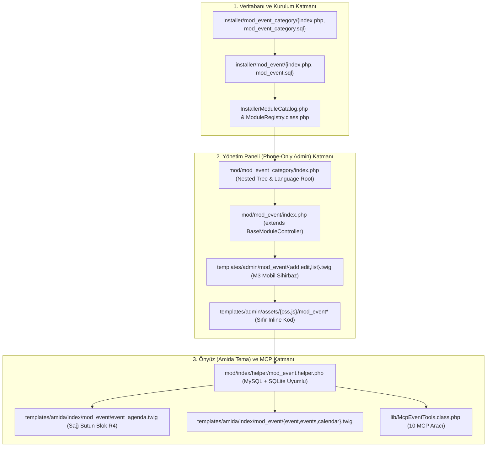
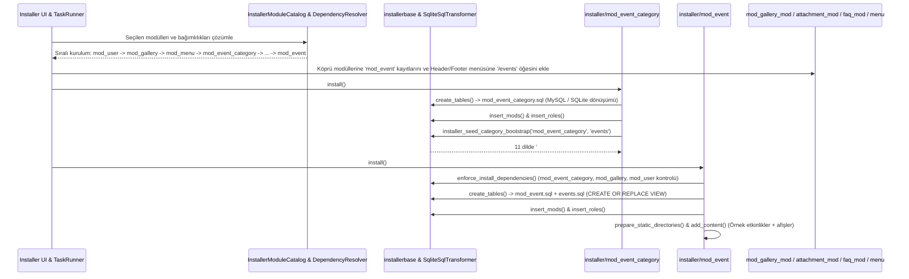
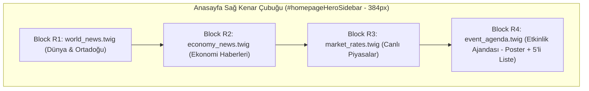

# `mod_etkinlik` -> `mod_event` & `mod_event_category` Modernizasyon ve Entegrasyon Planı

- **Kaynak Modül (Legacy):** `~/Desktop/projects/htdocs/AF/biys/mod/mod_etkinlik` ve `mod_etkinlik_kategori`
- **Hedef Depo:** `AF/Bulletin` (Amed Framework & Bulletin CMS)
- **Hedef Modül Adları (İngilizce Standart):** `mod_event` ve `mod_event_category`
- **Anasayfa Bileşeni:** `templates/amida/index/mod_event/event_agenda.twig` (*`docs/plan/homepage-layout-wireframe.html` — Sağ Sütun Blok 3: Etkinlik Ajandası*)
- **Referans Mimari:** `mod_news`, `mod_news_category`, `mod_announcements`, `BaseModuleController`, `DataTableService`, `ImageService`, `McpCrudToolsBase`

---

## 1. Yönetici Özeti ve Amaç

Bu doküman, `AF/biys` projesinde yer alan eski nesil (2015 yapımı, `indexMain` tabanlı) **`mod_etkinlik`** ve **`mod_etkinlik_kategori`** modüllerinin tüm işlevsel yeteneklerinin korunarak **Amed Framework** ve **Bulletin CMS** mimari standartlarına göre uçtan uca yeniden yapılandırılması (`mod_event` ve `mod_event_category`) ve `AF/Bulletin` ekosistemine entegre edilmesi planını tanımlar.

Bu dönüşüm kapsamında:
1. **Tam İngilizce Kod ve Rota Standardı (`AGENTS.md` Kural 7 & `i18n_guard.py`):** Tablo adları, sütun adları, PHP sınıf/metot/değişken adları, dosya adları, çeviri anahtarları (`en.php` temel alınarak) ve URL rotaları (`/events`, `/event/{seo}`, `/event-calendar`) %100 standart İngilizceye dönüştürülecektir.
2. **`BaseModuleController` & Servis Mimarisi:** 721 satırlık spagetti `mod_etkinlik/index.php` kontrolcüsü, `BaseModuleController` miras alınarak ~150 satırlık deklaratif, temiz bir yapıya kavuşturulacak; görsel işleme `ImageService`, listeleme `DataTableService`, doğrulama ise modern `Validator` yapısına devredilecektir.
3. **Yalnızca Telefon Görünümlü (Phone-Only) Yönetim Paneli (`AGENTS.md` Kural 6):** Yönetim arayüzü (`templates/admin/mod_event/` ve `mod_event_category/`), Material 3 mobil sihirbaz (Wizard), karakter sayaçları, sürükle-bırak kırpıcılı görsel yükleyici (`image_uploader.twig`) ve alt aksiyon araç çubuğu ile yalnızca mobil ekranlara özel tasarlanacaktır.
4. **Sıfır Satır İçi Kod Ayrımı (`AGENTS.md` Kural 2 & `code_separation_guard.py`):** Eski şablonlardaki tüm satır içi `<script>`, `<style>`, `style="..."` ve `onclick="..."` kullanımları kaldırılarak harici CSS ve JS dosyalarına taşınacaktır.
5. **Anasayfa "Etkinlik Ajandası" Widget'ı (`homepage-layout-wireframe.html` Uyumlu):** Sağ kenar çubuğunda (`#homepageHeroSidebar`, `384px`), Ekonomi & Piyasa bloğunun hemen altında yer alan **Etkinlik Ajandası** bileşeni (`event_agenda.twig`), sol tarafta seçili etkinlik afişi ve sağ tarafta sayfalanabilir 5'li etkinlik listesiyle hayata geçirilecektir.

---

## 2. Mevcut `biys/mod_etkinlik` Modülünün Teknik Analizi

### 2.1 Mevcut Dosya Envanteri (`AF/biys`)

| Katman | Mevcut Dosya Yolu (`AF/biys`) | Satır / Boyut | Mevcut Durum ve Tespit Edilen Sorunlar |
| :--- | :--- | :--- | :--- |
| **SQL Şeması** | `mod/mod_etkinlik/mod_etkinlik.sql` | 17 satır | Türkçe sütun adları (`ad`, `konu`, `tarih`, `etarih`, `yayin` `'e'/'h'`, `katilimcilar`, `davetliler`, `icerik`, `yer`, `resim`), `seo`/`summary`/`deck`/`gallery_id`/`file_id`/`video` alanları eksik, indeks yok. |
| **Kategori SQL** | `mod/mod_etkinlik_kategori/mod_etkinlik_kategori.sql` | 14 satır | Türkçe sütun adları (`ad`, `alt`, `sira`, `aciklama`, `resim`), `root` `'e'/'h'`, `acl_id` ve indeksler eksik. |
| **Admin Kontrolcü** | `mod/mod_etkinlik/index.php` | 721 satır | `indexMain` miras alıyor (`BaseModuleController` değil). Türkçe metotlar (`ekle`, `duzenle`, `listele`, `sil`, `yayinla`, `yayinkaldir`, `resim_remove_image`). `datatable_json()` içinde satır içi `onclick="..."` HTML üretimi var. `Load::mod('resim')` ve `mod_dosya` gibi eski kütüphaneleri çağırıyor. |
| **Kategori Kontrolcü** | `mod/mod_etkinlik_kategori/index.php` | 496 satır | `indexMain` miras alıyor, dil kök kapsayıcıları (`##`) desteği yok, eski `dragdrop_sil` ve `tasi` metotlarını kullanıyor. |
| **ORM Modelleri** | `mod/mod_etkinlik/model/mod_etkinlik.model.php`<br>`mod/mod_etkinlik/model/datatable.model.php` | 22 satır<br>119 satır | Türkçe özellik adları; `datatable.model.php` artık kullanılmayan eski Flexigrid yapısına ait ölü kod. |
| **Doğrulayıcılar** | `mod/mod_etkinlik/validator/ekle.validator.php`<br>`mod/mod_etkinlik/validator/duzenle.validator.php` | 159 satır<br>159 satır | `$this->valid->ekle()` ve Türkçe anahtarlar (`fonk`, `mesaj`, `hatalar`) kullanıyor. |
| **Önyüz Helper** | `mod/index/helper/mod_etkinlik.helper.php` | 376 satır | 1) Ham SQL sorgularında `SELECT DAYOFMONTH(tarih) AS gun` ile yasaklı `AS` alias kullanımı (`i18n_guard.py` `FORBIDDEN_ALIAS`).<br>2) `YEAR()`, `MONTH()`, `DAY()` fonksiyonları nedeniyle **SQLite uyumsuzluğu**.<br>3) `$year` ve `$month` değişkenlerinin doğrudan SQL'e birleştirilmesi.<br>4) `etkinlik2()` gibi test amaçlı unutulmuş (`asdfghjklşi` içeren) ölü metotlar. |
| **Admin Şablonları** | `templates/admin/mod_etkinlik/{ekle,duzenle,listele,script,css}.twig` | 5 dosya | Masaüstü odaklı Bootstrap 3 / Metronic portlet yapısı, satır içi `<script>` blokları, IE yorum satırları (`<!--[if !IE]>`), ham `<input type="file">`. |
| **Önyüz Şablonları** | `templates/default/index/mod_etkinlik/{etkinlik,etkinlikler,etkinliktakvimi,layout}.twig` + `etkinlikList.twig` | 6 dosya | Satır içi `<script>` ve `onmouseover="showEtkinlikResim(...)"` / `onclick="$('#akm_etkinlik').printThis(...)"` kullanımları, sayısal dil anahtarları (`lang.index.mod_etkinlik.22`), jQuery OwlCarousel 1 ve FullCalendar v2 bağımlılığı. |

### 2.2 İşlevsel Yetenekler (Korunacak ve Modernize Edilecek Özellikler)

`mod_etkinlik` modülünün sunduğu ve yeni `mod_event` mimarisinde eksiksiz korunacak alanlar şunlardır:
1. **Etkinlik Kimlik ve Kategori Bilgileri:** Dil (`lang`), Kategori (`category_id`), Etkinlik Adı (`name`), Etkinlik Konusu / Türü (`subject` — örn. *Tiyatro, Konferans, Müzikal, Sinema, Panel*).
2. **Zaman ve Mekân Yönetimi:** Başlangıç Tarihi ve Saati (`start_date`), Bitiş Tarihi ve Saati (`end_date`), Etkinlik Yeri / Mekân (`location`).
3. **Kişi ve Organizasyon Bilgileri:** Katılımcılar / Konuşmacılar / Sanatçılar (`participants`), Davetliler / Onur Konukları (`guests`).
4. **Zengin İçerik ve Medya:** Özet (`summary` + `deck` gösterim durumu), Detaylı Açıklama (`content` HTML), Afiş / Kapak Görseli (`image`), Fotoğraf Galerisi (`gallery_id` / `mod_gallery`), Video & Video Embed (`video` / `mod_video` & `mod_video_embed`), Ek Dosyalar / Program Broşürü (`file_id` / `mod_attachment`).
5. **Erişim ve Yayın Kontrolü:** Yayın durumu (`status`: `'y'` / `'n'`), Anasayfa Manşet Slider (`slider`: `'y'` / `'n'`), Erişim Kontrol Listesi (`acl_id`), Wikipedia tarzı SEO bağlantısı (`seo`) ve meta alanları (`title`, `keywords`, `description`).
6. **Önyüz Görünümleri:**
   - Anasayfa sağ sütun **Etkinlik Ajandası** bileşeni (`event_agenda.twig`).
   - Kategori filtreli ve sayfalamalı **Etkinlikler Listesi** (`/events`, `/events/{category}`).
   - Aylık/Yıllık ve kategori bazlı interaktif **Etkinlik Takvimi** (`/event-calendar`).
   - Zengin bilgi kartlı ve `Schema.org/Event` yapısal verili **Etkinlik Detay Sayfası** (`/event/{seo}`).

---

## 3. Hedef Mimari ve Dönüşüm Eşlemeleri

### 3.1 Modül, Tablo ve Sütun Eşleme Tablosu (`biys` -> `Bulletin`)

#### A. `mod_etkinlik` -> `mod_event` Tablosu

| Eski Sütun (`mod_etkinlik`) | Yeni Sütun (`mod_event`) | Veri Tipi (`MySQL` / `SQLite`) | Açıklama |
| :--- | :--- | :--- | :--- |
| `id` | `id` | `INT(11) AUTO_INCREMENT PRIMARY KEY` | Birincil anahtar |
| `lang` | `lang` | `VARCHAR(11) NOT NULL` | Dil kodu (`tr`, `ku`, `en`, vb.) |
| `kat_id` | `category_id` | `INT(11) NOT NULL DEFAULT 0` | `mod_event_category.id` referansı |
| `ad` | `name` | `VARCHAR(255) NOT NULL` | Etkinlik başlığı (1–70 karakter sihirbaz standardı) |
| `konu` | `subject` | `VARCHAR(255) NOT NULL` | Etkinlik konusu / alt türü (örn. *Konferans, Tiyatro*) |
| `tarih` | `start_date` | `DATETIME NOT NULL` | Etkinlik başlangıç tarihi ve saati |
| `etarih` | `end_date` | `DATETIME DEFAULT NULL` | Etkinlik bitiş tarihi ve saati (opsiyonel) |
| `yayin` (`'e','h'`) | `status` (`'y','n'`) | `ENUM('y','n') NOT NULL DEFAULT 'y'` | Yayın durumu (`y`: Yayında, `n`: Taslak) |
| *(Yok)* | `slider` (`'y','n'`) | `ENUM('y','n') NOT NULL DEFAULT 'n'` | Manşet slider gösterimi |
| *(Yok)* | `deck` (`'y','n'`) | `ENUM('y','n') NOT NULL DEFAULT 'n'` | Özet (spot) metni detay sayfasında gösterilsin mi? |
| *(Yok)* | `summary` | `TEXT DEFAULT NULL` | Kısa özet ve meta açıklaması (90–160 karakter) |
| `icerik` | `content` | `TEXT NOT NULL` | Etkinlik detaylı HTML açıklaması |
| `yer` | `location` | `TEXT DEFAULT NULL` | Etkinlik yeri / salon / adres bilgisi |
| `katilimcilar` | `participants` | `TEXT DEFAULT NULL` | Katılımcılar / konuşmacılar |
| `davetliler` | `guests` | `TEXT DEFAULT NULL` | Davetliler |
| *(Yok)* | `seo` | `VARCHAR(255) NOT NULL` | Wikipedia stili SEO URL (`legacy_seo` / alt çizgili) |
| *(Yok)* | `title` | `VARCHAR(255) NOT NULL` | SEO Sayfa Başlığı |
| *(Yok)* | `keywords` | `VARCHAR(255) NOT NULL` | SEO Anahtar Kelimeler |
| *(Yok)* | `description` | `VARCHAR(255) NOT NULL` | SEO Meta Açıklama |
| `resim` | `image` | `VARCHAR(255) DEFAULT NULL` | Etkinlik afiş / kapak görseli dosya adı |
| *(Yok)* | `gallery_id` | `INT(11) NOT NULL DEFAULT 0` | İlişkili galeri ID (`mod_gallery`) |
| *(Yok)* | `file_id` | `INT(11) NOT NULL DEFAULT 0` | İlişkili dosya eki ID (`mod_attachment`) |
| *(Yok)* | `video` | `TEXT DEFAULT NULL` | Serileştirilmiş video referansları (`video:ID`, `vid:ID`) |
| `acl_id` | `acl_id` | `INT(11) NOT NULL DEFAULT 0` | Erişim kontrol grubu (`0` = Herkese açık) |
| *(Yok)* | `view_count` | `INT(11) NOT NULL DEFAULT 0` | Görüntülenme sayacı |
| *(Yok)* | `created_at` | `TIMESTAMP NOT NULL DEFAULT CURRENT_TIMESTAMP` | Kayıt oluşturulma zamanı |
| *(Yok)* | `updated_at` | `DATETIME DEFAULT NULL` | Son güncellenme zamanı |
| `user_id` | `user_id` | `INT(11) NOT NULL` | Oluşturan yönetici ID |

#### B. `mod_etkinlik_kategori` -> `mod_event_category` Tablosu

| Eski Sütun (`mod_etkinlik_kategori`) | Yeni Sütun (`mod_event_category`) | Veri Tipi | Açıklama |
| :--- | :--- | :--- | :--- |
| `id` | `id` | `INT(11) AUTO_INCREMENT PRIMARY KEY` | Birincil anahtar |
| `lang` | `lang` | `VARCHAR(11) NOT NULL` | Dil kodu |
| `ad` | `name` | `VARCHAR(255) NOT NULL` | Kategori adı (`##` dil kök kapsayıcılarını destekler) |
| `alt` | `parent_id` | `INT(11) NOT NULL DEFAULT 0` | Üst kategori ID |
| `sira` | `order` | `INT(11) NOT NULL DEFAULT 0` | Sıralama indeksi |
| `root` (`'e','h'`) | `root` (`'y','n'`) | `ENUM('y','n') NOT NULL DEFAULT 'n'` | Kök kapsayıcı mı? (`y`/`n`) |
| `seo` | `seo` | `VARCHAR(255) NOT NULL` | Wikipedia stili kategori SEO bağlantısı |
| `title` | `title` | `VARCHAR(255) NOT NULL` | SEO Başlığı |
| `keywords` | `keywords` | `VARCHAR(255) NOT NULL` | SEO Anahtar Kelimeler |
| `aciklama` | `description` | `VARCHAR(255) NOT NULL` | SEO Açıklaması |
| `resim` | `image` | `VARCHAR(255) DEFAULT NULL` | Kategori görseli |
| `menu` | `menu` | `INT(11) NOT NULL DEFAULT 0` | Menü entegrasyonu ID |
| *(Yok)* | `show_on_homepage` | `ENUM('y','n') NOT NULL DEFAULT 'n'` | Anasayfada gösterim durumu |
| *(Yok)* | `acl_id` | `INT(11) NOT NULL DEFAULT 0` | Erişim kontrol grubu |
| `user_id` | `user_id` | `INT(11) NOT NULL` | Oluşturan kullanıcı ID |

#### C. `events` SQL Görünümü (View) ve `events.model.php`

`mod_publication` (`publications.sql` / `publications.model.php`) ve `mod_news` (`newses.sql` / `newses.model.php`) mimarisiyle tam uyumlu olacak şekilde; kategori, yazar, grup ve galeri görsel sayısını tek sorguda birleştiren **`events` SQL View** (`installer/mod_event/events.sql` ve `mod/mod_event/events.sql`) ile ORM modeli (`mod/mod_event/model/events.model.php`) oluşturulacaktır:

```sql
CREATE VIEW `events` AS
SELECT
    `mod_event`.`id` AS `id`,
    `mod_event`.`lang` AS `lang`,
    `mod_event`.`category_id` AS `category_id`,
    `mod_event`.`name` AS `name`,
    `mod_event`.`subject` AS `subject`,
    `mod_event`.`start_date` AS `start_date`,
    `mod_event`.`end_date` AS `end_date`,
    `mod_event`.`status` AS `status`,
    `mod_event`.`slider` AS `slider`,
    `mod_event`.`deck` AS `deck`,
    `mod_event`.`summary` AS `summary`,
    `mod_event`.`content` AS `content`,
    `mod_event`.`location` AS `location`,
    `mod_event`.`participants` AS `participants`,
    `mod_event`.`guests` AS `guests`,
    `mod_event`.`seo` AS `seo`,
    `mod_event`.`title` AS `title`,
    `mod_event`.`keywords` AS `keywords`,
    `mod_event`.`description` AS `description`,
    `mod_event`.`image` AS `image`,
    `mod_event`.`gallery_id` AS `gallery_id`,
    `mod_event`.`file_id` AS `file_id`,
    `mod_event`.`video` AS `video`,
    `mod_event`.`acl_id` AS `acl_id`,
    `mod_event`.`view_count` AS `view_count`,
    `mod_event`.`created_at` AS `created_at`,
    `mod_event`.`updated_at` AS `updated_at`,
    `mod_event`.`user_id` AS `user_id`,
    `mod_event_category`.`name` AS `category_name`,
    `mod_event_category`.`seo` AS `category_seo`,
    `mod_event_category`.`image` AS `category_image`,
    `mod_user`.`username` AS `username`,
    `mod_user`.`name` AS `u_name`,
    `mod_user`.`last_name` AS `u_last_name`,
    `mod_user`.`email` AS `email`,
    `mod_user_group`.`group_id` AS `group_id`,
    `mod_user_group`.`group_name` AS `group_name`,
    (SELECT COUNT(1) FROM `mod_gallery` `g` WHERE `g`.`mod_name` = 'mod_event' AND `g`.`vid` = `mod_event`.`id`) AS `gallery_count`
FROM `mod_event`
LEFT JOIN `mod_event_category` ON `mod_event_category`.`id` = `mod_event`.`category_id`
LEFT JOIN `mod_user` ON `mod_user`.`id` = `mod_event`.`user_id`
LEFT JOIN `mod_user_group` ON `mod_user`.`group_id` = `mod_user_group`.`group_id`;
```

---

### 3.2 URL Rotaları ve Endpoint Tasarımı (`config/url.config.php`)

Global kurallara (`RULE[user_global]` ve `AGENTS.md` Kural 7 & 10) uygun olarak tüm URL rotaları saf İngilizce olacak, eski Türkçe bağlantılar (`/etkinlik/...`, `/etkinlikler/...`) için ise geriye dönük 301 yönlendirme (legacy redirect) tanımlanacaktır:

```php
// Events and Event Category
$url['event/detail/(:any)'] = 'index/event/$1';
$url['event/(:any)'] = 'index/event/$1';
$url['events'] = 'index/events';
$url['events/'] = 'index/events';
$url['events/(:num)'] = 'index/events/all/$1';
$url['events/(:any)'] = 'index/events/$1';
$url['events/(:any)/(:num)'] = 'index/events/$1/$2';
$url['event-calendar'] = 'index/event_calendar';
$url['event-calendar/'] = 'index/event_calendar';
$url['event-calendar/(:any)'] = 'index/event_calendar/$1';
$url['events-calendar/json'] = 'index/event_calendar_json';
$url['eventSitemap.xml'] = 'index/eventSitemap';
```

- **Wikipedia Stili SEO URL (`AGENTS.md` Kural 10):** Etkinlik ve kategori kayıtlarında `seo` alanı oluşturulurken orijinal alfabe ve büyük/küçük harf korunacak, boşluklar alt çizgi (`_`) ile değiştirilecektir (örn. `/event/Amed_Kitap_Fuarı_2026`, `/events/Kültür_ve_Sanat`). Hem `seo` hem de `id` ile erişim desteklenecektir.

---

## 4. Katman Bazlı Uygulama Planı



### 4.1 Kurulum (`@installer`) Mimarisi, Bağımlılık Çözümleyici, SQLite Dönüştürücü ve Başlangıç Verileri

Kurulum sihirbazı (`installer/`) hem **MySQL (`PDO_MYSQL`)** hem de **SQLite (`PDO_SQLITE`)** motorlarında, temiz kurulum (*clean install*) ve başlangıç içerikli kurulum (*sample content enabled*) senaryolarında sıfır hata ile çalışacak şekilde uçtan uca tasarlanmıştır:



#### A. `installer/installerbase.php` Güncellemeleri

1. **Başlangıç Kategori Etiketleri (`installer_category_starter_labels()` — Satır 907):**
   - `installer_seed_category_bootstrap('mod_event_category', 'events')` çağrısının tüm dillerde (`InstallerLang::availableLanguages()`) hatasız çalışabilmesi için `installer_category_starter_labels()` dizisine `'events'` anahtarı **11 dilde** eklenecektir:
     ```php
     'events' => array(
         'ar' => 'الفعاليات',
         'de' => 'Veranstaltungen',
         'en' => 'Events',
         'fa' => 'رویدادها',
         'fr' => 'Événements',
         'ku' => 'Çalakî',
         'ckb' => 'چالاکییەکان',
         'sv' => 'Evenemang',
         'tr' => 'Etkinlikler',
         'zza' => 'Çalakî',
         'ru' => 'Мероприятия',
     ),
     ```
   - Bu anahtar sayesinde kurulum sırasında önce 11 dil için `##Türkçe_Kategoriler`, `##Kurmancî_Kategorî`, `##English_Categories` vb. kök kapsayıcılar (`root = 'y'`, `parent_id = 0`), ardından kullanıcı *"Başlangıç içeriğini yükle"* (`sample_content === 'yes'`) seçeneğini işaretlemişse her kökün altına o dilin başlangıç etkinlik kategorisi (`root = 'n'`, `parent_id = $rootId`) otomatik oluşturulur.
2. **MySQL ve SQLite Görünüm (View) Silme Güvenliği (`drop_table($table)` — Satır 778):**
   - `installerbase::drop_table($table)` metodu SQLite'ta `sqlite_master` üzerinden `type === 'view'` kontrolü yapmaktadır. MySQL'de de `events` gibi SQL görünümlerinin `uninstall()` sırasında hatasız kaldırılması için `SHOW FULL TABLES LIKE '$table'` sorgusunda `Table_type === 'VIEW'` ise `DROP VIEW IF EXISTS` çalıştıracak şekilde güncellenecektir.

#### B. `installer/app/InstallerModuleCatalog.php` ve `lib/ModuleRegistry.class.php` Sözleşmesi

1. **`installer/app/InstallerModuleCatalog.php`:**
   - `$modules` dizisine eklenecek tanımlar:
     ```php
     'mod_event_category' => array(
         'group' => 'project_specific',
         'required' => false,
         'default_selected' => true,
         'project_specific' => true,
         'dependencies' => array(),
         'supports_sample_content' => true,
         'sample_content_mode' => 'module_bootstrap_optional'
     ),
     'mod_event' => array(
         'group' => 'project_specific',
         'required' => false,
         'default_selected' => true,
         'project_specific' => true,
         'dependencies' => array('mod_event_category', 'mod_gallery', 'mod_user'),
         'supports_sample_content' => true,
         'sample_content_mode' => 'module_bootstrap_optional'
     ),
     ```
   - `$installOrder` dizisi sıralaması:
     - `mod_event_category`: `mod_publication_category` hemen sonrasına yerleştirilir.
     - `mod_event`: `mod_publication` hemen sonrasına (tüm kategori, kullanıcı ve medya modüllerinden sonra) yerleştirilir.
   - `sample_content_mode => 'module_bootstrap_optional'` olarak ayarlandığında `InstallerTaskRunner::buildSampleModuleResult()` kurulum sonunda her iki modül için de `state => 'completed'` (*"Sample-content starter records were enabled for this module"*) durumunu raporlar.
2. **`lib/ModuleRegistry.class.php`:**
   - **`$featureMap`:**
     - `'event.front' => ['modules' => ['mod_event', 'mod_event_category'], 'tables' => ['mod_event', 'mod_event_category']]`
     - `'event.latest' => ['modules' => ['mod_event'], 'tables' => ['mod_event']]`
     - `'event.calendar' => ['modules' => ['mod_event', 'mod_event_category'], 'tables' => ['mod_event', 'mod_event_category']]`
   - **`$installDependencies` (`enforce_install_dependencies()` için):**
     - `'mod_event' => ['modules' => ['mod_event_category', 'mod_gallery', 'mod_user'], 'tables' => ['mod_event_category', 'mod_gallery', 'mod_user']]`
   - **`$uninstallDependents` (`block_if_dependents_installed()` için):**
     - `'mod_event_category' => ['mod_event']` (`mod_event` kaldırılmadan `mod_event_category` modülünün kaldırılmasını engeller).

#### C. `installer/mod_event_category/` (`index.php` ve `mod_event_category.sql`)

1. **`installer/mod_event_category/mod_event_category.sql` (ve `mod/mod_event_category/mod_event_category.sql`):**
   - `SqliteSqlTransformer::extractInlineIndexes()` ile tam uyumlu olması için tüm indeksler ayrı satırlarda (`KEY \`idx_lang_parent\` (\`lang\`, \`parent_id\`)`, `KEY \`idx_root\` (\`root\`)`, `KEY \`idx_seo\` (\`seo\`)`) tanımlanacaktır.
2. **`installer/mod_event_category/index.php`:**
   - `$this->mod = 'mod_event_category';`
   - `$this->tables = array('mod_event_category');`
   - `$this->roles = array('add', 'edit', 'delete', 'list', 'moderate_edit', 'moderate_delete');`
   - `install()` akışı:
     1. `$this->create_tables()` -> `mod_event_category.sql` tablosunu oluşturur.
     2. `$this->insert_mods()` -> `mods` tablosuna `status = 'ready'`, `schema_ready = 'y'` olarak kaydeder.
     3. `$this->insert_roles()` -> Rolleri `mod_user_role` tablosuna ve Grup 1 yetkilerini `mod_user_perm` tablosuna işler.
     4. `$this->installer_seed_category_bootstrap('mod_event_category', 'events')` -> 11 dilde kök kategorileri ve (örnek içerik seçiliyse) başlangıç etkinlik kategorilerini oluşturur.
   - `uninstall()` akışı:
     - `$this->remove_tables()` (`mod_event` kuruluysa bağımlılık kilidi devreye girer), `$this->remove_mods()`, `$this->delete_roles()`, `$this->remove_perm()`.

#### D. `installer/mod_event/` (`index.php`, `mod_event.sql` ve `events.sql`)

1. **`installer/mod_event/mod_event.sql` ve `installer/mod_event/events.sql`:**
   - `mod_event.sql`: `id`, `lang`, `category_id`, `name`, `subject`, `start_date`, `end_date`, `status`, `slider`, `deck`, `summary`, `content`, `location`, `participants`, `guests`, `seo`, `title`, `keywords`, `description`, `image`, `gallery_id`, `file_id`, `video`, `acl_id`, `view_count`, `created_at`, `updated_at`, `user_id` sütunlarını ve performans indekslerini (`idx_lang_status`, `idx_start_date`, `idx_category_id`, `idx_seo`, `idx_slider`) içerir.
   - `events.sql`: `CREATE OR REPLACE VIEW \`events\` AS SELECT ...` ifadesiyle başlar. `SqliteSqlTransformer::transformViews()` bu ifadeyi SQLite üzerinde otomatik olarak `DROP VIEW IF EXISTS \`events\`; CREATE VIEW \`events\` AS SELECT ...` biçimine dönüştürür.
2. **`installer/mod_event/index.php`:**
   - `$this->mod = 'mod_event';`
   - `$this->tables = array('mod_event', 'events');` (`installerbase::create_tables()` dizideki her eleman için `<isim>.sql` dosyasını çalıştırdığından hem tablo hem görünüm bu dizide yer alır).
   - `$this->roles = array('add', 'edit', 'delete', 'list', 'gallery', 'file', 'faq', 'video', 'edit_status', 'change_status', 'approval', 'moderate_edit', 'moderate_delete', 'video_download');`
   - `install()` akışı:
     1. `$this->create_tables()` (`mod_event.sql` ve `events.sql` kurulumu).
     2. `$this->insert_mods()` ve `$this->insert_roles()`.
     3. `$this->prepare_static_directories()`: `static/mod_event/`, `static/mod_event/thumb/`, `static/mod_event/original/`, `static/mod_gallery/mod_event/original/` ve `static/mod_gallery/mod_event/thumb/` dizinlerini oluşturur.
     4. `$this->add_content()`: `$this->installer_sample_content_enabled()` aktif olduğunda:
        - `installer_resolve_category_starter_label('events', $lang)` ile `mod_event_category` tablosundan ilgili dilin kategori `id` değerini dinamik bulur (`mod_publication/index.php` satır 667–680 ile aynı güvenli yöntem).
        - `installer_replace_build_name($data)` ile `{{build_name}}` yer tutucularını proje adıyla değiştirir.
        - `tr`, `ku`, `en`, `ckb` dillerinde örnek kültür-sanat/konferans etkinliklerini (gelecek tarihli `start_date` ve `end_date`, `subject`, `location`, `participants`, `guests`, `summary`, `content`, `image`, `status = 'y'`, `deck = 'y'`) veritabanına ekler. Böylece kurulum biter bitmez anasayfadaki **Etkinlik Ajandası** (`event_agenda.twig`) ve `/event-calendar` dolu ve çalışır halde açılır.
   - `uninstall()` akışı:
     1. `$this->db->query("DROP VIEW IF EXISTS \`events\`");`
     2. `$this->remove_tables();`
     3. `if ($this->uninstall_blocked === TRUE) { return FALSE; }`
     4. `if (class_exists('BridgeCleanupService')) { BridgeCleanupService::cleanModule('mod_event'); }`
     5. `$this->remove_mods(); $this->delete_roles(); $this->remove_perm();`

#### E. Köprü Modüller, Menü Tohumlama (`mod_menu`) ve Kurulum Dil Dosyaları (`installer/lang/`)

1. **Köprü Modül Kurucuları:**
   - `installer/mod_gallery_mod/index.php` (`add_gallery_mods()`): `['name' => 'Event Galleries', 'mod_name' => 'mod_event', 'mod_key' => 'id', 'mod_value' => 'name', 'user_id' => 1]` kaydı eklenecektir.
   - `installer/mod_attachment_mod/index.php` (`add_file_modules()`): `['name' => 'Event Files', 'mod_name' => 'mod_event', 'mod_key' => 'id', 'mod_value' => 'name', 'user_id' => 1]` kaydı eklenecektir.
   - `installer/mod_faq_mod/index.php` (`add_faq_mods()`): `['name' => 'Event FAQs', 'mod_name' => 'mod_event', 'mod_key' => 'id', 'mod_value' => 'name', 'user_id' => 1]` kaydı eklenecektir.
2. **Üst ve Alt Menü Tohumlama (`installer/mod_menu/index.php`):**
   - `add_default_slot_roots()` içindeki `$sampleItems` dizisine `'url_suffix' => 'events'` öğesi (11 dildeki karşılıklarıyla: `tr => 'Etkinlikler'`, `ku => 'Çalakî'`, `en => 'Events'`, `ckb => 'چالاکییەکان'`, `zza => 'Çalakî'`, `ar => 'الفعاليات'`, `de => 'Veranstaltungen'`, `fa => 'رویدادها'`, `fr => 'Événements'`, `sv => 'Evenemang'`, `ru => 'Мероприятия'`) eklenecektir. Böylece örnek içerikle kurulum yapıldığında `##Header_Menu` ve `##Footer_Menu` içinde `/{lang}/events` bağlantısı otomatik yer alır.
3. **Kurulum Sihirbazı Dil Paketleri (`installer/lang/`):**
   - Mevcut `installer/lang/{ar,ckb,de,en,fa,fr,ku,sv,tr,zza}.php` dosyalarının tamamına (ve `InstallerLang::availableLanguages()` içinde tanımlı olan `ru` dili için `installer/lang/ru.php` dosyasına) `$installerLang['installer_mobile']['module_labels']` altına `'mod_event_category'` ve `'mod_event'` etiketleri eklenecektir.
4. **SQLite Tohum Veritabanı (`data/sqlite/bulletin.sql`):**
   - Hızlı SQLite kurulumları ve test ortamları için `data/sqlite/bulletin.sql` şemasına `mod_event_category`, `mod_event` tabloları ve `events` görünümü eklenecektir.

---

### 4.2 Backend: `mod_event`, `mod_event_category` ve Yönetim Entegrasyonları

#### A. `mod/mod_event/index.php` (`extends BaseModuleController`)

- **Özellik Tanımları:**
  - `protected $has_gallery = true;`
  - `protected $has_files = true;`
  - `protected $has_faq = true;`
  - `protected $need_simple_data = ['lang' => 'lang_lang', 'mod_acl' => 'mod_acl_acl_id'];`
  - `protected $need_nested_data = ['mod_event_category' => 'select_nested_category_id_result', 'mod_menu' => 'select_nested_menu_result'];`
  - `protected $menu_url_pattern = '{lang}/event/{seo}';`
- **Görsel Boyutlandırma (`$image_fields`):**
  - Etkinlik afişleri ve anasayfa ajanda posteri için hem afiş/kapak (`/` -> `800x1066` veya `1280x720` cover) hem de küçük görsel (`/thumb` -> `400x533` / `480x270`) ve `/original` yapılandırması `ImageService` üzerinden merkezi olarak işlenecektir.
- **Özel Alanlar (`$special_fields`):**
  - `'deck' => ['type' => 'safe']`, `'summary' => ['type' => 'html']`, `'content' => ['type' => 'html']`.
- **Yaşam Döngüsü Geri Çağrımları (`Callbacks`):**
  - `beforeSave($model)` ve `beforeUpdate($model, $id)`:
    - `start_date` ve `end_date` alanlarını `normalizeDateTime()` ile standart `YYYY-MM-DD HH:MM:SS` biçimine dönüştürür.
    - `seo` alanı boşsa `name` üzerinden Wikipedia stili (`legacy_seo`) benzersiz slug üretir.
    - `video` alanını `$this->serializeVideos(Req::Post_Safe('video'))` ile serileştirir.
- **DataTable ve Mobil Kart Listesi (`datatable_json` & `getDatatableColumns`):**
  - Eski kontrolcüdeki satır içi `onclick` butonları tamamen kaldırılarak `mod_news` ve `mod_announcements` ile aynı JSON yanıt şeması (`id`, `name`, `subject`, `start_date`, `end_date`, `location`, `image`, `lang`, `status`, `slider`, `deck`, `category_id`) döndürülecektir.

#### B. `mod/mod_event_category/index.php`

- `mod_news_category_mod` mimarisi birebir uygulanacaktır:
  - Her aktif dil için `##` önekli kök dil kapsayıcıları (`isLanguageRootRow`) otomatik oluşturulur.
  - Sürükle-bırak sıralama (`move` / `_change_order`), kategori silme (`dragdrop_delete`), menüye otomatik bağlama ve anasayfada gösterim (`show_on_homepage`) işlemleri İngilizce metot ve değişken adlarıyla yürütülür.

#### C. Doğrulayıcılar (`mod/mod_event/validator/{add,edit}.validator.php`)

- Zorunlu alanlar: `lang`, `category_id`, `name` (1–70 karakter), `subject` (2–255 karakter), `start_date`, `summary` (90–160 karakter), `content`.
- Tarih tutarlılığı kontrolü: `end_date` girilmişse `end_date >= start_date` doğrulaması yapılır.
- Enum kontrolü: `status` (`['y', 'n']`), `deck` (`['y', 'n']`), `slider` (`['y', 'n']`).

#### D. Yönetim Paneli Çekirdek Entegrasyonu (`mod/management/index.php` & `mod/mod_user/index.php`)

- **`mod/management/index.php`:**
  - `$toggleableModules` dizisine `'mod_event'` eklenecektir (kontrol panelinden modül durumunu açıp kapatma ve `module_repair` desteği için).
  - `$sharedModules` içine `'mod_event' => $this->isFeatureReady('event.front')` ve `$sharedModuleHealth` içine `'mod_event'` ile `'mod_event_category'` sağlık kontrolleri eklenecektir.
- **`mod/mod_user/index.php` ve `templates/admin/mod_user/panel.twig`:**
  - Yönetim paneli anasayfasındaki hızlı erişim ve modül sağlık kartlarına `mod_event` ve `mod_event_category` istatistikleri bağlanacaktır.

---

### 4.3 Telefon Görünümlü (Phone-Only) Yönetim Paneli Tasarımı (`templates/admin/`)

`AGENTS.md` Kural 6 ve `admin-mobile-check` uyarınca yönetim şablonları yalnızca mobil telefon görünümü için tasarlanacaktır:

1. **`templates/admin/partials/sidebar.twig` ve `templates/admin/partials/fab.twig`:**
   - `sidebar.twig`: `content_active` koşuluna `or mod == 'mod_event' or mod == 'mod_event_category'` eklenecek; İçerik & Sayfa grubuna `mod_event/list` (*Etkinlik Yönetimi*) ve `mod_event_category/list` (*Etkinlik Kategorileri*) bağlantıları (`session.permissions.mod_event.list` ve `session.permissions.mod_event_category.list` yetki kontrolleriyle) yerleştirilecektir.
   - `fab.twig`: Hızlı ekleme (Speed-Dial FAB) menüsüne `` kontrolüyle `{{ site.saddress }}mod_event/add` (`fab-row-event`, `lang.mod_user.fab.add_event`) butonu eklenecektir.
2. **`templates/admin/mod_event/list.twig`:**
   - Üstte 3'lü durum istatistik kartları (`Toplam Etkinlik`, `Yayında`, `Taslak`) ve yaklaşan/geçmiş etkinlik filtresi.
   - Mobil kart listesi (`#events-list-container`), aşağı çekerek yenileme (`#ptr-spinner`), sonsuz kaydırma (`#infinite-loader`) ve boş durum ekranı (`#empty-state`).
   - Sabit alt araç çubuğu (`#eventsToolbar`): Galeri (`open-gallery`), Dosyalar (`open-files`), SSS (`open-faq`), Video (`open-video`), Düzenle (`edit-event`), Sil (`delete-event`) ve sağ alt `+` FAB butonu (`#mainFab`).
3. **`templates/admin/mod_event/add.twig` & `edit.twig` (Material 3 Mobil Sihirbaz):**
   - `templates/admin/mod_announcements/add.twig` mimarisi örnek alınarak sıfır satır içi `<script>` ve sıfır `style="..."` ile bağımsız sihirbaz kabuğu (`#eventWizardShell`) olarak kurgulanacaktır:
   - **Adım 1:** Dil ve Kategori Seçimi (Seçilen dile göre dinamik filtrelenen `.wizard-selection-card` listesi).
   - **Adım 2:** Etkinlik Adı (`name`, canlı sayaç `0 / 70`) ve Etkinlik Konusu / Türü (`subject`, örn. *Tiyatro, Konferans, Konser, Sinema*).
   - **Adım 3:** Tarih, Saat ve Mekân (`start_date`, opsiyonel `end_date` ve `location` alanı).
   - **Adım 4:** Katılımcılar ve Davetliler (`participants` ve `guests` kayan etiketli textarea alanları).
   - **Adım 5:** Kısa Özet / Spot (`summary` 90–160 karakter canlı sayaçlı + `deck` gösterim kartı).
   - **Adım 6:** Etkinlik Detay İçeriği (`content` zengin metin editörü).
   - **Adım 7:** Etkinlik Afişi (`admin/partials/image_uploader.twig` + Cropper.js entegrasyonu).
   - **Adım 8:** Medya & Erişim (Video seçici, Menü bağlantısı, ACL erişim grubu `.selection-card`).
   - **Adım 9:** Özet Kontrolü ve Yayın Durumu (`status` & `slider` seçim kartları).
4. **Harici Varlıklar (Sıfır Inline CSS/JS):**
   - `templates/admin/assets/css/mod_event.css`
   - `templates/admin/assets/css/mod_event_wizard.css`
   - `templates/admin/assets/css/mod_event_category.css`
   - `templates/admin/assets/js/mod_event.js`
   - `templates/admin/assets/js/mod_event_wizard.js`
   - `templates/admin/assets/js/mod_event_category.js`

---

### 4.4 Önyüz (Public) Mimarisi, Anasayfa, Arama, Slider ve SEO/LLMS Entegrasyonu

#### A. `mod/index/helper/mod_event.helper.php` (MySQL & SQLite Çift Motor Uyumu)

Eski `mod_etkinlik.helper.php` içindeki tüm SQL hataları ve güvenlik açıkları giderilerek yeniden yazılacaktır:
- **Sıfır `AS` Alias Kuralı (`i18n_guard.py`):** `SELECT DAYOFMONTH(tarih) AS gun` yerine standart sütunlar (`id, name, subject, start_date, end_date, location, image, seo, summary`) çekilecek ve gün/ay gruplaması PHP katmanında (`(int) date('j', strtotime($row['start_date']))`) yapılacaktır. Böylece hem `FORBIDDEN_ALIAS` kuralı ihlal edilmez hem de SQLite/MySQL farkı ortadan kalkar.
- **SQLite / MySQL Tarih Filtrelemesi:**
  - `$isSqlite = ($db->getAdapterType() && strpos($db->getAdapterType(), 'PDO_SQLITE') !== false);`
  - SQLite için `strftime('%Y', start_date) = ? AND CAST(strftime('%m', start_date) AS INTEGER) = ?`
  - MySQL için `YEAR(start_date) = ? AND MONTH(start_date) = ?`
- **Helper Metotları:**
  - `_event_categories()`: Aktif dildeki kök olmayan (`root != 'y'`) kategorileri sıralı döndürür.
  - `_event_agenda($limit = 10)`: Anasayfa **Etkinlik Ajandası** bileşeni için yaklaşan (veya en güncel) yayındaki etkinlikleri afiş doğrulaması (`_verify_image_asset`) ile birlikte döndürür ve `ctx_set('event_agenda', ...)` olarak kaydeder.
  - `event($seoOrId)`: Tekil etkinlik detayını (`seo` veya `id` ile), kategori bilgisini, ACL yetki kontrolünü, galeri görsellerini (`_exact_gallery` / `_fetch_gallery_images`), ek dosyaları (`_mod_attachment`) ve videoları (`_mod_video`) yükler.
  - `events($category = null, $page = 1)`: Kategori filtreli ve sayfalamalı (`Pager`) etkinlik listesini hazırlar.
  - `event_calendar($category = null)` ve `event_calendar_json()`: Takvim görünümü ve JSON beslemesini sağlar.

#### B. Anasayfa Sağ Sütun Bileşeni: `templates/amida/index/mod_event/event_agenda.twig`

`docs/plan/homepage-layout-wireframe.html` dosyasındaki **BLOCK 3: ETKİNLİK AJANDASI (BELOW EKONOMİ)** tasarımına birebir sadık kalınarak `templates/amida/index/index.twig` içinde `#homepageHeroSidebar` (`384px`) sütununa, `market_rates.twig` bileşeninin hemen altına (**Block R4**) yerleştirilecektir:



- **Bileşen Yapısı (`event_agenda.twig`):**
  - **Üst Başlık (`.section-head`):** Sol tarafta `lang.index.mod_event.agenda_title` (*Etkinlik Ajandası*), sağ tarafta `.agenda-controls` (Tüm Etkinlikler bağlantı ikonu `/events`, Önceki sayfa `<`, Sonraki sayfa `>`).
  - **Gövde (`.agenda-body` — `148px` + `1fr` İki Sütunlu Grid):**
    - **Sol Sütun (`.agenda-poster` — `148px`):** Seçili veya üzerine gelinen (hover/focus) etkinliğin afiş görselini (``), başlığını ve tarih rozetini gösterir.
    - **Sağ Sütun (`.agenda-list`):** Her sayfada 5 etkinlik maddesi (`.agenda-item`) listelenir. Her maddede `&raquo; Etkinlik Başlığı` (`.agenda-item-title`) ve altında `Konu / GG.AA.YYYY SS:DD` (`.agenda-item-meta`) yer alır.
  - **Alt Sayfalama Noktaları (`.agenda-dots`):** 5'li gruplar arasında geçiş sağlayan aktif nokta göstergeleri.
  - **Harici CSS & JS:** Satır içi `onmouseover` veya `<script>` kullanılmadan, `templates/amida/static/css/event-agenda.css` ve `templates/amida/static/js/event-agenda.js` (`data-event-id`, `data-poster-src` nitelikleriyle) üzerinden çalıştırılır.

#### C. Önyüz Sayfa Şablonları (`templates/amida/index/mod_event/`)

1. **`event.twig` (Etkinlik Detay Sayfası):**
   - Breadcrumb (`Anasayfa > Etkinlikler > Kategori > Etkinlik Adı`).
   - Paylaşım ve yazdırma araç çubuğu (`partials/share_toolbar.twig`) ve `tools/saveText`, `tools/saveHtml`, `tools/saveAll` bağlantıları.
   - **Etkinlik Bilgi Kartı (Event Meta Card):** Konu (`subject`), Başlangıç Tarihi (`start_date`), Bitiş Tarihi (`end_date`), Yer/Mekân (`location`), Katılımcılar (`participants`) ve Davetliler (`guests`) bilgilerini modern ikonlu bilgi ızgarasında gösterir.
   - Afiş görseli, spot (`summary`) ve zengin HTML açıklama (`content|raw`).
   - Varsa fotoğraf galerisi (`mod_gallery`), video oynatıcı (`mod_video` / `mod_video_embed`), sıkça sorulan sorular (`mod_faq`) ve indirilebilir ek dosyalar (`mod_attachment`).
   - Google Etkinlik Zengin Sonuçları için `application/ld+json` (`@type: "Event"`, `name`, `startDate`, `endDate`, `location`, `image`, `description`, `performer`) yapısal verisi.
2. **`events.twig` (Etkinlik Listesi ve Kategori Arşivi):**
   - Sol/üst kategori filtre sekmesi (`_event_categories`), afişli etkinlik kartları ızgarası (tarih rozeti, konu etiketi, mekân bilgisi, başlık) ve sayfalama (`pagination`).
3. **`calendar.twig` (İnteraktif Etkinlik Takvimi):**
   - Kategori, yıl ve ay seçici filtre çubuğu + aylık takvim ızgarası ve seçilen güne ait etkinliklerin anlık listesi (`templates/amida/static/js/event-calendar.js` ve `templates/amida/static/css/events.css`).

#### D. Manşet Slider, Genel Arama, Sitemap ve AI (`llms.txt`) Entegrasyonları

1. **Manşet Slider Entegrasyonu (`mod/index/helper/mod_hero_slider.helper.php`):**
   - `hero_slider()` metoduna `$this->loadEventItems($limit)` eklenecektir (`isFeatureReady('event.front')` ve `hasSliderColumn('mod_event')` kontrolüyle `mod_event.events` görünümünden `status='y' AND slider='y'` olan etkinlikleri çeker ve `/event/{seo}` bağlantısıyla birleştirir).
2. **Genel Site İçi Arama (`mod/index/helper/search.helper.php` & `templates/amida/index/search.twig`):**
   - `search.helper.php` içine `$keyword . "-search-mod_event"` önbellek anahtarıyla `mod_event` araması (`name`, `subject`, `location`, `summary`, `content` alanlarında `LIKE` sorgusu) eklenecek ve sonuçlar `search.twig` şablonunda **Etkinlikler** sekmesi/bölümü altında gösterilecektir.
3. **XML Sitemap (`mod/index/index.php`):**
   - `sitemapIndex()` metoduna `eventSitemap.xml` eklenecek ve `eventSitemap()` metodu ile aktif tüm etkinliklerin çok dilli URL'leri (`{lang}/event/{seo}`) XML formatında sunulacaktır.
4. **AI / LLM Keşif Beslemesi (`lib/LlmsService.class.php`):**
   - `/llms.txt` ve `/llms-full.txt` üreticisine `if ($this->runtime->isModuleReady('mod_event'))` bloğu eklenerek `## Events & Cultural Agenda` başlığı altında güncel etkinlikler (`start_date`, `location`, `summary` ve `/event/{seo}` bağlantısıyla) listelenecektir.

---

### 4.5 Çok Dilli Yerelleştirme (Dil Paketleri)

Hiçbir şablonda `|default(...)` yedek metni kullanılmadan, aşağıdaki dil dosyalarının tamamı eksiksiz oluşturulacak ve güncellenecektir:
1. `mod/mod_event/lang/{en,ku,tr,ckb,zza,ar,de,fr,ru,sv}.php` (10 dil — tüm anahtarlar açıklayıcı İngilizce: `add`, `edit`, `list`, `wizard.*`, `validator.*`, `role.*`, `role_errors.*`, `admin.columns.*`).
2. `mod/mod_event_category/lang/{en,ku,tr,ckb,zza,ar,de,fr,ru,sv}.php` (10 dil).
3. `mod/index/lang/{en,ku,tr,ckb,zza,ar,de,fr,ru,sv}.php` (10 dil — `$lang['index']['mod_event']` altında `agenda_title`, `all_events`, `calendar_title`, `subject`, `start_date`, `end_date`, `location`, `participants`, `guests`, `no_events_found`, vb. açıklayıcı İngilizce anahtarlar; eski sayısal `'1'`, `'2'`, `'22'` anahtarları kullanılmayacaktır).
4. `mod/management/lang/{en,ku,tr,ckb,zza,ar,de,fr,ru,sv}.php` (10 dil — `event_management`, `event_categories`, `total_events`, `draft_events`).
5. `mod/mod_user/lang/{en,ku,tr,ckb,zza,ar,de,fr,ru,sv}.php` (10 dil — `fab.add_event` ve kontrol paneli modül kartı etiketleri).
6. `installer/lang/{en,ku,tr,ckb,zza,ar,de,fa,fr,ru,sv}.php` (11 dil, `fa.php` dahil — `module_labels.mod_event` ve `module_labels.mod_event_category`).

---

### 4.6 MCP Sunucu, Kaynak (Resource) ve Ajan Entegrasyonu

Bulletin CMS'in yapay zekâ ajanlarıyla (MCP üzerinden) etkinlikleri ve etkinlik kategorilerini yönetebilmesi için:
1. **`lib/McpEventTools.class.php` ve `lib/McpServer.class.php`:**
   - `McpCrudToolsBase` sınıfından türeyen `McpEventTools` oluşturulacak ve `McpServer` içine kaydedilecektir:
   - **Etkinlik Araçları:** `list_events`, `get_event`, `create_event`, `update_event`, `delete_event`.
   - **Kategori Araçları:** `list_event_categories`, `get_event_category`, `create_event_category`, `update_event_category`, `delete_event_category`.
2. **`lib/McpResourceManager.class.php`:**
   - `listResourceTemplates()` içine `cms://event/{id}` (`Event by ID`) şablonu ve `readResource()` içine `#^cms://event/(\d+)$#` eşleşmesi eklenecektir.
3. **`tasks/mcp_smoke.php`:**
   - MCP duman testlerine (smoke test) `mod_event` ve `mod_event_category` CRUD ve `cms://event/{id}` kaynak okuma test adımları eklenecektir.

---

## 5. Oluşturulacak ve Güncellenecek Dosyalar Listesi

### 5.1 Yeni Oluşturulacak Dosyalar

- **Kurulum (Installer):**
  - `installer/mod_event/index.php`
  - `installer/mod_event/mod_event.sql`
  - `installer/mod_event/events.sql` (`CREATE OR REPLACE VIEW events`)
  - `installer/mod_event_category/index.php`
  - `installer/mod_event_category/mod_event_category.sql`
  - `installer/lang/ru.php` (`InstallerLang::availableLanguages()` uyumu için)
- **Backend Modülleri (`mod/`):**
  - `mod/mod_event/index.php`
  - `mod/mod_event/mod_event.sql`
  - `mod/mod_event/events.sql`
  - `mod/mod_event/model/mod_event.model.php`
  - `mod/mod_event/model/events.model.php`
  - `mod/mod_event/validator/add.validator.php`
  - `mod/mod_event/validator/edit.validator.php`
  - `mod/mod_event/lang/{en,ku,tr,ckb,zza,ar,de,fr,ru,sv}.php` (10 dosya)
  - `mod/mod_event_category/index.php`
  - `mod/mod_event_category/mod_event_category.sql`
  - `mod/mod_event_category/model/mod_event_category.model.php`
  - `mod/mod_event_category/validator/add.validator.php`
  - `mod/mod_event_category/validator/edit.validator.php`
  - `mod/mod_event_category/lang/{en,ku,tr,ckb,zza,ar,de,fr,ru,sv}.php` (10 dosya)
  - `mod/index/helper/mod_event.helper.php`
- **MCP Araçları (`lib/`):**
  - `lib/McpEventTools.class.php`
- **Yönetim Paneli Şablonları ve Varlıkları (`templates/admin/`):**
  - `templates/admin/mod_event/list.twig`
  - `templates/admin/mod_event/add.twig`
  - `templates/admin/mod_event/edit.twig`
  - `templates/admin/mod_event_category/list.twig`
  - `templates/admin/mod_event_category/add.twig`
  - `templates/admin/mod_event_category/edit.twig`
  - `templates/admin/assets/css/mod_event.css`
  - `templates/admin/assets/css/mod_event_wizard.css`
  - `templates/admin/assets/css/mod_event_category.css`
  - `templates/admin/assets/js/mod_event.js`
  - `templates/admin/assets/js/mod_event_wizard.js`
  - `templates/admin/assets/js/mod_event_category.js`
- **Önyüz Şablonları ve Varlıkları (`templates/amida/`):**
  - `templates/amida/index/mod_event/event_agenda.twig`
  - `templates/amida/index/mod_event/event.twig`
  - `templates/amida/index/mod_event/events.twig`
  - `templates/amida/index/mod_event/calendar.twig`
  - `templates/amida/static/css/event-agenda.css`
  - `templates/amida/static/css/events.css`
  - `templates/amida/static/js/event-agenda.js`
  - `templates/amida/static/js/event-calendar.js`

### 5.2 Güncellenecek Mevcut Dosyalar

- `config/url.config.php` (İngilizce `/event`, `/events`, `/event-calendar`, `eventSitemap.xml` rotaları ve eski Türkçe `/etkinlik*` 301 yönlendirmeleri)
- `lib/ModuleRegistry.class.php` (`event.front`, `event.latest`, `event.calendar` tanımları)
- `lib/BaseModuleController.class.php` (`echoSuccessResponse` içine `mod_event` eklenmesi)
- `lib/LlmsService.class.php` (`/llms.txt` ve `/llms-full.txt` içine `mod_event` beslemesi)
- `lib/McpServer.class.php` ve `lib/McpResourceManager.class.php` (`McpEventTools` ve `cms://event/{id}` kaydı)
- `installer/installerbase.php` (`installer_category_starter_labels()` içine 11 dilde `'events'` anahtarının eklenmesi ve `drop_table()` metodunda MySQL/SQLite VIEW silme desteği)
- `installer/app/InstallerModuleCatalog.php` (`mod_event_category` ve `mod_event` katalog ve `$installOrder` kaydı)
- `installer/mod_menu/index.php` (`add_default_slot_roots()` örnek içerik menüsüne 11 dilde `/events` öğesinin eklenmesi)
- `installer/mod_gallery_mod/index.php`, `installer/mod_attachment_mod/index.php`, `installer/mod_faq_mod/index.php` (`mod_event` köprü modül kayıtları)
- `installer/lang/{en,ku,tr,ckb,zza,ar,de,fa,fr,ru,sv}.php` (Kurulum modül etiketleri: `mod_event_category` ve `mod_event`)
- `data/sqlite/bulletin.sql` (SQLite şemasına `mod_event`, `mod_event_category` ve `events` görünümünün eklenmesi)
- `mod/management/index.php` ve `mod/mod_user/index.php` (`$toggleableModules`, `$sharedModules`, `$sharedModuleHealth` ve kontrol paneli istatistikleri)
- `mod/management/lang/{en,ku,tr,ckb,zza,ar,de,fr,ru,sv}.php` ve `mod/mod_user/lang/{en,ku,tr,ckb,zza,ar,de,fr,ru,sv}.php` (`event_management`, `event_categories`, `fab.add_event` çeviri anahtarları)
- `templates/admin/partials/sidebar.twig`, `templates/admin/partials/fab.twig`, `templates/admin/mod_user/panel.twig` (Mobil sol çekmece menüsü, FAB hızlı ekleme butonu ve panel kartları)
- `mod/index/index.php` ve `mod/index/helper/index.php` (`event`, `events`, `event_calendar`, `_event_agenda`, `eventSitemap` yönlendiricileri)
- `mod/index/helper/mod_hero_slider.helper.php` (`loadEventItems` ile manşet slider entegrasyonu)
- `mod/index/helper/search.helper.php` ve `templates/amida/index/search.twig` (Site içi genel aramaya etkinliklerin dahil edilmesi)
- `mod/index/lang/{en,ku,tr,ckb,zza,ar,de,fr,ru,sv}.php` (`$lang['index']['mod_event']` çeviri anahtarları)
- `templates/amida/index/index.twig` (Sağ kenar çubuğuna `event_agenda.twig` ve `event-agenda.css` / `event-agenda.js` dahil edilmesi)
- `tools/audit_modernization.py`, `tools/audit_content_seo.py` ve `tasks/mcp_smoke.php` (Otomatik kalite ve duman testi betiklerine `mod_event` eklenmesi)

---

## 6. Fazlı Uygulama Yol Haritası ve Doğrulama Kriterleri

### Uygulama Fazları

1. **Faz 1 — Veritabanı, Kurulum, Köprü Modülleri ve Model Altyapısı:**
   - `installer/mod_event_category` ve `installer/mod_event` (`mod_event.sql` + `events.sql` View) kurulum dosyalarının oluşturulması.
   - `mod_gallery_mod`, `mod_attachment_mod`, `mod_faq_mod`, `ModuleRegistry`, `InstallerModuleCatalog` ve `data/sqlite/bulletin.sql` kayıtlarının yapılması.
   - ORM modellerinin (`mod_event.model.php`, `events.model.php`, `mod_event_category.model.php`) ve doğrulayıcıların (`add.validator.php`, `edit.validator.php`) yazılması.
2. **Faz 2 — Dil Paketleri ve Yönetim Paneli (Admin) Modernizasyonu:**
   - `mod_event`, `mod_event_category`, `management`, `mod_user`, `index` (10 dil) ve `installer` (11 dil) dosyalarının hazırlanması.
   - `BaseModuleController` tabanlı `mod/mod_event/index.php`, `mod/mod_event_category/index.php`, `mod/management/index.php` ve `mod/mod_user/index.php` entegrasyonlarının yazılması.
   - Mobil öncelikli (phone-only) `list.twig`, `add.twig`, `edit.twig`, `sidebar.twig`, `fab.twig` şablonları ile harici CSS/JS dosyalarının oluşturulması.
3. **Faz 3 — Önyüz Sayfaları, Anasayfa "Etkinlik Ajandası", Arama, Slider, SEO/LLMS ve MCP Entegrasyonu:**
   - Çift veritabanı motoru (MySQL + SQLite) uyumlu `mod/index/helper/mod_event.helper.php` dosyasının yazılması.
   - Anasayfa sağ kenar çubuğuna `event_agenda.twig` bileşeninin (`homepage-layout-wireframe.html` Blok 3) entegre edilmesi.
   - `event.twig`, `events.twig`, `calendar.twig` şablonlarının; `mod_hero_slider.helper.php`, `search.helper.php`, `eventSitemap` ve `LlmsService.class.php` entegrasyonlarının tamamlanması.
   - `McpEventTools.class.php` ve `McpResourceManager.class.php` (`cms://event/{id}`) sınıflarının tamamlanması.
4. **Faz 4 — Kalite Kapıları (Quality Gates) ve Test Doğrulaması:**
   - Tüm kalite bekçilerinin (`php -l`, `i18n_guard.py`, `code_separation_guard.py`, `min_css_guard.py`, `module_boundary_guard.py`, `audit_modernization.py`, `mcp_smoke.php`) sıfır hata ile geçilmesi.

### Zorunlu Doğrulama Komutları

```bash
# 1. PHP Sözdizimi Kontrolü
find mod/mod_event* installer/mod_event* lib/McpEventTools.class.php mod/index/helper/mod_event.helper.php -name "*.php" -exec php -l {} +

# 2. İ18n, İngilizce Tanımlayıcı ve Yorum Kontrolü (Sıfır Hata Zorunlu)
python3 tools/i18n_guard.py

# 3. Kod Ayrımı Kontrolü (Sıfır Inline CSS/JS)
python3 tools/code_separation_guard.py

# 4. CSS / Minified CSS Senkronizasyon Kontrolü
python3 tools/min_css_guard.py

# 5. Modül Sınır Kontrolü
python3 tools/module_boundary_guard.py --all

# 6. Modernizasyon Denetimi
python3 tools/audit_modernization.py
```
