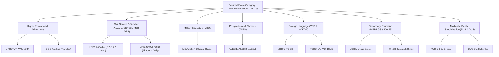

# Plan: ÖSYM & MEB Standardized Exams Ingestion Plan (`mod_event` / Category 5: `Sınavlar`)

**Target Domain:** `https://amedbulten.com`  
**Repository:** `AF/Bulletin`  
**Target Module:** [`mod_event`](file:///home/malpersaz/Desktop/projects/htdocs/AF/Bulletin/mod/mod_event/mod_event.sql) & [`mod_event_category`](file:///home/malpersaz/Desktop/projects/htdocs/AF/Bulletin/mod/mod_event_category/mod_event_category.sql)  
**Target Category:** ID `5` (`name: Sınavlar`, `seo: Sınavlar`)  
**Date:** 2026-11-10  
**Verification Baseline:** ÖSYM Official 2027 Exam Calendar Announcement (Released 28 October 2026, 10:00 via `osym.gov.tr`) & MEB Central Examination Schedule  
**Architecture Standard:** Amed Framework Core (`legacy_seo` slugs, semantic HTML without inline styles/scripts, phone-first admin parity, MCP `amed-bulletin` event ingestion)

---

## 1. Executive Summary & Verification Context

Category `5` (`Sınavlar`) in [`mod_event_category`](file:///home/malpersaz/Desktop/projects/htdocs/AF/Bulletin/mod/mod_event_category/mod_event_category.sql) is defined as:
> *"ÖSYM, MEB, üniversite ve kamu sınav tarihleri, başvuru ve sonuç takvimi."*

Following rigorous re-verification against the official **ÖSYM 2027 Yılı Sınav Takvimi** announced on **28 Ekim 2026** and the latest **MEB** regulations, this plan outlines the definitive master schedule for all nationwide examinations.

### Key Regulatory & Calendar Verifications:
1. **Teaching Academy Entrance Exam (MEB-AGS):** Per the new Teacher Profession Law (*Öğretmenlik Mesleği Kanunu*), ÖSYM has officially added the **MEB-AGS** (8 Mayıs 2027) and **ÖABT** (9 Mayıs 2027) to the central calendar.
2. **YKS Schedule:** TYT (19 Haziran 2027, Cumartesi), AYT/YDT (20 Haziran 2027, Pazar). Official results release: **21 Temmuz 2027**.
3. **Calendar Coherence & Days of the Week:** All dates have been mathematically validated against the 2027 calendar (Saturday sessions for TYT, MSÜ, MEB-AGS, TUS 1; Sunday sessions for AYT, LGS, KPSS, DGS, ALES, YDS, YÖKDİL).

---

## 2. Ingestion Standard & Field Invariants

Every event created under Category `5` must strictly adhere to the following schema contract:

1. **`lang`**: `'tr'` (active language in `mod_event_category`).
2. **`category_id`**: `5` (`Sınavlar`).
3. **`status`**: `'y'` (published).
4. **`slider`**: `'n'`.
5. **`deck`**: `'y'` for active upcoming flagship exams (YKS, KPSS, MEB-AGS, LGS, MSÜ), `'n'` for secondary or departmental sessions.
6. **`location`**: `'Diyarbakır ve 81 İl Sınav Merkezleri'`.
7. **`participants`**: Clear target audience (e.g., `'Lise Mezunları, Üniversite Adayları'`, `'Öğretmen Adayları ve Lisans Mezunları'`).
8. **`seo`**: Exact Wikipedia-style `legacy_seo` preservation (retaining Turkish characters, converting spaces to `_`).
9. **`title`**: `<Exam Name> Ne Zaman? Başvuru ve Sınav Tarihi Takvimi` (concise, SEO-optimized, < 255 chars).
10. **`description`**: Meta description (< 160 characters) providing exact exam date, application window, and candidate scope.
11. **`summary`**: Clean 1–2 sentence overview detailing the exam session, hour, and administration institution.
12. **`content`**: Semantic HTML (`<h2>`, `
`, `<ul>`, `<li>`) strictly containing **zero inline `style="..."` or `<script>` tags** (Rule 1 compliance).

---

## 3. Verified Master Schedule Table (2027 Cycle)

| # | Exam Code | Event Name (`name`) | Day of Week | `start_date` | `end_date` | Application Window | Results Date | `deck` |
| :-: | :--- | :--- | :--- | :--- | :--- | :--- | :--- | :-: |
| 1 | **YÖKDİL/1** | `2027 Yükseköğretim Kurumları Yabancı Dil Sınavı (YÖKDİL/1)` | Pazar | `2027-02-28 10:15:00` | `2027-02-28 13:15:00` | 12.01.2027 – 20.01.2027 | 26.03.2027 | `n` |
| 2 | **MSÜ** | `2027 Millî Savunma Üniversitesi Askerî Öğrenci Aday Belirleme Sınavı (MSÜ)` | Cumartesi | `2027-03-20 10:15:00` | `2027-03-20 13:00:00` | 13.01.2027 – 10.02.2027 | 15.04.2027 | `y` |
| 3 | **TUS/1** | `2027 Tıpta Uzmanlık Eğitimi Giriş Sınavı (TUS 1. Dönem)` | Cumartesi | `2027-03-27 10:15:00` | `2027-03-27 16:00:00` | 02.02.2027 – 10.02.2027 | 22.04.2027 | `n` |
| 4 | **YDS/1** | `2027 Yabancı Dil Bilgisi Seviye Tespit Sınavı (YDS/1)` | Pazar | `2027-03-28 10:15:00` | `2027-03-28 13:15:00` | 03.02.2027 – 11.02.2027 | 21.04.2027 | `n` |
| 5 | **ALES/1** | `2027 Akademik Personel ve Lisansüstü Eğitimi Giriş Sınavı (ALES/1)` | Pazar | `2027-04-18 10:15:00` | `2027-04-18 12:45:00` | 24.02.2027 – 04.03.2027 | 14.05.2027 | `n` |
| 6 | **İOKBS** | `2027 MEB İlköğretim ve Ortaöğretim Bursluluk Sınavı (İOKBS)` | Pazar | `2027-04-25 10:00:00` | `2027-04-25 12:00:00` | Şubat – Mart 2027 | Mayıs 2027 | `n` |
| 7 | **MEB-AGS** | `2027 Millî Eğitim Bakanlığı Akademi Giriş Sınavı (MEB-AGS)` | Cumartesi | `2027-05-08 10:15:00` | `2027-05-08 12:45:00` | 19.03.2027 – 29.03.2027 | 08.06.2027 | `y` |
| 8 | **ÖABT** | `2027 Öğretmenlik Alan Bilgisi Testi (ÖABT)` | Pazar | `2027-05-09 10:15:00` | `2027-05-09 12:45:00` | 19.03.2027 – 29.03.2027 | 08.06.2027 | `y` |
| 9 | **LGS** | `2027 Liselere Geçiş Sistemi (LGS) Merkezi Sınavı` | Pazar | `2027-06-13 09:30:00` | `2027-06-13 12:50:00` | Otomatik / MEB e-Okul | 28.06.2027 | `y` |
| 10 | **YKS-TYT** | `2027 YKS 1. Oturum Temel Yeterlilik Testi (TYT)` | Cumartesi | `2027-06-19 10:15:00` | `2027-06-19 13:00:00` | 04.02.2027 – 02.03.2027 | 21.07.2027 | `y` |
| 11 | **YKS-AYT/YDT**| `2027 YKS 2. ve 3. Oturum (AYT ve YDT)` | Pazar | `2027-06-20 10:15:00` | `2027-06-20 17:45:00` | 04.02.2027 – 02.03.2027 | 21.07.2027 | `y` |
| 12 | **ALES/2** | `2027 Akademik Personel ve Lisansüstü Eğitimi Giriş Sınavı (ALES/2)` | Pazar | `2027-07-11 10:15:00` | `2027-07-11 12:45:00` | 07.05.2027 – 17.05.2027 | 16.09.2027 | `n` |
| 13 | **DGS** | `2027 Dikey Geçiş Sınavı (DGS)` | Pazar | `2027-07-18 10:15:00` | `2027-07-18 12:50:00` | 26.05.2027 – 03.06.2027 | 12.08.2027 | `n` |
| 14 | **YÖKDİL/2** | `2027 Yükseköğretim Kurumları Yabancı Dil Sınavı (YÖKDİL/2)` | Pazar | `2027-07-25 10:15:00` | `2027-07-25 13:15:00` | 08.06.2027 – 16.06.2027 | 13.08.2027 | `n` |
| 15 | **TUS/2** | `2027 Tıpta Uzmanlık Eğitimi Giriş Sınavı (TUS 2. Dönem)` | Pazar | `2027-08-22 10:15:00` | `2027-08-22 16:00:00` | 05.07.2027 – 13.07.2027 | 16.09.2027 | `n` |
| 16 | **KPSS-GYGK** | `2027 KPSS A Grubu ve Öğretmenlik (Genel Yetenek - Genel Kültür)` | Pazar | `2027-09-12 10:15:00` | `2027-09-12 12:25:00` | 08.07.2027 – 19.07.2027 | 14.10.2027 | `y` |
| 17 | **KPSS-Alan** | `2027 KPSS Alan Bilgisi Oturumları` | H.Sonu | `2027-09-18 10:15:00` | `2027-09-19 16:00:00` | 08.07.2027 – 19.07.2027 | 14.10.2027 | `n` |
| 18 | **DUS** | `2027 Diş Hekimliğinde Uzmanlık Eğitimi Giriş Sınavı (DUS)` | Pazar | `2027-10-24 10:15:00` | `2027-10-24 13:00:00` | 01.09.2027 – 09.09.2027 | 18.11.2027 | `n` |
| 19 | **YDS/2** | `2027 Yabancı Dil Bilgisi Seviye Tespit Sınavı (YDS/2)` | Pazar | `2027-11-21 10:15:00` | `2027-11-21 13:15:00` | 05.10.2027 – 13.10.2027 | 10.12.2027 | `n` |
| 20 | **ALES/3** | `2027 Akademik Personel ve Lisansüstü Eğitimi Giriş Sınavı (ALES/3)` | Pazar | `2027-11-28 10:15:00` | `2027-11-28 12:45:00` | 08.10.2027 – 19.10.2027 | 17.12.2027 | `n` |

---

## 4. Execution Workflow

1. **Ingestion Verification:** Execute `amed-bulletin` MCP tool `create_event` sequentially for each approved exam item.
2. **Field Verification:** Validate that every event contains valid ISO timestamps, accurate `legacy_seo` slug, and clean semantic HTML content.
3. **Database Audit:** Run `list_events` with `category_id: 5` to confirm proper indexing and total count parity.
