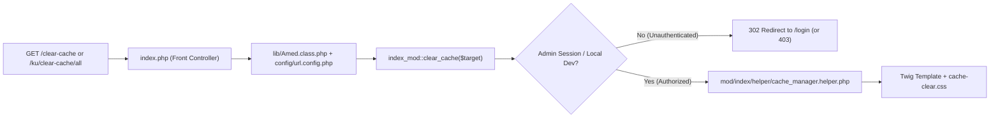

# Security Hardening, Root Sanitization & `/clear-cache` Route Modernization Plan

- **Target Project:** `AF/Bulletin` (`amedbulten.com`)
- **Target Production Server:** `ssh-w02232db@w02232db.kasserver.com` (`/www/htdocs/w02232db/amedbulten.com/`)
- **Plan Document:** `docs/plan/security-hardening-and-cache-route-modernization-plan.md`
- **Target Release Version:** `v1.0.20`
- **Status:** Proposed — Awaiting User Review & Approval

---

## 1. Executive Summary & Architectural Assessment

While `v1.0.19` and the initial `v1.0.20` pass eliminated `.git/`, `.agents/`, `installer/`, and root Markdown clutter, a comprehensive security audit of both the local repository root and the live production server (`amedbulten.com`) identified **six remaining security and architectural vulnerabilities**:

1. **Unauthenticated Standalone `/clear_cache.php` in Web Root (High Risk — Cache Stampede / DoS):**
   - `clear_cache.php` sits directly in the public web root (`https://amedbulten.com/clear_cache.php`) and executes cache wiping without authentication or session validation.
   - It also violates **AGENTS.md Rule 2 (Strict Code Separation)** by mixing PHP logic, inline HTML (`echo "<div class='alert...'>"`), and external CDN links (`cdn.jsdelivr.net`).
2. **Legacy Unused `/modules.php` in Web Root (Information Disclosure):**
   - A 22-line legacy script from 2011 (`modules.php`) sits in the public root, sets `Access-Control-Allow-Origin: *`, queries the `mods` table without authentication, and outputs module metadata as JSON. It is completely unused across the codebase.
3. **World-Writable (`0777` / `rwxrwxrwx`) Permissions on Production Code & Configs (Critical Risk):**
   - Because `rsync -avz` preserved local development permissions, critical production directories (`config/`, `lib/`, `mod/`, `templates/`, `vendor/`, `data/`) and entry scripts (`index.php`, `resize.php`, `css.php`, `js.php`) on `amedbulten.com` currently carry `0777` permissions.
4. **Unprotected Internal Directories & Migration Scripts (`tasks/`, `lib/`, `vendor/`, `data/`):**
   - `.deployignore` only excluded `tasks/migrate_*dry_run.php`, allowing `tasks/migrate_users.php`, `tasks/migrate_news.php`, `tasks/migrate_publications.php`, and `tasks/recompress_news_images.php` to deploy to the live server.
   - `.htaccess` lacks explicit rewrite blocks preventing direct HTTP access to `/tasks/`, `/lib/`, `/vendor/`, `/data/`, `/logs/`, `/tools/`, `/tests/`, and `/templates_c/`.
5. **Executable PHP Risk in Writable Directories (`static/`, `cache/`, `templates_c/`):**
   - Writable upload and cache directories lack explicit Apache `<FilesMatch>` directives disabling PHP/script execution if a malicious file were ever written.
6. **Production Stack Trace & Error Disclosure (`index.php`):**
   - `index.php` unconditionally sets `ini_set('display_errors', 1)` for non-AJAX requests and prints raw exception messages and stack traces (`$e->getTraceAsString()`) to public visitors.

---

## 2. Expert Evaluation: `/clear-cache` Route vs. Standalone `/clear_cache.php`

### Why `/clear-cache` via `config/url.config.php` is the Right Architecture

Replacing the standalone `/clear_cache.php` file with the clean route `/clear-cache` registered in `config/url.config.php` is **architecturally superior** and strictly conforms to Amed Framework standards:

| Dimension | Legacy `/clear_cache.php` (Standalone Root File) | Modernized `/clear-cache` (Amed Framework Route) |
| :--- | :--- | :--- |
| **Root Cleanliness** | Pollutes repository and production web root with a 406-line standalone script. | **Zero root files added.** Dispatched cleanly through Front Controller (`index.php`). |
| **URL Standard** | Exposes `.php` implementation file (`/clear_cache.php?lang=ku&cache=all`). | Clean English routing (`/clear-cache`, `/clear-cache/all`, `/ku/clear-cache`, `/tr/clear-cache/market`). |
| **Security & Auth** | **Zero authentication.** Any bot or visitor can wipe all caches at will. | **Protected by Admin Session & ACL.** Requires authenticated admin/privileged session in production; redirects unauthenticated visitors to `/login`. |
| **Multilingual (i18n)** | Manual `$_GET['lang']` file inclusion bypasses `Amed` language bootstrap. | Native 10-language routing via `Amed` (`ku`, `tr`, `en`, `de`, `fr`, `ru`, `sv`, `zza`, `ar`, `ckb`). |
| **Code Separation** | Violates Rule 2 (embeds HTML strings inside PHP functions and loads CDN Bootstrap). | **100% Rule 2 compliant.** Controller/Helper (`mod/index/helper/cache_manager.helper.php`) + Twig view (`templates/admin/cache_clear.twig` / `templates/amed/index/cache_clear.twig`) + external CSS (`templates/base_static/css/cache-clear.css`). |
| **Search Indexing** | Relies on external rules to avoid indexing. | Emits explicit `X-Robots-Tag: noindex, nofollow, noarchive` header. |



---

## 3. Step-by-Step Implementation Plan

### Phase 1: `/clear-cache` Route Integration & Complete Retirement of `clear_cache.php`

1. **Register Clean Routes in `config/url.config.php`:**
   - Add English route definitions compliant with Amed Framework conventions:
     ```php
     // Cache Management Routes
     $url['clear-cache'] = 'index/clear_cache';
     $url['clear-cache/'] = 'index/clear_cache';
     $url['clear-cache/(:any)'] = 'index/clear_cache/$1';
     ```
2. **Create Cache Manager Helper (`mod/index/helper/cache_manager.helper.php`):**
   - Encapsulate directory scanning and safe cache purging for all supported targets (`img`, `js`, `css`, `video`, `sql`, `templates`, `llms`, `captcha`, `market`, `sports`, `all`).
   - Support both clean path segment (`/clear-cache/all`, `/clear-cache/market`) and query string fallback (`/clear-cache?cache=all`).
   - Return structured arrays (never `echo` raw HTML from PHP) for Twig rendering.
3. **Add `clear_cache($target = null)` Action in `mod/index/index.php`:**
   - Enforce security gate:
     - Check active session (`$this->session->get('id')`) and verify administrative/settings permission (`Role::hasPermission('mod_settings', 'edit')` or `Role::hasPermission('mod_user', 'acl')`), allowing direct access only when authenticated (or on local CLI/localhost dev if configured).
     - If unauthorized, redirect cleanly to `$this->site['saddress'] . 'login'`.
   - Set `header('X-Robots-Tag: noindex, nofollow, noarchive');` and `header('Cache-Control: no-store, no-cache, must-revalidate');`.
   - Render clean Twig template (`index/cache_clear.twig`) using existing `templates/base_static/css/cache-clear.css` and local self-hosted Bootstrap/icons.
4. **Create Zero-Inline Twig Template (`templates/amed/index/cache_clear.twig`):**
   - Strictly obey **AGENTS.md Rule 2** (zero inline `style=""`, zero `<style>`, zero `onclick=""`, zero CDN links).
   - Use local `/templates/amed/static/css/bootstrap.min.css`, `/templates/amed/static/css/amed-icons.min.css`, and `/templates/base_static/css/cache-clear.css`.
5. **Permanently Delete `clear_cache.php`:**
   - Remove `clear_cache.php` from the repository root (`git rm clear_cache.php`).
   - Remove `clear_cache.php` from the remote production server (`/www/htdocs/w02232db/amedbulten.com/clear_cache.php`).
   - Update `tools/cross_repo_sync.py` and `docs/SERVER.md` to reflect the `/clear-cache` route and removal of `clear_cache.php`.

---

### Phase 2: Root Legacy Script Cleanup & `index.php` Production Error Shield

1. **Retire Unused Legacy `modules.php`:**
   - Remove `modules.php` from the repository root (`git rm modules.php`) and delete it from the production server web root, eliminating unauthenticated module enumeration.
2. **Harden `index.php` Error & Exception Handling:**
   - Gate `display_errors` and `display_startup_errors` behind `$isLocal` (found in `config/site.config.php` or host check):
     - In production (`!$isLocal`), set `ini_set('display_errors', '0')` and `ini_set('display_startup_errors', '0')`.
   - In the global `set_exception_handler` in `index.php`:
     - Always log full details to `logs/ajax_errors.log`.
     - Only output `$e->getMessage()` and `$e->getTraceAsString()` when `$isLocal` is true; in production, return HTTP 500 with a clean, non-disclosing error message.

---

### Phase 3: Multi-Layer Apache & Directory Access Hardening (`.htaccess`)

1. **Block Direct HTTP Requests to Internal Framework Directories in Root `.htaccess`:**
   - Add explicit rewrite protection before the front-controller rule in `.htaccess`:
     ```apache
     # Block direct HTTP access to internal framework, runtime, and task directories
     RewriteRule ^(config|lib|vendor|tasks|data|logs|tools|tests|installer|docs|templates_c)(/|$) - [F,L]
     ```
2. **Harden Directory-Level `.htaccess` Shields:**
   - `data/.htaccess`: `Require all denied` (protects `credentials.json`, `google_settings.json`, SQLite files).
   - `logs/.htaccess`: `Require all denied` (protects `ajax_errors.log` and runtime logs).
   - `templates_c/.htaccess`: `Require all denied` (prevents direct access to compiled templates).
   - `cache/.htaccess` & `static/.htaccess`: Disable script execution for `.php`, `.phtml`, `.phar`, `.sh`, `.py`, `.pl`, `.cgi` via `<FilesMatch "\.(?i:php[0-9]?|phtml|phar|pl|py|cgi|sh)$">` -> `Require all denied`, while permitting static asset delivery (`css`, `js`, `webp`, `jpg`, `png`, `svg`, `woff2`, `webmanifest`).

---

### Phase 4: Deployment Pipeline & Server Permission Hardening (`.deployignore` & `tools/deploy_production.sh`)

1. **Expand `.deployignore` Exclusions:**
   - Exclude all migration and one-off scripts in `tasks/`:
     ```gitignore
     tasks/migrate_*.php
     tasks/recompress_*.php
     tasks/mcp_bootstrap.php
     ```
     (Only `tasks/update_market_rates.php` and `tasks/update_sports_data.php` remain for cron execution).
   - Add `clear_cache.php` and `modules.php` to `.deployignore` as a safeguard.
2. **Enforce Standard Production Permissions & Cleanup in `tools/deploy_production.sh`:**
   - Add `--chmod=Du=rwx,Dg=rx,Do=rx,Fu=rw,Fg=r,Fo=r` to `RSYNC_OPTS` so directories deploy as `0755` and files deploy as `0644` (eliminating `0777` on code/config files).
   - Add `--delete` to `RSYNC_OPTS` (safely paired with existing `--filter='protect ...'` rules for `config/*.local.php`, `data/*.json`, `data/*.sqlite`, `static/mod_*/**`, `cache/**`, `templates_c/**`, `logs/**`) so files removed locally are automatically purged on the server.
3. **Remote Server Permission & Orphan Sanitization (`w02232db/amedbulten.com/`):**
   - Remove `clear_cache.php`, `modules.php`, `tasks/migrate_*.php`, `tasks/recompress_*.php`, and `tasks/mcp_bootstrap.php` from the production server.
   - Normalize directory permissions to `0755` and file permissions to `0644` across `config/`, `lib/`, `mod/`, `templates/`, `vendor/`, and root PHP files, and lock `config/*.local.php` and `data/*.json` to `0640`.

---

## 4. Verification & Quality Gate Checklist

- [ ] **PHP Syntax Validation:** Run `php -l` on `config/url.config.php`, `index.php`, `mod/index/index.php`, and `mod/index/helper/cache_manager.helper.php`.
- [ ] **Strict Code Separation Guard:** Run `python3 tools/code_separation_guard.py` to confirm `0` violations in `templates/amed/index/cache_clear.twig`.
- [ ] **i18n & Boundary Guards:** Run `python3 tools/i18n_guard.py` and `python3 tools/module_boundary_guard.py`.
- [ ] **E2E Test Suite:** Run `php tests/e2e/run.php` and verify route resolution for `/clear-cache` and `/clear-cache/all`.
- [ ] **Production Security Verification:**
  - Verify `https://amedbulten.com/clear_cache.php` and `https://amedbulten.com/modules.php` return `404 Not Found`.
  - Verify `https://amedbulten.com/config/`, `/lib/`, `/tasks/`, `/vendor/`, `/data/`, `/logs/` return `403 Forbidden`.
  - Verify unauthenticated request to `https://amedbulten.com/clear-cache` redirects to `/login` instead of wiping cache.
  - Verify production file permissions via SSH (`0755` directories, `0644` files, `0640` sensitive local configs).
