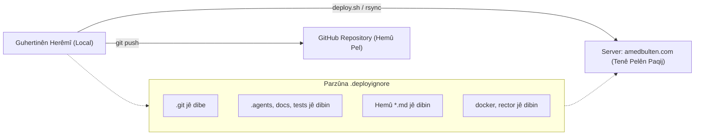

# Plana Paqijkirina Root-a Serverê û Sîstema Weşandina Paqij (Deployment Hardening)

- **Projeya Armanc:** `AF/Bulletin` (`amedbulten.com`)
- **Servera Armanc:** `ssh-w02232db@w02232db.kasserver.com`
- **Pelrêça Webê ya Serverê:** `/www/htdocs/w02232db/amedbulten.com/`
- **Pelê Planê:** `docs/plan/server-root-cleanup-and-deployment-hardening-plan.md`
- **Rewş:** Amadekirî bo Nirxandin û Bicihanînê

---

## 1. Kurteya Armancê û Analîza Rewşa Heyî

Li gorî lêkolîn û dîmenên pelrêça serverê (`w02232db/amedbulten.com/`), niha di kokê (root) ya malperê de **19 pelrêç** û **28 pel** hene. Sedema sereke ya vê qelebalixiyê ew e ku di serverê de fermana `git clone` / `git pull` rasterast di nav pelrêça giştî ya webê de hatiye bikaranîn.

Ji ber vê sedemê:
1. Pelrêça `.git/` (33 MB) rasterast di bin çavdêriya webê de vekirî ye ku ev xetereyeke mezin a ewlehiyê ye (her kes dikare dîroka kodan û mîhengên git bibîne).
2. Pelrêçên alavên aqilê çêkirî (`.agents/` 20 MB, `.gemini/`), pelrêçên ceribandin û pêşvebirinê (`tests/`, `tools/`, `docker/`), pelgehên navxweyî (`docs/`) û hemû pelên Markdown (`*.md`) ketine ser serverê.
3. Root-a malperê qelebalix bûye û pelên runtime bi pelên pêşvebirinê re tevlîhev bûne.

Ev plan rêbazeke pîşeyî datîne da ku:
- **Root-a serverê bi temamî paqij bibe** û tenê pelên pêwîst ên xebitandinê (production runtime) li wir bimînin.
- **Tiştên nehewce (mîna `.git`, `docs`, `tests`, `tools`, `*.md`) her çend li ser GitHubê hebin jî, qet danekevin ser serverê û li wir tune bin.**
- Sîstema weşandinê (deployment) bi awayekî parastî û xweser bixebite.

---

## 2. Dabeşkirina Pel û Pelrêçan (Audit & Classification)

### 2.1 Tiştên ku DIVÊ li ser Serverê HEBIN (Production Runtime Essentials)

| Pel / Pelrêç | Cûre | Erka li ser Serverê |
| :--- | :--- | :--- |
| `index.php` | Pel | Deriyê sereke yê têketina malperê (Front Controller). |
| `init.php` | Pel | Destpêkirina bingehîn a sîstemê, bîrdozî û mîhengan. |
| `modules.php` | Pel | Barkirin û kargêriya modulan. |
| `template.php` | Pel | Alîkarê motora şablonan (Template Engine helper). |
| `captcha.php` | Pel | Hilberîna koda ewlehiyê ya wêneyî. |
| `css.php` & `js.php` | Pel | Kêşandin û hevgirtina dînamîk a stîl û skriptan. |
| `resize.php` | Pel | Guhertina pîvanên wêneyan bi awayekî otomatîk. |
| `robots.php` & `robots.txt` | Pel | Rênîşandana crawler û robotên lêgerînê. |
| `llms.php` | Pel | Çavkaniya LLMS txt bo motorên zîrekiya sûnî. |
| `mcp.php` | Pel | Xala girêdana servîsa MCP (heke li ser serverê were xebitandin). |
| `.htaccess` | Pel | Rêgezên Apache, ewlehî, beralîkirina lînkan (URL rewrites). |
| `config/` | Pelrêç | Mîhengên pergalê û databasê (`db.config.local.php`, `site.config.local.php`). |
| `lib/` | Pelrêç | Pirtûkxaneyên bingehîn ên PHP (`Database`, `Auth`, `Twig`, hwd.). |
| `mod/` | Pelrêç | Modulên çalak ên malperê (`mod_news`, `mod_event`, `mod_page`, hwd.). |
| `templates/` | Pelrêç | Şablonên dîtbarî yên rûpelan (`amed`, `admin`). |
| `vendor/` | Pelrêç | Paketên pêwîst ên Composer (tenê `--no-dev`). |
| `cache/` | Pelrêç | Depoya pêşbîrê (Twig cache, sql cache - divê destûra nivîsandinê hebe). |
| `templates_c/` | Pelrêç | Pêşbîra berhevkirî ya şablonan (divê destûra nivîsandinê hebe). |
| `logs/` | Pelrêç | Tomarên çewtî û agahdariyên pergalê. |
| `static/` | Pelrêç | Pelên medyayê, wêne, font, wêneya nûçeyan (`mod_news/`, hwd.). |
| `data/` | Pelrêç | Verastkirinên taybet (`credentials.json`, `google_settings.json`). |
| `tasks/` | Pelrêç | Karên periyodîk ên cronê (`update_market_rates.php`, `update_sports_data.php`). |

---

### 2.2 Tiştên ku DIVÊ li ser Serverê TUNE BIN (Unwanted Clutter & Security Risks)

Ev hemû dê li ser **GitHubê bimînin**, lê dê **ji serverê werin jêbirin û qet danekevin ser serverê**:

| Pel / Pelrêç | Cûre | Çima divê li ser Serverê tune be? |
| :--- | :--- | :--- |
| `.git/` | Pelrêç (33 MB) | **Xetereya Krîtîk:** Dîroka guhertinan, şîfre û hemû kodan ji derve re vekirî dihêle. |
| `.agents/` | Pelrêç (20 MB) | Skîll, agahiyên amûrên AI û daneyên pêşvebirinê yên herêmî ne. |
| `.gemini/` | Pelrêç | Pelên mîhengên Gemini yên herêmî ne. |
| `.codex` | Pel | Mîhengên pêşvebirinê yên edîtorê ne. |
| `.playwright-mcp/`| Pelrêç | Pelên ceribandina dîtbarî ya navgînê ne. |
| `docs/` | Pelrêç (340 KB)| Belgeyên navxweyî, planên pêşvebirinê û rênîşandan in; ji bikarhêner re ne hewce ne. |
| `docker/` | Pelrêç | Mîhengên container ên herêmî ne (MySQL, PHPMyAdmin Docker). |
| `tests/` | Pelrêç (404 KB)| Testên yekîneyê (unit tests, runtime tests) li ser serverê naxebitin. |
| `tools/` | Pelrêç (156 KB)| Skrîptên Python yên çavdêriyê (`audit_*.py`, `i18n_guard.py`, `cross_repo_sync.py`). |
| `installer/` | Pelrêç (1.1 MB)| Piştî sazkirina malperê, mayîna wê xetereyeke ewlehiyê ye. |
| `*.md` hemû | Pel | Pelên `AGENTS.md`, `CODE_QUALITY_AGENT_STRATEGY.md`, `DESIGN.md`, `PILOT_AGENT_REVIEW_FLOW.md`, `PROJECT.md`, `TEST_INFRA.md`, `TEST_READY.md`. |
| `docker-compose.yml` | Pel | Konfigurasyona Docker a komputera herêmî ye. |
| `package.json` | Pel | Mîhengên paketên NPM yên herêmî ne. |
| `package-lock.json` | Pel | Kilîta guhertoyên NPM e. |
| `rector.php` | Pel | Amûra refactoring a PHP ye; di production de qedexe ye. |
| `composer.json` | Pel | Agahiyên paketên Composer; di root a giştî de xetereya nasîna versiyonan e. |
| `composer.lock` | Pel | Kilîta Composer; ne hewce ye di bin web root de vekirî be. |
| `.gitignore` | Pel | Mîhengê Git e; li ser servera zindî hewce nake. |

---

## 3. Stratejiya Çareseriyê: Kod Çawa ji GitHubê Bêyî Zibilê Dikeve Serverê?

Ji bo ku pelên nehewce tenê li ser GitHubê hebin û **qet danekevin ser serverê**, em rêbaza standard a pîşesaziyê (Industry Standard Deployment) bi kar tînin.

### Metoda Pêşniyarkirî: Sîstema Deploymentê ya bi Rsync û `.deployignore`

Di vê rêbazê de, em rasterast di nav `amedbulten.com` de `git clone` an `git pull` **nakin**. Li şûna wê:



#### Gav 1: Çêkirina Pelê `.deployignore`
Di nav projeya herêmî de pelek bi navê `.deployignore` tê afirandin. Ev pel diyar dike ka kîjan pel û pelrêç nabin biçin ser serverê:
```text
# Versiyon û Pêşvebirina Zîrek
.git/
.gitignore
.gitattributes
.agents/
.gemini/
.codex
.playwright-mcp/

# Belge û Markdown
docs/
*.md

# Jîngeha Docker û Amûrên Dev
docker/
docker-compose.yml
rector.php
package.json
package-lock.json
node_modules/

# Test û Amûrên Kontrolê
tests/
tools/
installer/
tasks/agent_*
tasks/mcp_smoke.php
tasks/module_management_smoke.php
tasks/migrate_*dry_run.php

# Composer (Ji bo ku di web root de eşkere nebin)
composer.json
composer.lock

# Pelên Taybet ên Herêmî (Daneyên serverê diparêze)
config/*.local.php
data/*.sqlite
data/*.json
data/credentials.json
data/google_search_console_api.json
static/mod_*
cache/*
templates_c/*
logs/*
```

#### Gav 2: Skrîpta Weşandina Yek-Tikandinê (`tools/deploy_production.sh`)
Skrîptek tê amadekirin ku dema em bixwazin malperê li ser serverê nûjen bikin, bi yek fermanê weşandinê pêk tîne:
```bash
#!/usr/bin/env bash
set -e

SERVER_USER="ssh-w02232db"
SERVER_HOST="w02232db.kasserver.com"
REMOTE_PATH="/www/htdocs/w02232db/amedbulten.com/"
LOCAL_PATH="$(cd "$(dirname "${BASH_SOURCE[0]}")/.." && pwd)/"

echo "==> Malper tê nûjenkirin li ser serverê: $SERVER_HOST..."

# Şandina pelan bi parzûna .deployignore
rsync -avz --delete \
    --exclude-from="${LOCAL_PATH}.deployignore" \
    "${LOCAL_PATH}" "${SERVER_USER}@${SERVER_HOST}:${REMOTE_PATH}"

# Pakkirina pêşbîrê (Twig cache clear) piştî weşandinê
ssh -o BatchMode=yes "${SERVER_USER}@${SERVER_HOST}" "rm -rf ${REMOTE_PATH}cache/twig/*"

echo "==> Weşandin bi serkeftî bi dawî bû! Root-a serverê paqij e."
```

**Feydeyên vê rêbazê:**
- `.git` û pelên pêşvebirinê qet ji ser komputera we naçin ser serverê.
- Pelên wêne (`static/mod_*`), mîhengên serverê (`*.local.php`), û databasên zindî (`data/`) li ser serverê nayên destdan û parastî dimînin.
- Weşandin tenê 2-3 çirkeyan dikişîne.

---

### Metoda Alternatîf (Ger Weşandin bi rêya SSH li ser Serverê were kirin)

Heke hûn bixwazin her tim têkevin nav serverê bi SSH û fermanê li wir bidin:
1. Pelrêça `.git` ji nav `amedbulten.com` tê derxistin bo pelrêçeke veşartî ya derveyî webê (mînak: `/www/htdocs/w02232db/repo/bulletin/`).
2. Li wir `git pull` tê xebitandin.
3. Skrîpta serverê tenê pelên pêwîst bi `rsync` an `git archive` ji pelrêça repo dikişîne nav `amedbulten.com/`.
4. Bi vî rengî jî dîsa pelrêça webê (`amedbulten.com`) %100 paqij dimîne.

---

## 4. Gavên Paqijkirina Niha ya li ser Serverê (Execution Steps)

Ji bo paqijkirina vê qelebalixa heyî ya ku di dîmenan de xuya dike:

### Gava 1: Paşgirtina Ewlehiyê (Pre-cleanup Backup)
Berî her tiştî em ê piştrast bibin ku pelên `config/*.local.php` û `data/*.json` yên li ser serverê parastî ne:
```bash
ssh ssh-w02232db@w02232db.kasserver.com "cp -r /www/htdocs/w02232db/amedbulten.com/config /www/htdocs/w02232db/config_backup"
```

### Gava 2: Jêbirina Pelrêçên Zêde yên ji Serverê
Fermanên jêbirinê bo wan pelrêçên ku divê tenê li ser GitHubê hebin:
```bash
ssh ssh-w02232db@w02232db.kasserver.com "cd /www/htdocs/w02232db/amedbulten.com && rm -rf .git .agents .gemini docker docs tests tools installer"
```
*(Bi vê gavê tenê nêzîkî **55 MB** qada bêkêr û xetereya ewlehiyê ya `.git` û `.agents` jê dibe!)*

### Gava 3: Jêbirina Pelên Zêde û Markdown ji Root-ê
Fermanên jêbirina pelên konfigurasyona pêşvebirinê û pelgehên `.md`:
```bash
ssh ssh-w02232db@w02232db.kasserver.com "cd /www/htdocs/w02232db/amedbulten.com && rm -f *.md docker-compose.yml rector.php package.json package-lock.json composer.json composer.lock .gitignore"
```

---

## 5. Zexmkirina Ewlehiyê bi rêya `.htaccess` (Defense in Depth)

Ji bo ku heke rojekê bi şaşîtî pelek hate avêtin jî kes nikaribe ji derve rasterast wê daxîne, em ê di `.htaccess` de rêgezên nû lê zêde bikin:

```apache
# 1. Astengkirina Pelên Veşartî (.git, .env, .agents, .gemini, hwd.)
<FilesMatch "^\.">
    Require all denied
</FilesMatch>

# 2. Astengkirina Pelên Belgeyan, Mîhengan û Zibilê (.md, .json, .lock, .yml)
<FilesMatch "\.(md|markdown|json|lock|yml|yaml|dist|sql|sqlite|log|sh)$">
    Require all denied
</FilesMatch>

# 3. Îstîsnayên Giştî yên Pêwîst (Mînak: manifest)
<Files "site.webmanifest">
    Require all granted
</Files>
```

Her wiha di pelrêça `config/` de em ê pelek `.htaccess` bi rêzika `Require all denied` bi cih bikin da ku kes nikaribe agahiyên girêdana databasê bixwîne.

---

## 6. Struktura Nû ya Paqij a Root-a Serverê (Target Clean State)

Piştî cîbicîkirina vê planê, dîmena pelrêça serverê ya di panela ALL-INKL de dê bi vî rengî kêm, paqij û xurt be:

### Pelrêçên Mayî (Tenê 11 Pelrêç li şûna 19):
```text
cache/          (Pêşbîr)
config/         (Mîhengên parastî)
data/           (Daneyên json/sqlite yên parastî)
lib/            (Pirtûkxaneyên koda sîstemê)
logs/           (Tomarên pergalê)
mod/            (Modulên malperê)
static/         (Medyaya giştî, css, js, font, wêne)
tasks/          (Skrîptên cronê)
templates/      (Şablonên rûpelan)
templates_c/    (Pêşbîra berhevkirî)
vendor/         (Paketên sîstemê yên PHP)
```

### Pelên Mayî (Tenê 13 Pel li şûna 28):
```text
.htaccess       (Mîheng û ewlehiya serverê)
captcha.php     (Hilberînerê ewlehiya kodê)
clear_cache.php (Alîkarê paqijkirina pêşbîrê)
css.php         (Rêveberê stîlan)
index.php       (Deriyê sereke)
init.php        (Destpêka sîstemê)
js.php          (Rêveberê skrîptan)
llms.php        (LLMS API)
mcp.php         (MCP API)
modules.php     (Barkirkerê modulan)
resize.php      (Resize wêneyan)
robots.php      (Robots dînamîk)
robots.txt      (Robots statîk)
template.php    (Barkirkerê şablonê)
```

---

## 7. Gavên Piştî Pejirandina Planê (Action Checklist)

- [ ] **Gava 1:** Çêkirina pelê `.deployignore` di nav koka projeyê de li ser GitHub / herêmî.
- [ ] **Gava 2:** Çêkirina skrîpta weşandina paqij `tools/deploy_production.sh`.
- [ ] **Gava 3:** Paqijkirina rasterast a serverê bi rêya SSH li gorî lîsteya ewle.
- [ ] **Gava 4:** Nûjenkirina rêgezên `.htaccess` li ser serverê bo parastina pelên hesas.
- [ ] **Gava 5:** Kontrolkirina karbidestiya malperê (`https://amedbulten.com/`) û girtina hemû deriyên nepenî.
