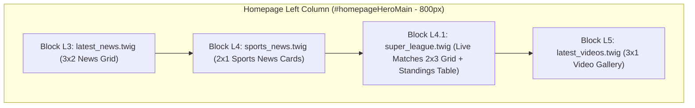

# Live Super League Standings & Matchday Widget (`super_league.twig`) — Architectural & Implementation Plan

- **Repository:** `AF/Bulletin` (Amed Framework CMS)
- **Target Component:** `templates/amida/index/mod_news/super_league.twig`
- **Service Layer:** `lib/SportsDataService.class.php`
- **CLI Runner:** `tasks/update_sports_data.php`
- **Stylesheet:** `templates/amida/static/css/super-league.css`
- **Cache Management Integration:** `clear_cache.php` & `templates/base_static/css/cache-clear.css`
- **Reference Pattern:** `templates/amida/index/mod_news/market_rates.twig` & `lib/MarketDataService.class.php` (Commit `0bdb592`)

---

## 1. Executive Summary & Objective

This document specifies the complete engineering plan for adding a **Live Super League Matchday & Standings Widget (`super_league.twig`)** directly beneath the **Sports (`sports_news.twig`)** section on the public homepage (`templates/amida/index/index.twig`).

Modeled after the Google Sports Turkish Super League overview card and engineered to match the zero-latency, fault-tolerant architecture of `MarketDataService` (`market_rates.twig`), the widget delivers:
1. **Zero-Latency Page Rendering:** Reads pre-normalized data from Redis (`bulletin_super_league_v1`) or an atomic JSON file cache (`cache/sports/super_league.json`) in `< 1ms` during HTTP requests, scheduling stale cache refreshes asynchronously after response flushing (`fastcgi_finish_request()`).
2. **Google Sports Split-Panel Layout:**
   - **Header Bar:** League trophy icon, localized title, active matchweek indicator (*Matchday 10 of 34*), and a pulsing green **Live** status pill.
   - **Left Panel — Matchday Fixtures & Live Scores (`2x3` Grid, 6 Matches):** Displays live in-play matches (`Live 39'`), completed full-time results (`FT` with winner caret indicators), and upcoming fixtures (`Tomorrow 13:30`) with official club crests.
   - **Right Panel — Live League Standings Table:** Displays the top clubs (`#`, `Club`, `MP`, `W`, `D`, `L`, `GD`, `Pts`) with dedicated visual highlighting for **Amed SK** (`is_amed`).
3. **Full Architectural & Guard Compliance:** Adheres strictly to `AGENTS.md` rules:
   - **100% Pure English Identifiers & Comments (`tools/i18n_guard.py`):** Uses `super_league` (`_super_league`, `getSuperLeagueData`, `refreshSuperLeagueData`) instead of Turkish `super_lig` (which fails `EnglishLexicon` on token `'lig'`), uses direct `lang.index.mod_news.sports_news.*` references in Twig without forbidden `|default(...)` fallbacks, and keeps all code comments strictly in ASCII English.
   - **Strict Code Separation (`tools/code_separation_guard.py`):** Zero inline CSS (`style="..."` or `<style>`) and zero inline JavaScript (`<script>` or `on*` attributes).
   - **CSS Asset Integrity (`tools/min_css_guard.py`):** External stylesheet `super-league.css` with no orphan `.min.css` drift.
   - **Domain Boundary Isolation (`tools/module_boundary_guard.py`):** Operates strictly within `mod_news` / `index` and `lib/SportsDataService.class.php`.

---

## 2. Homepage Placement & Wireframe Alignment

In `templates/amida/index/index.twig`, the left primary editorial column (`#homepageHeroMain`, `col-12 col-lg-8`, `~800px` desktop width) currently renders:
- **Block L1:** `index/hero_slider.twig`
- **Block L2:** `index/mod_publication/latest_publications.twig`
- **Block L3:** `index/mod_news/latest_news.twig`
- **Block L4:** `index/mod_news/sports_news.twig` (2 horizontal sports news cards)
- **Block L5:** `index/mod_video_embed/latest_videos.twig`

The new widget is inserted as **Block L4.1** immediately after `sports_news.twig` and above `latest_videos.twig`, forming a cohesive Sports editorial + live data cluster analogous to the `economy_news.twig` + `market_rates.twig` pairing in the right sidebar:



---

## 3. Zero-Latency Data Service Architecture (`lib/SportsDataService.class.php`)

### 3.1 Constants & Cache Configuration

| Constant | Value | Purpose |
| :--- | :--- | :--- |
| `CACHE_SUBDIR` | `'cache/sports/'` | Dedicated writable cache directory under `root_dir` |
| `CACHE_FILENAME` | `'super_league.json'` | Atomic JSON snapshot file |
| `LOCK_FILENAME` | `'refresh.lock'` | Non-blocking `flock(LOCK_EX \| LOCK_NB)` mutex file |
| `CACHE_TTL` | `180` | 3-minute freshness window for live match scores & standings |
| `RETRY_COOLDOWN` | `60` | Minimum 60-second backoff between upstream network attempts |
| `CONNECT_TIMEOUT` | `2` | cURL connection timeout in seconds |
| `FETCH_TIMEOUT` | `4` | cURL transfer timeout in seconds |
| `REDIS_KEY` | `'bulletin_super_league_v1'` | Primary in-memory `RedisCache` key |
| `TOTAL_MATCHDAYS` | `34` | Total matchdays in the 18-team Super League season |
| `STANDINGS_LIMIT` | `5` | Number of top clubs displayed in the compact standings panel (with automatic inclusion of Amed SK if outside top 5) |
| `MATCHES_LIMIT` | `6` | Number of match cards displayed in the `2x3` matchday grid |

### 3.2 Upstream Feeds & Parallel Multi-cURL Ingestion

`SportsDataService::executeParallelFetch()` uses `curl_multi_init()` with IPv4 resolution (`CURL_IPRESOLVE_V4`) and strict TLS verification to fetch upstream JSON endpoints concurrently without key authentication:

1. **Primary Standings Feed (`HTTP 200` Verified):**
   - `https://site.web.api.espn.com/apis/v2/sports/soccer/tur.1/standings`
   - Returns all 18 Turkish Super League clubs ordered by rank, including team ID, display name, 500x500 PNG crest URL (`https://a.espncdn.com/i/teamlogos/soccer/500/{id}.png`), and exact statistics (`rank`, `gamesPlayed`, `wins`, `ties`, `losses`, `pointDifferential`, `points`).
2. **Backup Standings Feed (`HTTP 200` Verified):**
   - `https://sports.core.api.espn.com/v2/sports/soccer/leagues/tur.1/seasons/2026/types/1/groups/1/standings/0`
   - Provides failover resilience if the primary web API endpoint is unreachable.
3. **Matchday Scoreboard Feeds (Single-Date Multi-Day Window via Parallel cURL):**
   - `https://site.api.espn.com/apis/site/v2/sports/soccer/tur.1/scoreboard?dates={YYYYMMDD}`
   - **Important Protocol Constraint:** The `tur.1/scoreboard` endpoint rejects hyphenated date ranges (`?dates=YYYYMMDD-YYYYMMDD` returns `HTTP 400 Bad Request`), but accepts single-day `?dates=YYYYMMDD` queries (`HTTP 200 OK`).
   - Because a Super League matchweek spans Friday through Monday (`4` calendar days), `executeParallelFetch()` queries single-day URLs concurrently inside `curl_multi_init()` across a 4-day matchweek window (`yesterday`, `today`, `tomorrow`, `day+2`—or active matchweek dates from `leagues[0].calendar`), deduplicating events by `event.id`.

### 3.3 Club Name Normalization & Regional Highlighting (`Amed SK`)

Upstream feeds return internationalized or abbreviated club names (e.g., `Amed SFK`, `Istanbul BB`, `Caykur Rizespor`, `Genclerbirli`). `SportsDataService::normalizeTeam()` maps team IDs and raw names to clean, canonical display names and flags **Amed SK** (`id: 132335` or name match `Amed`) so the template can highlight the club row and prioritize its fixture:

| Upstream ID | Upstream Name / Short Name | Canonical Display Name | `is_amed` |
| :--- | :--- | :--- | :--- |
| `132335` | `Amed SFK` | `Amed SK` | `true` |
| `432` | `Galatasaray` | `Galatasaray` | `false` |
| `997` | `Trabzonspor` | `Trabzonspor` | `false` |
| `1895` | `Besiktas` | `Beşiktaş` | `false` |
| `436` | `Fenerbahce` | `Fenerbahçe` | `false` |
| `132334` | `Çorum FK` | `Çorum FK` | `false` |
| `6870` | `Kasimpasa` | `Kasımpaşa` | `false` |
| `995` | `Kocaelispor` | `Kocaelispor` | `false` |
| `19267` | `Erzurum BB` / `Erzurum` | `Erzurumspor` | `false` |
| `789` | `Goztepe` | `Göztepe` | `false` |
| `9078` | `Alanyaspor` | `Alanyaspor` | `false` |
| `7914` | `Istanbul Basaksehir` / `Istanbul BB` | `Başakşehir` | `false` |
| `7656` | `Caykur Rizespor` | `Rizespor` | `false` |
| `20070` | `Gaziantep FK` / `Gaziantep` | `Gaziantep FK` | `false` |
| `7648` | `Konyaspor` | `Konyaspor` | `false` |
| `996` | `Genclerbirligi` / `Genclerbirli` | `Gençlerbirliği` | `false` |
| `11429` | `Samsunspor` | `Samsunspor` | `false` |
| `20729` | `Eyupspor` | `Eyüpspor` | `false` |

### 3.4 Matchday Prioritization & Status Formatting (`selectFeaturedMatches`)

A Super League matchweek contains 9 fixtures, whereas the Google Sports compact overview grid displays `6` fixtures (`2 columns x 3 rows`). `SportsDataService` scores and selects the 6 most relevant matches deterministically:
1. **Priority Tier 1 (Live Matches):** Any match with `state === 'in'` (in-play / halftime) is pinned first.
2. **Priority Tier 2 (Amed SK Match):** Any match involving **Amed SK** (`is_amed === true`) is guaranteed a slot in the 6-match grid.
3. **Priority Tier 3 (Today's Matches & Top-5 Contenders):** Matches played today (`today`) or involving top-5 clubs.
4. **Ordering within the 6 selected cards:** Sorted by state and schedule (`in` live matches first, then `today` completed/upcoming, `yesterday` completed, `tomorrow` upcoming) to mirror the Google Sports visual layout.

Each match item in the normalized payload contains:
```php
[
    'id' => '753821',
    'state' => 'in', // 'in' (live), 'post' (finished), 'pre' (scheduled)
    'status_code' => 'LIVE', // 'LIVE', 'HT', 'FT', 'SCHED'
    'clock_display' => "39'",
    'timestamp' => 1793462400, // UTC epoch converted to Europe/Istanbul timezone for display
    'day_key' => 'today', // 'yesterday', 'today', 'tomorrow', or 'date'
    'date_short' => '31.10',
    'kickoff_time' => '19:00', // Local kickoff time in Europe/Istanbul
    'home' => [
        'id' => '436',
        'name' => 'Fenerbahçe',
        'logo' => 'https://a.espncdn.com/i/teamlogos/soccer/500/436.png',
        'score' => 0,
        'is_winner' => false,
        'is_amed' => false,
    ],
    'away' => [
        'id' => '789',
        'name' => 'Göztepe',
        'logo' => 'https://a.espncdn.com/i/teamlogos/soccer/500/789.png',
        'score' => 0,
        'is_winner' => false,
        'is_amed' => false,
    ],
]
```

### 3.5 Active Matchday Calculation & Sanity Validation

- **Active Matchday (`matchday`):** Computed from the median/mode `gamesPlayed` across the standings table (or active fixture round), bounded between `1` and `34` (currently `10`).
- **Sanity Validation (`validateSanity`):**
  - Verifies that the standings array has at least `5` valid teams with `points >= 0` and `gamesPlayed >= 0`.
  - If an upstream fetch fails or returns malformed data, `SportsDataService` retains the previous valid cache (`$previous`) or falls back to `getSeedData()`.
- **Cold-Start Seed Snapshot (`getSeedData`):**
  - Pre-populated with the verified Matchday 10 Super League standings (`1. Galatasaray 25 pts`, `2. Amed SK 20 pts`, `3. Trabzonspor 19 pts`, `4. Beşiktaş 18 pts`, `5. Fenerbahçe 16 pts`) and the 6 Matchday 10 fixtures (`Fenerbahçe vs Göztepe`, `Kocaelispor vs Rizespor`, `Erzurumspor vs Çorum FK`, `Konyaspor vs Galatasaray`, `Amed SK vs Eyüpspor`, `Başakşehir vs Samsunspor`), guaranteeing an instant, accurate render even in offline test environments.

---

## 4. Controller, CLI Runner & Cache Management Integration

### 4.1 Frontend Controller Method (`mod/index/index.php`)

Add `_super_league($t)` directly alongside `_market_rates($t)` in `index_mod`:

```php
public function _super_league($t)
{
    require_once lib_dir . 'SportsDataService.class.php';
    $t->ctx_set('super_league', SportsDataService::getSuperLeagueData((string) ($this->site['lang'] ?? 'tr')));
}
```

### 4.2 CLI Cache Runner (`tasks/update_sports_data.php`)

Create `tasks/update_sports_data.php` mirroring `tasks/update_market_rates.php`:
- Enforces `PHP_SAPI === 'cli'`.
- Bootstraps `init.php` and `lib/SportsDataService.class.php`.
- Supports `--force` flag (`php tasks/update_sports_data.php --force`) to bypass TTL/cooldown and immediately refresh `cache/sports/super_league.json` and Redis.
- Outputs item counts (standings rows, match cards, matchday number, and ISO timestamp) and exits with `0` on success or `1` on failure.

### 4.3 Cache Management Parity (`clear_cache.php` & `cache-clear.css`)

To maintain 100% administrative parity with `market_rates.twig` (Commit `0bdb592`):
1. Add `'cache/sports'` to `$directories` in `clear_cache.php`.
2. Add `elseif ($c === 'sports')` handler and the `cache=sports` action card in `clear_cache.php` using `$lang['index']['cache']['cache_sports']`.
3. Add `.cache-icon.sports { background: #15803d; }` to `templates/base_static/css/cache-clear.css`.
4. Add `'cache_sports'` to `$lang['index']['cache']` across all 10 language files (`mod/index/lang/*.php`).

---

## 5. Frontend Twig Component (`templates/amida/index/mod_news/super_league.twig`)

### 5.1 Self-Contained Context Hydration & Direct `lang.*` Key Access

Just like `market_rates.twig`, `super_league.twig` hydrates its own context if not already set and references `lang.index.mod_news.sports_news.*` directly (without `|default(...)` filters or intermediate variable aliases) so `tools/i18n_guard.py` statically verifies every translation key:

```twig

    {{ run({"mod": "index", "method": "_super_league"}) }}
    



<section class="super-league-widget" aria-label="{{ lang.index.mod_news.sports_news.league_title }}">
    <!-- 1. Top League Bar -->
    <header class="super-league-head">
        <div class="super-league-brand">
            <span class="super-league-trophy" aria-hidden="true">
                <i class="bi bi-trophy-fill"></i>
            </span>
            <div class="super-league-title-group">
                <h3 class="super-league-title">{{ lang.index.mod_news.sports_news.league_title }}</h3>
                <span class="super-league-subtitle">{{ super_league.matchday_label }}</span>
            </div>
        </div>
        <span class="super-league-live-pill">
            <span class="super-league-live-dot" aria-hidden="true"></span>
            <span>{{ lang.index.mod_news.sports_news.live_data }}</span>
        </span>
    </header>

    <!-- 2. Split Body: Left (Matches 2x3 Grid) + Right (Standings Table) -->
    <div class="super-league-body">
        <!-- Left Panel: Matchday Fixtures -->
        <div class="super-league-panel super-league-matches-panel">
            <div class="super-league-panel-head">
                <span class="super-league-panel-title">{{ lang.index.mod_news.sports_news.matches_title }}</span>
                <span class="super-league-panel-meta">{{ super_league.matchday_label }}</span>
            </div>
            <div class="super-league-matches-grid">
                
                    <article class="super-league-match-card is-live is-amed-match">
                        <div class="super-league-match-teams">
                            <!-- Home Team Row -->
                            <div class="super-league-team-row is-winner is-amed-team">
                                <span class="super-league-team-info">
                                    
                                        
                                    
                                        <i class="bi bi-shield-shaded super-league-team-fallback" aria-hidden="true"></i>
                                    
                                    <span class="super-league-team-name">{{ match.home.name }}</span>
                                </span>
                                
                                    <span class="super-league-team-score" dir="ltr">
                                        {{ match.home.score }}
                                        <span class="super-league-winner-caret" aria-hidden="true">◀</span>
                                    </span>
                                
                            </div>
                            <!-- Away Team Row -->
                            <div class="super-league-team-row is-winner is-amed-team">
                                <span class="super-league-team-info">
                                    
                                        
                                    
                                        <i class="bi bi-shield-shaded super-league-team-fallback" aria-hidden="true"></i>
                                    
                                    <span class="super-league-team-name">{{ match.away.name }}</span>
                                </span>
                                
                                    <span class="super-league-team-score" dir="ltr">
                                        {{ match.away.score }}
                                        <span class="super-league-winner-caret" aria-hidden="true">◀</span>
                                    </span>
                                
                            </div>
                        </div>

                        <!-- Match Status / Time Column -->
                        <div class="super-league-match-status">
                            
                                <span class="super-league-status-live">{{ match.status_label }}</span>
                                
                                    <span class="super-league-status-clock" dir="ltr">{{ match.clock_display }}</span>
                                
                            
                                <span class="super-league-status-ft">{{ match.status_label }}</span>
                                <span class="super-league-status-day">{{ match.day_label }}</span>
                            
                                <span class="super-league-status-day">{{ match.day_label }}</span>
                                <span class="super-league-status-time" dir="ltr">{{ match.kickoff_time }}</span>
                            
                        </div>
                    </article>
                
            </div>
        </div>

        <!-- Right Panel: Standings Table -->
        <div class="super-league-panel super-league-table-panel">
            <div class="super-league-panel-head">
                <span class="super-league-panel-title">{{ lang.index.mod_news.sports_news.standings_title }}</span>
                <span class="super-league-panel-live-sub">
                    <span class="super-league-sub-dot" aria-hidden="true"></span>
                    <span>{{ lang.index.mod_news.sports_news.league_title }}</span>
                </span>
            </div>
            <div class="super-league-table-wrap">
                <table class="super-league-table">
                    <thead>
                        <tr>
                            <th scope="col" class="col-club" colspan="2">{{ lang.index.mod_news.sports_news.club_col }}</th>
                            <th scope="col" class="col-stat" title="{{ lang.index.mod_news.sports_news.mp_col }}">{{ lang.index.mod_news.sports_news.mp_col }}</th>
                            <th scope="col" class="col-stat" title="{{ lang.index.mod_news.sports_news.w_col }}">{{ lang.index.mod_news.sports_news.w_col }}</th>
                            <th scope="col" class="col-stat" title="{{ lang.index.mod_news.sports_news.d_col }}">{{ lang.index.mod_news.sports_news.d_col }}</th>
                            <th scope="col" class="col-stat" title="{{ lang.index.mod_news.sports_news.l_col }}">{{ lang.index.mod_news.sports_news.l_col }}</th>
                            <th scope="col" class="col-stat" title="{{ lang.index.mod_news.sports_news.gd_col }}">{{ lang.index.mod_news.sports_news.gd_col }}</th>
                            <th scope="col" class="col-pts" title="{{ lang.index.mod_news.sports_news.pts_col }}">{{ lang.index.mod_news.sports_news.pts_col }}</th>
                        </tr>
                    </thead>
                    <tbody>
                        
                            <tr class="super-league-table-row is-amed-row is-leader-row">
                                <td class="cell-rank" dir="ltr">{{ row.rank }}</td>
                                <td class="cell-club">
                                    <div class="cell-club-inner">
                                        
                                            
                                        
                                            <i class="bi bi-shield-shaded super-league-team-fallback" aria-hidden="true"></i>
                                        
                                        <span class="cell-club-name">{{ row.name }}</span>
                                    </div>
                                </td>
                                <td class="cell-stat" dir="ltr">{{ row.mp }}</td>
                                <td class="cell-stat" dir="ltr">{{ row.w }}</td>
                                <td class="cell-stat" dir="ltr">{{ row.d }}</td>
                                <td class="cell-stat" dir="ltr">{{ row.l }}</td>
                                <td class="cell-stat" dir="ltr">{{ row.gd }}</td>
                                <td class="cell-pts" dir="ltr">{{ row.pts }}</td>
                            </tr>
                        
                    </tbody>
                </table>
            </div>
        </div>
    </div>
</section>

```

---

## 6. Stylesheet & Visual Architecture (`templates/amida/static/css/super-league.css`)

### 6.1 Design Tokens & Visual Harmony
- **Seamless Integration with `sports-news.css`:**
  - Uses matching emerald/pitch-green accents (`--sl-accent: #15803d`, `--sl-live: #16a34a`, dark mode `--sl-accent: #4ade80`) and matching card geometry (`border-radius: 8px`, `1px solid` subtle borders).
  - Placed with `margin-top: 10px` below `.sports-news-section` so the Sports News cards and the Live Super League board read as a unified sports desk module.
- **Desktop Split Grid (`@media (min-width: 768px)`):**
  - `.super-league-body` uses `grid-template-columns: minmax(0, 1.32fr) minmax(0, 1fr); gap: 12px;` so the 2-column matchday grid on the left and the 8-column standings table on the right align to the exact same height without horizontal scrollbars.
- **Match Cards (`2x3` Grid):**
  - `.super-league-matches-grid` uses `grid-template-columns: repeat(2, minmax(0, 1fr));` on tablet/desktop and `1fr` on narrow phones (`< 520px`).
  - Each card features a vertical divider separating the two team rows on the left from the centered status/time badge on the right, replicating the exact Google Sports match cell layout.
  - Live matches (`is-live`) display a pulsing emerald status label (`Live` / `Canlı` / `Zindî`) and minute counter (`39'`).
- **Amed SK Highlight (`is-amed-row` & `is-amed-match`):**
  - Subtle emerald tint background (`rgba(22, 163, 74, 0.08)` in light mode, `rgba(74, 222, 128, 0.12)` in dark mode) and bold club name so readers immediately spot **Amed SK** in both the fixture list and standings table.
- **Dark Mode & RTL Support:**
  - Full CSS variable override block under `html[data-bs-theme="dark"] .super-league-widget, body.dark .super-league-widget, body.dark-mode .super-league-widget` matching the dark slate aesthetic (`#1e293b` container, `#0f172a` inner panels) shown in the Google Sports dark screenshot.
  - Full `[dir="rtl"]` rules reversing flex/grid directions and winner caret orientation for `ar` and `ckb` locales while preserving `dir="ltr"` on numeric scores and stats (`font-variant-numeric: tabular-nums`).
- **Stylesheet Registration (`templates/amida/layouts/base.twig` & `templates/amida/index/index.twig`):**
  - Registered alongside `market-rates.css?v={{ site.version }}` in `base.twig` (or in `` of `index.twig` alongside `sports-news.css?v={{ site.version }}`), keeping `tools/min_css_guard.py` 100% clean with zero orphan `.min.css` files.

---

## 7. 10-Language Localization Matrix (`mod/index/lang/*.php`)

All keys below have been verified against `EnglishLexicon.check_identifier()` in `tools/i18n_guard.py` and are added across all 10 language files (`en.php`, `tr.php`, `ku.php`, `zza.php`, `ckb.php`, `ar.php`, `de.php`, `fr.php`, `ru.php`, `sv.php`):

### 7.1 Widget Keys (`$lang['index']['mod_news']['sports_news']`)

| Key | `en` (English) | `tr` (Turkish) | `ku` (Kurmanji) | `zza` (Zazaki) | `ckb` (Sorani) | `ar` (Arabic) | `de` (German) | `fr` (French) | `ru` (Russian) | `sv` (Swedish) |
| :--- | :--- | :--- | :--- | :--- | :--- | :--- | :--- | :--- | :--- | :--- |
| `league_title` | `Süper Lig` | `Süper Lig` | `Lîga Sûper` | `Lîga Sûper` | `سوپەر لیگ` | `الدوري التركي الممتاز` | `Süper Lig` | `Süper Lig` | `Суперлига` | `Süper Lig` |
| `matchday_format` | `Matchday %d of %d` | `%d. Hafta / %d` | `Hefteya %d / %d` | `Hefteya %d / %d` | `هەفتەی %d لە %d` | `الجولة %d من %d` | `Spieltag %d von %d` | `Journée %d sur %d` | `Тур %d из %d` | `Omgång %d av %d` |
| `matches_title` | `Matches` | `Maçlar` | `Maçên Hefteyê` | `Maçê Hefteyî` | `یارییەکان` | `المباريات` | `Spiele` | `Matchs` | `Матчи` | `Matcher` |
| `standings_title` | `Table` | `Puan Durumu` | `Tabloya Puanan` | `Tabloyê Puanan` | `ڕیزبەندی` | `الترتيب` | `Tabelle` | `Classement` | `Таблица` | `Tabell` |
| `live_data` | `Live` | `Canlı` | `Zindî` | `Cındi` | `زیندوو` | `مباشر` | `Live` | `En direct` | `Онлайн` | `Live` |
| `club_col` | `Club` | `Kulüp` | `Klûb` | `Klûb` | `یانە` | `النادي` | `Klub` | `Club` | `Клуб` | `Klubb` |
| `mp_col` | `MP` | `O` | `L` | `K` | `ی` | `ل` | `Sp` | `MJ` | `И` | `S` |
| `w_col` | `W` | `G` | `B` | `B` | `ب` | `ف` | `S` | `G` | `В` | `V` |
| `d_col` | `D` | `B` | `W` | `Z` | `ی` | `ت` | `U` | `N` | `Н` | `O` |
| `l_col` | `L` | `M` | `T` | `V` | `د` | `خ` | `N` | `P` | `П` | `F` |
| `gd_col` | `GD` | `AV` | `AV` | `AV` | `ج` | `ف.أ` | `TD` | `DB` | `РМ` | `MS` |
| `pts_col` | `Pts` | `P` | `P` | `P` | `خ` | `نقاط` | `Pkt` | `Pts` | `О` | `P` |
| `status_ft` | `FT` | `MS` | `Qed.` | `Qed.` | `کۆتایی` | `انتهت` | `Ende` | `ap.` | `Завершен` | `Slut` |
| `status_ht` | `HT` | `İY` | `ND` | `ND` | `نیوە` | `ش.أ` | `HZ` | `MT` | `Перерыв` | `HT` |
| `status_live` | `Live` | `Canlı` | `Zindî` | `Cındi` | `زیندوو` | `مباشر` | `Live` | `Direct` | `Live` | `Live` |
| `today` | `Today` | `Bugün` | `Îro` | `Ewro` | `ئەمڕۆ` | `اليوم` | `Heute` | `Auj.` | `Сегодня` | `Idag` |
| `yesterday` | `Yesterday` | `Dün` | `Duh` | `Vîzêr` | `دوێنێ` | `أمس` | `Gestern` | `Hier` | `Вчера` | `Igår` |
| `tomorrow` | `Tomorrow` | `Yarın` | `Sibe` | `Meşte` | `سبەی` | `غداً` | `Morgen` | `Demain` | `Завтра` | `Imorgon` |

### 7.2 Cache Management Key (`$lang['index']['cache']['cache_sports']`)

| Key | `en` | `tr` | `ku` | `zza` | `ckb` | `ar` | `de` | `fr` | `ru` | `sv` |
| :--- | :--- | :--- | :--- | :--- | :--- | :--- | :--- | :--- | :--- | :--- |
| `cache_sports` | `Sports Standings Cache` | `Spor Puan Durumu Önbelleği` | `Pêşbîra Puanên Sporê` | `Verhafızaya Puananê Spori` | `کاشی ڕیزبەندی وەرزشی` | `ذاكرة تخزين نتائج الرياضة` | `Sporttabellen-Cache` | `Cache du classement sportif` | `Кэш спортивной таблицы` | `Cache för sporttabell` |

---

## 8. Step-by-Step Execution & Verification Plan

1. **Step 1 — Localization Updates (`mod/index/lang/*.php`):**
   - Add the 18 descriptive keys under `$lang['index']['mod_news']['sports_news']` and `'cache_sports'` under `$lang['index']['cache']` across all 10 language files (`en`, `tr`, `ku`, `zza`, `ckb`, `ar`, `de`, `fr`, `ru`, `sv`).
2. **Step 2 — Backend Service (`lib/SportsDataService.class.php`), CLI Task (`tasks/update_sports_data.php`) & Cache Utility (`clear_cache.php`):**
   - Implement `SportsDataService` with parallel multi-cURL fetching (single-date `YYYYMMDD` scoreboard requests + standings feed), team normalization (`Amed SK`), 6-match selection, atomic file + Redis caching, and seed fallback.
   - Implement `tasks/update_sports_data.php` and execute `php tasks/update_sports_data.php --force` to verify live cache generation in `cache/sports/super_league.json`.
   - Register `'cache/sports'` in `clear_cache.php` and `.cache-icon.sports` in `templates/base_static/css/cache-clear.css`.
3. **Step 3 — Controller Wiring (`mod/index/index.php`):**
   - Register `_super_league($t)` in `index_mod`.
4. **Step 4 — Frontend Template (`templates/amida/index/mod_news/super_league.twig`) & Stylesheet (`templates/amida/static/css/super-league.css`):**
   - Create `super_league.twig` and `super-league.css` with zero inline styles/scripts and direct `lang.index.mod_news.sports_news.*` references.
   - Include `super-league.css` and `index/mod_news/super_league.twig` in `templates/amida/index/index.twig` right below `sports_news.twig`.
5. **Step 5 — Automated Quality & Policy Gates:**
   - Run `php -l` on all modified/created PHP files.
   - Run `python3 tools/code_separation_guard.py --all`.
   - Run `python3 tools/i18n_guard.py`.
   - Run `python3 tools/min_css_guard.py --check`.
   - Run `python3 tools/module_boundary_guard.py`.
