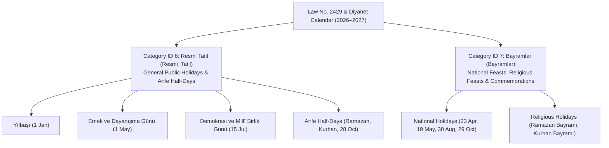

# Plan: Turkey Official Holidays and National/Religious Days Seeding Plan (`mod_event`)

**Target Domain:** `https://amedbulten.com`
**Repository:** `AF/Bulletin`
**Target Module:** [`mod_event`](file:///home/malpersaz/Desktop/projects/htdocs/AF/Bulletin/mod/mod_event/mod_event.sql) & [`mod_event_category`](file:///home/malpersaz/Desktop/projects/htdocs/AF/Bulletin/mod/mod_event_category/mod_event_category.sql)
**Date:** 2026-11-10
**Architecture Standard:** Amed Framework Core (Wikipedia-style `legacy_seo` slugs, MCP `amed-bulletin` event ingestion, Law No. 2429 on National Holidays and General Holidays)

---

## 1. Executive Summary & Category Taxonomy

This plan classifies all statutory holidays, religious feasts, national holidays, and official commemoration days in Turkey (per Law No. 2429 and the Presidency of Religious Affairs / Diyanet calendar) across the active [`mod_event_category`](file:///home/malpersaz/Desktop/projects/htdocs/AF/Bulletin/mod/mod_event_category/mod_event_category.sql) taxonomy for **2026** and **2027**.

### Active `mod_event_category` Mapping (`lang = 'tr'`)

Per live database inspection via `amed-bulletin` (`list_event_categories`), the 7 active categories are:

| `category_id` | Name (`tr`) | SEO (`legacy_seo`) | Relevance to Official Holidays | Classification Rule |
| :---: | :--- | :--- | :--- | :--- |
| `1` | Kültür & Sanat | `Kültür_Sanat` | Out of scope | Theatre, concerts, exhibitions |
| `2` | Edebiyat & Söyleşi | `Edebiyat_Söyleşi` | Out of scope | Book fairs, panels, talks |
| `3` | Sinema & Belgesel | `Sinema_Belgesel` | Out of scope | Screenings, documentaries |
| `4` | Atölye & Akademi | `Atölye_Akademi` | Out of scope | Workshops, training |
| `5` | Sınavlar | `Sınavlar` | Out of scope | ÖSYM, MEB, public exams |
| **`6`** | **Resmi Tatil** | **`Resmi_Tatil`** | **Primary Target** | General public holidays (`Genel Tatil Günleri` under Law No. 2429: New Year's Day, Labour Day, July 15, and half-day official *Arife* holidays) |
| **`7`** | **Bayramlar** | **`Bayramlar`** | **Primary Target** | National holidays (`Ulusal ve Resmi Bayramlar`: April 23, May 19, August 30, October 29) and Religious Feasts (`Dini Bayramlar`: Ramazan Bayramı, Kurban Bayramı) |

---

## 2. Classification Matrix by `mod_event_category`

### 2.1 Category `6` — `Resmi Tatil` (`seo: Resmi_Tatil`)

Description in DB: *"Ulusal ve resmi tatil günleri, köprü izinleri ve kamu tatil takvimi."*
Assigned to non-feast general public holidays (`Genel Tatiller`) and statutory half-day eve (`Arife`) administrative holidays:

1. **Yılbaşı Tatili** (1 Ocak — Full Day)
2. **Ramazan Bayramı Arifesi** (Half Day — starts at `13:00:00`)
3. **Emek ve Dayanışma Günü (1 Mayıs İşçi Bayramı)** (1 Mayıs — Full Day)
4. **Kurban Bayramı Arifesi** (Half Day — starts at `13:00:00`)
5. **Demokrasi ve Millî Birlik Günü** (15 Temmuz — Full Day)
6. **Cumhuriyet Bayramı Arifesi** (28 Ekim — Half Day, starts at `13:00:00`)

### 2.2 Category `7` — `Bayramlar` (`seo: Bayramlar`)

Description in DB: *"Dini ve milli bayramlar, anma günleri ve bayram kutlama etkinlikleri."*
Assigned to National Holidays (`Ulusal ve Millî Bayramlar`) and Religious Holidays (`Dini Bayramlar`):

1. **Ramazan Bayramı** (3 Days — Religious Feast)
2. **23 Nisan Ulusal Egemenlik ve Çocuk Bayramı** (23 Nisan — 1 Day, National Holiday)
3. **19 Mayıs Atatürk'ü Anma, Gençlik ve Spor Bayramı** (19 Mayıs — 1 Day, National Holiday & Commemoration)
4. **Kurban Bayramı** (4 Days — Religious Feast)
5. **30 Ağustos Zafer Bayramı** (30 Ağustos — 1 Day, National Holiday)
6. **29 Ekim Cumhuriyet Bayramı** (29 Ekim — 1 Day, National Holiday)

---

## 3. Staged Event Records (2026 & 2027)

All records adhere to Amed Framework's `legacy_seo` convention (preserving Turkish characters and casing, replacing spaces with underscores) and the [`mod_event`](file:///home/malpersaz/Desktop/projects/htdocs/AF/Bulletin/mod/mod_event/mod_event.sql) schema (`lang`, `category_id`, `name`, `subject`, `start_date`, `end_date`, `location`, `seo`, `title`, `keywords`, `description`, `summary`, `content`, `status`).

### 3.1 Year 2026 Schedule

#### Category `6`: `Resmi Tatil` (2026)

| # | `name` | `seo` (`legacy_seo`) | `start_date` | `end_date` | `subject` |
| :-: | :--- | :--- | :--- | :--- | :--- |
| 1 | `2026 Yılbaşı Resmi Tatili` | `2026_Yılbaşı_Resmi_Tatili` | `2026-01-01 00:00:00` | `2026-01-01 23:59:59` | `1 Ocak Yılbaşı Genel Tatili (1 Gün)` |
| 2 | `2026 Ramazan Bayramı Arifesi (Yarım Gün Resmi Tatil)` | `2026_Ramazan_Bayramı_Arifesi_Yarım_Gün_Resmi_Tatil` | `2026-03-19 13:00:00` | `2026-03-19 23:59:59` | `Ramazan Bayramı Arifesi Kamu İdari Tatili (0,5 Gün)` |
| 3 | `1 Mayıs Emek ve Dayanışma Günü 2026` | `1_Mayıs_Emek_ve_Dayanışma_Günü_2026` | `2026-05-01 00:00:00` | `2026-05-01 23:59:59` | `1 Mayıs İşçi Bayramı ve Genel Tatil Günü (1 Gün)` |
| 4 | `2026 Kurban Bayramı Arifesi (Yarım Gün Resmi Tatil)` | `2026_Kurban_Bayramı_Arifesi_Yarım_Gün_Resmi_Tatil` | `2026-05-26 13:00:00` | `2026-05-26 23:59:59` | `Kurban Bayramı Arifesi Kamu İdari Tatili (0,5 Gün)` |
| 5 | `15 Temmuz Demokrasi ve Millî Birlik Günü 2026` | `15_Temmuz_Demokrasi_ve_Millî_Birlik_Günü_2026` | `2026-07-15 00:00:00` | `2026-07-15 23:59:59` | `Demokrasi ve Millî Birlik Günü Genel Tatili (1 Gün)` |
| 6 | `28 Ekim Cumhuriyet Bayramı Arifesi 2026 (Yarım Gün)` | `28_Ekim_Cumhuriyet_Bayramı_Arifesi_2026_Yarım_Gün` | `2026-10-28 13:00:00` | `2026-10-28 23:59:59` | `Cumhuriyet Bayramı Arifesi Resmi Tatili (0,5 Gün)` |

#### Category `7`: `Bayramlar` (2026)

| # | `name` | `seo` (`legacy_seo`) | `start_date` | `end_date` | `subject` |
| :-: | :--- | :--- | :--- | :--- | :--- |
| 7 | `2026 Ramazan Bayramı` | `2026_Ramazan_Bayramı` | `2026-03-20 00:00:00` | `2026-03-22 23:59:59` | `Ramazan Bayramı 1, 2 ve 3. Günleri (3 Gün)` |
| 8 | `23 Nisan Ulusal Egemenlik ve Çocuk Bayramı 2026` | `23_Nisan_Ulusal_Egemenlik_ve_Çocuk_Bayramı_2026` | `2026-04-23 00:00:00` | `2026-04-23 23:59:59` | `Ulusal Egemenlik ve Çocuk Bayramı Resmi Kutlamaları (1 Gün)` |
| 9 | `19 Mayıs Atatürk'ü Anma, Gençlik ve Spor Bayramı 2026` | `19_Mayıs_Atatürkü_Anma_Gençlik_ve_Spor_Bayramı_2026` | `2026-05-19 00:00:00` | `2026-05-19 23:59:59` | `Atatürk'ü Anma, Gençlik ve Spor Bayramı (1 Gün)` |
| 10 | `2026 Kurban Bayramı` | `2026_Kurban_Bayramı` | `2026-05-27 00:00:00` | `2026-05-30 23:59:59` | `Kurban Bayramı 1, 2, 3 ve 4. Günleri (4 Gün)` |
| 11 | `30 Ağustos Zafer Bayramı 2026` | `30_Ağustos_Zafer_Bayramı_2026` | `2026-08-30 00:00:00` | `2026-08-30 23:59:59` | `30 Ağustos Zafer Bayramı Resmi Tören ve Kutlamaları (1 Gün)` |
| 12 | `29 Ekim Cumhuriyet Bayramı 2026` | `29_Ekim_Cumhuriyet_Bayramı_2026` | `2026-10-29 00:00:00` | `2026-10-29 23:59:59` | `Cumhuriyetin İlanının 103. Yıl Dönümü Ulusal Bayramı (1 Gün)` |

---

### 3.2 Year 2027 Schedule

#### Category `6`: `Resmi Tatil` (2027)

| # | `name` | `seo` (`legacy_seo`) | `start_date` | `end_date` | `subject` |
| :-: | :--- | :--- | :--- | :--- | :--- |
| 13 | `2027 Yılbaşı Resmi Tatili` | `2027_Yılbaşı_Resmi_Tatili` | `2027-01-01 00:00:00` | `2027-01-01 23:59:59` | `1 Ocak Yılbaşı Genel Tatili (1 Gün - Cuma)` |
| 14 | `2027 Ramazan Bayramı Arifesi (Yarım Gün Resmi Tatil)` | `2027_Ramazan_Bayramı_Arifesi_Yarım_Gün_Resmi_Tatil` | `2027-03-08 13:00:00` | `2027-03-08 23:59:59` | `Ramazan Bayramı Arifesi Kamu İdari Tatili (0,5 Gün - Pazartesi)` |
| 15 | `1 Mayıs Emek ve Dayanışma Günü 2027` | `1_Mayıs_Emek_ve_Dayanışma_Günü_2027` | `2027-05-01 00:00:00` | `2027-05-01 23:59:59` | `1 Mayıs İşçi Bayramı ve Genel Tatil Günü (1 Gün - Cumartesi)` |
| 16 | `2027 Kurban Bayramı Arifesi (Yarım Gün Resmi Tatil)` | `2027_Kurban_Bayramı_Arifesi_Yarım_Gün_Resmi_Tatil` | `2027-05-15 13:00:00` | `2027-05-15 23:59:59` | `Kurban Bayramı Arifesi Kamu İdari Tatili (0,5 Gün - Cumartesi)` |
| 17 | `15 Temmuz Demokrasi ve Millî Birlik Günü 2027` | `15_Temmuz_Demokrasi_ve_Millî_Birlik_Günü_2027` | `2027-07-15 00:00:00` | `2027-07-15 23:59:59` | `Demokrasi ve Millî Birlik Günü Genel Tatili (1 Gün - Perşembe)` |
| 18 | `28 Ekim Cumhuriyet Bayramı Arifesi 2027 (Yarım Gün)` | `28_Ekim_Cumhuriyet_Bayramı_Arifesi_2027_Yarım_Gün` | `2027-10-28 13:00:00` | `2027-10-28 23:59:59` | `Cumhuriyet Bayramı Arifesi Resmi Tatili (0,5 Gün - Perşembe)` |

#### Category `7`: `Bayramlar` (2027)

| # | `name` | `seo` (`legacy_seo`) | `start_date` | `end_date` | `subject` |
| :-: | :--- | :--- | :--- | :--- | :--- |
| 19 | `2027 Ramazan Bayramı` | `2027_Ramazan_Bayramı` | `2027-03-09 00:00:00` | `2027-03-11 23:59:59` | `Ramazan Bayramı 1, 2 ve 3. Günleri (3 Gün - Salı–Perşembe)` |
| 20 | `23 Nisan Ulusal Egemenlik ve Çocuk Bayramı 2027` | `23_Nisan_Ulusal_Egemenlik_ve_Çocuk_Bayramı_2027` | `2027-04-23 00:00:00` | `2027-04-23 23:59:59` | `Ulusal Egemenlik ve Çocuk Bayramı Resmi Kutlamaları (1 Gün - Cuma)` |
| 21 | `2027 Kurban Bayramı` | `2027_Kurban_Bayramı` | `2027-05-16 00:00:00` | `2027-05-19 23:59:59` | `Kurban Bayramı 1, 2, 3 ve 4. Günleri (4 Gün - Pazar–Çarşamba)` |
| 22 | `19 Mayıs Atatürk'ü Anma, Gençlik ve Spor Bayramı 2027` | `19_Mayıs_Atatürkü_Anma_Gençlik_ve_Spor_Bayramı_2027` | `2027-05-19 00:00:00` | `2027-05-19 23:59:59` | `Atatürk'ü Anma, Gençlik ve Spor Bayramı (1 Gün - Çarşamba, Kurban Bayramı 4. Günü ile çakışmaktadır)` |
| 23 | `30 Ağustos Zafer Bayramı 2027` | `30_Ağustos_Zafer_Bayramı_2027` | `2027-08-30 00:00:00` | `2027-08-30 23:59:59` | `30 Ağustos Zafer Bayramı Resmi Tören ve Kutlamaları (1 Gün - Pazartesi)` |
| 24 | `29 Ekim Cumhuriyet Bayramı 2027` | `29_Ekim_Cumhuriyet_Bayramı_2027` | `2027-10-29 00:00:00` | `2027-10-29 23:59:59` | `Cumhuriyetin İlanının 104. Yıl Dönümü Ulusal Bayramı (1 Gün - Cuma)` |

---

## 4. Field-Level Ingestion Standards (`mod_event`)

When executing this plan via the `amed-bulletin` MCP `create_event` tool, each record must populate the following fields:

- **`lang`**: `'tr'` (active language in `mod_event_category`)
- **`category_id`**: `6` (`Resmi Tatil`) or `7` (`Bayramlar`) per the tables in §3
- **`status`**: `'y'` (published)
- **`slider`**: `'n'`
- **`deck`**: `'y'` for upcoming major holidays, `'n'` for past dates
- **`location`**: `'Türkiye Geneli / Diyarbakır'`
- **`participants`**: `'Kamu Kurumları, Özel Sektör, Öğrenciler ve Vatandaşlar'`
- **`seo`**: Exact Wikipedia-style `legacy_seo` string preserving Turkish characters (`Ç, Ğ, İ, Ö, Ş, Ü, ç, ğ, ı, ö, ş, ü, î`) with spaces converted to `_`
- **`title`**: `<Event Name> Ne Zaman? Resmi Tatil ve Takvim Bilgisi` (max 255 chars)
- **`keywords`**: Comma-separated Turkish keywords (`resmi tatil, bayram takvimi, diyarbakır etkinlik, kamu tatili, <holiday name>`)
- **`description`**: Concise 150–160 character meta description summarizing exact start/end dates, duration, and official holiday status under Law No. 2429
- **`summary`**: 1–2 sentence overview indicating the day of the week, total holiday duration, and whether public institutions/schools/banks are closed
- **`content`**: Clean semantic HTML (`
`, `<h2>`, `<ul>`, `<li>` — strictly zero inline `style` or `<script>` attributes per Rule #1) detailing:
  1. Statutory basis (2429 sayılı Ulusal Bayram ve Genel Tatiller Hakkında Kanun).
  2. Exact start and end times (including half-day 13:00 transitions on *Arife* days).
  3. Status of public institutions, schools, banks, Notaries, and PTT branches in Diyarbakır and nationwide.
  4. Bridge-leave (*köprü izni*) context where the holiday falls on a Tuesday or Thursday.

---

## 5. Execution & Verification Steps

1. **Scope Confirmation**: Confirm with the user whether both **2026** (12 records) and **2027** (12 records) or only upcoming dates from `2026-11-10` onward (i.e., the 12 records of **2027**) should be inserted via `create_event`.
2. **Batch Ingestion via MCP**: Execute `amed-bulletin` `create_event` calls sequentially for each approved item.
3. **Verification**:
   - Call `list_events` with `category_id: 6` and `category_id: 7` to confirm all records exist with `status: 'y'`.
   - Verify that all generated `seo` slugs follow the `legacy_seo` underscore standard and that event `content` contains zero inline CSS/JS (`python3 tools/code_separation_guard.py`).
