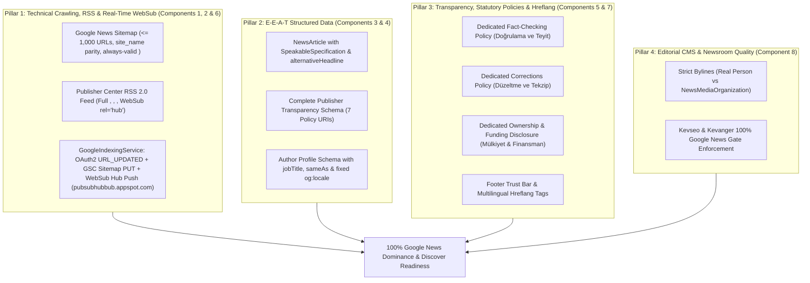

# Plan v1.0.54: 100% Google News Compliance, E-E-A-T Transparency & Framework Architecture

**Target Domain:** `https://amedbulten.com`  
**Repository:** `AF/Bulletin`  
**Target Version:** `v1.0.54`  
**Date:** 2026-11-09  
**Architecture Standard:** Amed Framework Core & Google News Technical, Editorial & Publisher Center Guidelines  

---

## 1. Executive Summary & Google News 100% Compliance Goal

Google News inclusion and top ranking are governed by deterministic algorithmic filters and strict editorial quality policies (E-E-A-T: Experience, Expertise, Authoritativeness, and Trustworthiness). For `amedbulten.com` to operate with **100% Google News compliance**, Bulletin CMS and Amed Framework must satisfy four foundational pillars:



---

## 2. Audit Findings & Gap Analysis (Deficiencies Identified)

A line-by-line code audit of `mod/index/index.php`, `lib/GoogleIndexingService.class.php`, `mod/mod_news/model/newses.model.php`, `templates/amed/`, and the database schema identified the following concrete deficiencies:

### Finding 1 (Component 1): Publisher Center RSS Feed Lacks `<content:encoded>`, `<dc:creator>`, `<category>`, and WebSub Hub Link
- **Location:** [`mod/index/index.php`](file:///home/malpersaz/Desktop/projects/htdocs/AF/Bulletin/mod/index/index.php#L638-L735) (`index_mod::rss()`)
- **Current State:**
  - Queries only `['name', 'title', 'summary', 'created_at', 'updated_at', 'seo', 'lang', 'image']` from `newses` view (even though `newses` view in `mod/mod_news/model/newses.model.php` already exposes `content`, `category_name`, `u_name`, `u_last_name`, and `username`).
  - Emits only a 500-character truncated `<description>`.
- **Deficiencies for Google News Publisher Center:**
  1. **Missing `<content:encoded>` (`xmlns:content="http://purl.org/rss/1.0/modules/content/"`):** Google News Publisher Center requires the full sanitized HTML article body inside `<content:encoded>` to render native articles in the Google News app.
  2. **Missing `<dc:creator>` (`xmlns:dc="http://purl.org/dc/elements/1.1/"`):** Every `<item>` must declare the author's real name (`u_name` + `u_last_name`, or fallback to `site_name` if `habermerkezi`).
  3. **Missing `<category>`:** Must emit the section name (`category_name`) inside `<item>`.
  4. **Missing WebSub Hub Link:** `<channel>` lacks `<atom:link href="https://pubsubhubbub.appspot.com/" rel="hub" />`.

### Finding 2 (Component 2): Google News Sitemap Quota (`50000` vs `1000`), Publication Name & Fallback XML Bug
- **Location:** [`mod/index/index.php`](file:///home/malpersaz/Desktop/projects/htdocs/AF/Bulletin/mod/index/index.php#L880-L972) (`index_mod::newsSitemap()`)
- **Deficiencies:**
  1. **Quota Limit Violation (Line 887):** Sets `$page_limit = 50000;`. Google News Sitemap protocol strictly limits news sitemaps to a maximum of **1,000 URLs** per file (`$page_limit = 1000;`).
  2. **Publication Name Mismatch (Line 908):** Uses `$this->site['title']` instead of preferring `$this->site['site_name']` (`Amed Bülten`), which must match the exact publication name in Google News Publisher Center.
  3. **Invalid XML on Fallback (Line 947):** When 0 articles are published in the last 48 hours, Tier 1 fallback fetches the latest 5 published articles (`$isFallback = true`), but line 947 wraps `<news:news>...</news:news>` inside `if (!$isFallback)`. When Google Search Console parses a sitemap with `xmlns:news` where `<url>` nodes lack `<news:news>`, it fails validation with *"Your Sitemap does not contain any URLs that belong to Google News"*. Every news item in Tier 1 fallback must still emit a valid `<news:news>` block.

### Finding 3 (Component 6): Real-Time WebSub Push Missing in `GoogleIndexingService`
- **Location:** [`lib/GoogleIndexingService.class.php`](file:///home/malpersaz/Desktop/projects/htdocs/AF/Bulletin/lib/GoogleIndexingService.class.php#L1-L380)
- **Current State (What Already Works):**
  - `GoogleIndexingService` is already wired into all news publish/update/delete lifecycles across `BaseModuleController`, `mod_news`, and `McpCrudToolsBase`.
  - It already sends authenticated OAuth2 `URL_UPDATED` / `URL_DELETED` requests to `https://indexing.googleapis.com/v3/urlNotifications:publish`.
  - `pingSitemaps()` already submits `sitemap.xml`, `newsSitemap.xml`, and `newsArchiveSitemap.xml` via the official authenticated Google Search Console API (`PUT https://www.googleapis.com/webmasters/v3/sites/{propertyId}/sitemaps/{sitemapUrl}`). *(Note: The legacy unauthenticated `google.com/ping?sitemap=` endpoint was deprecated by Google and must NOT be used.)*
- **What Is Missing:**
  - **WebSub (PubSubHubbub) Hub Push:** When a news item is published or updated, `GoogleIndexingService` does not notify Google's WebSub hub (`https://pubsubhubbub.appspot.com/`) that `/{lang}/rss.xml` has been updated (`hub.mode=publish` & `hub.url=https://amedbulten.com/{lang}/rss.xml`).
  - **Architectural Rule:** Do NOT create separate `WebSubService.class.php` or `IndexNowService.class.php` files (Google does not use IndexNow). Instead, add a lightweight `pingWebSubHub(?string $baseOrigin = null, ?string $lang = null): bool` method directly inside `GoogleIndexingService` and call it from `dispatchCompanionNotifications(string $url)`.

### Finding 4 (Component 3 & 4): Structured Data Schema Gaps (`NewsArticle` & `ProfilePage`)
- **Location:** [`templates/amed/index/mod_news/news.twig`](file:///home/malpersaz/Desktop/projects/htdocs/AF/Bulletin/templates/amed/index/mod_news/news.twig#L117-L216) & [`templates/amed/index/mod_publication/author.twig`](file:///home/malpersaz/Desktop/projects/htdocs/AF/Bulletin/templates/amed/index/mod_publication/author.twig#L49-L97)
- **Deficiencies:**
  - `news.twig` lacks `speakable` (`SpeakableSpecification`), `alternativeHeadline`, `copyrightHolder`, `copyrightYear`, `factCheckingPolicy`, and `ownershipFundingInfo`.
  - `author.twig` lacks `jobTitle` and `sameAs` in its `Person` JSON-LD, and line 49 has an invalid `_SE` locale fallback (``).

### Finding 5 (Component 5 & 7): Missing Statutory E-E-A-T Pages, Footer Trust Bar & Hreflang Tags
- **Location:** `mod_page` database table, [`templates/amed/index/footer.twig`](file:///home/malpersaz/Desktop/projects/htdocs/AF/Bulletin/templates/amed/index/footer.twig#L312-L321), and [`templates/amed/layouts/base.twig`](file:///home/malpersaz/Desktop/projects/htdocs/AF/Bulletin/templates/amed/layouts/base.twig#L18-L22)
- **Deficiencies:**
  - Missing dedicated pages for `Doğrulama ve Teyit Politikası`, `Düzeltme ve Tekzip Politikası`, and `Mülkiyet ve Finansman Yapısı`.
  - `footer.twig` only links to `/legal` and `/cookie-policy`, hiding editorial trust policies.
  - `base.twig` lacks `<link rel="alternate" hreflang="..." />` tags for active site languages.

---

## 3. Detailed Implementation Specifications for v1.0.54 (Step-by-Step Instructions for Execution)

> [!IMPORTANT]
> Follow the exact `Target` and `Replacement` code blocks below. Do NOT create extra unrequested classes (`WebSubService.class.php` or `IndexNowService.class.php`). All PHP modifications must pass `php -l` and all Twig modifications must pass `python3 tools/code_separation_guard.py`.

---

### Component 1: Google News Publisher Center RSS 2.0 Feed (`mod/index/index.php`)

**[MODIFY] [`mod/index/index.php`](file:///home/malpersaz/Desktop/projects/htdocs/AF/Bulletin/mod/index/index.php#L638-L735)**

Replace the `rss()` method (lines `638–735`) with the following implementation that includes `xmlns:content`, `xmlns:dc`, `<atom:link rel="hub">`, `<dc:creator>`, `<category>`, and full sanitized `<content:encoded>`:

```php
    public function rss()
    {
        if (!$this->guardFeatureOr404('news.feed')) {
            return;
        }

        header("content-type: text/xml; charset=utf-8");

        $allowedCatIds = $this->getAllowedCategoryIds('mod_news_category', (string) $this->site['lang'], true);
        $allowedCatList = !empty($allowedCatIds) ? implode(',', array_map('intval', $allowedCatIds)) : '0';

        $news = Load::model('mod_news.newses');
        $news->where_status_and_lang('y', $this->site['lang']);
        $news->addWhere('(acl_id = 0 OR acl_id IS NULL)');
        $news->addWhere($this->getPublishedDateCondition(''));
        $news->addWhere("category_id IN ({$allowedCatList})");
        $news->order('created_at', 'DESC');
        $news->select([
            'name',
            'title',
            'summary',
            'content',
            'category_name',
            'u_name',
            'u_last_name',
            'username',
            'created_at',
            'updated_at',
            'seo',
            'lang',
            'image',
        ]);
        $news->limit(50);
        $news->gR();

        $newsArray = $news->getSize() != 0 ? $news->toArray() : [];
        $lastBuildDate = date(DATE_RSS);
        if (!empty($newsArray)) {
            $newest = $newsArray[0];
            $newestTs = !empty($newest['updated_at']) ? strtotime((string) $newest['updated_at']) : (!empty($newest['created_at']) ? strtotime((string) $newest['created_at']) : time());
            if ($newestTs > 0) {
                $lastBuildDate = date(DATE_RSS, $newestTs);
            }
        }

        $channelTitle = !empty($this->site['site_name']) ? (string) $this->site['site_name'] : (string) ($this->site['title'] ?? 'Amed Bülten');
        $rssSelfUrl = Helper::sitemap_url($this->site['address'] . $this->site['lang'] . '/rss.xml');

        echo '<?xml version="1.0" encoding="UTF-8"?>
        <rss version="2.0" xmlns:atom="http://www.w3.org/2005/Atom" xmlns:media="http://search.yahoo.com/mrss/" xmlns:content="http://purl.org/rss/1.0/modules/content/" xmlns:dc="http://purl.org/dc/elements/1.1/">
        <channel>
            <title>' . htmlspecialchars(html_entity_decode($channelTitle, ENT_QUOTES | ENT_HTML5, 'UTF-8'), ENT_XML1 | ENT_QUOTES, 'UTF-8') . '</title>
            <link>' . Helper::sitemap_url($this->site['address'] . $this->site['lang'] . '/') . '</link>
            <description>' . htmlspecialchars(html_entity_decode((string) $this->site['description'], ENT_QUOTES | ENT_HTML5, 'UTF-8'), ENT_XML1 | ENT_QUOTES, 'UTF-8') . '</description>
            <language>' . htmlspecialchars((string) $this->site['lang'], ENT_XML1 | ENT_QUOTES, 'UTF-8') . '</language>
            <lastBuildDate>' . $lastBuildDate . '</lastBuildDate>
            <atom:link href="' . $rssSelfUrl . '" rel="self" type="application/rss+xml" />
            <atom:link href="https://pubsubhubbub.appspot.com/" rel="hub" />';

        if (!empty($newsArray)) {
            foreach ($newsArray as $o) {
                $link = Helper::sitemap_url($this->site['address'] . $o['lang'] . '/news/' . $o['seo']);
                $imageUrl = "";
                $thumbUrl = "";
                $imageMime = "image/jpeg";
                $imageLength = 0;
                if (!empty($o['image'])) {
                    $imageFile = root_dir . 'static' . DS . 'mod_news' . DS . $o['image'];
                    if (is_file($imageFile)) {
                        $imageLength = (int) @filesize($imageFile);
                        if ($imageLength > 0) {
                            $imageUrl = Helper::sitemap_url($this->site['iaddress'] . 'mod_news/' . $o['image']);
                            $thumbFile = root_dir . 'static' . DS . 'mod_news' . DS . 'thumb' . DS . $o['image'];
                            if (is_file($thumbFile)) {
                                $thumbUrl = Helper::sitemap_url($this->site['iaddress'] . 'mod_news/thumb/' . $o['image']);
                            } else {
                                $thumbUrl = $imageUrl;
                            }
                            $ext = strtolower((string) pathinfo((string) $o['image'], PATHINFO_EXTENSION));
                            if ($ext === 'webp') {
                                $imageMime = 'image/webp';
                            } elseif ($ext === 'png') {
                                $imageMime = 'image/png';
                            } elseif ($ext === 'gif') {
                                $imageMime = 'image/gif';
                            }
                        }
                    }
                }

                $headline = !empty($o['name']) ? $o['name'] : (!empty($o['title']) ? $o['title'] : '');
                $cleanHeadline = htmlspecialchars(html_entity_decode(strip_tags((string) $headline), ENT_QUOTES | ENT_HTML5, 'UTF-8'), ENT_XML1 | ENT_QUOTES, 'UTF-8');
                $cleanSummary = trim(html_entity_decode(strip_tags((string) $o['summary']), ENT_QUOTES | ENT_HTML5, 'UTF-8'));
                $shortSummary = mb_substr($cleanSummary, 0, 500);
                $shortSummaryCdata = str_replace(']]>', ']]]]><![CDATA[>', $shortSummary);

                $uName = trim((string) ($o['u_name'] ?? ''));
                $uLastName = trim((string) ($o['u_last_name'] ?? ''));
                $username = trim((string) ($o['username'] ?? ''));
                if ($uName !== '' && $username !== 'habermerkezi') {
                    $authorName = trim($uName . ' ' . $uLastName);
                } else {
                    $authorName = $channelTitle;
                }
                $authorCdata = str_replace(']]>', ']]]]><![CDATA[>', html_entity_decode($authorName, ENT_QUOTES | ENT_HTML5, 'UTF-8'));

                $categoryName = trim(html_entity_decode(strip_tags((string) ($o['category_name'] ?? '')), ENT_QUOTES | ENT_HTML5, 'UTF-8'));
                $categoryCdata = str_replace(']]>', ']]]]><![CDATA[>', $categoryName);

                $rawBody = (string) ($o['content'] ?? '');
                $sanitizedBody = preg_replace('#<(script|style|iframe|form|object|embed)\b[^>]*>.*?</\1>#is', '', $rawBody);
                $sanitizedBody = strip_tags((string) $sanitizedBody, '<p><h2><h3><h4><blockquote><ul><ol><li><a><strong><b><em><i><figure><figcaption><br>');
                $encodedParts = [];
                if ($imageUrl !== '') {
                    $encodedParts[] = '<figure></figure>';
                }
                if ($cleanSummary !== '') {
                    $encodedParts[] = '<p><strong>' . htmlspecialchars($cleanSummary, ENT_XML1 | ENT_QUOTES, 'UTF-8') . '</strong></p>';
                }
                if (trim($sanitizedBody) !== '') {
                    $encodedParts[] = $sanitizedBody;
                }
                $fullEncodedHtml = str_replace(']]>', ']]]]><![CDATA[>', implode("\n", $encodedParts));

                echo '
            <item>
                <title>' . $cleanHeadline . '</title>
                <link>' . $link . '</link>
                <guid isPermaLink="true">' . $link . '</guid>
                <pubDate>' . date(DATE_RSS, strtotime((string) $o['created_at'])) . '</pubDate>
                <dc:creator><![CDATA[' . $authorCdata . ']]></dc:creator>';
                if ($categoryCdata !== '') {
                    echo '
                <category><![CDATA[' . $categoryCdata . ']]></category>';
                }
                echo '
                <description><![CDATA[' . ($thumbUrl ? '' : '') . $shortSummaryCdata . ']]></description>
                <content:encoded><![CDATA[' . $fullEncodedHtml . ']]></content:encoded>';
                if ($imageUrl && $imageLength > 0) {
                    echo '
                <media:content url="' . $imageUrl . '" medium="image" type="' . $imageMime . '" width="1280" height="720" />
                <enclosure url="' . $imageUrl . '" type="' . $imageMime . '" length="' . $imageLength . '" />';
                }
                echo '
            </item>';
            }
        }
        echo '
        </channel>
        </rss>';
        exit;
    }
```

---

### Component 2: Google News Sitemap 1,000-URL Quota & Always-Valid `<news:news>` (`mod/index/index.php`)

**[MODIFY] [`mod/index/index.php`](file:///home/malpersaz/Desktop/projects/htdocs/AF/Bulletin/mod/index/index.php#L880-L972)**

In `newsSitemap($page = 1)` (lines `880–972`), perform three exact adjustments:
1. Change `$page_limit = 50000;` to `$page_limit = 1000;`.
2. Resolve `$siteTitle` from `$this->site['site_name']` first (falling back to `$this->site['title']` or `'Amed Bülten'`).
3. Remove the `if (!$isFallback)` condition around `<news:news>...</news:news>` so that Tier 1 fallback news items always emit valid `<news:news>` blocks.

**Exact Replacement for `newsSitemap($page = 1)`:**
```php
    public function newsSitemap($page = 1)
    {
        if (!$this->guardFeatureOr404('news.latest')) {
            return;
        }

        header("content-type: text/xml; charset=utf-8");
        $page_limit = 1000;
        $page = (intval($page) === 0) ? 1 : intval($page);
        $offset = ($page - 1) * $page_limit;

        $allowedCatIds = $this->getAllowedCategoryIds('mod_news_category', (string) $this->site['lang'], true);
        $allowedCatList = !empty($allowedCatIds) ? implode(',', array_map('intval', $allowedCatIds)) : '0';

        $nowTime = time();
        $recentNewsCutoff = $nowTime - (48 * 3600);

        $news = Load::model('mod_news.newses');
        $news->where_status_and_lang('y', $this->site['lang']);
        $news->addWhere('(acl_id = 0 OR acl_id IS NULL)');
        $news->addWhere($this->getPublishedDateCondition(''));
        $news->addWhere("category_id IN ({$allowedCatList})");
        $news->addWhere("created_at >= '" . date('Y-m-d H:i:s', $recentNewsCutoff) . "'");
        $news->order('created_at', 'DESC');
        $news->select(['name', 'seo', 'lang', 'created_at', 'updated_at']);
        $news->limit($page_limit, $offset);
        $news->gR();

        $rawPubName = !empty($this->site['site_name'])
            ? (string) $this->site['site_name']
            : (string) ($this->site['title'] ?? 'Amed Bülten');
        $siteTitle = htmlspecialchars(html_entity_decode($rawPubName, ENT_QUOTES | ENT_HTML5, 'UTF-8'), ENT_XML1 | ENT_QUOTES, 'UTF-8');
        $langCode = htmlspecialchars((string) ($this->site['lang'] ?? 'tr'), ENT_XML1 | ENT_QUOTES, 'UTF-8');
        
        $items = ($news->getSize() !== 0) ? $news->toArray() : [];

        // Tier 1 Guard: If 0 published in last 48h, query 5 latest published news to prevent empty <urlset>
        if (empty($items)) {
            $fallbackNews = Load::model('mod_news.newses');
            $fallbackNews->where_status_and_lang('y', $this->site['lang']);
            $fallbackNews->addWhere('(acl_id = 0 OR acl_id IS NULL)');
            $fallbackNews->addWhere($this->getPublishedDateCondition(''));
            $fallbackNews->addWhere("category_id IN ({$allowedCatList})");
            $fallbackNews->order('created_at', 'DESC');
            $fallbackNews->select(['name', 'seo', 'lang', 'created_at', 'updated_at']);
            $fallbackNews->limit(5, 0);
            $fallbackNews->gR();
            if ($fallbackNews->getSize() !== 0) {
                $items = $fallbackNews->toArray();
            }
        }

        echo '<?xml version="1.0" encoding="UTF-8"?>
        <urlset xmlns="http://www.sitemaps.org/schemas/sitemap/0.9" xmlns:news="http://www.google.com/schemas/sitemap-news/0.9">';
        if (!empty($items)) {
            foreach ($items as $o) {
                $createdTime = !empty($o['created_at']) ? strtotime($o['created_at']) : $nowTime;
                $updatedTime = !empty($o['updated_at']) ? strtotime($o['updated_at']) : $createdTime;
                if ($updatedTime < $createdTime) {
                    $updatedTime = $createdTime;
                }
                $lastmod = date('c', $updatedTime);
                $cleanTitle = htmlspecialchars(html_entity_decode(strip_tags((string) $o['name']), ENT_QUOTES | ENT_HTML5, 'UTF-8'), ENT_XML1 | ENT_QUOTES, 'UTF-8');
                $pubDate = date('c', $createdTime);

                echo '<url>
                          <loc>' . Helper::sitemap_url($this->site['address'] . $o['lang'] . '/news/' . $o['seo']) . '</loc>
                          <lastmod>' . $lastmod . '</lastmod>
                          <news:news>
                            <news:publication>
                              <news:name>' . $siteTitle . '</news:name>
                              <news:language>' . $langCode . '</news:language>
                            </news:publication>
                            <news:publication_date>' . $pubDate . '</news:publication_date>
                            <news:title>' . $cleanTitle . '</news:title>
                          </news:news>
                          <priority>0.80</priority>
                    </url>';
            }
        } else {
            // Tier 2 Guard: Zero published news in database (fresh install) -> emit homepage URL
            echo '<url>
                      <loc>' . Helper::sitemap_url($this->site['address'] . $langCode . '/') . '</loc>
                      <lastmod>' . date('c', $nowTime) . '</lastmod>
                      <priority>1.00</priority>
                  </url>';
        }
        echo '</urlset>';
        exit;
    }
```

---

### Component 6: Integrated WebSub (PubSubHubbub) Real-Time Push in `GoogleIndexingService`

> [!NOTE]
> Google Search Console sitemap submission (`PUT /webmasters/v3/sites/.../sitemaps/...`) and Google Indexing API (`URL_UPDATED` / `URL_DELETED`) are **already implemented** in [`lib/GoogleIndexingService.class.php`](file:///home/malpersaz/Desktop/projects/htdocs/AF/Bulletin/lib/GoogleIndexingService.class.php). Do NOT create `WebSubService.class.php` or `IndexNowService.class.php`, and do NOT call the deprecated `google.com/ping?sitemap=` URL. Simply add `pingWebSubHub()` inside `GoogleIndexingService.class.php`.

**[MODIFY] [`lib/GoogleIndexingService.class.php`](file:///home/malpersaz/Desktop/projects/htdocs/AF/Bulletin/lib/GoogleIndexingService.class.php)**

1. **In `loadState()` (line 62):** Include `'websub' => []` in the default array:
   ```php
   return ['urls' => [], 'sitemaps' => [], 'websub' => [], 'quota_exhausted_until' => 0];
   ```
2. **In `notifyUpdate()` (lines 82–90) and `notifyDelete()` (lines 99–107):** Ensure `dispatchCompanionNotifications($url)` is called so WebSub hub notifications fire on every production publish/update/delete, and add `pingWebSubHub()` inside `GoogleIndexingService`:
   ```php
    /**
     * Notify Google WebSub (PubSubHubbub) hub that the language RSS feed has been updated.
     */
    public function pingWebSubHub(?string $baseOrigin = null, ?string $lang = null): bool
    {
        if ($baseOrigin === null || $baseOrigin === '') {
            $siteConfig = Registry::get('site_config');
            $baseOrigin = is_array($siteConfig) && !empty($siteConfig['address'])
                ? rtrim((string) $siteConfig['address'], '/')
                : '';
        } else {
            $baseOrigin = rtrim($baseOrigin, '/');
        }

        if ($baseOrigin === '') {
            return false;
        }

        $host = strtolower((string) parse_url($baseOrigin, PHP_URL_HOST));
        if ($host === '' || str_contains($host, 'localhost') || $host === '127.0.0.1') {
            return false;
        }

        if ($lang === null || $lang === '') {
            $siteConfig = Registry::get('site_config');
            $lang = (is_array($siteConfig) && !empty($siteConfig['default_lang']))
                ? (string) $siteConfig['default_lang']
                : 'tr';
        }

        $rssUrl = Helper::sitemap_url($baseOrigin . '/' . trim($lang, '/') . '/rss.xml');
        $state = $this->loadState();
        $now = time();
        $lastWebSub = (int) ($state['websub'][$rssUrl] ?? 0);

        // 60-second cooldown per language RSS feed
        if (($now - $lastWebSub) < 60) {
            return true;
        }

        if (!class_exists('HttpClient')) {
            $httpPath = (defined('lib_dir') ? lib_dir : dirname(__DIR__) . '/lib/') . 'HttpClient.class.php';
            if (file_exists($httpPath)) {
                require_once $httpPath;
            }
        }

        if (!class_exists('HttpClient')) {
            return false;
        }

        $res = HttpClient::postForm('https://pubsubhubbub.appspot.com/', [
            'hub.mode' => 'publish',
            'hub.url' => $rssUrl,
        ], [], 10);

        if ($res['status'] >= 200 && $res['status'] < 300) {
            $state['websub'][$rssUrl] = $now;
            $this->saveState($state);
            return true;
        }

        error_log("Google WebSub hub ping failed ({$res['status']}) for {$rssUrl}: {$res['error']}");
        return false;
    }
   ```
3. **In `dispatchCompanionNotifications(string $url)` (lines 242–247):** Call `$this->pingWebSubHub($baseOrigin, $lang);` alongside `$this->pingSitemaps($baseOrigin, $lang);`:
   ```php
        $sitemapKey = $baseOrigin . '|' . ($lang ?? '');
        if (empty(self::$pingedSitemapLangs[$sitemapKey])) {
            self::$pingedSitemapLangs[$sitemapKey] = true;
            $this->pingWebSubHub($baseOrigin, $lang);
            $this->pingSitemaps($baseOrigin, $lang);
        }
   ```

---

### Component 3: NewsArticle Schema.org Enrichment (`templates/amed/index/mod_news/news.twig`)

**[MODIFY] [`templates/amed/index/mod_news/news.twig`](file:///home/malpersaz/Desktop/projects/htdocs/AF/Bulletin/templates/amed/index/mod_news/news.twig#L117-L216)**

In the `NewsArticle` JSON-LD block:
1. After `"headline": {{ d.name|json_ld|raw }},`, add `alternativeHeadline` and `speakable`:
   ```twig
		  "alternativeHeadline": {{ d.summary|striptags|trim|json_ld|raw }},
		  "speakable": {
		    "@type": "SpeakableSpecification",
		    "cssSelector": [
		      ".news-detail-title",
		      ".news-detail-lead"
		    ]
		  },
   ```
2. Add `copyrightHolder` and `copyrightYear`:
   ```twig
		  "copyrightHolder": {
		    "@type": "NewsMediaOrganization",
		    "@id": {{ (site.saddress ~ '#organization')|json_ld|raw }}
		  },
		  "copyrightYear": {{ article_created_ts|date('Y') }},
   ```
3. Expand `publisher` policy links to include dedicated `correctionsPolicy`, `factCheckingPolicy`, and `ownershipFundingInfo`:
   ```twig
		    "masthead": {{ (site.saddress ~ 'legal')|json_ld|raw }},
		    "publishingPrinciples": {{ (site.saddress ~ 'page/Yayın_İlkeleri')|json_ld|raw }},
		    "correctionsPolicy": {{ (site.saddress ~ 'page/Düzeltme_ve_Tekzip_Politikası')|json_ld|raw }},
		    "ethicsPolicy": {{ (site.saddress ~ 'page/Basın_Etiği_ve_Uyum')|json_ld|raw }},
		    "factCheckingPolicy": {{ (site.saddress ~ 'page/Doğrulama_ve_Teyit_Politikası')|json_ld|raw }},
		    "ownershipFundingInfo": {{ (site.saddress ~ 'page/Mülkiyet_ve_Finansman_Yapısı')|json_ld|raw }},
		    "actionableFeedbackPolicy": {{ (site.saddress ~ 'page/Hakkımızda')|json_ld|raw }},
   ```

---

### Component 4: Author E-E-A-T Schema & Locale Fix (`author.twig` & `mod_news.helper.php`)

1. **[MODIFY] [`templates/amed/index/mod_publication/author.twig`](file:///home/malpersaz/Desktop/projects/htdocs/AF/Bulletin/templates/amed/index/mod_publication/author.twig#L49-L97)**
   - Replace lines `49–53` (``) with standard locale mapping (`en_US`, `tr_TR`, `de_DE`, `fr_FR`, `sv_SE`, `ru_RU`, `ar_AR`, `ku`, `ckb`, `zza`).
   - In `mainEntity` (`Person` JSON-LD, lines `80–97`), add `jobTitle` (`author.role_label`) and `sameAs` (built from `ctx_get('author_social_links')`).

2. **[MODIFY] [`mod/index/helper/mod_news.helper.php`](file:///home/malpersaz/Desktop/projects/htdocs/AF/Bulletin/mod/index/helper/mod_news.helper.php#L229-L270)**
   - Ensure `author_job_title` and `author_same_as` remain populated cleanly for `news.twig`.

---

### Component 5: Dedicated E-E-A-T Transparency Pages & Footer Trust Bar

1. **[NEW] [`tasks/seed_google_news_policies.php`](file:///home/malpersaz/Desktop/projects/htdocs/AF/Bulletin/tasks/seed_google_news_policies.php)**
   - Idempotent CLI seed script that inserts (if not existing) three Turkish (`tr`) statutory pages in `pages` (`mod_page` model) with `status = 'y'`:
     - `Doğrulama ve Teyit Politikası` (`seo`: `Doğrulama_ve_Teyit_Politikası`)
     - `Düzeltme ve Tekzip Politikası` (`seo`: `Düzeltme_ve_Tekzip_Politikası`)
     - `Mülkiyet ve Finansman Yapısı` (`seo`: `Mülkiyet_ve_Finansman_Yapısı`)

2. **[MODIFY] [`templates/amed/index/footer.twig`](file:///home/malpersaz/Desktop/projects/htdocs/AF/Bulletin/templates/amed/index/footer.twig#L312-L321)**
   - Add links in `.footer-policies-area` for the editorial transparency pages when `site.lang == 'tr'` alongside `/legal` and `/cookie-policy`.

---

### Component 7: Multilingual Hreflang & Canonical Integrity (`base.twig`)

**[MODIFY] [`templates/amed/layouts/base.twig`](file:///home/malpersaz/Desktop/projects/htdocs/AF/Bulletin/templates/amed/layouts/base.twig#L18-L22)**
- Add a `` block in `<head>` right after `` so public pages emit `<link rel="alternate" hreflang="{{ site.lang }}" ...>` and `x-default`.

---

### Component 8: Editorial Pipeline Skill Updates (`kevseo` & `kevanger`)

**[MODIFY] [`.agents/skills/kevseo/SKILL.md`](file:///home/malpersaz/Desktop/projects/htdocs/AF/Bulletin/.agents/skills/kevseo/SKILL.md)**
- Document the `SpeakableSpecification` lead requirement (first paragraph and `.news-detail-lead` concise 5N1K summary suitable for TTS reading).

---

## 4. Verification & Testing Protocol

| Check | Target | Command / Method | Pass Criteria |
| :--- | :--- | :--- | :--- |
| **PHP Syntax** | `mod/index/index.php`, `lib/GoogleIndexingService.class.php` | `php -l` | `No syntax errors detected` |
| **RSS 2.0 Feed** | `http://localhost:8080/tr/rss.xml` | `curl -s http://localhost:8080/tr/rss.xml \| xmllint --noout -` | Valid XML; contains `xmlns:content`, `xmlns:dc`, `<atom:link href="https://pubsubhubbub.appspot.com/" rel="hub" />`, `<dc:creator>`, `<category>`, and `<content:encoded>` |
| **News Sitemap** | `http://localhost:8080/tr/newsSitemap.xml` | `curl -s http://localhost:8080/tr/newsSitemap.xml \| xmllint --noout -` | Valid XML; `$page_limit = 1000`; `<news:name>Amed Bülten</news:name>`; every news `<url>` has `<news:news>` |
| **NewsArticle Schema** | News detail page | `curl -s` + JSON-LD parse | Valid JSON-LD; includes `speakable`, `alternativeHeadline`, `factCheckingPolicy`, `correctionsPolicy`, `ownershipFundingInfo` |
| **Author Schema** | Author profile page | `curl -s` + JSON-LD parse | Valid JSON-LD; includes `jobTitle`, `sameAs`; `og:locale` has no `_SE` bug |
| **Code Separation** | All Twig templates | `python3 tools/code_separation_guard.py` | `0 violations` |

---

## 5. Version Bumping & Documentation Checklist

Upon execution of this plan:
1. Bump framework version to `1.0.54` in `config/site.config.php` and `config/site.config.example.php`.
2. Document all component changes in `docs/VERSION.md` under `## v1.0.54 (2026-11-09)`.
