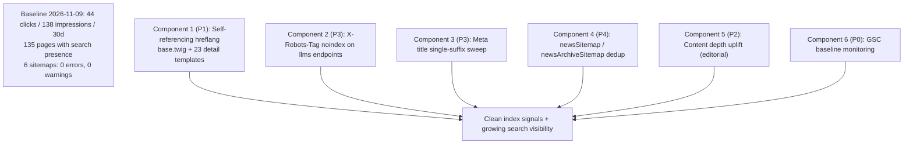

# Plan v1.0.55: Google Index Health Remediation & Search Visibility Uplift

**Target Domain:** `https://amedbulten.com`
**Repository:** `AF/Bulletin`
**Target Version:** `v1.0.55`
**Date:** 2026-11-09
**Architecture Standard:** Amed Framework Core & Google Search Central Guidelines (Search Essentials, canonical, hreflang, meta robots, duplicate content)
**Evidence Baseline:** Live audit executed 2026-11-09 against production (robots/sitemap/canonical crawls) and the Google Search Console API (read-only, service account in `data/google_search_console_api.json`, property `sc-domain:amedbulten.com`)

---

## 1. Executive Summary

The 2026-11-09 index health audit concludes: **technical crawling and indexation infrastructure is healthy; the binding constraint is organic visibility, plus exactly one template-level code defect (invalid hreflang cluster) and minor SERP hygiene noise.**



Priorities: **P1** = confirmed code defect degrading index signals; **P2** = primary visibility constraint; **P3** = SERP presentation noise; **P4** = cosmetic. **P0** = process, no code.

---

## 2. Audit Findings & Evidence Baseline (2026-11-09)

### 2.1 Verified Healthy (no action required)

| Area | Evidence |
| :--- | :--- |
| robots.txt | `Allow: /`, internal paths (`/tools/`, `/cache/`, `/installer/`) disallowed; sitemap index + news sitemaps declared |
| Sitemap index | `sitemap.xml` with 5 children, all `lastmod` 2026-11-09 (fresh); all child sitemaps HTTP 200 |
| Redirect chain | `http://` → `https://` → non-`www` single-hop (2 hops max from `http://www`); `/tr` → `/tr/` 301; root → `/tr/` 301 |
| 404 / 410 semantics | Missing news slug returns real HTTP 404; disabled locale `/ku/*` returns HTTP 410 Gone (correct retirement) |
| Internal search | `/tr/index/search/?query=…` emits `<meta name="robots" content="noindex, follow">` — no index bloat |
| Canonicals | News article self-canonical; `/contact` → `https://amedbulten.com/tr/page/Hakkımızda`; category `/tr/newses/Gündem` self-canonical |
| Meta robots | `index, follow, max-image-preview:large, max-snippet:-1, max-video-preview:-1` on home, article, page |
| Structured data | `NewsArticle` complete (speakable, `alternativeHeadline`, 3-ratio 1200px+ images, `datePublished`/`dateModified`, E-E-A-T policy URIs); `WebSite` + `NewsMediaOrganization` on home; `BreadcrumbList` on article |
| Indexing pipeline | `GoogleIndexingService` auto URL_UPDATED/URL_DELETED + GSC sitemap PUT + WebSub push on publish (v1.0.52–v1.0.54) |
| GSC integration | Property configured, service-account key present; sitemaps auto-submitted 2026-11-08 and downloaded same day, `0 errors / 0 warnings` on all 6 |

### 2.2 GSC Search Analytics (30 days, `dataState=all`, via API)

| Metric | Value |
| :--- | :--- |
| Clicks | 44 |
| Impressions | 138 |
| Average position | 4.6 |
| Pages with ≥1 impression | 135 |
| Top pages | Legal/contact pages and homepage; news articles ≈ 6–29 impressions each |

Sitemap coverage counters returned by the API read `submitted: N / indexed: 0` for every sitemap. This is **not** evidence of zero indexation: 135 distinct pages earned impressions in the window, and `site:` sampling shows homepage, all categories, fresh (2026-11-07) and archive (2026-11-04) articles indexed. The API counters lag or never populate for this young property (credentials created 2026-11-03). Authoritative per-URL coverage must be read from the GSC UI "Pages" report.

### 2.3 Finding 1 (P1): Invalid hreflang cluster — every non-home page points `tr` and `x-default` at the homepage

- **Location:** [`templates/amed/layouts/base.twig`](file:///home/malpersaz/Desktop/projects/htdocs/AF/Bulletin/templates/amed/layouts/base.twig#L20-L23) (``, added in v1.0.54 Component 7)
- **Current State:** The base block hardcodes both `<link rel="alternate" hreflang="{{ site.lang }}" href="{{ site.saddress }}…">` and `x-default` to the language homepage. 23 detail/listing templates override `` with their own self-canonical URL, but **none** override ``.
- **Live evidence:**
  - Article `/tr/news/diyarbakırda_uyuşturucu_operasyonlarında_24_kişi_tutuklandı`: canonical = article URL, hreflang `tr` + `x-default` = `/tr/`
  - Category `/tr/newses/Gündem`: canonical = category URL, hreflang `tr` + `x-default` = `/tr/`
  - Statutory `/contact`: canonical = `/tr/page/Hakkımızda`, hreflang `tr` + `x-default` = `/tr/`
- **Impact:** Hundreds of pages declare the same URL (`/tr/`) as their `tr` alternate — a structurally invalid hreflang cluster. Google currently tolerates it (pages remain indexed), but it is a standing quality signal defect and blocks the multilingual intent of v1.0.54 Component 7.

### 2.4 Finding 2 (P2): Thin content is the visibility ceiling

- **Evidence:** Sample article JSON-LD `wordCount: 191` (~1,133 characters of body) versus the `.agents/skills/kevseo/SKILL.md` thresholds (hard news minimum 2,500 chars; absolute thin-content rejection floor 1,500 chars). Site-wide: 44 clicks / 138 impressions per 30 days with top pages being statutory pages, not journalism.
- **Impact:** With ~95 published news items averaging near this depth, indexation exists but ranking demand does not. No code defect — an editorial pipeline/backlog problem.

### 2.5 Finding 3 (P3): SERP presentation noise

1. **`/tr/llms.txt` indexed** with a literal `N/A` title (served by `index_mod::llms()`, routed via `config/url.config.php` lines 71–74). Harmless but pollutes brand queries.
2. **Stored brand-suffix duplication in page meta titles:** live `<title>Hakkımızda | Amed Bülten - Amed Bülten</title>`. `templates/amed/index/mod_page/page.twig` renders `{{ page_meta_title }} - {{ site.title }}`, and the stored `mod_page.title` value already ends with `| Amed Bülten` — the same class of defect fixed for news titles in v1.0.53 Component 2 (suffix regex `/\s*[|–—-]\s*Amed\s*B[üu]lten(?:i)?\s*$/iu`).
3. **Legal templates append the long tagline:** `templates/amed/index/legal/index.twig` and `cookie_policy.twig` render `{{ page_meta_title }} - {{ site.name }}`, producing SERP titles like "Bizi Arayın - Diyarbakır, Ortadoğu ve dünyanın nabzını dinleyen hür yayıncılık." instead of a compact brand suffix.
4. **Legacy URL rows in GSC:** `http://amedbulten.com/` and bare `https://amedbulten.com/` appear as separate rows alongside `/tr/` (consolidation in progress; canonicals and 301s are correct, so this self-resolves — monitor only).

### 2.6 Finding 4 (P4): URL overlap between `newsSitemap.xml` and `newsArchiveSitemap.xml`

- **Location:** [`mod/index/index.php`](file:///home/malpersaz/Desktop/projects/htdocs/AF/Bulletin/mod/index/index.php#L1025) (`index_mod::newsArchiveSitemap()` lists all published news; `newsSitemap()` lists the last 48h plus Tier-1 fallback)
- **Live evidence:** `Türkiye_Başika_Üssünü_Aşamalı_Olarak_Iraka_Devrediyor` appears as `<loc>` #1 in **both** files.
- **Impact:** Allowed by the sitemap protocol and ignored by Google; purely redundant fetch volume. Fix is optional.

### 2.7 Finding 5 (P0, informational): Monitoring limitations

- **URL Inspection API returns HTTP 404** for both `sc-domain:amedbulten.com` and URL-prefix property forms (endpoint routing limitation observed with valid OAuth token; sitemaps + searchAnalytics endpoints work with the same token). Per-URL "Indexed" verdicts must be read from the GSC UI until this is resolved upstream.
- `site:` counts gathered via Exa-backed search are a proxy, not Google's authoritative count.

---

## 3. Detailed Implementation Specifications for v1.0.55

### Component 1 (P1): Self-Referencing Hreflang on All Non-Home Pages

**Approach:** Mirror the existing `` override pattern — every template that overrides canonical also overrides hreflang with its own URL. No controller changes, no new variables, consistent with the template architecture.

1. **[MODIFY] [`templates/amed/layouts/base.twig`](file:///home/malpersaz/Desktop/projects/htdocs/AF/Bulletin/templates/amed/layouts/base.twig#L20-L23)**
   - Keep the default `` (homepage semantics: `tr` + `x-default` → language root). Add a one-line Twig comment above the block documenting that **every** non-home template must override both `canonical` and `hreflang` together.

2. **[MODIFY] The 23 templates that override ``** (author/announcement×2/calendar/cookie_policy/event×2/gallery/legal/news archive/news detail/newses listing/page/publication archive/author×2/publications detail+listing/us_elections_live/video×2 — full list from `grep "block canonical" templates/amed`):
   - Immediately after each `…`, add an adjacent override emitting the **identical URL**:
     ```twig
     
         <link rel="alternate" hreflang="{{ site.lang }}" href="{same URL expression as canonical}"/>
         <link rel="alternate" hreflang="x-default" href="{same URL expression as canonical}"/>
     
     ```
   - Copy the URL expression verbatim from the sibling canonical block (including `page > 1` / filtered-category conditionals) so the two can never diverge.

3. **Rationale for keeping hreflang (not deleting it):** single-language self-referencing hreflang is harmless and preserves the multilingual cluster structure for the moment a second `lang_status='y'` locale activates (at which point cross-language alternates replace the self-references).

### Component 2 (P3): `X-Robots-Tag: noindex` on LLM Feed Endpoints

**[MODIFY] [`mod/index/index.php`](file:///home/malpersaz/Desktop/projects/htdocs/AF/Bulletin/mod/index/index.php#L1481-L1496)**

- In `index_mod::llms()` and `index_mod::llmsFull()`, send `header('X-Robots-Tag: noindex, follow');` alongside the existing `Content-Type: text/plain` header, before any body output. This covers all three routes (`llms.txt`, `llms-full.txt`, `.well-known/llms.txt`) since they share the controller.
- Do **not** remove the `# LLMS-Txt:` comment line from `robots.php`/`robots.txt` — discovery for AI crawlers stays, only Google's HTML index drops the file.

### Component 3 (P3): Meta Title Single-Suffix Sweep

1. **[NEW] [`tasks/sweep_page_meta_titles.php`](file:///home/malpersaz/Desktop/projects/htdocs/AF/Bulletin/tasks/)**
   - Idempotent CLI sweep (mirror `tasks/seed_google_news_policies.php` bootstrap conventions) that strips the trailing brand suffix pattern `/\s*[|–—-]\s*Amed\s*B[üu]lten(?:i)?\s*$/iu` from `mod_page.title` values, following the exact v1.0.53 Component 2 precedent applied to news titles. Prints per-row before/after; safe to re-run.
2. **[MODIFY] [`mod/mod_page/validator/add.validator.php` / `edit.validator.php`]**
   - Reject/strip the same trailing brand-suffix pattern on save, mirroring the news validators from v1.0.53, so the duplication cannot be reintroduced.
3. **[MODIFY] [`templates/amed/index/legal/index.twig`](file:///home/malpersaz/Desktop/projects/htdocs/AF/Bulletin/templates/amed/index/legal/index.twig#L17-L19) and `cookie_policy.twig`**
   - Change the title suffix from `{{ site.name }}` (long tagline) to `{{ site.title }}` (compact brand), producing "Bizi Arayın - Amed Bülten" instead of the full tagline. Verify `site.name` vs `site.title` semantics during implementation before switching.

### Component 4 (P4, optional): Archive Sitemap 48h Exclusion

**[MODIFY] [`mod/index/index.php`](file:///home/malpersaz/Desktop/projects/htdocs/AF/Bulletin/mod/index/index.php#L1025) (`index_mod::newsArchiveSitemap()`)**

- Exclude URLs already emitted by `newsSitemap()` by filtering out articles published within the last 48 hours (the same cutoff `newsSitemap()` uses), so each news URL lives in exactly one of the two files.
- Explicitly skippable: protocol-legal, Google-ignored. Close as "won't fix (documented)" if implementation risks touching the fallback-tier logic.

### Component 5 (P2, editorial — no code): Content Depth Uplift

1. Triage all ~95 published news items with the existing admin **quality meter** (v1.0.52) against the `.agents/skills/kevseo` thresholds: hard news ≥ 2,500 chars, absolute floor 1,500 chars.
2. Editorial backlog: expand every live article below the 1,500-char floor (audit sample was 191 words / ~1,133 chars), prioritizing articles with existing impressions (they already have demand).
3. Pipeline enforcement stays with `kevseo` Stage audit (`audit_seo.py` PASSED gate) — no new code gates.

### Component 6 (P0, process): GSC Baseline & 30-Day Recheck

1. Record this document's §2.2 table as the official baseline (2026-11-09).
2. Recheck cadence via the existing `mod_seo` admin report (30-day window) plus the GSC UI Pages report (authoritative coverage; the API's `indexed: 0` counters and the URL Inspection API 404 are known limitations).
3. Confirm in GSC UI that hreflang errors/warnings are zero after Component 1 deploys and recrawls.

---

## 4. Verification & Testing Protocol

| Check | Target | Command / Method | Pass Criteria |
| :--- | :--- | :--- | :--- |
| **PHP Syntax** | `mod/index/index.php`, `mod/mod_page/validator/*` | `php -l` | `No syntax errors detected` |
| **Hreflang parity** | Live article, category, statutory page, listing page | `curl -s <url> \| grep -E 'canonical\|alternate'` | hreflang `tr` and `x-default` href **equal** the canonical href on every non-home page; homepage unchanged |
| **LLM noindex** | `/llms.txt`, `/llms-full.txt`, `/.well-known/llms.txt`, `/tr/llms.txt` | `curl -sI <url> \| grep -i x-robots` | `X-Robots-Tag: noindex, follow` present; body unchanged |
| **Title sweep** | `/contact` (Hakkımızda), legal pages | `curl -s <url> \| grep -oE '<title>[^<]*</title>'` | Exactly one brand token; no `Amed Bülten - Amed Bülten`; no long tagline on legal pages |
| **Sitemap validity** | `/tr/newsSitemap.xml`, `/tr/newsArchiveSitemap.xml`, `/sitemap.xml` | `curl -s <url> \| xmllint --noout -` | Valid XML; (if Component 4 done) zero `<loc>` intersection between the two news sitemaps |
| **Code separation** | All modified Twig templates | `python3 tools/code_separation_guard.py` | `0 violations` |
| **GSC re-verification** | Search Console UI, ≥14 days post-deploy | Pages report + International Targeting/hreflang report | No hreflang errors; coverage stable or rising vs §2.2 baseline |

---

## 5. Version Bumping & Documentation Checklist

Upon execution of this plan:
1. Bump framework version to `1.0.55` in `config/site.config.php` and `config/site.config.example.php`.
2. Document all component changes in `docs/VERSION.md` under `## v1.0.55 (2026-11-09)`.

---

## 6. Scope Guards & Non-Goals

- `biys/` archive directory is untouchable (AGENTS.md boundary).
- No new service classes (no `IndexNowService`, no separate hreflang service); no changes to `lib/GoogleIndexingService.class.php` — the indexing pipeline is verified healthy.
- No `robots.txt` restructuring; no canonical changes on listing pagination beyond the hreflang mirror (pagination canonicals are already correct).
- Component 5 is editorial: no CMS code, no forced auto-expansion of articles.
