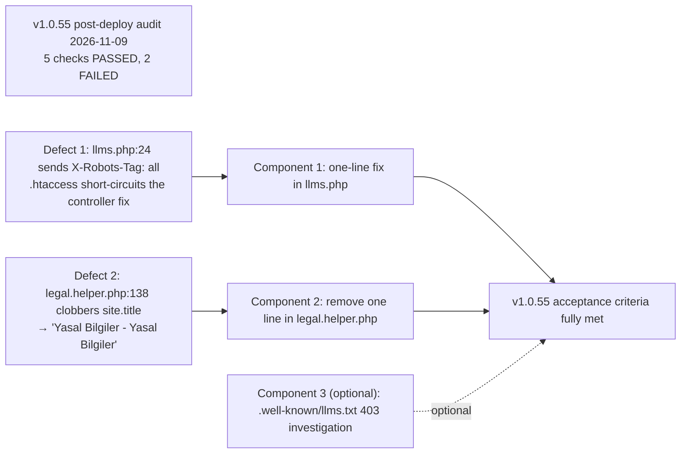

# Plan v1.0.56: LLM Entrypoint Noindex Parity & Legal Page Brand-Title Restoration

**Target Domain:** `https://amedbulten.com`
**Repository:** `AF/Bulletin`
**Target Version:** `v1.0.56`
**Date:** 2026-11-09
**Architecture Standard:** Amed Framework Core & Google Search Central Guidelines (robots meta directives, duplicate content, SERP title quality)
**Context:** Post-deploy verification of v1.0.55 (executed 2026-11-09, live production) confirmed Components 1/3/4 of `docs/plan/v1.0.55-google-index-health-remediation-plan.md` as working, but exposed **two residual defects** where the deployed behavior contradicts the v1.0.55 changelog claims. This plan closes exactly those two gaps plus one optional investigation item. No new features.

---

## 1. Executive Summary



Both fixes are single-line changes with fully reproducible live evidence and low regression risk. Every claim below is verifiable by the implementer with the exact commands in §4 before touching any code.

---

## 2. Findings (Evidence-Rooted, Verifiable)

### Finding 1 (P1): All LLM endpoints still emit `X-Robots-Tag: all` — the v1.0.55 fix landed in code that Apache never executes

**Where the v1.0.55 fix went:** `mod/index/index.php` lines 1481–1501 — `index_mod::llms()` (line 1487) and `index_mod::llmsFull()` (line 1498) correctly send `header('X-Robots-Tag: noindex, follow');`.

**Why it has no effect in production:** root `.htaccess` lines 21–25 short-circuit every llms URL directly to the standalone entrypoint before the framework router (and therefore before `index_mod`) is ever invoked:

```apache
RewriteRule ^llms\.txt$ llms.php [L]
RewriteRule ^llms-full\.txt$ llms.php?mode=full [L]
RewriteRule ^\.well-known/llms\.txt$ llms.php [L]
RewriteRule ^([a-z]{2,3})/llms\.txt$ llms.php?lang=$1 [L]
RewriteRule ^([a-z]{2,3})/llms-full\.txt$ llms.php?lang=$1&mode=full [L]
```

The `[L]` flags terminate rewrite processing; `config/url.config.php` lines 72–74 (`$url['llms.txt'] = 'index/llms';` …) are unreachable under Apache for these paths. They remain reachable under the nginx Docker profile (`docker/nginx/default.conf` contains no llms location), which is why the controller headers must stay.

**Where the defect actually lives:** [`llms.php`](file:///home/malpersaz/Desktop/projects/htdocs/AF/Bulletin/llms.php#L24) line 24:

```php
header('X-Robots-Tag: all');
```

**Live evidence (2026-11-09, post-v1.0.55-deploy):**

```
$ curl -sI https://amedbulten.com/llms.txt | grep -iE '^(HTTP|x-robots|content-type)'
HTTP/2 200
x-robots-tag: all          <-- expected: noindex, follow
content-type: text/plain; charset=utf-8
```
Identical result for `/llms-full.txt` and `/tr/llms.txt`. The response also carries `cache-control: public, max-age=3600, stale-while-revalidate=86400` — the exact signature of `llms.php:23`, proving the entrypoint (not the controller) served the request.

**Why it matters:** `/tr/llms.txt` is currently indexed in Google with a literal `N/A` title (observed in `site:amedbulten.com` results during the 2026-11-09 audit). `noindex, follow` removes it from the Google HTML index while leaving the body fully consumable by AI crawlers — which ignore `X-Robots-Tag` for content retrieval.

**History note (why `all` exists):** `llms.php` got `X-Robots-Tag: all` in v1.0.18 when the development indexing shield was lifted (`docs/VERSION.md` line 798: "Restored `X-Robots-Tag: all` on public AI and LLM ingestion endpoint `llms.php`"). That decision predates the index-hygiene goal and is superseded by v1.0.55 Component 2.

### Finding 2 (P1): Legal and cookie-policy `<title>` tags render duplicated page names

**Live evidence (2026-11-09):**

```
$ curl -s https://amedbulten.com/tr/legal | grep -oE '<title>[^<]*</title>'
<title>Yasal Bilgiler - Yasal Bilgiler</title>          <-- expected: Yasal Bilgiler - Amed Bülten
$ curl -s https://amedbulten.com/tr/cookie-policy | grep -oE '<title>[^<]*</title>'
<title>Çerez Politikası - Çerez Politikası</title>
```

**Root cause — execution order in [`mod/index/helper/legal.helper.php`](file:///home/malpersaz/Desktop/projects/htdocs/AF/Bulletin/mod/index/helper/legal.helper.php#L138) (`legal_helper::render()`):**

1. `$this->site['title']` enters `render()` holding the **brand** from settings (`Amed Bülten` — `mod_settings` row `lang='tr'`, field `title`).
2. Line 138 executes: `$this->site['title'] = $title;` — this **overwrites the brand with the page title** (`$title` = "Yasal Bilgiler" / "Çerez Politikası", resolved at lines 73–75 from `lang.index.*`).
3. Line 143 pushes the mutated array to Twig: `$this->theme->set('site', $this->site);`
4. The templates render `{{ page_meta_title }} - {{ site.title }}` (`templates/amed/index/legal/index.twig:22`, `templates/amed/index/legal/cookie_policy.twig:21` — both changed to `site.title` in v1.0.55 Component 4 expecting the **brand**) → both halves are now the same string.

The v1.0.55 changelog states the intended output is `"Yasal Bildirimler - Amed Bülten"` style; the implementer fixed the templates but missed that this helper clobbers the value the template reads.

**Why removing line 138 is the correct fix (alternatives rejected):**

- The page title is already delivered to templates through the dedicated variable `policy_title` (line 135) and consumed by the schema/`<h1>` paths; nothing on the rendered page needs `site.title` to equal the page title.
- Remaining consumers of `site.title` on legal pages — the template `<title>` suffix and `base.twig`'s RSS alternate `title="{{ site.title }}"` — both want the brand. With line 138 removed they get it.
- Line 115 (`$siteName = !empty($this->site['title']) ? …`) runs **before** 138 and uses `site['title']` as the brand for default cookie-sample rows — today it accidentally still works because 115 precedes 138; after removal it keeps working by design instead of by accident.
- Rejected alternative A — hardcode `Amed Bülten` in the two templates: breaks the 10-locale dictionary architecture (same titles render for `ku`, `en`, `de`, …).
- Rejected alternative B — introduce a new `site.brand` Twig variable: redundant indirection; the settings `title` field already is the single brand source everywhere else on the site (article titles, category titles).
- Keep lines 139–141 (description overwrite) untouched: `meta description` per statutory page is intended behavior.

### Finding 3 (P3, optional): `/.well-known/llms.txt` returns HTTP 403 despite the rewrite at `.htaccess:23`

**Live evidence:** `curl -sI https://amedbulten.com/.well-known/llms.txt` → `HTTP/2 403` with `content-type: text/html; charset=iso-8859-1` (Apache default error page, not the framework's). All other four llms routes serve 200. The rewrite exists, so the 403 originates upstream of mod_rewrite — almost certainly host-level dotfile protection (ALL-INKL KAS shared hosting). Impact is negligible: 403 cannot be indexed, and the canonical `llmstxt.org` path is `/llms.txt`, which works. Investigate only if the host exposes a dotfile-override; otherwise close as won't-fix with a note in `docs/SERVER.md`.

---

## 3. Implementation Specifications for v1.0.56

### Component 1 (P1): `X-Robots-Tag: noindex, follow` in the llms entrypoint

**[MODIFY] [`llms.php`](file:///home/malpersaz/Desktop/projects/htdocs/AF/Bulletin/llms.php#L24)**

```diff
     header('Content-Type: text/plain; charset=utf-8');
     header('Cache-Control: public, max-age=3600, stale-while-revalidate=86400');
-    header('X-Robots-Tag: all');
+    header('X-Robots-Tag: noindex, follow');
```

- Exactly one line. Do **not** touch the `Cache-Control` line or the error branch (an error page should stay out of the index anyway; optionally the catch block may also send the same header — implementer's discretion, not required).
- Do **not** revert or "clean up" the controller headers in `mod/index/index.php:1487/1498`: under the nginx Docker profile those methods are the live path (see Finding 1 routing analysis). Both paths must now agree, which they will.

### Component 2 (P1): Stop overwriting the brand title in the legal helper

**[MODIFY] [`mod/index/helper/legal.helper.php`](file:///home/malpersaz/Desktop/projects/htdocs/AF/Bulletin/mod/index/helper/legal.helper.php#L138)**

```diff
         $this->theme->set('policy_title', $title);
         $this->theme->set('policy_description', $description);
 
-        $this->site['title'] = $title;
         if (!empty($description)) {
             $this->site['description'] = $description;
         }
```

- Exactly one deleted line; no template changes (the v1.0.55 template suffix `{{ site.title }}` becomes correct the moment the clobber is gone).
- Expected rendered titles after deploy: `Yasal Bilgiler - Amed Bülten`, `Çerez Politikası - Amed Bülten` — matching the v1.0.55 changelog intent.

### Component 3 (P3, optional): `.well-known/llms.txt` 403 investigation

1. Check whether the host permits overriding dotfile access (`<FilesMatch>` / `RedirectMatch` in the KAS panel or an outer Apache config).
2. If overridable, add the narrowest possible allow rule for `.well-known/llms.txt` only (do not open dotfiles broadly).
3. If not overridable, document the 403 as intentional in `docs/SERVER.md` and close.

### Component 4: Framework Version Parity

1. Bump framework version to `1.0.56` in `config/site.config.php` and `config/site.config.example.php`.
2. Record all changes in `docs/VERSION.md` under `## v1.0.56 (2026-11-09)`, explicitly noting that v1.0.55 Components 2/4 are completed by this release (entrypoint parity + brand-title restoration).

---

## 4. Verification & Testing Protocol (implementer runs these BEFORE and AFTER the change)

| # | Check | Command | Pass Criteria |
| :--- | :--- | :--- | :--- |
| 1 | PHP syntax | `php -l llms.php && php -l mod/index/helper/legal.helper.php` | `No syntax errors detected` ×2 |
| 2 | LLM headers (pre-deploy should FAIL, post-deploy must PASS) | `for u in llms.txt llms-full.txt tr/llms.txt tr/llms-full.txt; do curl -sI https://amedbulten.com/$u \| grep -i x-robots; done` | `x-robots-tag: noindex, follow` on all four; body unchanged (`curl -s …/llms.txt \| head -1` still `# …`) |
| 3 | LLM cache staliness | repeat check 2 up to 60 min post-deploy | llms.php declares `max-age=3600`; a cached `all` may persist briefly — re-check after TTL expiry before declaring failure |
| 4 | Legal titles (pre-deploy FAIL, post-deploy PASS) | `for u in tr/legal tr/cookie-policy; do curl -s https://amedbulten.com/$u \| grep -oE '<title>[^<]*</title>'; done` | `Yasal Bilgiler - Amed Bülten` / `Çerez Politikası - Amed Bülten` — exactly one brand token, no duplicated page name |
| 5 | Statutory redirects unchanged (regression) | `for u in contact legal terms-of-service editorial-policy; do curl -s -o /dev/null -w "%{http_code} %{redirect_url}\n" https://amedbulten.com/$u; done` | All four still 301 to `/tr/page/…` / `/tr/legal` exactly as verified on 2026-11-09 |
| 6 | Cookie-policy fallback regression | temporarily reason over code path only: `legal.helper.php:115` reads `site['title']` | Code review: line 115 still sees the brand (it executes before the removed line would have) |
| 7 | Legal schema/og unaffected (regression) | `curl -s https://amedbulten.com/tr/legal \| grep -oE '"@type": ?"[A-Za-z]+"' \| sort -u` and `og:title` | Schema types and `og:title` (uses `page_meta_title`) unchanged |
| 8 | Optional Component 3 | `curl -sI https://amedbulten.com/.well-known/llms.txt` | 200 + `noindex, follow` (if host override found) or documented won't-fix note |
| 9 | Search-index follow-up (≥14 days post-deploy) | GSC UI → URL inspection of `/tr/llms.txt` | Coverage becomes "Excluded by 'noindex'"; legal page SERP titles refresh |

---

## 5. Rollback & Risk Notes

- **Component 1:** worst case an intermediate proxy served the old header for ≤1 h (check 3). The directive affects only Google's HTML index, not AI consumption — no traffic loss path.
- **Component 2:** the only behavioral surface is the legal/cookie `<title>` and the RSS alternate title on those two pages; both move toward the documented v1.0.55 intent. If any unforeseen consumer needed the page title in `site.title`, it is still available as the template variable `policy_title`.
- No database changes, no `.htaccess` changes (Component 3 aside), no template changes, no sitemap changes.

---

## 6. Scope Guards & Non-Goals

- `biys/` archive directory is untouchable (AGENTS.md boundary).
- News sitemap ∩ archive sitemap overlap (v1.0.55 Finding 4) stays closed as documented won't-fix.
- No changes to `mod/index/index.php`, `templates/`, `robots.txt`/`robots.php`, or `lib/GoogleIndexingService.class.php`.
- GSC API-side limitations (sitemap `indexed: 0` counters, URL Inspection API 404) are upstream; monitoring continues per v1.0.55 Component 6.
