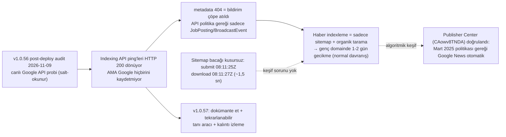

# Plan v1.0.57: Google Indexing API Reality Documentation, Read-Only Diagnostic Tool & SERP Residual Monitoring

**Target Domain:** `https://amedbulten.com`
**Repository:** `AF/Bulletin`
**Target Version:** `v1.0.57`
**Date:** 2026-11-09
**Architecture Standard:** Amed Framework Core & Google Search Central (Indexing API usage policy, Search Console API, sitemap crawl scheduling)
**Context:** Post-v1.0.56 live audit (2026-11-09) using the production service account (`amedbulten-ai@amedbulten.iam.gserviceaccount.com`) against Google's own APIs. The audit closed the "why is indexing slow and brand-weak" question with a definitive root cause. This plan exists so that the finding is **never re-investigated or misread again**: it documents where the problem lives, why it happens, and how to verify it in the future. No behavioral change to the indexing pipeline.

---

## 1. Executive Summary



---

## 2. Findings (Evidence-Rooted, Google-Side — all verified 2026-11-09)

### Finding 1 (P1 — the root cause): `urlNotifications:publish` is a **silent no-op** for this site's content type

**Where:** the pipeline in [`lib/GoogleIndexingService.class.php`](file:///home/malpersaz/Desktop/projects/htdocs/AF/Bulletin/lib/GoogleIndexingService.class.php) (`notifyUpdate()` / `notifyDelete()` → `publishNotification()`, lines ~82–107, ~390–446).

**Evidence chain (all from 2026-11-09):**

1. `data/indexing_state.json` (production-synced copy) records **successful** publishes — `state['urls'][$urlKey] = $now` is only written when Google returns HTTP 200 (`publishNotification()` line ~443):
   - `https://amedbulten.com/|URL_UPDATED` → 2026-11-06
   - `https://amedbulten.com/tr/|URL_UPDATED` → 2026-11-06
   `https://amedbulten.com/tr/news/Türkiye_Başika...|URL_UPDATED` → 2026-11-08
2. Google's own record for the **exact same URL strings**, via read-only `GET https://indexing.googleapis.com/v3/urlNotifications/metadata` (indexing scope token minted from `data/credentials.json`):
   - `https://amedbulten.com/tr/` → **404 NOT_FOUND**
   - the 2026-11-08 article URL (single-encoded, byte-identical to the published string) → **404 NOT_FOUND**
3. Google policy (Search Central, Indexing API docs): the API is **only for `JobPosting` and `BroadcastEvent` structured-data pages**. Calls for other URLs are accepted with HTTP 200 but never registered or acted upon.

**Conclusion:** `HTTP 200` from `urlNotifications:publish` **does not mean Google received anything**. The only way to verify Google-side receipt is the `urlNotifications/metadata` 404-vs-200 check (implemented by Component 3).

**Why it matters / observed production impact:**
- The v1.0.54 "instant indexing" architecture assumption is invalid for news content. New articles are discovered only via sitemap + organic crawl → **1–2 day index latency** on this young domain is the *expected* signature of organic-only discovery, not a defect.
- **Sitemap leg is healthy** — do not chase it: all 6 sitemaps `lastSubmitted 2026-11-09T08:11:25–27Z`, `lastDownloaded` 1–2 s later, `errors=0`. Google fetches eagerly; it simply schedules URL crawling later.
- **Decision — keep the pipeline as-is.** It is harmless (quota never exhausted; `quota_exhausted_until` stays 0), it remains valid if the site ever publishes `JobPosting`/`BroadcastEvent` content, and `pingSitemaps()` + `pingWebSubHub()` (which DO work) ride on the same class. Removing it buys nothing.

### Finding 2 (P2 — known artifact, do not re-investigate): GSC API `indexed: 0` counters

`searchAnalytics` shows live impressions on pages across the property, while the sitemaps API reports `indexed=0` for every child sitemap (newsSitemap 9/0, newsArchive 95/0, page 18/0, category 22/0, gallery 1/0). Impressions imply indexing, therefore the counters are the **Search Console API reporting artifact already classified upstream in v1.0.55 §6**. Minor oddity observed: `newsSitemap.xml` appears **twice** in the sitemaps list response with identical timestamps — harmless API duplication, no action.

### Finding 3 (P2 — the real 28-day visibility baseline, from `searchAnalytics.query`)

Full-property, 2026-10-12 → 2026-11-09: **≈317 impressions, ≈42 clicks total.** Query-dimension report is nearly empty (2 rows: `amedstore paris` pos 9, `ebyn` pos 80) — nearly all traffic is anonymized/rare long-tail queries.

| Surface | Impressions | Avg position | Reading |
| :-- | :-- | :-- | :-- |
| `https://amedbulten.com/` | 23 | **1.4** | Homepage IS shown and wins when a query triggers it |
| `https://amedbulten.com/tr/` | 28 | **1.8** | Same |
| `http://amedbulten.com/` | 6 | 2.2 | SERP residual (Finding 4) |
| News articles | 1–19 each | **15–31** | Indexed but weakly ranked; brand demand is near-zero |
| `/legal`, `/contact`, `/compliance` (root) | 18–33 | 2.5–5.1 | Legacy-root residuals out-impressing news |

**Corrected conclusion vs. earlier perception:** the homepage is *not* missing from Google — it averages position 1.4–1.8. The visible problem is **query-side volume** (brand generates almost no search demand yet), not indexability.

### Finding 4 (P3 — SERP residuals, monitoring-only): three legacy clusters still earning impressions

1. `http://amedbulten.com/` served as a separate URL row (6 impr). Live check: `http://` → **301 → `https://amedbulten.com/`** everywhere. This is Google-side attribution decay; no fix exists on our side.
2. `/ku/*` pages (`/ku/accessibility`, `/ku/authors`, `/ku/publications`, `/ku/security-policy`, `/ku/cookie-policy`; 8–11 impr each) — live: **HTTP 410 + `X-Robots-Tag: noindex, nofollow`** (correct since the language was disabled). Impressions are pre-cleanup index remnants; Google purges 410s on recrawl.
3. Root legal/contact/compliance URLs (`/legal` 33, `/contact` 21, `/compliance` 18 impr) — live: **301** to `/tr/...` (verified in the v1.0.56 audit). Remnants of the pre-redirect index state; titles shown in SERP are stale caches.

All three clusters already return the correct live signals (301/410/noindex). **No code action** — they decay naturally. Escalation criteria in §3 Component 4.

### Finding 5 (P1 — verified 2026-11-09): Google Publisher Center status & March 2025 automatic generation policy

The publication **Amed Bulten** is registered and active in Google Publisher Center under ID `CAowv8TNDA` (`https://publishercenter.google.com/?publication=CAowv8TNDA`), with *Reader Revenue Manager* (`IN PROGRESS`) listed under active products. Per Google's **March 2025 policy update** (*"Google News now automatically generates publication pages"*), manual RSS/sitemap section configuration and manual publication review submission in Publisher Center have been retired. Google News and Discover inclusion is now 100% algorithmic, driven by `tr/newsSitemap.xml`, `tr/rss.xml` (WebSub), `NewsArticle` structured data, and sustained publishing velocity. Therefore, no manual Publisher Center review action exists; the 1–2 day web-index latency on a young domain will decrease organically as crawl authority grows.

---

## 3. Implementation Specifications for v1.0.57

### Component 1: `docs/SERVER.md` — new section documenting the Indexing API reality

**[MODIFY] [`docs/SERVER.md`](file:///home/malpersaz/Desktop/projects/htdocs/AF/Bulletin/docs/SERVER.md)** — append a new top-level section after the last existing one:

```markdown
## 7. Google Indexing Diagnostics & Indexing API Reality

### 7.1 Indexing API Is a Silent No-Op for News Content (verified 2026-11-09)
- `urlNotifications:publish` returns HTTP 200 for ANY URL, but Google only
  registers notifications for `JobPosting` / `BroadcastEvent` pages (policy).
- Evidence: `data/indexing_state.json` recorded successful publishes on
  2026-11-06/08, while `urlNotifications/metadata` returns 404 NOT_FOUND for
  the same URL strings — Google never recorded them.
- Consequence: news indexing relies solely on sitemap submission (verified
  healthy: submitted & downloaded within ~1.5 s) + organic crawl. 1–2 day
  index latency on a young domain is EXPECTED, not a defect.
- Do NOT interpret a 200 from the Indexing API as delivery. Verify receipt
  only via `urlNotifications/metadata` (tool: §7.2).
- The pipeline is intentionally kept: `pingSitemaps()` / `pingWebSubHub()`
  work, and the publish path becomes valid again for future
  JobPosting/BroadcastEvent content.

### 7.2 Diagnostic Protocol (repeatable)
- Run locally (tools/ is NOT deployed — see .deployignore):
  `php tools/google_indexing_diagnose.php`
- Expected healthy output: webmasters token OK; `/sites` lists
  `sc-domain:amedbulten.com` with `siteOwner`; 6 sitemaps with
  `errors=0` and fresh `lastDownloaded`; sitemap `indexed=0` counters are a
  known GSC API artifact (v1.0.55 §6) — ignore them.
- Expected for `urlNotifications/metadata` on news URLs: 404 NOT_FOUND
  (this confirms §7.1, not a fault).
```

### Component 2: `lib/GoogleIndexingService.class.php` — docblock annotation only

**[MODIFY]** — extend the class-level docblock and the `publishNotification()` docblock (NO executable-code change):

```diff
  * GoogleIndexingService - Helper to notify Google Search Console of URL updates and deletions
+ *
+ * POLICY NOTE (verified 2026-11-09): Google's Indexing API registers
+ * notifications ONLY for JobPosting / BroadcastEvent pages. For all other
+ * URLs publish returns HTTP 200 but the notification is silently discarded
+ * (urlNotifications/metadata => 404). A 200 here does NOT mean delivery.
+ * See docs/SERVER.md §7 and tools/google_indexing_diagnose.php.
```

### Component 3 (new file): `tools/google_indexing_diagnose.php` — read-only CLI probe

Institutionalizes the 2026-11-09 throwaway probes so any future audit is one command. Requirements:

1. **CLI-only guard:** `if (PHP_SAPI !== 'cli') { exit(1); }` (defense in depth; `/tools/` is additionally blocked by root `.htaccess:49` and robots.txt).
2. **Read-only:** the ONLY non-GET request is the OAuth token exchange. Never calls `publish`, `PUT sitemaps`, or anything state-changing.
3. Steps, in order:
   - Load `data/credentials.json` (same fallback order as the service class); print `client_email`.
   - Mint `webmasters` + `indexing` tokens (reuse the RS256 JWT logic of `GoogleIndexingService::getAccessToken()`; refactor-safe: may `require_once` the class and use reflection-safe reimplementation — simplest is a local copy of the ~20-line JWT mint, as in the 2026-11-09 probe).
   - `GET /webmasters/v3/sites` → assert `sc-domain:amedbulten.com`, `siteOwner`.
   - `GET .../sitemaps` → table: path | submitted | indexed | lastSubmitted | lastDownloaded | errors.
   - `GET urlNotifications/metadata` for (a) `https://amedbulten.com/tr/` and (b) the newest URL in `data/indexing_state.json` → print 404/200 with the §7.1 interpretation hint.
   - `POST searchAnalytics/query` (28 days): top 10 queries and top 10 pages with clicks/impressions/position.
4. Output: plain text, exit 0 on success, non-zero on token/permission failure.

### Component 4 (operational, no code): Publisher Center verification record + residual monitoring cadence

1. **Publisher Center (verified 2026-11-09, closed):** `Amed Bulten` (`publication=CAowv8TNDA`) is registered in Publisher Center. Under Google's March 2025 update, publication pages and Google News inclusion are generated automatically from `tr/newsSitemap.xml`, `tr/rss.xml`, and `NewsArticle` JSON-LD without manual review submission. No further console action required.
2. **SERP residual decay watch (monthly, via Component 3 output):**
   - Expect `/ku/*`, `http://amedbulten.com/`, and root `/legal`,`/contact`,`/compliance` impressions to trend to 0 over ~30–60 days.
   - **Escalation only if** `/ku/*` still impresses after 60 days: submit a GSC *Temporary Removals* request for `https://amedbulten.com/ku/*` (manual, UI-only; 410+noindex is already correct live, so no code change can speed this up).
3. **Do not** chase the sitemap `indexed=0` counters (Finding 2) or re-test Indexing API delivery by re-pinging (Finding 1 — 15-min per-URL cooldown exists, but re-pinging proves nothing; metadata is the only receipt).

### Component 5: Framework Version Parity

1. Bump framework version to `1.0.57` in `config/site.config.php` and `config/site.config.example.php`.
2. Record all changes in `docs/VERSION.md` under `## v1.0.57 (2026-11-09)` as a documentation/diagnostics-only release (no runtime behavior change).

---

## 4. Verification & Testing Protocol

| # | Check | Command | Pass Criteria |
| :-- | :--- | :--- | :-- |
| 1 | PHP syntax | `php -l lib/GoogleIndexingService.class.php && php -l tools/google_indexing_diagnose.php` | `No syntax errors detected` ×2 |
| 2 | No behavior change | diff of executable lines in `GoogleIndexingService.class.php` | Only docblock/comment lines changed |
| 3 | Diagnostic tool end-to-end | `php tools/google_indexing_diagnose.php` | webmasters+indexing tokens OK; `siteOwner` on `sc-domain:amedbulten.com`; 6 sitemaps `errors=0`; metadata 404 printed with policy hint; searchAnalytics tables render |
| 4 | CLI guard | `curl -s -o /dev/null -w '%{http_code}' https://amedbulten.com/tools/google_indexing_diagnose.php` | `403` (`.htaccess:49` blocks `/tools/` — and the file is not deployed anyway per `.deployignore`) |
| 5 | SERVER.md render | manual read of new §7 | Contains evidence dates, 200-≠-delivered warning, protocol |
| 6 | Version parity | `grep 1.0.57 config/site.config.php config/site.config.example.php docs/VERSION.md` | All three present |

---

## 5. Rollback & Risk Notes

- Components 1/2 are documentation-only: rollback = revert the files.
- Component 3 adds a local tool that is excluded from deployment (`.deployignore` keeps `tools/` off the server) and performs no writes against Google. Zero production risk.
- Component 4's escalation path (GSC Temporary Removals) is reversible (removals expire) and UI-only.
- Keeping the no-op Indexing API publish path costs one HTTP call per publish event (10 s timeout, 15-min per-URL cooldown, quota breaker already implemented). Removing it would break `dispatchCompanionNotifications()` for zero gain.

---

## 6. Scope Guards & Non-Goals

- `biys/` archive directory is untouchable (AGENTS.md boundary).
- **No changes** to `GoogleIndexingService` executable logic, `.htaccess`, `robots.txt`, templates, sitemaps, or `data/` contents.
- No attempt to bypass Google's Indexing API content-type restriction (there is no legitimate bypass; abuse risks manual action).
- No Publisher Center automation via API (review status is console-manual by design).
- `indexed: 0` sitemap counters and the duplicate `newsSitemap.xml` API row stay closed as documented artifacts.
- The `/tr/llms.txt` index entry continues on the v1.0.56 §4/9 schedule (GSC URL inspection ≥14 days post-deploy); not re-scoped here.
