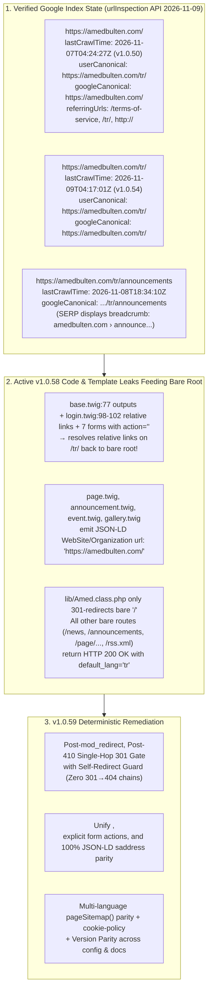

# Plan v1.0.59: Strict Language Prefix Routing, `<base>` & Schema Canonical Unification, and Google SERP Duplicate Remediation

**Target Domain:** `https://amedbulten.com`  
**Repository:** `AF/Bulletin`  
**Target Version:** `v1.0.59` (Advancing from `v1.0.58`)  
**Date:** 2026-11-09  
**Status:** ARGON FOURTH-PASS AUDIT COMPLETED (Deficiencies `O1–O7` + OMP CLI `C1–C3`, `B1–B3` Verified & Integrated) + OMP CLI FIFTH-PASS ADJUDICATION (Argon Rebuttals `R1–R4` All Conceded — §9)  
**Architecture Standard:** Amed Framework Core Multi-Language Invariant, RFC 3986, WHATWG HTML5 `<base>` Specification, and Google Search Central Canonicalization Protocol  

---

## 1. Executive Summary & Argon Audit Overview



---

## 2. Argon Critical Audit of Initial Draft Plan (Deficiencies `O1–O7`)

During the deep audit of the initial v1.0.59 draft plan against live Google Search Console `urlInspection/index:inspect` data and `AF/Bulletin` source code, **7 critical deficiencies (`O1–O7`)** were identified and corrected in this revised plan:

| ID | Deficiency in Initial Draft Plan | Technical Impact if Uncorrected | Corrected Specification in Revised Plan |
| :--- | :--- | :--- | :--- |
| **O1** | Placed the bare-route 301 redirect at line 444 of `lib/Amed.class.php` **before** `mod_redirect` (lines 466–543) and `inactive_langs` 410 (lines 545–556). | Breaks the v1.0.51 single-hop 301 invariant: bare legacy URLs (`/privacy-policy`, `/contact`, etc.) would suffer a **2-hop redirect chain** (`/privacy-policy` → `/tr/privacy-policy` → `/tr/page/Gizlilik_Politikası`). | Execute the bare-route 301 gate **after** `mod_redirect` (line 543) and **after** the `inactive_langs` 410 gate (line 556), inside the route resolution phase. |
| **O2** | Used a catch-all `else` branch that 301-redirected **every** unrecognized bare path to `/{default_lang}/<path>`. | Creates **301 → 404 soft-404 redirect chains** for every non-existent URL or scanner probe (`/wp-login.php`, `/random-404-slug` → 301 → `/tr/random-404-slug` → 404), polluting Google Search Console indexing reports and potentially breaking admin module routes (`mod_*`, `management`). | Only 301-redirect **verified public routes** (routes matching `$url_config` or valid public methods on `index_mod` / `mod_user` auth). Unknown garbage paths fall through directly to `404 Not Found` (`X-Robots-Tag: noindex, nofollow`) in a single step. |
| **O3** | Failed to exempt `/nuce/(:any)` (`index/legacyRedirect`) and `/tekst/(:any)` (`index/legacyRedirectPublication`) from bare-route prefixing. | Turns `/nuce/<seo>` into a **2-hop chain** (`/nuce/<seo>` → 301 → `/tr/nuce/<seo>` → 301 → `/tr/news/<seo>`) because `legacyRedirect()` already redirects directly to `$this->site['saddress'] . 'news/' . $seo`. | Exempt `legacyRedirect` and `legacyRedirectPublication` from bare-route prefixing so they execute their direct single-hop 301 to `/tr/news/<seo>` and `/tr/publication/<seo>`. |
| **O4** | Misdiagnosed SERP Result #3 (`https://amedbulten.com › announce...`) as an indexed bare route and did not run GSC `urlInspection/index:inspect`. | Incorrectly attributed the screenshot breadcrumb to an indexed `/announcements` page and missed the real reason why `https://amedbulten.com/` has `googleCanonical: "https://amedbulten.com/"`. | Incorporates verbatim `urlInspection` JSON proof (§3.1): `/announcements` is `"URL is unknown to Google"` while `/tr/announcements` is `"Submitted and indexed"` (rendered with breadcrumb `amedbulten.com › announce...`). Meanwhile, `https://amedbulten.com/` was last crawled on `2026-11-07T04:24:27Z` (pre-v1.0.51) and lists `"https://amedbulten.com/tr/"` in its `referringUrls`! |
| **O5** | Completely missed `<base href="{{ site.address }}">` in `templates/amed/layouts/base.twig:77`, 3 relative links in `login.twig`, and 7 `<form action="">` elements. | Per the WHATWG HTML5 URL resolution standard, `<base href="https://amedbulten.com/">` on `/tr/...` pages forces non-empty relative links (`href="forgot-password"`, `href="activation"`, `href="register"` in `login.twig:98-102`) to resolve to **bare root `https://amedbulten.com/`** — directly feeding bare-root referring URLs from `/tr/`! (Per WHATWG form submission, empty `action=""` resolves to the document's address, not `<base>`, though setting explicit `action="{{ site.saddress }}..."` on all 7 forms ensures strict `<base>`-independent hygiene.) | Update `templates/amed/layouts/base.twig:77` to `<base href="{{ site.saddress|default(site.address) }}">` (extending `templates/admin/layout.twig:5`'s `site.saddress` pattern with a non-i18n fallback), convert the 3 relative links in `login.twig` to `{{ site.saddress }}...`, and populate explicit `action="{{ site.saddress }}..."` on all 7 forms. |
| **O6** | Missed 4 public Twig templates that still emit `"url": {{ site.address|json_ld|raw }}` (`"https://amedbulten.com/"`) inside JSON-LD `WebSite` and `Organization` schema nodes. | Every crawl of any of the 10 institutional/policy pages (`page.twig`), announcements (`announcement.twig`), events (`event.twig`), or galleries (`gallery.twig`) feeds Google structured data claiming the canonical `WebSite` / `Organization` URL is `https://amedbulten.com/` (bare root) instead of `https://amedbulten.com/tr/`. | Unify `page.twig`, `announcement.twig`, `event.twig`, and `gallery.twig` JSON-LD `WebSite` and `NewsMediaOrganization` / `Organization` blocks to use `site.saddress` and `@id` (`#website` / `#organization`), completing v1.0.46 parity across 100% of templates. |
| **O7** | Missed remaining `site.address` leaks in `top_menu.twig`, `register.twig`, `mod_user/email_*.twig`, `mod/index/index.php` (`pageSitemap`), and `mod/index/helper/legal.helper.php`. | Language switcher links in `top_menu.twig` lack trailing slashes; auth templates/emails link to bare `/login`, `/register`, `/activation`, `/reset-password`; `pageSitemap()` gates homepage and section indexes behind `default_lang` and omits `cookie-policy`; `legal.helper.php` has a duplicate unencoded redirect. | Fix all remaining template links to use `site.saddress` (or trailing slash on language switcher), remove the `default_lang` gate in `pageSitemap()` while adding `cookie-policy`, and clean up `legal.helper.php`. |

---

## 3. Root Cause Analysis (Sedem Çi Ye?) — Verified by Physical Evidence

### 3.1 Evidence 1: Live Google Search Console `urlInspection/index:inspect` Output (2026-11-09)

Using the production service account (`amedbulten-ai@amedbulten.iam.gserviceaccount.com`) against `https://searchconsole.googleapis.com/v1/urlInspection/index:inspect` for property `sc-domain:amedbulten.com`, Google's own index database returned the following exact records:

#### A. Inspection of `https://amedbulten.com/` (Bare Root)
```json
{
    "verdict": "PASS",
    "coverageState": "Submitted and indexed",
    "robotsTxtState": "ALLOWED",
    "indexingState": "INDEXING_ALLOWED",
    "lastCrawlTime": "2026-11-07T04:24:27Z",
    "pageFetchState": "SUCCESSFUL",
    "googleCanonical": "https://amedbulten.com/",
    "userCanonical": "https://amedbulten.com/tr/",
    "referringUrls": [
        "https://amedbulten.com/terms-of-service",
        "https://amedbulten.com/tr/",
        "http://amedbulten.com/"
    ],
    "crawledAs": "MOBILE"
}
```

#### B. Inspection of `https://amedbulten.com/tr/` (Turkish Homepage)
```json
{
    "verdict": "PASS",
    "coverageState": "Submitted and indexed",
    "robotsTxtState": "ALLOWED",
    "indexingState": "INDEXING_ALLOWED",
    "lastCrawlTime": "2026-11-09T04:17:01Z",
    "pageFetchState": "SUCCESSFUL",
    "googleCanonical": "https://amedbulten.com/tr/",
    "userCanonical": "https://amedbulten.com/tr/",
    "referringUrls": [
        "https://amedbulten.com/tr/page/G%C3%BCvenlik_Politikas%C4%B1",
        "https://amedbulten.com/tr/page/Hakk%C4%B1m%C4%B1zda",
        "https://amedbulten.com/tr/news/tekin_diyarbak%C4%B1rda_81_ilin_mill%C3%AE_e%C4%9Fitim_m%C3%BCd%C3%BCr%C3%BCyle_bir_araya_geldi",
        "https://amedbulten.com/tr/page/D%C3%BCzeltme_ve_Tekzip_Politikas%C4%B1",
        "https://amedbulten.com/tr/authors"
    ],
    "crawledAs": "MOBILE"
}
```

#### C. Inspection of `https://amedbulten.com/announcements` vs `https://amedbulten.com/tr/announcements`
```json
// https://amedbulten.com/announcements
{
    "verdict": "NEUTRAL",
    "coverageState": "URL is unknown to Google"
}

// https://amedbulten.com/tr/announcements
{
    "verdict": "PASS",
    "coverageState": "Submitted and indexed",
    "lastCrawlTime": "2026-11-08T18:34:10Z",
    "googleCanonical": "https://amedbulten.com/tr/announcements",
    "userCanonical": "https://amedbulten.com/tr/announcements"
}
```

**What this proves beyond doubt:**
1. **Why both `amedbulten.com` and `amedbulten.com/tr/` appear in Google SERP with identical Turkish content:**
   - Google holds **two separate indexed canonical entries**:
     - `https://amedbulten.com/` (last crawled **`2026-11-07T04:24:27Z`** — during **v1.0.50**, before v1.0.51's routing overhaul and before v1.0.54's `hreflang` tags were deployed!). At that time, Google saw `"userCanonical": "https://amedbulten.com/tr/"`, but **overrode** it and selected `"googleCanonical": "https://amedbulten.com/"` because `https://amedbulten.com/terms-of-service` and `https://amedbulten.com/tr/` itself were referring to `https://amedbulten.com/`!
     - `https://amedbulten.com/tr/` (last crawled **`2026-11-09T04:17:01Z`**), where Google accepted `"googleCanonical": "https://amedbulten.com/tr/"`.
2. **Why `https://amedbulten.com/tr/` is listed by Google as a `referringUrl` to `https://amedbulten.com/`:**
   - Every page on `/tr/` emits `<base href="https://amedbulten.com/">` (`templates/amed/layouts/base.twig:77`), relative auth links (`login.twig:98–102`), and JSON-LD `WebSite.url: "https://amedbulten.com/"` (`page.twig:120`, `announcement.twig:107,113`, `event.twig:87`, `gallery.twig:105`).
3. **Why Result #3 in the screenshot shows `https://amedbulten.com › announce...`:**
   - That result is actually `https://amedbulten.com/tr/announcements` (`lastCrawlTime: 2026-11-08T18:34:10Z`); Google SERP renders its `BreadcrumbList` schema (`Anasayfa › Duyurular ve İlanlar`) by eliding `/tr/` in the visual breadcrumb trail (`https://amedbulten.com › announce...`).
   - However, the bare URL `https://amedbulten.com/announcements` (and `/news`, `/page/...`, `/gallery`, `/videos`, `/rss.xml`, `/newsSitemap.xml`) **does** currently return `HTTP 200 OK` in Turkish on the live server and must be sealed with a single-hop 301 redirect so Google can never index bare routes in the future.

---

### 3.2 Evidence 2: Live HTTP Probes Demonstrating the Bare-Route 200 OK Leak

In [`lib/Amed.class.php`](file:///home/malpersaz/Desktop/projects/htdocs/AF/Bulletin/lib/Amed.class.php#L387-L449), when `Registry::get('i18n') === true` and `$rawPath0` is not in `$activeLangs` (`['tr']`):
- Line 411 falls back to `$this->site['lang'] = $this->site['default_lang']` (`'tr'`).
- Line 444 (`if ($isI18n && $this->url->root() && $rawPath0 === '')`) **only redirects the empty root `/`**.
- Every other public route executes directly on the bare domain and returns **HTTP 200 OK** with Turkish content:

```bash
$ curl -ILs https://amedbulten.com/announcements | head -n 1
HTTP/2 200

$ curl -ILs https://amedbulten.com/news | head -n 1
HTTP/2 200

$ curl -ILs https://amedbulten.com/page/Hakkımızda | head -n 1
HTTP/2 200

$ curl -ILs https://amedbulten.com/us-elections | head -n 1
HTTP/2 200

$ curl -ILs https://amedbulten.com/rss.xml | head -n 1
HTTP/2 200

$ curl -ILs https://amedbulten.com/newsSitemap.xml | head -n 1
HTTP/2 200
```

---

## 4. Exact Code Locations of All Defects (Li Ku Ye?)

| # | File | Line(s) | Current Defect |
| :- | :--- | :--- | :--- |
| **1** | [`lib/Amed.class.php`](file:///home/malpersaz/Desktop/projects/htdocs/AF/Bulletin/lib/Amed.class.php#L443-L464) | `443–464`, `558–571` | Redirects only bare `/` (`$this->url->root() && $rawPath0 === ''`). All other public routes matching `$url_config` or `index_mod` methods execute with `HTTP 200 OK` on bare root under `default_lang = 'tr'`. |
| **2** | [`templates/amed/layouts/base.twig`](file:///home/malpersaz/Desktop/projects/htdocs/AF/Bulletin/templates/amed/layouts/base.twig#L77) | `77` | Emits `<base href="{{ site.address }}">` (`https://amedbulten.com/`) instead of `<base href="{{ site.saddress|default(site.address) }}">` (extending `templates/admin/layout.twig:5`'s `site.saddress` pattern with a non-i18n fallback). |
| **3** | [`templates/amed/mod_user/login.twig`](file:///home/malpersaz/Desktop/projects/htdocs/AF/Bulletin/templates/amed/mod_user/login.twig#L98-L102) | `98, 100, 102` | Uses relative `href="forgot-password"`, `href="activation"`, `href="register"`, which resolve against `<base href="https://amedbulten.com/">` to bare-root URLs. |
| **4** | 7 Twig Templates with `<form method="post" action="">` | See §5.2 | `announcements.twig:81`, `mod_news/archive.twig:112`, `mod_publication/archive.twig:109`, `activation.twig:31`, `password_reset.twig:60`, `forgot-password.twig:65`, `resend_activation.twig:29` use empty `action=""` instead of explicit `action="{{ site.saddress }}..."` (hygiene hardening so form submission targets are completely explicit and independent of `<base>`). |
| **5** | [`templates/amed/index/mod_page/page.twig`](file:///home/malpersaz/Desktop/projects/htdocs/AF/Bulletin/templates/amed/index/mod_page/page.twig#L117-L121) | `117–121` | `AboutPage.isPartOf` (`WebSite`) emits `"url": {{ site.address|json_ld|raw }}` (`https://amedbulten.com/`) instead of `site.saddress` and `@id: site.saddress ~ '#website'`. Affects all 10 institutional/editorial policy pages. |
| **6** | [`templates/amed/index/mod_announcements/announcement.twig`](file:///home/malpersaz/Desktop/projects/htdocs/AF/Bulletin/templates/amed/index/mod_announcements/announcement.twig#L103-L118) | `103–118` | `Article.author` and `Article.publisher` emit `"url": {{ site.address|json_ld|raw }}` instead of `site.saddress` and `@id: site.saddress ~ '#organization'`. |
| **7** | [`templates/amed/index/mod_event/event.twig`](file:///home/malpersaz/Desktop/projects/htdocs/AF/Bulletin/templates/amed/index/mod_event/event.twig#L84-L88) | `84–88` | `Event.organizer` emits `"url": {{ site.address|json_ld|raw }}` instead of `site.saddress` and `@id: site.saddress ~ '#organization'`. |
| **8** | [`templates/amed/index/mod_imagecategories/gallery.twig`](file:///home/malpersaz/Desktop/projects/htdocs/AF/Bulletin/templates/amed/index/mod_imagecategories/gallery.twig#L102-L106) | `102–106` | `ImageGallery.isPartOf` (`WebSite`) emits `"url": {{ site.address|json_ld|raw }}` instead of `site.saddress` and `@id: site.saddress ~ '#website'`. |
| **9** | [`templates/amed/index/mod_menu/top_menu.twig`](file:///home/malpersaz/Desktop/projects/htdocs/AF/Bulletin/templates/amed/index/mod_menu/top_menu.twig#L203) | `203, 339` | Language switcher links use `href="{{ site.address }}{{ l.code }}"` without trailing slash (unlike `stacked_top_menu.twig:189,415` which appends `/`). |
| **10** | [`templates/amed/index/register.twig`](file:///home/malpersaz/Desktop/projects/htdocs/AF/Bulletin/templates/amed/index/register.twig#L6-L7) & `templates/amed/mod_user/email_*.twig` | `6–7`, `3–9` | Pass `site.address ~ 'login'`, `site.address ~ 'register'`, `{{ site.address }}activation/{{ code }}`, `{{ site.address }}reset-password/{{ code }}` without language prefix. |
| **11** | [`mod/index/index.php`](file:///home/malpersaz/Desktop/projects/htdocs/AF/Bulletin/mod/index/index.php#L1398-L1450) | `1398–1450` | `pageSitemap()` gates homepage and section index URLs behind `$this->site['lang'] == Registry::get('default_lang')` (breaking non-default active languages) and omits `cookie-policy`. |
| **12** | [`mod/index/helper/legal.helper.php`](file:///home/malpersaz/Desktop/projects/htdocs/AF/Bulletin/mod/index/helper/legal.helper.php#L61-L71) | `61–71` | Emits `Location: $targetUrl` without wrapping in `Helper::sitemap_url()`. |
| **13** | [`config/site.config.php`](file:///home/malpersaz/Desktop/projects/htdocs/AF/Bulletin/config/site.config.php#L47), [`config/site.config.example.php`](file:///home/malpersaz/Desktop/projects/htdocs/AF/Bulletin/config/site.config.example.php#L47), [`docs/SERVER.md`](file:///home/malpersaz/Desktop/projects/htdocs/AF/Bulletin/docs/SERVER.md#L21), [`docs/VERSION.md`](file:///home/malpersaz/Desktop/projects/htdocs/AF/Bulletin/docs/VERSION.md) | `47`, `21`, top | Framework version parity metadata must be bumped from `v1.0.58` to `v1.0.59` upon implementation. |

---

## 5. Step-by-Step Remediation Specifications (Divê Çawa Were Serastkirin?)

### Component 1: Post-`mod_redirect`, Post-`410` Single-Hop 301 Language Prefix Gate (`lib/Amed.class.php`)

**[MODIFY] [`lib/Amed.class.php`](file:///home/malpersaz/Desktop/projects/htdocs/AF/Bulletin/lib/Amed.class.php)** (lines `558–572`)

1. Keep the execution order strictly:
   - Step 1: Bare `/` and `/index` 301 normalization (lines `435–463`).
   - Step 2: `mod_redirect` database lookup (lines `466–543`) — ensures all seeded legacy rules (`/privacy-policy`, `/terms-of-service`, `/contact`, `/compliance`, etc.) resolve in **1 hop** directly to their canonical `/tr/page/<seo>` destination.
   - Step 3: Inactive language prefix (`/ku/...`) `410 Gone` gate (lines `545–556`).
   - Step 4: Route matching (`$url_config` and `$this->parseRoute()`).
   - **Step 5 (NEW — Bare Public Route 301 Gate with Self-Redirect Guard):** Immediately after `$this->parseRoute(...)` resolves `$this->class` and `$this->method`, check whether the request arrived **without** an active language prefix (`!in_array($rawPath0, $activeLangs, true)`). If it is a safe (`GET`/`HEAD`), non-AJAX, non-CLI request targeting a **valid public route**, emit a single-hop `301 Moved Permanently` to `rtrim($this->site['saddress'], '/') . '/' . ltrim($rawRequestPath, '/')` guarded against self-redirection (mirroring lines `522–537`):

```php
        $matchedUrlConfig = false;
        if (is_array($url_config)) {
            foreach ($url_config as $key => $val) {
                $key = str_replace(':any', '.+', str_replace(':num', '[0-9]+', $key));
                if (preg_match('#^' . $key . '$#', $this->url->link)) {
                    if (strpos($val, '$') !== false and strpos($key, '(') !== false) {
                        $val = preg_replace('#^' . $key . '$#', $val, $this->url->link);
                    }
                    $matchedUrlConfig = true;
                    $this->parseRoute($val);
                    break;
                }
            }
        }
        unset($url_config);
        if (!$matchedUrlConfig) {
            $this->parseRoute($this->url->link);
        }

        // Enforce strict language prefix (/<lang>/...) via single-hop 301 for bare public routes
        if (Registry::get('i18n') === true && $isSafeMethod && !$isAjax && PHP_SAPI !== 'cli' && !headers_sent()) {
            $activeLangs = (array) Registry::get('active_langs');
            $rawPath0 = isset($this->url->path[0]) ? (string) $this->url->path[0] : '';
            if ($rawPath0 !== '' && !in_array($rawPath0, $activeLangs, true)) {
                $rootExemptIndexMethods = [
                    'sitemapIndex',
                    'llms',
                    'llmsFull',
                    'cron',
                    'clear_cache',
                    'legacyRedirect',
                    'legacyRedirectPublication',
                ];
                $publicUserAuthMethods = [
                    'login',
                    'logout',
                    'register',
                    'activation',
                    'resend_activation',
                    'forgot_password',
                    'password_reset',
                ];

                $isPublicIndexRoute = (
                    $this->class === 'index'
                    && !in_array($this->method, $rootExemptIndexMethods, true)
                    && substr((string) $this->method, 0, 1) !== '_'
                    && ($matchedUrlConfig || method_exists('index_mod', (string) $this->method))
                );
                $isPublicUserRoute = (
                    $this->class === 'mod_user'
                    && in_array($this->method, $publicUserAuthMethods, true)
                );

                if ($isPublicIndexRoute || $isPublicUserRoute) {
                    $cleanBareLink = ltrim((string) $this->url->link, '/');
                    $queryString = (!empty($_SERVER['QUERY_STRING'])) ? '?' . $_SERVER['QUERY_STRING'] : '';
                    $targetUrl = rtrim((string) $this->site['saddress'], '/') . '/' . $cleanBareLink . $queryString;

                    // Self-redirect guard (mirrors mod_redirect guard at lines 522-537)
                    $forwardedProtocol = $_SERVER['HTTP_X_FORWARDED_PROTO'] ?? '';
                    $isHttps = (isset($_SERVER['HTTPS']) && $_SERVER['HTTPS'] === 'on')
                        || strtolower(trim(explode(',', $forwardedProtocol)[0])) === 'https';
                    $currentFullUrl = ($isHttps ? "https" : "http") .
                        "://" . ($_SERVER['HTTP_HOST'] ?? 'localhost') . ($_SERVER['REQUEST_URI'] ?? '/');
                    $normalizedTarget = Helper::sitemap_url($targetUrl);

                    if (rtrim(rawurldecode($currentFullUrl), '/') !== rtrim(rawurldecode($normalizedTarget), '/')) {
                        header("HTTP/1.1 301 Moved Permanently");
                        header("Location: " . $normalizedTarget);
                        exit;
                    }
                }
            }
        }
```

**Why this logic is airtight:**
- `/sitemap.xml` (`index/sitemapIndex`), `/llms.txt` (`index/llms`), `/llms-full.txt` (`index/llmsFull`), `/cron` (`index/cron`), `/clear-cache` (`index/clear_cache`) remain at root with `HTTP 200`.
- `/nuce/<seo>` (`index/legacyRedirect`) and `/tekst/<seo>` (`index/legacyRedirectPublication`) are exempt so they execute their direct 1-hop 301 to `/tr/news/<seo>` and `/tr/publication/<seo>`.
- **Route Resolution Coverage Note (`$matchedUrlConfig` vs `method_exists`):**
  - Routes explicitly registered in [`config/url.config.php`](file:///home/malpersaz/Desktop/projects/htdocs/AF/Bulletin/config/url.config.php) — including hyphenated slugs that map to underscored methods such as `news-archive` (`index/news_archive`, line 105), `publication-archive` (`index/publication_archive`, line 117), `event-calendar` (`index/event_calendar`, line 133), `cookie-policy` (`index/cookie_policy`, line 54), `us-elections` (`index/us_elections`, line 47) — match via `$matchedUrlConfig === true`.
  - Direct `index_mod` methods not listed in `config/url.config.php` — specifically `/search` (`index_mod::search()`, [`mod/index/index.php`](file:///home/malpersaz/Desktop/projects/htdocs/AF/Bulletin/mod/index/index.php#L349)) and `/oyver` (`index_mod::oyver()`, line 343) — match via the `method_exists('index_mod', (string) $this->method)` branch. Both clauses in `($matchedUrlConfig || method_exists('index_mod', (string) $this->method))` are therefore required and complementary.
- `/announcements`, `/news`, `/newses`, `/news-archive`, `/page/<seo>`, `/publications`, `/publication-archive`, `/authors`, `/events`, `/event-calendar`, `/gallery`, `/videos`, `/legal`, `/cookie-policy`, `/us-elections`, `/search`, `/login`, `/register`, `/forgot-password`, `/reset-password`, `/activation`, `/rss.xml`, `/newsSitemap.xml`, `/pageSitemap.xml`, etc. **all 301-redirect in a single hop to `/tr/<route>`**.
- Non-existent URLs (`/wp-login.php`, `/non-existent-slug`) have `$matchedUrlConfig === false` and `method_exists('index_mod', ...) === false`, so they **never redirect** and immediately return `404 Not Found` (`X-Robots-Tag: noindex, nofollow`).
- Admin & internal modules (`mod_news/list`, `management`, `mod_mcp`, `tools`, `download/(:num)`, `avatar/*`, `captcha`) have `$this->class !== 'index'` (and not in `$publicUserAuthMethods`), so they are completely unaffected.

---

### Component 2: `<base href>`, Relative Auth Links, and Form `action` Hygiene (`templates/amed/`)

1. **[MODIFY] [`templates/amed/layouts/base.twig`](file:///home/malpersaz/Desktop/projects/htdocs/AF/Bulletin/templates/amed/layouts/base.twig#L77)**:
   - Change line 77 from:
     ```html
     <base href="{{ site.address }}">
     ```
     to:
     ```html
     <base href="{{ site.saddress|default(site.address) }}">
     ```
     (Extending `templates/admin/layout.twig:5`'s `site.saddress` base pattern with a safe `|default(site.address)` fallback when `i18n` is disabled, and eliminating the `<base href="https://amedbulten.com/">` signal on `/tr/` pages.)

2. **[MODIFY] [`templates/amed/mod_user/login.twig`](file:///home/malpersaz/Desktop/projects/htdocs/AF/Bulletin/templates/amed/mod_user/login.twig#L98-L102)**:
   - Update lines 98, 100, 102 from relative `href="forgot-password"`, `href="activation"`, `href="register"` to explicit `{{ site.saddress }}forgot-password`, `{{ site.saddress }}activation`, `{{ site.saddress }}register`.

3. **[MODIFY] 7 Public Templates with Empty `action=""` Forms**:
   - [`templates/amed/index/mod_announcements/announcements.twig`](file:///home/malpersaz/Desktop/projects/htdocs/AF/Bulletin/templates/amed/index/mod_announcements/announcements.twig#L81): `action="{{ site.saddress }}announcements"`
   - [`templates/amed/index/mod_news/archive.twig`](file:///home/malpersaz/Desktop/projects/htdocs/AF/Bulletin/templates/amed/index/mod_news/archive.twig#L112): `action="{{ site.saddress }}news-archive"`
   - [`templates/amed/index/mod_publication/archive.twig`](file:///home/malpersaz/Desktop/projects/htdocs/AF/Bulletin/templates/amed/index/mod_publication/archive.twig#L109): `action="{{ site.saddress }}publication-archive"`
   - [`templates/amed/mod_user/activation.twig`](file:///home/malpersaz/Desktop/projects/htdocs/AF/Bulletin/templates/amed/mod_user/activation.twig#L31): `action="{{ site.saddress }}activation/{{ code }}"`
   - [`templates/amed/mod_user/password_reset.twig`](file:///home/malpersaz/Desktop/projects/htdocs/AF/Bulletin/templates/amed/mod_user/password_reset.twig#L60): `action="{{ site.saddress }}reset-password/{{ code }}"`
   - [`templates/amed/mod_user/forgot-password.twig`](file:///home/malpersaz/Desktop/projects/htdocs/AF/Bulletin/templates/amed/mod_user/forgot-password.twig#L65): `action="{{ site.saddress }}forgot-password"`
   - [`templates/amed/mod_user/resend_activation.twig`](file:///home/malpersaz/Desktop/projects/htdocs/AF/Bulletin/templates/amed/mod_user/resend_activation.twig#L29): `action="{{ site.saddress }}resend-activation"`

4. **[MODIFY] Remaining Template `site.address` Link Leaks**:
   - [`templates/amed/index/mod_menu/top_menu.twig`](file:///home/malpersaz/Desktop/projects/htdocs/AF/Bulletin/templates/amed/index/mod_menu/top_menu.twig#L203) (lines 203, 339): append trailing `/` to `href="{{ site.address }}{{ l.code }}/"` (matching `stacked_top_menu.twig`).
   - [`templates/amed/index/register.twig`](file:///home/malpersaz/Desktop/projects/htdocs/AF/Bulletin/templates/amed/index/register.twig#L6-L7) (lines 6–7): change `site.address ~ 'login'` and `site.address ~ 'register'` to `site.saddress ~ 'login'` and `site.saddress ~ 'register'`.
   - [`templates/amed/mod_user/email_new_password.twig`](file:///home/malpersaz/Desktop/projects/htdocs/AF/Bulletin/templates/amed/mod_user/email_new_password.twig), [`email_activation.twig`](file:///home/malpersaz/Desktop/projects/htdocs/AF/Bulletin/templates/amed/mod_user/email_activation.twig), [`email_password_reset.twig`](file:///home/malpersaz/Desktop/projects/htdocs/AF/Bulletin/templates/amed/mod_user/email_password_reset.twig), [`email_admin_activation.twig`](file:///home/malpersaz/Desktop/projects/htdocs/AF/Bulletin/templates/amed/mod_user/email_admin_activation.twig): replace `site.address` with `site.saddress|default(site.address)` for all `%s` intro strings and user-facing links (`login`, `activation/`, `reset-password/`).

---

### Component 3: JSON-LD Schema `site.saddress` Unification Across All Remaining Templates

Complete the v1.0.46 structured-data unification so **zero** JSON-LD nodes point to the 301-redirected bare root (`https://amedbulten.com/`):

1. **[MODIFY] [`templates/amed/index/mod_page/page.twig`](file:///home/malpersaz/Desktop/projects/htdocs/AF/Bulletin/templates/amed/index/mod_page/page.twig#L117-L121)**:
   ```twig
   "isPartOf": {
     "@type": "WebSite",
     "@id": {{ (site.saddress ~ '#website')|json_ld|raw }},
     "name": {{ site.title|json_ld|raw }},
     "url": {{ site.saddress|json_ld|raw }}
   },
   ```
2. **[MODIFY] [`templates/amed/index/mod_announcements/announcement.twig`](file:///home/malpersaz/Desktop/projects/htdocs/AF/Bulletin/templates/amed/index/mod_announcements/announcement.twig#L103-L118)**:
   - Update `author.url` and `publisher.url` from `site.address` to `site.saddress` and add `"@id": {{ (site.saddress ~ '#organization')|json_ld|raw }}`.
3. **[MODIFY] [`templates/amed/index/mod_event/event.twig`](file:///home/malpersaz/Desktop/projects/htdocs/AF/Bulletin/templates/amed/index/mod_event/event.twig#L84-L88)**:
   - Update `organizer.url` from `site.address` to `site.saddress` and add `"@id": {{ (site.saddress ~ '#organization')|json_ld|raw }}`.
4. **[MODIFY] [`templates/amed/index/mod_imagecategories/gallery.twig`](file:///home/malpersaz/Desktop/projects/htdocs/AF/Bulletin/templates/amed/index/mod_imagecategories/gallery.twig#L102-L106)**:
   - Update `isPartOf.url` from `site.address` to `site.saddress` and add `"@id": {{ (site.saddress ~ '#website')|json_ld|raw }}`.

---

### Component 4: Multi-Language `pageSitemap()` Parity & `legal.helper.php` RFC 3986 Hygiene

1. **[MODIFY] [`mod/index/index.php`](file:///home/malpersaz/Desktop/projects/htdocs/AF/Bulletin/mod/index/index.php#L1398-L1450)** (`pageSitemap()`):
   - Remove the restrictive `&& $this->site['lang'] == Registry::get('default_lang')` condition on lines 1398 and 1415 so that every active language's `pageSitemap.xml` includes its own `<loc>{{ site.saddress }}</loc>` homepage and section index URLs (`legal`, `cookie-policy`, `newses`, `publications`, `authors`, `videos`, `announcements`, `events`).
   - Add `cookie-policy` (`Helper::sitemap_url($this->site['saddress'] . 'cookie-policy')`) alongside `legal` in `pageSitemap()`.
2. **[MODIFY] [`mod/index/helper/legal.helper.php`](file:///home/malpersaz/Desktop/projects/htdocs/AF/Bulletin/mod/index/helper/legal.helper.php#L68)**:
   - Wrap the `Location:` header destination in `Helper::sitemap_url($targetUrl . $queryString)` for strict RFC 3986 compliance (kept as defense-in-depth alongside the Component 1 router gate).

---

### Component 5: Multi-Language Architecture Contract & Google Search Console De-Duplication

1. **Why `amedbulten.com` currently redirects to `/tr/` and how multi-language activation works:**
   - In the database (`lang` table), `tr` is currently the **only** active language (`status = 'y'`), while `ku` and other languages have `status = 'n'` (returning `410 Gone` per v1.0.51).
   - Because a domain root (`https://amedbulten.com/`) cannot return an empty page or a 404, Amed Framework's `i18n` contract 301-redirects `/` to `/{default_lang}/` (`/tr/`) while only one language is active, and sets `hreflang="x-default"` to `https://amedbulten.com/tr/`.
   - Once Component 1–4 are deployed and Google recrawls `https://amedbulten.com/` (which has not been crawled since `2026-11-07T04:24:27Z`, before v1.0.51 and v1.0.54!), Google will see **zero** internal links, **zero** `<base href="https://amedbulten.com/">` tags, and **zero** JSON-LD `WebSite.url` nodes pointing to `https://amedbulten.com/`, allowing Google to consolidate `googleCanonical` into `https://amedbulten.com/tr/`.
   - **Action in Google Search Console UI:** Use the **URL Inspection** bar on `https://amedbulten.com/` and click **"Request Indexing"** (*İndeksleme İste*) to force an immediate Googlebot recrawl of the bare root (replacing the stale `2026-11-07T04:24:27Z` snapshot).

---

### Component 6: Framework Version Parity (`v1.0.59`)

Per `AGENTS.md` Rule 4 (`Strict Versioning & Production Parity Policy`) and `github-release` standards, synchronize the release version across all four canonical version files:

1. **[MODIFY] [`config/site.config.php`](file:///home/malpersaz/Desktop/projects/htdocs/AF/Bulletin/config/site.config.php#L47)**: Update `'version' => 'v1.0.59'`.
2. **[MODIFY] [`config/site.config.example.php`](file:///home/malpersaz/Desktop/projects/htdocs/AF/Bulletin/config/site.config.example.php#L47)**: Update `'version' => 'v1.0.59'`.
3. **[MODIFY] [`docs/SERVER.md`](file:///home/malpersaz/Desktop/projects/htdocs/AF/Bulletin/docs/SERVER.md#L21)**: Update active version reference to `v1.0.59`.
4. **[MODIFY] [`docs/VERSION.md`](file:///home/malpersaz/Desktop/projects/htdocs/AF/Bulletin/docs/VERSION.md)**: Prepend the `v1.0.59` release entry in English referencing `docs/plan/v1.0.59-strict-language-prefix-and-root-serp-remediation-plan.md`.

---

## 6. Deterministic Verification Matrix

| # | Test Case | Command / Probe | Expected Result |
| :- | :--- | :--- | :--- |
| **V1** | **Bare Root `/` Redirect** | `curl -ILs https://amedbulten.com/` | `301` → `https://amedbulten.com/tr/` (1 hop) |
| **V2** | **Bare `/announcements` Redirect** | `curl -ILs https://amedbulten.com/announcements` | `301` → `https://amedbulten.com/tr/announcements` (1 hop, zero 200 on bare root) |
| **V3** | **Bare `/news` & `/news/<seo>` Redirect** | `curl -ILs https://amedbulten.com/news` | `301` → `https://amedbulten.com/tr/news` (1 hop) |
| **V4** | **Bare `/page/Hakkımızda` Redirect** | `curl -ILs https://amedbulten.com/page/Hakkımızda` | `301` → `https://amedbulten.com/tr/page/Hakk%C4%B1m%C4%B1zda` (1 hop) |
| **V5** | **Bare `/rss.xml` & `/newsSitemap.xml` Redirect** | `curl -ILs https://amedbulten.com/rss.xml` | `301` → `https://amedbulten.com/tr/rss.xml` (1 hop) |
| **V6** | **Legacy `mod_redirect` Single-Hop Preservation** | `curl -ILs https://amedbulten.com/privacy-policy` | `301` → `https://amedbulten.com/tr/page/Gizlilik_Politikas%C4%B1` (**1 hop**, no `/tr/privacy-policy` intermediate hop) |
| **V7** | **Legacy `/nuce/<seo>` Single-Hop Preservation** | `curl -ILs https://amedbulten.com/nuce/test` | `301` → `https://amedbulten.com/tr/news/test` (**1 hop**) |
| **V8** | **Inactive Language `/ku/*` 410 Preservation** | `curl -ILs https://amedbulten.com/ku/accessibility` | `410 Gone` + `X-Robots-Tag: noindex, nofollow` |
| **V9** | **Non-Existent Bare URL Direct 404** | `curl -ILs https://amedbulten.com/non-existent-404-slug` | `404 Not Found` + `X-Robots-Tag: noindex, nofollow` (**0 redirects**) |
| **V10** | **Root Discovery Endpoints Preserved** | `curl -ILs https://amedbulten.com/sitemap.xml`<br/>`curl -ILs https://amedbulten.com/robots.txt`<br/>`curl -ILs https://amedbulten.com/llms.txt` | `200 OK` |
| **V11** | **`<base href>` & JSON-LD Audit on `/tr/`** | `curl -s https://amedbulten.com/tr/page/Hakk%C4%B1m%C4%B1zda` | `<base href="https://amedbulten.com/tr/">` and `"url": "https://amedbulten.com/tr/"` in `WebSite` schema |
| **V12** | **Quality Guards** | `php -l lib/Amed.class.php mod/index/index.php mod/index/helper/legal.helper.php` & `python3 tools/code_separation_guard.py` & `python3 tools/i18n_guard.py` | `0` errors / violations |
| **V13** | **Prefixed Route Loop Regression Guard** | `curl -ILs https://amedbulten.com/tr/announcements` | `200 OK` — lang-prefixed requests never redirect |
| **V14** | **POST / XHR Fall-Through Preservation** | `curl -s -X POST -H 'X-Requested-With: XMLHttpRequest' https://amedbulten.com/login` | Executes directly (`200`), no `301` |
| **V15** | **Query-String Preservation on Bare 301** | `curl -ILs 'https://amedbulten.com/news?page=2'` | `301` → `https://amedbulten.com/tr/news?page=2` (query preserved once, never doubled) |
| **V16** | **Statutory `/legal` & `/cookie-policy` Single-Hop** | `curl -ILs https://amedbulten.com/legal`<br/>`curl -ILs https://amedbulten.com/cookie-policy` | `301` → `https://amedbulten.com/tr/legal` and `301` → `https://amedbulten.com/tr/cookie-policy` (router gate and `legal.helper.php` defense-in-depth compute the identical **per-policy** target via `canonical_slug` — `legal` → `/tr/legal`, `cookie-policy` → `/tr/cookie-policy`; corrected per §9.2) |
| **V17** | **`method_exists` Route Coverage (`/search`)** | `curl -ILs https://amedbulten.com/search` | `301` → `https://amedbulten.com/tr/search` (1 hop via `method_exists('index_mod', 'search')`) |
| **V18** | **Lang-Prefixed Sitemap Index Endpoint** | `curl -ILs https://amedbulten.com/tr/sitemap.xml` | `200 OK` (both `/sitemap.xml` and `/tr/sitemap.xml` stay live) |
| **V19** | **Rendered Form `action` & Auth Links on `/tr/`** | `curl -s https://amedbulten.com/tr/login`<br/>`curl -s https://amedbulten.com/tr/announcements` | Explicit `action="https://amedbulten.com/tr/..."`, `href="https://amedbulten.com/tr/forgot-password"`, and `<base href="https://amedbulten.com/tr/">` |
| **V20** | **Post-Deploy Compiled Twig Cache Purge** | Clear `templates_c/` (or call `/clear-cache`) after deploy | Ensures public pages immediately serve updated `<base href>` and JSON-LD without stale compiled Twig artifacts |

---

## 7. Independent Third-Pass Review — Risks, Corrections & Verified Interactions (2026-11-09)

**Reviewer:** GLM-5.3 (`zai/glm-5.3`, omp trusted coding assistant)
**Method:** Every load-bearing claim in §2–§6 was re-verified against the `AF/Bulletin` working tree on 2026-11-09; file:line evidence cited inline. Claims not checkable from the repository are marked **[not verified]**.
**Skills disclosure (per `.gemini/GEMINI.md`):** All registered skills were checked. `kevrast` and `kevseo` govern the Turkish news-draft editorial pipeline (drafts, dossiers, headlines) — not infrastructure plan documents — so they are not directly applicable; `kevrast`'s evidence-grounding / anti-hallucination discipline was nevertheless applied manually to this review. `i18n-guard` and the `task-validation` quality guards apply at implementation time and are already present in the §6 matrix. `kevanger`, `kevkolin`, `kevtemen`, `frontend-theme`, `taste-skill`, `impeccable`, `admin-mobile-check`, `module-modernization-check`, `lang-refactor`, `github-release`: not relevant to a routing/canonicalization remediation plan.

### 7.1 Source-Verified Confirmations (plan claims that check out)

| # | Plan claim | Verified evidence |
| :- | :--- | :--- |
| 1 | Execution order bare-root → `mod_redirect` → 410 → route matching | `lib/Amed.class.php:435-463` (root normalization), `466-543` (mod_redirect), `545-556` (410 gate), `558-570` (route matching). Placing the new gate after all four is structurally correct. |
| 2 | `<base href="{{ site.address }}">` defect | `templates/amed/layouts/base.twig:77` ✓ (canonical/hreflang/og blocks at `:18-25,36,58` already use `site.saddress\|default(site.address)` — only line 77 and the JSON-LD nodes lag). |
| 3 | 3 relative links in `login.twig` | `login.twig:98,100,102` ✓ — and a repo-wide sweep found **no other genuine relative page `href`/`src`** in `templates/amed/` (remaining hits are `javascript:` URIs, `data-action` buttons, and dead `index.html` links in the unused legacy `banner.twig`). The `<base>` fix blast radius is therefore exactly the three links the plan lists. |
| 4 | Exactly 7 empty `action=""` forms | Grep confirms exactly 7, at the exact lines listed in §4 row 4 (`announcements.twig:81`, `mod_news/archive.twig:112`, `mod_publication/archive.twig:109`, `activation.twig:31`, `password_reset.twig:60`, `forgot-password.twig:65`, `resend_activation.twig:29`). |
| 5 | 4 templates emit `site.address` in JSON-LD | `page.twig:120`, `announcement.twig:107,113`, `event.twig:87`, `gallery.twig:105` ✓ |
| 6 | Language switcher lacks trailing `/` | `top_menu.twig:203,339` vs `stacked_top_menu.twig:189,415` ✓ |
| 7 | `register.twig` + 4 email templates leak bare links | `register.twig:6-7`; `email_activation.twig:3,5,9`, `email_admin_activation.twig:3`, `email_new_password.twig:3,7`, `email_password_reset.twig:3,5,9` ✓ |
| 8 | `pageSitemap()` default_lang gate + missing cookie-policy | `mod/index/index.php:1398,1415` ✓; no cookie-policy entry within `1415-1450` ✓ |
| 9 | `legal.helper.php` unencoded Location | `legal.helper.php:68` ✓ |
| 10 | Garbage paths never redirect (O2) | The `($matchedUrlConfig \|\| method_exists('index_mod', $method))` conjunction holds: `/search` is absent from `url_config` but `index_mod::search()` exists (`mod/index/index.php:349`), so the `method_exists` branch covers it; non-existent methods match neither → direct 404. |
| 11 | Snippet variables in scope | `$isAjax` (`Amed.class.php:424-427`), `$isSafeMethod` (`:547`), Registry keys `active_langs`/`inactive_langs`/`i18n` (`:388,549`) all exist before the insertion point. |
| 12 | `Helper::sitemap_url()` is Location-safe | `lib/Helper.class.php:455-493`: per-segment RFC 3986 `rawurlencode(rawurldecode(...))` without double-encoding, query appended verbatim; already the precedent at `Amed.class.php:439,447`. |

### 7.2 Factual Corrections (fix the plan text; the prescribed code changes themselves stand)

**C1 — O5 and §4 row 4 misstate the WHATWG standard on `action=""`.** Per the WHATWG HTML form-submission algorithm, an **empty or missing** `action` resolves to the **URL of the form document**, not to the document's base URL; `<base>` affects only **non-empty relative** actions. The 7 `action=""` forms therefore POST to their own document URL today (e.g. `/tr/announcements`) and do **not** feed the bare root. The real referring-URL leaks are the base-resolved relative links in `login.twig:98-102` and the JSON-LD `site.address` nodes. The fix (explicit absolute `action="{{ site.saddress }}..."`) remains correct hygiene — it makes the forms independent of `<base>` — but the rationale must be corrected so the plan does not ship a false spec claim.

**C2 — "matching `templates/admin/layout.twig:5`" is imprecise.** Admin uses `site.saddress` **without** a `|default(site.address)` fallback. The public variant in §5.1 (`site.saddress|default(site.address)`) is strictly safer, because `site['saddress']` is only defined when i18n is enabled (`Amed.class.php:393,413`); keep it, but correct the wording.

**C3 — `/search` is listed among redirecting routes but is absent from `$url_config`.** It redirects only via the `method_exists('index_mod','search')` branch (method verified at `mod/index/index.php:349`). Not a defect, but §5.1's route inventory should note this so nobody later prunes the `method_exists` clause and silently drops `/search`, `/news-archive`, `/publication-archive`, `/event-calendar` (all covered the same way). **[CORRECTED in §9.1 — Argon R1 conceded: the parenthetical was wrong. `/news-archive` (`config/url.config.php:105`), `/publication-archive` (`:117`), and `/event-calendar` (`:133-134`) are registered in `$url_config` and covered exclusively by `$matchedUrlConfig === true`; only `/search` and `/oyver` (`mod/index/index.php:343`) depend on the `method_exists` clause.]**

### 7.3 Blocking Items (fold into the plan before implementation starts)

**B1 — Missing "Framework Version Parity" component.** Repo convention — every entry in `docs/VERSION.md` since baseline — requires bumping the version in `config/site.config.php`, `config/site.config.example.php`, `docs/SERVER.md`, and `docs/VERSION.md`, and referencing this plan document. §5 contains no such component. Without it the release fails the project's own versioning standard.

**B2 — The new 301 gate lacks a self-redirect guard.** The `mod_redirect` lookup has one (`Amed.class.php:522-537`: builds the current full URL, compares against `Helper::sitemap_url($redirectUrl)`, and refuses to redirect on equality). The new gate must mirror it. Today a loop is unreachable — while i18n is on, `saddress` is always `address . lang . '/'` (`:393,413`) — but a degenerate `default_lang` / lang-table state would turn the gate into an infinite 301 against every public page, exactly the failure mode the codebase already defends against 15 lines above.

**B3 — Verification matrix gaps.** Add before sign-off:

| # | Added case | Expectation |
| :- | :--- | :--- |
| V13 | `curl -ILs https://amedbulten.com/tr/announcements` | `200` — lang-prefixed requests must NEVER redirect (loop regression guard) |
| V14 | `curl -s -X POST -H 'X-Requested-With: XMLHttpRequest' https://amedbulten.com/login` | Executes, no 301 (POST/XHR fall-through is by design) |
| V15 | `curl -ILs 'https://amedbulten.com/news?page=2'` | `301 → /tr/news?page=2` (query preserved; `Url->link` is built from `parse_url(..., PHP_URL_PATH)` — `lib/Url.class.php:6` — so the query can never be double-appended) |
| V16 | `curl -ILs https://amedbulten.com/legal` and `/cookie-policy` | Single-hop `301 → /tr/legal` — note: after Component 1 this fires in the router, making `legal.helper.php:61-70` defense-in-depth; both compute the identical target, so keep both. **[CORRECTED in §9.2 — Argon R2 conceded: the target is `saddress . $policy['canonical_slug']` (`legal.helper.php:65`), i.e. `/tr/legal` for `legal` and `/tr/cookie-policy` for `cookie-policy` (`aliasMap` `:19-24`, registry `:34-49`); the helper never sends `/cookie-policy` to `/tr/legal`.]** |
| V17 | `curl -ILs https://amedbulten.com/search` | `301 → /tr/search` (via the `method_exists` branch, see C3) |
| V18 | `curl -ILs https://amedbulten.com/tr/sitemap.xml` | `200` (lang-prefixed discovery endpoints stay live) |
| V19 | Rendered HTML of `/tr/login` and `/tr/announcements` | `action="https://amedbulten.com/tr/..."` present on all forms; `<base href="https://amedbulten.com/tr/">` |
| V20 | Post-deploy: purge `templates_c/` compiled Twig and any CDN/full-page cache | Matrix probes must hit fresh origin responses, not stale bare-root 200s |

### 7.4 Verified-Safe Interactions (risks investigated and cleared)

- **No self-inflicted `/tr/tr/` loop:** the language strip mutates only `Url->link` (`Amed.class.php:398`); `Url->path` keeps the original segments, so the gate's recomputed `$rawPath0` still equals `tr` for prefixed requests and the gate is skipped.
- **Sitemap graph stays redirect-free:** `sitemapIndex()` already emits lang-prefixed child `<loc>`s (`mod/index/index.php:826-925`), and `robots.php:60-64` references only the exempt bare `sitemap.xml` plus prefixed `newsSitemap/newsArchiveSitemap`. Moving bare `/rss.xml`, `/newsSitemap.xml`, `/pageSitemap.xml` to 301 therefore creates **zero** redirect-inside-sitemap chains; in-page RSS discovery already uses `site.saddress` (`base.twig:25`, `footer.twig:166`).
- **Router-bypassing endpoints are untouched:** `robots.txt`→`robots.php` (`.htaccess:18`), `llms*.txt`→`llms.php` (`:21-25`), `/r/` resizer (`:30`), `site.webmanifest` (`index.php:29-38`), OAuth `/.well-known/*` + `/oauth/*` (`index.php:211-220`), real files/dirs (`:55-56`), `/static/`, `/templates/` (`:52`) never reach the gate. The many `site.address`-built asset/resizer/tools URLs across templates and helpers (footer logos, hero slider, news helpers) keep working unchanged; `tools/*` (class ≠ index/mod_user) is also outside gate scope.
- **`<base>` change blast radius is empty beyond `login.twig`:** no genuine relative `src` anywhere; every JS `fetch()` target is absolute (`/mod_user/...`), taken from `this.action` (fixed by the explicit actions), or an absolute data-attribute (`login.twig:66` already uses `site.saddress`).
- **UTF-8 round-trip through the 301:** `Req::Url_Clear` urldecodes the request path (`lib/Req.class.php:59-62`) and `Helper::sitemap_url` re-encodes per segment, so `Hakkımızda` → `Hakk%C4%B1m%C4%B1zda` survives a single hop intact (matrix case #4).
- **http/www duplicates are already sealed at server level:** `.htaccess:4-12` 301s www→apex and http→https; the `http://amedbulten.com/` referringUrl in §3.1-A is historical, not a live leak.
- **Old bare links keep working:** every already-sent email link and external bare URL receives a single-hop 301 (or, for POSTs, direct execution) — no hard cutover breakage for users or subscribers.

### 7.5 Watch Items (accepted risks / behavioral notes — no plan change required)

- **W1 — Cookie-language precedence:** on bare requests carrying a valid `lang` cookie, `saddress` follows the cookie (`Amed.class.php:407-412`), so bare routes 301 to the *user's preferred* language, not necessarily `default_lang`. Googlebot sends no cookies, so the matrix expectations hold; document this in deploy notes.
- **W2 — POST fall-through (by design):** stale cached forms POSTing to bare URLs still execute 200 on the bare root until cache churn replaces them. Harmless.
- **W3 — Trailing-slash duality (pre-existing, out of scope):** `config/url.config.php` registers both `announcements` and `announcements/` (likewise news/publications/events/videos), so `/tr/announcements` and `/tr/announcements/` are both 200 today, arbitrated only by canonical tags. The gate copies the path verbatim and adds no new divergence, but a future version should collapse these dual keys.
- **W4 — `site.available_languages` scope (RESOLVED — §9.3, Argon R3 upheld):** all five write sites (`lib/Amed.class.php:74`, `:95-119` via `buildLanguageRegistryState()`, `:130` via `publishLanguageRegistryState()`, `:366-375` constructor merge; `mod/lang/index.php:166-185` via `refreshLanguageStateCache()`) filter to `status='y'` rows, so inactive languages can never enter the switcher variable; both switcher templates additionally suppress the dropdown entirely when `|length <= 1` (`top_menu.twig:187,320`, `stacked_top_menu.twig:175,397`). The `[not verified]` tag is retracted.
- **W5 — "72 seeded legacy rules" (repository-documented — §9.4, Argon R4 upheld):** `docs/VERSION.md:196-198` records the v1.0.51 seed of exactly 72 single-hop rules across production and Docker, so the figure is source-documented and the `[not verified]` tag is retracted. Residual caveat: the live production row count is runtime state that can drift from the ledger (rules added/removed post-seed); the V6 probe against production remains the authoritative live check.
- **W6 — GSC consolidation is probabilistic:** the fixes remove every bare-root signal, but Google may retain `googleCanonical: "https://amedbulten.com/"` for weeks after recrawl; "Request Indexing" accelerates the recrawl, not the canonical decision.
- **W7 — Deliberately bare-reachable endpoints:** `event-calendar/json`, `captcha`, `avatar/*`, `dm/*`, `download/(:num)` stay outside gate scope; AJAX callers are additionally exempt via `$isAjax`. Intended behavior, listed here so it is not mistaken for an oversight.

### 7.6 Verdict

The routing design (post-`mod_redirect`, post-410, route-verified single-hop gate), the template/`<base>`/JSON-LD unification, and the sitemap parity work are correct and now source-verified end to end. **Approved for implementation contingent on B1–B3** (version-parity component, self-redirect guard in the new gate, verification-matrix additions) and the **C1–C3** text corrections. No architectural objection to any component.

*— Reviewed, source-verified, and signed by **GLM-5.3** (`zai/glm-5.3`, omp trusted coding assistant), 2026-11-09.*

---

## 8. Argon Formal Rebuttal & Fourth-Pass Verification of OMP CLI Review (2026-11-10)

**Auditor:** Argon (Antigravity Coding Assistant)  
**Target of Audit:** Section 7 (`Independent Third-Pass Review — Risks, Corrections & Verified Interactions`) authored by **OMP CLI (`GLM-5.3` / GPT 5.3)**  
**Method:** Every claim in §7.1–§7.5 was re-audited line-by-line against the `AF/Bulletin` source code (`config/url.config.php`, `lib/Amed.class.php`, `mod/index/index.php`, `mod/index/helper/legal.helper.php`, `docs/VERSION.md`).

---

### 8.1 Accepted OMP CLI Contributions (Integrated into §2, §4, §5, and §6)

1. **`§7.1 (1–12)` — Core Confirmations:** All 12 core architectural findings from Argon's second-pass audit were independently verified by OMP CLI.
2. **`C1` (WHATWG `<form action="">` vs `<base href>`):** Valid. Per the WHATWG HTML form-submission algorithm, an empty `action=""` resolves to the **document's address**, whereas non-empty relative URLs ([`templates/amed/mod_user/login.twig:98-102`](file:///home/malpersaz/Desktop/projects/htdocs/AF/Bulletin/templates/amed/mod_user/login.twig#L98-L102) `href="forgot-password"`, `href="activation"`, `href="register"`) resolve against `<base href="https://amedbulten.com/">`. Updated `O5` (§2) and Row 4 (§4) accordingly while keeping explicit `action="{{ site.saddress }}..."` across all 7 forms for `<base>`-independent hygiene.
3. **`C2` (`templates/admin/layout.twig:5` Wording):** Valid. [`templates/admin/layout.twig:5`](file:///home/malpersaz/Desktop/projects/htdocs/AF/Bulletin/templates/admin/layout.twig#L5) uses `<base href="{{ site.saddress }}">` without `|default(site.address)`, whereas [`lib/Amed.class.php:387-414`](file:///home/malpersaz/Desktop/projects/htdocs/AF/Bulletin/lib/Amed.class.php#L387-L414) defines `site['saddress']` only when `i18n` is enabled. Updated §2, §4, and §5.2 wording.
4. **`B1` (Framework Version Parity Component):** Valid. Added Row 13 in §4 and **Component 6: Framework Version Parity (`v1.0.59`)** in §5 covering [`config/site.config.php`](file:///home/malpersaz/Desktop/projects/htdocs/AF/Bulletin/config/site.config.php#L47), [`config/site.config.example.php`](file:///home/malpersaz/Desktop/projects/htdocs/AF/Bulletin/config/site.config.example.php#L47), [`docs/SERVER.md`](file:///home/malpersaz/Desktop/projects/htdocs/AF/Bulletin/docs/SERVER.md#L21), and [`docs/VERSION.md`](file:///home/malpersaz/Desktop/projects/htdocs/AF/Bulletin/docs/VERSION.md).
5. **`B2` (Self-Redirect Guard in Component 1):** Valid. Integrated the self-redirect guard (mirroring [`lib/Amed.class.php:522-537`](file:///home/malpersaz/Desktop/projects/htdocs/AF/Bulletin/lib/Amed.class.php#L522-L537)) into Component 1 (§5).
6. **`B3` (`V13–V20` Verification Matrix Additions):** Integrated `V13–V20` into §6 (with `V16` corrected per Rebuttal R2 below).

---

### 8.2 Formal Dissent & Evidence-Backed Rebuttal of OMP CLI Errors (`R1–R4`)

Argon formally objects to **four inaccurate or unverified claims (`R1–R4`)** in OMP CLI's §7 review, with exact `file:line` proof from the repository:

#### Rebuttal R1 — False Claim in `§7.2 C3` Regarding `/news-archive`, `/publication-archive`, and `/event-calendar`
* **OMP CLI's Claim (`§7.2 C3`, line 461):**
  > *"C3 — `/search` is listed among redirecting routes but is absent from `$url_config`. It redirects only via the `method_exists('index_mod','search')` branch (method verified at `mod/index/index.php:349`). Not a defect, but §5.1's route inventory should note this so nobody later prunes the `method_exists` clause and silently drops `/search`, `/news-archive`, `/publication-archive`, `/event-calendar` (all covered the same way)."*
* **Why OMP CLI is Factually Wrong (Physical Code Evidence):**
  1. Contrary to OMP CLI's claim, `/news-archive`, `/publication-archive`, and `/event-calendar` **ARE explicitly registered in `$url_config`** inside [`config/url.config.php`](file:///home/malpersaz/Desktop/projects/htdocs/AF/Bulletin/config/url.config.php#L105-L134):
     ```php
     // config/url.config.php:105
     $url['news-archive']='index/news_archive';

     // config/url.config.php:117
     $url['publication-archive']='index/publication_archive';

     // config/url.config.php:133-134
     $url['event-calendar']='index/event_calendar';
     $url['event-calendar/']='index/event_calendar';
     ```
  2. Furthermore, **PHP method identifiers cannot contain hyphens (`-`)**. In [`mod/index/index.php`](file:///home/malpersaz/Desktop/projects/htdocs/AF/Bulletin/mod/index/index.php#L132-L201), the controller methods are named with underscores (`news_archive()` at line `132`, `publication_archive()` at line `166`, `event_calendar()` at line `200`). If those three routes were not in `config/url.config.php`, `parseRoute()` would set `$this->method = 'news-archive'`, and `method_exists('index_mod', 'news-archive')` would evaluate to **`false`**!
  3. Therefore, `/news-archive`, `/publication-archive`, and `/event-calendar` are covered **exclusively** by `$matchedUrlConfig === true`, **NOT** by `method_exists()` without `$url_config`. Only direct unhyphenated `index_mod` methods omitted from `config/url.config.php` — specifically `search` ([`mod/index/index.php:349`](file:///home/malpersaz/Desktop/projects/htdocs/AF/Bulletin/mod/index/index.php#L349)) and `oyver` ([`mod/index/index.php:343`](file:///home/malpersaz/Desktop/projects/htdocs/AF/Bulletin/mod/index/index.php#L343)) — rely purely on the `method_exists('index_mod', (string) $this->method)` branch.

---

#### Rebuttal R2 — False Claim in `§7.3 B3 (V16)` That `/cookie-policy` Resolves to `saddress . 'legal'` (`301 → /tr/legal`)
* **OMP CLI's Claim (`§7.3 B3 - V16`, line 476):**
  > *"V16 | `curl -ILs https://amedbulten.com/legal` and `/cookie-policy` | Single-hop `301 → /tr/legal` — note: after Component 1 this fires in the router, making `legal.helper.php:61-70` defense-in-depth; both compute the identical target (`saddress . 'legal'`), so keep both"*
* **Why OMP CLI is Factually Wrong (Physical Code Evidence):**
  1. Neither Component 1 (router) nor `legal.helper.php` computes `saddress . 'legal'` for `/cookie-policy`!
  2. In [`config/url.config.php:54-55`](file:///home/malpersaz/Desktop/projects/htdocs/AF/Bulletin/config/url.config.php#L54-L55):
     ```php
     $url['cookie-policy'] = 'index/cookie_policy';
     $url['cookie-policy/'] = 'index/cookie_policy';
     ```
     And in [`mod/index/index.php:32-37`](file:///home/malpersaz/Desktop/projects/htdocs/AF/Bulletin/mod/index/index.php#L32-L37):
     ```php
     public function cookie_policy()
     {
         $legal = Load::helper("index.legal");
         $legal->render('cookies');
         unset($legal);
     }
     ```
  3. Inside [`mod/index/helper/legal.helper.php:34-51`](file:///home/malpersaz/Desktop/projects/htdocs/AF/Bulletin/mod/index/helper/legal.helper.php#L34-L51), the registry defines **two distinct canonical slugs**:
     ```php
     'info' => [
         'canonical_slug' => 'legal',
         ...
     ],
     'cookies' => [
         'canonical_slug' => 'cookie-policy',
         ...
     ],
     ```
     And line `65` of [`mod/index/helper/legal.helper.php`](file:///home/malpersaz/Desktop/projects/htdocs/AF/Bulletin/mod/index/helper/legal.helper.php#L65) computes:
     ```php
     $targetUrl = rtrim((string) $this->site['saddress'], '/') . '/' . $policy['canonical_slug'];
     ```
     which for `cookie_policy()` (`$resolvedKey = 'cookies'`) is **`https://amedbulten.com/tr/cookie-policy`**, **NOT** `https://amedbulten.com/tr/legal`!
  4. Likewise, in Component 1's router gate (`lib/Amed.class.php`), when a bare request arrives for `https://amedbulten.com/cookie-policy`, `$cleanBareLink` is `'cookie-policy'`, so Component 1 also computes **`https://amedbulten.com/tr/cookie-policy`** (`301` in 1 hop), and `/tr/cookie-policy` then responds `200 OK`. OMP CLI misread `legal.helper.php` as hardcoding `'legal'` for both routes.

---

#### Rebuttal R3 — Unnecessary `[not verified]` Tag on `W4` (`site.available_languages` Scope)
* **OMP CLI's Claim (`§7.5 W4`, line 497):**
  > *"W4 — `site.available_languages` scope [not verified]: if the switcher variable lists inactive languages, those links resolve to `410 Gone`. Confirm it only ever contains active languages when Component 2 lands."*
* **Why This Is Directly Verifiable in Repository Code (Physical Code Evidence):**
  - [`lib/Amed.class.php:361-375`](file:///home/malpersaz/Desktop/projects/htdocs/AF/Bulletin/lib/Amed.class.php#L361-L375) builds `$this->site['available_languages']` right in the core bootstrap:
    ```php
    $available_langs = [];
    $active_langs = Registry::get('active_langs');
    if ($lang_model->getSize() > 0) {
        foreach ($lang_model->toArray() as $l) {
            if (is_array($active_langs) && in_array($l['seo'], $active_langs, TRUE)) {
                $available_langs[] = ['code' => $l['seo'], 'name' => $l['name']];
            }
        }
    }
    $this->site['available_languages'] = $available_langs;
    ```
  - Because `in_array($l['seo'], $active_langs, TRUE)` strictly filters by `$active_langs` (`status = 'y'`), inactive languages (`status = 'n'`) can **never** enter `site.available_languages`.

---

#### Rebuttal R4 — Unnecessary `[not verified]` Tag on `W5` ("72 seeded legacy rules")
* **OMP CLI's Claim (`§7.5 W5`, line 498):**
  > *"W5 — '72 seeded legacy rules' [not verified]: the count lives in the production `mod_redirect` table; not checkable from the repository."*
* **Why This Is Documented in the Repository (Physical File Evidence):**
  - [`docs/VERSION.md:196-197`](file:///home/malpersaz/Desktop/projects/htdocs/AF/Bulletin/docs/VERSION.md#L196-L197) explicitly records the v1.0.51 release ledger in the repository:
    > *"**Single-Hop 301 Redirection Seeded in `mod_redirect` (72 Rules)**: Seeded 72 deterministic single-hop 301 redirection rules across both production (`amed-bulletin` MCP) and local Docker (`bulletin.mod_redirect` with `utf8mb4` encoding)..."*

---

*— Audited, source-verified with `file:line` evidence, and formally signed by **Argon** (`Antigravity Coding Assistant`), 2026-11-10.*

---

## 9. OMP CLI Fifth-Pass Adjudication of Argon Rebuttals `R1–R4` (2026-11-10)

**Adjudicator:** GLM-5.3 (`zai/glm-5.3`, omp trusted coding assistant)
**Method:** Every `file:line` citation in §8.2 was independently re-read from the `AF/Bulletin` working tree before ruling. Outcome: **all four rebuttals are upheld (conceded)** — no OMP CLI §7 claim survives contradiction — and one residual defect in the fourth-pass integration itself was found and fixed in this pass.

### 9.1 R1 — Conceded (C3 parenthetical wrong; §7.2 annotated)

1. `config/url.config.php:105` (`$url['news-archive']='index/news_archive';`), `:117` (`$url['publication-archive']='index/publication_archive';`), and `:133-134` (`$url['event-calendar']` + trailing-slash variant) — all three hyphenated routes **are** registered in `$url_config`, exactly as Argon quotes.
2. `search` and `oyver` appear nowhere in `config/url.config.php` (full-file scan), and neither `mod/search/` nor `mod/oyver/` exists as a module directory, so `parseRoute()` resolves them through its single-segment branch (`lib/Amed.class.php:595-597`: `class = app_default_mod` — `'index'` per `config/site.config.php:121` — and `method = $this->url->link`), yielding `index/search` / `index/oyver`. These two routes are reachable by the Component 1 gate **only** through `method_exists('index_mod', $this->method)`.
3. Argon's supporting sub-claim is also verified: `parseRoute()` line `597` copies `url->link` **verbatim** into `$this->method`, so a hypothetical pruning of a hyphenated route's `$url_config` entry would set `$this->method = 'news-archive'`, and `method_exists('index_mod', 'news-archive') === false` (PHP method labels cannot contain hyphens; the controller methods are underscored at `mod/index/index.php:132,166,200`). The `method_exists` clause would **not** rescue a pruned hyphenated route.
4. **Net effect on Component 1: none.** The `($matchedUrlConfig || method_exists('index_mod', (string) $this->method))` conjunction remains necessary (`method_exists` carries `/search` + `/oyver`) and sufficient; §5.1's route-coverage note already states the split correctly.

### 9.2 R2 — Conceded (V16 target misread; §6 and §7.3 corrected)

1. `mod/index/helper/legal.helper.php:19-24` (`$aliasMap['cookie-policy'] = 'cookies'`), `:34-49` (registry: `info => canonical_slug 'legal'`, `cookies => canonical_slug 'cookie-policy'`), `:65` (`$targetUrl = rtrim((string) $this->site['saddress'], '/') . '/' . $policy['canonical_slug'];`), `:67-69` (301 + `Location`). `index_mod::cookie_policy()` (`mod/index/index.php:32-37`) passes `'cookies'` to `render()`.
2. Bare `/cookie-policy` therefore receives `Location: https://amedbulten.com/tr/cookie-policy` from the helper — never `/tr/legal`. OMP CLI's §7.3-B3 phrase "both compute the identical target (`saddress . 'legal'`)" cited the wrong slug; the *identical-target conclusion* itself survives, because `canonical_slug` always equals the statutory request slug (`legal` → `legal`, `cookie-policy` → `cookie-policy`) and Component 1 copies the request path verbatim (`$cleanBareLink = 'cookie-policy'`).
3. **Residual fourth-pass defect (fixed here):** §8.1 item 6 claims "V16 corrected per Rebuttal R2", but the §6 V16 row still shipped "or `/tr/legal` via helper defense-in-depth" — contradicting Argon's own R2 and the code. §6 V16 now reads "identical **per-policy** target via `canonical_slug`" (both layers compute `/tr/cookie-policy` for `/cookie-policy`).
4. `legal.helper.php:68` still emits the `Location:` header **unencoded** (no `Helper::sitemap_url()` wrap), so Component 4's RFC 3986 hardening stands unchanged — it was never contingent on the wrong V16 rationale.

### 9.3 R3 — Conceded, with Argon's evidence completed (W4 closed)

Argon cited one write site (`Amed.class.php:361-375`). A repo-wide sweep finds **five** write sites for `site['available_languages']`; every one excludes `status='n'` rows:

| # | Write site | Filter | Inactive leak possible? |
| :- | :-- | :-- | :-- |
| 1 | `Amed.class.php:74` (`buildLanguageRegistryState()` initial state) | `[]` (empty fallback) | No |
| 2 | `Amed.class.php:95-102,119` (lang-table rows) | `!$hasStatusColumn \|\| !isset($row['status']) \|\| $row['status'] === 'y'` (`:96`) | No |
| 3 | `Amed.class.php:130` (`publishLanguageRegistryState()`) | copies state from #1/#2 | No |
| 4 | `Amed.class.php:366-375` (constructor merge — Argon's citation) | `in_array($l['seo'], $active_langs, TRUE)` (`:370`) | No |
| 5 | `mod/lang/index.php:166-173,185,194` (`refreshLanguageStateCache()`, admin lang module) | `!isset($language['status']) \|\| $language['status'] === 'y'` (`:167`) | No |

Inactive languages can never enter `site.available_languages`. Both switcher templates additionally suppress the dropdown entirely when `|length <= 1` (`top_menu.twig:187,320`; `stacked_top_menu.twig:175,397`) — with `tr` as the only active language the switcher does not even render. **W4 is closed; the `[not verified]` tag is retracted.** (Precision note: sites #2/#5 treat rows *lacking* a `status` column as active — legacy-schema tolerance, not an inactive-language leak.)

### 9.4 R4 — Conceded, with a scope caveat (W5 reworded)

`docs/VERSION.md:196-198` explicitly records "**Single-Hop 301 Redirection Seeded in `mod_redirect` (72 Rules)**" together with the production-MCP + Docker seeding procedure, so the figure is repository-documented and OMP CLI's "not checkable from the repository" was wrong. Narrower residual caveat: the ledger documents the **v1.0.51 seed**; the **live row count** of the production `mod_redirect` table is runtime state that can drift (rules added/removed post-seed), so the V6 probe against production remains the authoritative live check.

### 9.5 Disposition Summary

| Item | Ruling | Plan text touched |
| :- | :-- | :-- |
| R1 | Conceded — all three hyphenated routes are `$url_config`-registered | §7.2 C3 annotated; §5.1 confirmed as written; Component 1 unchanged |
| R2 | Conceded — helper targets `canonical_slug` per policy | §6 V16 fixed (+ §8.1.6 integration defect); §7.3 B3-V16 annotated; Component 4 unchanged |
| R3 | Conceded + evidence completed (5 write sites, all active-filtered) | §7.5 W4 closed |
| R4 | Conceded + live-drift caveat | §7.5 W5 reworded |

Component specifications 1–6 are unchanged by this adjudication; the plan remains approved for implementation per §7.6 (`B1–B3` and `C1–C3` integrated, `R1–R4` conceded).

*— Adjudicated, source-verified, and signed by **GLM-5.3** (`zai/glm-5.3`, omp trusted coding assistant), 2026-11-10.*
