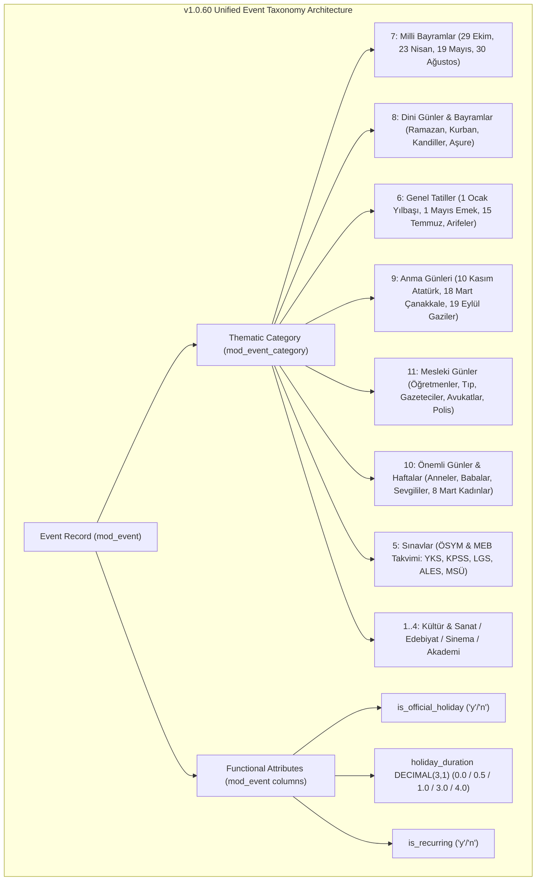

# Plan v1.0.60: `mod_event` Semantic Taxonomy Disentanglement, Professional Days & Official Holiday Attribute Refactoring (Comprehensive Risk-Audited & Zero-Defect Execution Specification)

**Target Domain:** `https://amedbulten.com`  
**Repository:** `AF/Bulletin`  
**Target Version:** `v1.0.60`  
**Target Module:** [`mod/mod_event`](file:///home/malpersaz/Desktop/projects/htdocs/AF/Bulletin/mod/mod_event/mod_event.sql) & [`mod/mod_event_category`](file:///home/malpersaz/Desktop/projects/htdocs/AF/Bulletin/mod/mod_event_category/mod_event_category.sql)  
**Date:** 2026-11-10  
**Architecture Standard:** Amed Framework Core (Strict Code Separation, Mobile-First Admin Surface, Wikipedia-style `legacy_seo`, Google Event JSON-LD ISO-8601 Parity, Deterministic Zero-Drift DB Schema)  
**Predecessor Version:** `v1.0.59` (`docs/plan/v1.0.59-strict-language-prefix-and-root-serp-remediation-plan.md`)  
**Target Executor:** Gemini 3.8 Flash (Deterministic Step-by-Step Blueprint)

---

## 1. Executive Summary & Expanded Category Model

In the historical structure of [`mod_event`](file:///home/malpersaz/Desktop/projects/htdocs/AF/Bulletin/mod/mod_event/mod_event.sql), thematic event content categories, occupational observances, and statutory legal holiday statuses were collapsed into ambiguous, conflicting buckets (`Resmi Tatil` vs `Bayramlar`).

Following comprehensive editorial, legal, and codebase risk analysis, **v1.0.60** separates:
1. **Thematic Content Categories** (`mod_event_category`) — Distinct, mutually exclusive editorial scopes:
   - `Milli Bayramlar` (`id = 7`, renamed from `Bayramlar`)
   - `Dini Günler & Bayramlar` (`id = 8`, new)
   - `Genel Tatiller` (`id = 6`, renamed from `Resmi Tatil`)
   - `Anma Günleri` (`id = 9`, new)
   - `Önemli Günler & Haftalar` (`id = 10`, new — societal, familial, awareness, and humanitarian days)
   - `Mesleki Günler` (`id = 11`, new — dedicated category for occupational recognition)
   - `Sınavlar` (`id = 5`, existing)
   - Arts & Culture (`id = 1..4`: `Kültür & Sanat`, `Edebiyat & Söyleşi`, `Sinema & Belgesel`, `Atölye & Akademi`)
2. **Functional Holiday Attributes** (`mod_event` columns) — Detached from content classification:
   - `is_official_holiday`: `ENUM('y','n') NOT NULL DEFAULT 'n'` indicates statutory work cessation under Law No. 2429.
   - `holiday_duration`: `DECIMAL(3,1) NOT NULL DEFAULT 0.0` records exact statutory holiday duration in days (`0.0` non-holiday, `0.5` Arife half-day, `1.0` full day, `1.5` 29 Ekim with Arife, `3.0` / `3.5` Ramazan Bayramı, `4.0` / `4.5` Kurban Bayramı). *(Upgraded from `DECIMAL(2,1)` to `DECIMAL(3,1)` to safely support 9-day administrative bridge holidays up to `99.9` without MySQL strict-mode overflow).*
   - `is_recurring`: `ENUM('y','n') NOT NULL DEFAULT 'n'` flags perpetual annual calendar events.



---

## 2. Comprehensive Risk Audit & Root-Cause Mitigations (Why Old Plan Would Fail)

Before executing any code changes, the following **16 critical architectural risks and defects** must be addressed:

| Risk ID | Severity | Affected File(s) & Line Numbers | Root Cause & Failure Mechanism | Mandatory Mitigation in v1.0.60 |
| :-: | :-: | :--- | :--- | :--- |
| **R1** | **CRITICAL (Fatal Twig Error)** | [`mod/index/helper/mod_event.helper.php`](file:///home/malpersaz/Desktop/projects/htdocs/AF/Bulletin/mod/index/helper/mod_event.helper.php#L444-L446), [`events.twig`](file:///home/malpersaz/Desktop/projects/htdocs/AF/Bulletin/templates/amed/index/mod_event/events.twig#L159) | `events()` builds `$templatePath = 'index/mod_event/sections/section_' . $templateKey . '.twig'` and `events.twig` executes ``. Returning new keys (`national_holidays`, `religious_holidays`, `memorial_days`, `professional_days`, `special_observances`, `public_holidays`) without creating those 6 `.twig` files or updating `$isCivic` (Line 446) causes an immediate **Twig `LoaderError: Unable to find template`** on `/tr/events` and `/tr/events/{seo}`! | Create all 6 dedicated section templates under `templates/amed/index/mod_event/sections/` AND update `$isCivic` in `mod/index/helper/mod_event.helper.php` (Line 446) to include all civic/calendar template keys. |
| **R2** | **CRITICAL (ORM & View Desync)** | [`mod/mod_event/model/mod_event.model.php`](file:///home/malpersaz/Desktop/projects/htdocs/AF/Bulletin/mod/mod_event/model/mod_event.model.php#L7-L61), [`mod/mod_event/model/events.model.php`](file:///home/malpersaz/Desktop/projects/htdocs/AF/Bulletin/mod/mod_event/model/events.model.php#L47-L130) | 1) `BaseModuleController::processFieldData()` checks `property_exists($model, $field)`. Without public properties `$is_official_holiday`, `$holiday_duration`, `$is_recurring` on `mod_event_model` and `events_model`, ORM silently drops them.<br>2) `events_model::ensureViewExists()` only checks `hasUserImageColumn() && hasViewCountColumn() && hasCategoryAclIdColumn()`. If `events` view already exists, it will NOT recreate the view with the new columns, and if it ever does recreate it later using its hardcoded SQL (Lines 61–111), it will **wipe out** the new columns! | Declare the 3 new public properties + `getDefaults()` in `mod_event.model.php`, declare them in `events.model.php`, add `hasOfficialHolidayColumn()` to `ensureViewExists()`, and update the inline `CREATE VIEW events` SQL inside `events.model.php`. |
| **R3** | **HIGH (SQL DDL Syntax Error)** | [`mod/mod_event/mod_event.sql`](file:///home/malpersaz/Desktop/projects/htdocs/AF/Bulletin/mod/mod_event/mod_event.sql#L1-L37), [`installer/mod_event/mod_event.sql`](file:///home/malpersaz/Desktop/projects/htdocs/AF/Bulletin/installer/mod_event/mod_event.sql#L1-L37) | These two files are full `CREATE TABLE mod_event (...)` definitions used by the installer, NOT migration scripts. Appending `ALTER TABLE` instead of integrating the columns into `CREATE TABLE` breaks fresh installations and schema drift checks. | Update the `CREATE TABLE mod_event` definition directly in both `.sql` files, and run `ALTER TABLE` idempotently inside the migration task after checking `SHOW COLUMNS`. |
| **R4** | **HIGH (Agenda Duplicate & Ongoing Bug)** | [`mod/index/helper/mod_event.helper.php`](file:///home/malpersaz/Desktop/projects/htdocs/AF/Bulletin/mod/index/helper/mod_event.helper.php#L48-L92), [`mod/index/helper/mod_event.helper.php`](file:///home/malpersaz/Desktop/projects/htdocs/AF/Bulletin/mod/index/helper/mod_event.helper.php#L870-L903) | 1) On `2026-11-10 02:00:10`, an event starting `2026-11-10 00:00:00` has `$startTs < $now`. In `_cleanEventRow()`, `$row['is_upcoming'] = ($startTs >= $now)` becomes `false`, and `is_today` only checks `date('Y-m-d', $startTs) === $todayStr` (ignoring multi-day holidays like Ramazan/Kurban Bayramı on days 2–4!).<br>2) In `_event_agenda()`, if `$queryUpcoming` includes today's ongoing events (`start_date < $now` and `end_date >= $now`), then `$queryPast` (`start_date < $now`) will **fetch the exact same today event a second time** when backfilling (`count($agenda) < $limit`)! | 1) In `_cleanEventRow()`, compute `$todayStartTs = strtotime(date('Y-m-d 00:00:00', $now))` and `$todayEndTs = strtotime(date('Y-m-d 23:59:59', $now))`. Set `is_today = ($startTs <= $todayEndTs && $endTs >= $todayStartTs)` and `is_upcoming = ($endTs >= $now)`.<br>2) In `_event_agenda()`, use `COALESCE(end_date, start_date) >= '{$todayStart}'` for `$queryUpcoming` and `COALESCE(end_date, start_date) < '{$todayStart}'` (plus `id NOT IN (...)`) for `$queryPast`. |
| **R5** | **HIGH (SEO 404 on Old Category Slugs)** | [`lib/Amed.class.php`](file:///home/malpersaz/Desktop/projects/htdocs/AF/Bulletin/lib/Amed.class.php#L480-L539), [`mod/index/helper/mod_event.helper.php`](file:///home/malpersaz/Desktop/projects/htdocs/AF/Bulletin/mod/index/helper/mod_event.helper.php#L490-L522) | Renaming Category 6 `Resmi_Tatil` → `Genel_Tatiller` and Category 7 `Bayramlar` → `Milli_Bayramlar` breaks existing indexed URLs `/tr/events/Resmi_Tatil` and `/tr/events/Bayramlar` with HTTP 404. | Seed 301 redirect rules in `mod_redirect` (`tr/events/Resmi_Tatil` → `tr/events/Genel_Tatiller`, `tr/events/Bayramlar` → `tr/events/Milli_Bayramlar`) AND add legacy alias mapping in `mod_event.helper.php` (`events()`) to 301-redirect `Resmi_Tatil` and `Bayramlar` to their new canonical slugs. |
| **R6** | **HIGH (MCP Tool & Schema Blindness)** | [`lib/McpEventTools.class.php`](file:///home/malpersaz/Desktop/projects/htdocs/AF/Bulletin/lib/McpEventTools.class.php#L18-L151), [`lib/McpEventTools.class.php`](file:///home/malpersaz/Desktop/projects/htdocs/AF/Bulletin/lib/McpEventTools.class.php#L310-L534) | `McpEventTools` (`list_events`, `create_event`, `update_event`) does not select, validate, or persist `is_official_holiday`, `holiday_duration`, or `is_recurring`. Any MCP agent call would ignore these columns. | Add `is_official_holiday`, `holiday_duration`, and `is_recurring` to `definitions()`, `listEvents()`, `createEvent()`, `updateEvent()`, and `applyEventFilters()` in `lib/McpEventTools.class.php`. |
| **R7** | **HIGH (Deployment Exclusion of `tasks/migrate_*`)** | [`.deployignore`](file:///home/malpersaz/Desktop/projects/htdocs/AF/Bulletin/.deployignore#L43), [`tools/deploy_production.sh`](file:///home/malpersaz/Desktop/projects/htdocs/AF/Bulletin/tools/deploy_production.sh#L46) | `.deployignore` Line 43 explicitly excludes `tasks/migrate_*`! Naming the script `tasks/migrate_mod_event_taxonomy_v1060.php` means `deploy_production.sh` will **never upload it** to `amedbulten.com`! Furthermore, local CLI `/usr/bin/php` lacks `pdo_mysql` while production `amedbulten.com` runs the live MySQL database. | Name the script `tasks/seed_mod_event_taxonomy_v1060.php` (matching `tasks/seed_google_news_policies.php`, which IS deployed by rsync) and execute it on production via SSH (`ssh ssh-w02232db@w02232db.kasserver.com "php /www/htdocs/w02232db/amedbulten.com/tasks/seed_mod_event_taxonomy_v1060.php"`). |
| **R8** | **MEDIUM (Multi-Day Holiday Overflow)** | [`mod/mod_event/mod_event.sql`](file:///home/malpersaz/Desktop/projects/htdocs/AF/Bulletin/mod/mod_event/mod_event.sql) | In Law No. 2429, Ramazan Bayramı is `3.0` days (`3.5` with Arife) and Kurban Bayramı is `4.0` days (`4.5` with Arife), and administrative bridge holidays reach `9.0` days. `DECIMAL(2,1)` overflows at `10.0`. | Use `DECIMAL(3,1) NOT NULL DEFAULT 0.0` so values from `0.0` to `99.9` are stored safely, and assign exact statutory durations (`1.0`, `0.5`, `3.0`, `4.0`) to each seeded holiday record. |
| **R9** | **MEDIUM (Substring Collision in `_resolveCategoryTemplateKey`)** | [`mod/index/helper/mod_event.helper.php`](file:///home/malpersaz/Desktop/projects/htdocs/AF/Bulletin/mod/index/helper/mod_event.helper.php#L199-L228) | Existing line 223 checks `strpos($seoNorm, 'bayramlar') !== false || strpos($nameNorm, 'bayram') !== false`. Because both `Milli Bayramlar` (`Milli_Bayramlar`) and `Dini Günler & Bayramlar` (`Dini_Günler_ve_Bayramlar`) contain `'bayram'`, if the old check is not removed or placed after specific checks, both categories will collapse into `'holidays'`! Also `strtolower()` in PHP does not lowercase multibyte `İ`/`I`/`Ü`/`Ö`/`Ş`/`Ç` without `mb_strtolower(..., 'UTF-8')`. | Use `mb_strtolower(..., 'UTF-8')` and check specific slugs (`milli_bayram`, `dini_gunler` / `dini_günler`, `genel_tatil`, `anma_gun` / `anma_gün`, `mesleki_gun` / `mesleki_gün`, `onemli_gun` / `önemli_gün`) BEFORE any generic fallback. |
| **R10** | **MEDIUM (Admin Forms & Validator Support)** | [`mod/mod_event/index.php`](file:///home/malpersaz/Desktop/projects/htdocs/AF/Bulletin/mod/mod_event/index.php#L79-L140), [`mod/mod_event/validator/add.validator.php`](file:///home/malpersaz/Desktop/projects/htdocs/AF/Bulletin/mod/mod_event/validator/add.validator.php#L178-L218), [`edit.validator.php`](file:///home/malpersaz/Desktop/projects/htdocs/AF/Bulletin/mod/mod_event/validator/edit.validator.php#L178-L218), [`edit.twig`](file:///home/malpersaz/Desktop/projects/htdocs/AF/Bulletin/templates/admin/mod_event/edit.twig), [`wizard_event.twig`](file:///home/malpersaz/Desktop/projects/htdocs/AF/Bulletin/templates/admin/partials/wizard_event.twig) | If an admin edits an event in `/mod_event/edit/{id}`, `beforeSave()` and `beforeUpdate()` and the admin forms (`edit.twig`, `wizard_event.twig`) must preserve `is_official_holiday`, `holiday_duration`, and `is_recurring` without resetting them or failing validation. | Add optional enum/numeric validation in `add.validator.php` & `edit.validator.php`, normalize the 3 fields in `mod/mod_event/index.php` (`beforeSave` / `beforeUpdate`), and preserve the 3 attributes across admin saves via hidden inputs in `wizard_event.twig` and `edit.twig` (authoring/toggling is MCP-only via `create_event` / `update_event` in v1.0.60; visible admin controls are deferred to v1.0.61 admin hardening). |
| **R11** | **MEDIUM (Google Event JSON-LD ISO-8601 & `event.twig` Parity)** | [`templates/amed/index/mod_event/event.twig`](file:///home/malpersaz/Desktop/projects/htdocs/AF/Bulletin/templates/amed/index/mod_event/event.twig#L66-L91), [`mod/index/helper/mod_event.helper.php`](file:///home/malpersaz/Desktop/projects/htdocs/AF/Bulletin/mod/index/helper/mod_event.helper.php#L94-L105) | `event.twig` already has a `schema.org/Event` block (Lines 66–91), so adding a second block would create duplicate `Event` schemas! However, `d.start_date` is currently output as `"2026-11-10 00:00:00"` (MySQL format without `T` or `+03:00` timezone offset), which triggers Google Search Console warning *"Invalid ISO 8601 dateTime format in startDate/endDate"*. | Compute `$row['schema_start_date'] = date('c', $startTs)` and `$row['schema_end_date'] = date('c', $endTs)` in `_cleanEventRow()`, and update the existing `Event` JSON-LD block in `event.twig` (Lines 71–73) to use `d.schema_start_date` and `d.schema_end_date`. |
| **R12** | **MEDIUM (Summary Length Constraint 90..255 Chars)** | [`mod/mod_event/validator/add.validator.php`](file:///home/malpersaz/Desktop/projects/htdocs/AF/Bulletin/mod/mod_event/validator/add.validator.php#L150-L164) | `add_validator` and `edit_validator` strictly enforce `summary` length between **90 and 255 characters** (`min: 90, max: 255`) and `subject` length between **2 and 120 characters**. Any seeded event with a `summary` shorter than 90 chars will fail when later edited in the admin panel! | Enforce `mb_strlen($summary) >= 95 && mb_strlen($summary) <= 240` and `mb_strlen($subject) <= 115` on every seeded record in `tasks/seed_mod_event_taxonomy_v1060.php`. |
| **R13** | **LOW (Calendar JSON & Detail Page Holiday Badge)** | [`mod/index/helper/mod_event.helper.php`](file:///home/malpersaz/Desktop/projects/htdocs/AF/Bulletin/mod/index/helper/mod_event.helper.php#L813-L833), [`templates/amed/index/mod_event/event.twig`](file:///home/malpersaz/Desktop/projects/htdocs/AF/Bulletin/templates/amed/index/mod_event/event.twig#L147-L172) | `calendar_json()` does not return `is_official_holiday` or `holiday_duration`, and `event.twig` / `event_agenda.twig` do not display an Official Holiday badge (`Resmi Tatil`) when `is_official_holiday === 'y'`. | Expose `is_official_holiday`, `holiday_duration`, and `is_recurring` in `_cleanEventRow()` and `calendar_json()`, and render the localized official holiday badge in `event.twig`, `event_agenda.twig`, and civic section templates. |
| **R14** | **LOW (i18n Guard Parity Across Language Files)** | [`mod/index/lang/en.php`](file:///home/malpersaz/Desktop/projects/htdocs/AF/Bulletin/mod/index/lang/en.php#L665), [`mod/index/lang/tr.php`](file:///home/malpersaz/Desktop/projects/htdocs/AF/Bulletin/mod/index/lang/tr.php#L633), [`mod/mod_event/lang/en.php`](file:///home/malpersaz/Desktop/projects/htdocs/AF/Bulletin/mod/mod_event/lang/en.php#L163), [`mod/mod_event/lang/tr.php`](file:///home/malpersaz/Desktop/projects/htdocs/AF/Bulletin/mod/mod_event/lang/tr.php#L163) | Adding new UI badges (`official_holiday_badge`, `half_day_holiday`, `recurring_annual`) without adding keys to both `en.php` and `tr.php` will fail `python3 tools/i18n_guard.py`. | Add all 3 new translation keys in lockstep to `mod/index/lang/en.php`, `mod/index/lang/tr.php` (and sibling `mod/index/lang/*.php` files) as well as `mod/mod_event/lang/en.php` and `mod/mod_event/lang/tr.php`. |
| **R15** | **CRITICAL (Detail Page Hydration Regression — `$eventModel->sync()`)** | [`mod/index/helper/mod_event.helper.php`](file:///home/malpersaz/Desktop/projects/htdocs/AF/Bulletin/mod/index/helper/mod_event.helper.php#L608-L646), [`lib/Traits/PublicHelperTrait.php`](file:///home/malpersaz/Desktop/projects/htdocs/AF/Bulletin/lib/Traits/PublicHelperTrait.php#L260-L275) | `event($seo)` calls `$this->findItemBySeoOrIdStrict('mod_event.events', ...)`, which executes `$model->limit(1)->gRo()` without calling `$model->sync()`. Consequently, `$eventModel->seo`, `$eventModel->id`, `$eventModel->acl_id`, and `$eventModel->category_id` are all `null`! At Line 641, `(string)$eventModel->seo !== $cleanSeo` (`"" !== $cleanSeo`) always evaluates to `true`, causing every `/tr/event/{seo}` URL to 301-redirect to bare `/tr/event/`! | Call `$eventModel->sync();` in `mod/index/helper/mod_event.helper.php` (`event()` immediately after Line 638, before Line 641) AND inside `lib/Traits/PublicHelperTrait.php` (`findItemBySeoOrIdStrict()` before returning `$model`). |
| **R16** | **MEDIUM (`calendar_json()` Category Filter Lookup Bug)** | [`mod/index/helper/mod_event.helper.php`](file:///home/malpersaz/Desktop/projects/htdocs/AF/Bulletin/mod/index/helper/mod_event.helper.php#L772-L779) | In `calendar_json()`, `$catLookup->where_seo_and_lang_and_root(...)` calls `gRo()` without `$catLookup->sync()`, so `(int) $catLookup->id` at Line 778 is always `0`! Filtering the interactive calendar by any category (`Milli_Bayramlar`, `Genel_Tatiller`, etc.) silently fails to apply `category_id IN (...)`. | Add `$catLookup->sync();` at Line 778 of `mod/index/helper/mod_event.helper.php` before reading `$catLookup->id`. |

---

## 3. Definitive Category Taxonomy (`mod_event_category`)

| ID | Category Name (`name`) | SEO Slug (`legacy_seo`) | Template Key (`_resolveCategoryTemplateKey`) | Section Layout (`is_civic`) | `is_official_holiday` Context |
| :-: | :--- | :--- | :--- | :-: | :--- |
| `1` | `Kültür & Sanat` | `Kültür_Sanat` | `culture_art` | Cultural (`false`) | Regular (`n`, `0.0`) |
| `2` | `Edebiyat & Söyleşi` | `Edebiyat_Söyleşi` | `literature_talk` | Cultural (`false`) | Regular (`n`, `0.0`) |
| `3` | `Sinema & Belgesel` | `Sinema_Belgesel` | `cinema_documentary` | Cultural (`false`) | Regular (`n`, `0.0`) |
| `4` | `Atölye & Akademi` | `Atölye_Akademi` | `workshop_academy` | Cultural (`false`) | Regular (`n`, `0.0`) |
| `5` | `Sınavlar` | `Sınavlar` | `exams` | Civic (`true`) | Regular (`n`, `0.0`) |
| **`6`** | **`Genel Tatiller`** *(Renamed from `Resmi Tatil`)* | **`Genel_Tatiller`** | `public_holidays` | Civic (`true`) | Statutory (`y`: `1.0` full day or `0.5` Arife half-day) |
| **`7`** | **`Milli Bayramlar`** *(Renamed from `Bayramlar`)* | **`Milli_Bayramlar`** | `national_holidays` | Civic (`true`) | Statutory (`y`: `1.0` full day) |
| **`8`** | **`Dini Günler & Bayramlar`** *(New)* | **`Dini_Günler_ve_Bayramlar`** | `religious_holidays` | Civic (`true`) | Dual: Ramazan (`y`, `3.0`) & Kurban (`y`, `4.0`); Kandiller & Aşure (`n`, `0.0`) |
| **`9`** | **`Anma Günleri`** *(New)* | **`Anma_Günleri`** | `memorial_days` | Civic (`true`) | Observance (`n`, `0.0`) — e.g. 10 Kasım, 18 Mart, 19 Eylül, Ahmed Arif, Cahit Sıtkı Tarancı |
| **`10`**| **`Önemli Günler & Haftalar`** *(New)* | **`Önemli_Günler_ve_Haftalar`** | `special_observances` | Civic (`true`) | Observance (`n`, `0.0`) — e.g. 21 Mart Newroz, 8 Mart Kadınlar, Anneler/Babalar Günü |
| **`11`**| **`Mesleki Günler`** *(New)* | **`Mesleki_Günler`** | `professional_days` | Civic (`true`) | Observance (`n`, `0.0`) — e.g. 24 Kasım Öğretmenler, 10 Ocak Gazeteciler, 14 Mart Tıp, 5 Nisan Avukatlar |

---

## 4. Exact File-by-File Implementation Specifications

### 4.1 Database Schema & View Definitions (`.sql` Files)

#### 4.1.1 [MODIFY] [`mod/mod_event/mod_event.sql`](file:///home/malpersaz/Desktop/projects/htdocs/AF/Bulletin/mod/mod_event/mod_event.sql) & [`installer/mod_event/mod_event.sql`](file:///home/malpersaz/Desktop/projects/htdocs/AF/Bulletin/installer/mod_event/mod_event.sql)
**Why:** Both files must remain valid `CREATE TABLE` schemas for fresh installs and schema validators (Risk **R3**, **R8**).
**Exact Replacement Content (Lines 1–42):**

```sql
CREATE TABLE `mod_event` (
  `id` int(11) NOT NULL AUTO_INCREMENT,
  `lang` varchar(11) NOT NULL,
  `category_id` int(11) NOT NULL DEFAULT 0,
  `name` varchar(255) NOT NULL,
  `subject` varchar(255) NOT NULL,
  `start_date` datetime NOT NULL,
  `end_date` datetime DEFAULT NULL,
  `status` enum('y','n') NOT NULL DEFAULT 'y',
  `is_official_holiday` enum('y','n') NOT NULL DEFAULT 'n',
  `holiday_duration` decimal(3,1) NOT NULL DEFAULT 0.0,
  `is_recurring` enum('y','n') NOT NULL DEFAULT 'n',
  `slider` enum('y','n') NOT NULL DEFAULT 'n',
  `deck` enum('y','n') NOT NULL DEFAULT 'n',
  `summary` text DEFAULT NULL,
  `content` text NOT NULL,
  `location` text DEFAULT NULL,
  `participants` text DEFAULT NULL,
  `guests` text DEFAULT NULL,
  `seo` varchar(255) NOT NULL,
  `title` varchar(255) NOT NULL,
  `keywords` varchar(255) NOT NULL,
  `description` varchar(255) NOT NULL,
  `image` varchar(255) DEFAULT NULL,
  `gallery_id` int(11) NOT NULL DEFAULT 0,
  `file_id` int(11) NOT NULL DEFAULT 0,
  `video` text DEFAULT NULL,
  `acl_id` int(11) NOT NULL DEFAULT 0,
  `view_count` int(11) NOT NULL DEFAULT 0,
  `created_at` timestamp NOT NULL DEFAULT CURRENT_TIMESTAMP,
  `updated_at` datetime DEFAULT NULL,
  `user_id` int(11) NOT NULL,
  PRIMARY KEY (`id`),
  INDEX `idx_event_lang_seo` (`lang`, `seo`),
  INDEX `idx_event_lang_status` (`lang`, `status`),
  INDEX `idx_event_start_date` (`start_date`),
  INDEX `idx_event_category` (`category_id`),
  INDEX `idx_event_official_holiday` (`is_official_holiday`, `start_date`),
  INDEX `idx_event_recurring` (`is_recurring`),
  INDEX `idx_event_slider` (`slider`),
  INDEX `idx_event_user` (`user_id`)
) ENGINE=InnoDB DEFAULT CHARSET=utf8mb4 COLLATE=utf8mb4_unicode_ci;
```

#### 4.1.2 [MODIFY] [`mod/mod_event/events.sql`](file:///home/malpersaz/Desktop/projects/htdocs/AF/Bulletin/mod/mod_event/events.sql) & [`installer/mod_event/events.sql`](file:///home/malpersaz/Desktop/projects/htdocs/AF/Bulletin/installer/mod_event/events.sql)
**Why:** Keep the `events` SQL view definition synchronized with `events.model.php` (Risk **R2**).
**Exact Replacement Content:**

```sql
CREATE VIEW events AS
SELECT
  mod_event.id,
  mod_event.lang,
  mod_event.category_id AS category_id,
  mod_event.name,
  mod_event.subject,
  mod_event.start_date,
  mod_event.end_date,
  mod_event.status,
  mod_event.is_official_holiday,
  mod_event.holiday_duration,
  mod_event.is_recurring,
  mod_event.slider,
  mod_event.deck,
  mod_event.summary,
  mod_event.content,
  mod_event.location,
  mod_event.participants,
  mod_event.guests,
  mod_event.seo,
  mod_event.title,
  mod_event.keywords,
  mod_event.description,
  mod_event.image,
  mod_event.gallery_id AS gallery_id,
  mod_event.file_id AS file_id,
  mod_event.video,
  mod_event.acl_id AS acl_id,
  mod_event.view_count,
  mod_event.created_at,
  mod_event.updated_at,
  mod_event.user_id AS user_id,
  mod_event_category.name AS category_name,
  mod_event_category.name AS categoryname,
  mod_event_category.seo AS category_seo,
  mod_event_category.image AS category_image,
  mod_event_category.acl_id AS category_acl_id,
  mod_user.username,
  mod_user.name AS u_name,
  mod_user.last_name AS u_last_name,
  mod_user.email,
  mod_user.image AS user_image,
  mod_user_group.name AS group_name,
  (
    SELECT COUNT(mod_gallery.id)
    FROM mod_gallery
    WHERE mod_event.id = mod_gallery.vid
      AND mod_gallery.mod_name = 'mod_event'
  ) AS gallery_count
FROM mod_event
LEFT JOIN mod_user ON mod_event.user_id = mod_user.id
LEFT JOIN mod_user_group ON mod_user.group_id = mod_user_group.group_id
LEFT JOIN mod_event_category ON mod_event.category_id = mod_event_category.id;
```

---

### 4.2 ORM Models (`mod_event.model.php` & `events.model.php`)

#### 4.2.1 [MODIFY] [`mod/mod_event/model/mod_event.model.php`](file:///home/malpersaz/Desktop/projects/htdocs/AF/Bulletin/mod/mod_event/model/mod_event.model.php#L14-L61)
**Why:** `BaseModuleController::processFieldData()` checks `property_exists($model, $field)`. Without these properties and defaults, ORM operations ignore the new columns (Risk **R2**).
**Action:**
1. Add after `public $status;` (Line 14):
```php
    public $is_official_holiday;
    public $holiday_duration;
    public $is_recurring;
```
2. Add inside `getDefaults()` array (after `'status' => 'y',` at Line 45):
```php
            'is_official_holiday' => 'n',
            'holiday_duration' => 0.0,
            'is_recurring' => 'n',
```

#### 4.2.2 [MODIFY] [`mod/mod_event/model/events.model.php`](file:///home/malpersaz/Desktop/projects/htdocs/AF/Bulletin/mod/mod_event/model/events.model.php#L14-L130)
**Why:** `events_model` is used by `mod_event_helper::event()` (`findItemBySeoOrIdStrict('mod_event.events', ...)`) and `mod_hero_slider`. Its `ensureViewExists()` method must verify `hasOfficialHolidayColumn()` and include the 3 columns in its `CREATE VIEW` SQL so the view auto-upgrades and never drops the columns (Risk **R2**).
**Action:**
1. Add after `public $status;` (Line 14):
```php
    public $is_official_holiday;
    public $holiday_duration;
    public $is_recurring;
```
2. In `ensureViewExists()` (Line 55), change:
```php
        if ($this->viewExists('events') && $this->hasUserImageColumn() && $this->hasViewCountColumn() && $this->hasCategoryAclIdColumn() && $this->hasOfficialHolidayColumn()) {
            return;
        }
```
3. In the inline `$sql = "CREATE VIEW events AS ..."` inside `ensureViewExists()` (after `mod_event.status,` at Line 70), add:
```sql
  mod_event.is_official_holiday,
  mod_event.holiday_duration,
  mod_event.is_recurring,
```
4. Add helper method after `hasCategoryAclIdColumn()` (Line 129):
```php
    private function hasOfficialHolidayColumn()
    {
        return $this->hasViewColumn('is_official_holiday');
    }
```

---

### 4.3 Public Helper (`mod/index/helper/mod_event.helper.php`) & Trait (`lib/Traits/PublicHelperTrait.php`)

#### 4.3.0 [MODIFY] [`lib/Traits/PublicHelperTrait.php`](file:///home/malpersaz/Desktop/projects/htdocs/AF/Bulletin/lib/Traits/PublicHelperTrait.php#L260-L276) & [`mod/index/helper/mod_event.helper.php`](file:///home/malpersaz/Desktop/projects/htdocs/AF/Bulletin/mod/index/helper/mod_event.helper.php#L608-L646) — Fix ORM Model Hydration (`sync()`) in `event()`
**Why:** `findItemBySeoOrIdStrict()` executes `$model->limit(1)->gRo()` without calling `$model->sync()`, leaving `$eventModel->seo`, `$eventModel->id`, `$eventModel->acl_id`, and `$eventModel->category_id` unhydrated (`null`). Consequently, the canonical comparison `(string)$eventModel->seo !== $cleanSeo` at Line 641 always fires (`"" !== $cleanSeo`) and 301-redirects every `/tr/event/{seo}` detail URL to `/tr/event/` (Risk **R15**).
**Action:**
1. In [`lib/Traits/PublicHelperTrait.php`](file:///home/malpersaz/Desktop/projects/htdocs/AF/Bulletin/lib/Traits/PublicHelperTrait.php#L261-L275), call `$model->sync();` immediately before `return $model;` in both the SEO loop (Line 262) and the ID fallback block (Line 274):
```php
            $model->limit(1)->gRo();
            if ($model->getSize() > 0) {
                $model->sync();
                return $model;
            }
```
2. In [`mod/index/helper/mod_event.helper.php`](file:///home/malpersaz/Desktop/projects/htdocs/AF/Bulletin/mod/index/helper/mod_event.helper.php#L638-L641) inside `event($seo)`, immediately after the not-found `if` block closes at Line 638 and before the canonical check at Line 641, insert:
```php
        $eventModel->sync();
```

#### 4.3.1 [MODIFY] [`mod/index/helper/mod_event.helper.php`](file:///home/malpersaz/Desktop/projects/htdocs/AF/Bulletin/mod/index/helper/mod_event.helper.php#L42-L132) — `_cleanEventRow()`
**Why:**
- Normalizes `is_official_holiday`, `holiday_duration`, `is_recurring`, and boolean conveniences `is_holiday_flag`, `is_half_day_holiday`.
- Fixes `is_today` and `is_upcoming` for active single-day and multi-day events so events on `2026-11-10` that started at `00:00:00` remain `is_today = true` and `is_upcoming = true` all day until `23:59:59` (Risk **R4**).
- Generates valid ISO-8601 `schema_start_date` and `schema_end_date` (`date('c', ...)`) for Google Event JSON-LD schema (Risk **R11**).
- Preserves the Localized Month Map (`$monthsMap` and `$row['start_month_localized']` at Lines 63–78) intact inside the replacement block.

**Action in `_cleanEventRow()`:**
1. Around Line 46, after `$row['has_slider'] = ...;`, add:
```php
        $row['is_official_holiday'] = (isset($row['is_official_holiday']) && $row['is_official_holiday'] === 'y') ? 'y' : 'n';
        $row['is_holiday_flag'] = ($row['is_official_holiday'] === 'y');
        $row['holiday_duration'] = isset($row['holiday_duration']) ? round((float) $row['holiday_duration'], 1) : 0.0;
        $row['is_half_day_holiday'] = ($row['is_holiday_flag'] && abs($row['holiday_duration'] - 0.5) < 0.05);
        $row['is_recurring'] = (isset($row['is_recurring']) && $row['is_recurring'] === 'y') ? 'y' : 'n';
```
2. Replace Lines 48–105 with the complete block below (which explicitly retains the Localized Month Map at Lines 63–78):
```php
        if (isset($row['start_date']) && !empty($row['start_date'])) {
            $startTs = strtotime($row['start_date']);
            $endTs = !empty($row['end_date']) ? strtotime($row['end_date']) : strtotime(date('Y-m-d 23:59:59', $startTs));
            if ($endTs < $startTs) {
                $endTs = $startTs;
            }
            $now = time();

            // Duration in days (e.g. multi-day holidays)
            $row['duration_days'] = max(1, (int) floor((strtotime(date('Y-m-d', $endTs)) - strtotime(date('Y-m-d', $startTs))) / 86400) + 1);

            $row['start_day'] = date('d', $startTs);
            $row['start_month'] = date('M', $startTs);
            $row['start_time'] = date('H:i', $startTs);
            $row['start_date_only'] = date('d.m.Y', $startTs);
            $row['start_date_formatted'] = date('d.m.Y H:i', $startTs);

            // Localized Month Map
            $langCode = strtolower((string) ($this->site['lang'] ?? 'tr'));
            $monthNum = date('m', $startTs);
            $monthsMap = [
                'tr' => ['01' => 'Oca', '02' => 'Şub', '03' => 'Mar', '04' => 'Nis', '05' => 'May', '06' => 'Haz', '07' => 'Tem', '08' => 'Ağu', '09' => 'Eyl', '10' => 'Eki', '11' => 'Kas', '12' => 'Ara'],
                'ku' => ['01' => 'Rêb', '02' => 'Reş', '03' => 'Ada', '04' => 'Avb', '05' => 'Gul', '06' => 'Pûş', '07' => 'Tîr', '08' => 'Teb', '09' => 'Îlû', '10' => 'Cot', '11' => 'Miş', '12' => 'Ber'],
                'en' => ['01' => 'Jan', '02' => 'Feb', '03' => 'Mar', '04' => 'Apr', '05' => 'May', '06' => 'Jun', '07' => 'Jul', '08' => 'Aug', '09' => 'Sep', '10' => 'Oct', '11' => 'Nov', '12' => 'Dec'],
                'de' => ['01' => 'Jan', '02' => 'Feb', '03' => 'Mär', '04' => 'Apr', '05' => 'Mai', '06' => 'Jun', '07' => 'Jul', '08' => 'Aug', '09' => 'Sep', '10' => 'Okt', '11' => 'Nov', '12' => 'Dez'],
                'fr' => ['01' => 'Jan', '02' => 'Fév', '03' => 'Mar', '04' => 'Avr', '05' => 'Mai', '06' => 'Juin', '07' => 'Juil', '08' => 'Aoû', '09' => 'Sep', '10' => 'Oct', '11' => 'Nov', '12' => 'Déc'],
                'zza' => ['01' => 'Çel', '02' => 'Guc', '03' => 'Ada', '04' => 'Nîs', '05' => 'Gul', '06' => 'Hez', '07' => 'Tîr', '08' => 'Pal', '09' => 'Kek', '10' => 'Tşr', '11' => 'Kan', '12' => 'Çil'],
                'ar' => ['01' => 'يناير', '02' => 'فبراير', '03' => 'مارس', '04' => 'أبريل', '05' => 'مايو', '06' => 'يونيو', '07' => 'يوليو', '08' => 'أغسطس', '09' => 'سبتمبر', '10' => 'أكتوبر', '11' => 'نوفمبر', '12' => 'ديسمبر'],
                'ckb' => ['01' => 'کانوونی دووەم', '02' => 'شوبات', '03' => 'ئازار', '04' => 'نیسان', '05' => 'ئایار', '06' => 'حوزەیران', '07' => 'تەممووز', '08' => 'ئاب', '09' => 'ئەیلوول', '10' => 'تشرینی یەکەم', '11' => 'تشرینی دووەم', '12' => 'کانوونی یەکەم'],
                'ru' => ['01' => 'Янв', '02' => 'Фев', '03' => 'Мар', '04' => 'Апр', '05' => 'Май', '06' => 'Июн', '07' => 'Июл', '08' => 'Авг', '09' => 'Сен', '10' => 'Окт', '11' => 'Ноя', '12' => 'Дек'],
                'sv' => ['01' => 'Jan', '02' => 'Feb', '03' => 'Mar', '04' => 'Apr', '05' => 'Maj', '06' => 'Jun', '07' => 'Jul', '08' => 'Aug', '09' => 'Sep', '10' => 'Okt', '11' => 'Nov', '12' => 'Dec'],
            ];
            $row['start_month_localized'] = $monthsMap[$langCode][$monthNum] ?? date('M', $startTs);

            // Relative date calculations (active throughout the entire day / multi-day span)
            $todayStartTs = strtotime(date('Y-m-d 00:00:00', $now));
            $todayEndTs = strtotime(date('Y-m-d 23:59:59', $now));
            $startDateStr = date('Y-m-d', $startTs);
            $tomorrowStr = date('Y-m-d', strtotime('+1 day', $now));

            $row['is_today'] = ($startTs <= $todayEndTs && $endTs >= $todayStartTs);
            $row['is_tomorrow'] = (!$row['is_today'] && $startDateStr === $tomorrowStr);
            $row['is_upcoming'] = ($endTs >= $now || $row['is_today']);

            $endOfWeekTs = strtotime('sunday this week 23:59:59', $now);
            $row['is_this_week'] = ($row['is_today'] || ($startTs >= $now && $startTs <= $endOfWeekTs));

            $diffDays = (int) floor((strtotime(date('Y-m-d 00:00:00', $startTs)) - $todayStartTs) / 86400);
            $row['days_until'] = max(0, $diffDays);

            // Calendar & Schema.org ISO-8601 integration fields
            $row['iso_start'] = date('Ymd\THis', $startTs);
            $row['schema_start_date'] = date('c', $startTs);
            if (!empty($row['end_date'])) {
                $rawEndTs = strtotime($row['end_date']);
                $row['iso_end'] = date('Ymd\THis', $rawEndTs);
                $row['schema_end_date'] = date('c', $rawEndTs);
                $row['end_date_only'] = date('d.m.Y', $rawEndTs);
                $row['end_date_formatted'] = date('d.m.Y H:i', $rawEndTs);
            } else {
                $row['iso_end'] = date('Ymd\THis', $startTs + 7200);
                $row['schema_end_date'] = date('c', $endTs);
                $row['end_date_only'] = '';
                $row['end_date_formatted'] = '';
            }
```
*(Keep the Google Calendar URL and Google Maps URL lines 106–115 unchanged, and in the `else` branch at Line 116 add `'schema_start_date' => '', 'schema_end_date' => '',`).*

#### 4.3.2 [MODIFY] [`mod/index/helper/mod_event.helper.php`](file:///home/malpersaz/Desktop/projects/htdocs/AF/Bulletin/mod/index/helper/mod_event.helper.php#L199-L228) — `_resolveCategoryTemplateKey()`
**Why:** Prevents `'bayram'` substring collisions between `Milli Bayramlar` and `Dini Günler & Bayramlar` and handles Turkish multibyte lowercase conversion cleanly (Risk **R9**).
**Exact Replacement for `_resolveCategoryTemplateKey()` (Lines 199–228):**

```php
    private function _resolveCategoryTemplateKey(array $cat): string
    {
        $rawSeo = rawurldecode((string) ($cat['seo'] ?? ''));
        $seoNorm = mb_strtolower(trim(str_replace(['-', ' '], '_', $rawSeo)), 'UTF-8');
        $nameNorm = mb_strtolower(trim((string) ($cat['name'] ?? '')), 'UTF-8');

        if (strpos($seoNorm, 'kultur_sanat') !== false || strpos($seoNorm, 'kültür_sanat') !== false || strpos($nameNorm, 'kültür') !== false || strpos($nameNorm, 'çand') !== false) {
            return 'culture_art';
        }
        if (strpos($seoNorm, 'edebiyat_soylesi') !== false || strpos($seoNorm, 'edebiyat_söyleşi') !== false || strpos($nameNorm, 'edebiyat') !== false) {
            return 'literature_talk';
        }
        if (strpos($seoNorm, 'sinema_belgesel') !== false || strpos($nameNorm, 'sinema') !== false || strpos($nameNorm, 'sînema') !== false) {
            return 'cinema_documentary';
        }
        if (strpos($seoNorm, 'atolye_akademi') !== false || strpos($seoNorm, 'atölye_akademi') !== false || strpos($nameNorm, 'atölye') !== false || strpos($nameNorm, 'atolye') !== false) {
            return 'workshop_academy';
        }
        if (strpos($seoNorm, 'sinavlar') !== false || strpos($seoNorm, 'sınavlar') !== false || strpos($nameNorm, 'sınav') !== false || strpos($nameNorm, 'azmûn') !== false || strpos($nameNorm, 'ezmûn') !== false) {
            return 'exams';
        }
        if (strpos($seoNorm, 'milli_bayram') !== false || strpos($nameNorm, 'milli bayram') !== false || strpos($nameNorm, 'millî bayram') !== false) {
            return 'national_holidays';
        }
        if (strpos($seoNorm, 'dini_gun') !== false || strpos($seoNorm, 'dini_gün') !== false || strpos($nameNorm, 'dini gün') !== false) {
            return 'religious_holidays';
        }
        if (strpos($seoNorm, 'genel_tatil') !== false || strpos($nameNorm, 'genel tatil') !== false) {
            return 'public_holidays';
        }
        if (strpos($seoNorm, 'anma_gun') !== false || strpos($seoNorm, 'anma_gün') !== false || strpos($nameNorm, 'anma gün') !== false) {
            return 'memorial_days';
        }
        if (strpos($seoNorm, 'mesleki_gun') !== false || strpos($seoNorm, 'mesleki_gün') !== false || strpos($nameNorm, 'mesleki gün') !== false) {
            return 'professional_days';
        }
        if (strpos($seoNorm, 'onemli_gun') !== false || strpos($seoNorm, 'önemli_gün') !== false || strpos($nameNorm, 'önemli gün') !== false) {
            return 'special_observances';
        }
        if (strpos($seoNorm, 'resmi_tatil') !== false || strpos($nameNorm, 'resmi tatil') !== false || strpos($nameNorm, 'bêhnvedan') !== false) {
            return 'official_holidays';
        }
        if (strpos($seoNorm, 'bayramlar') !== false || strpos($nameNorm, 'bayram') !== false || strpos($nameNorm, 'cejn') !== false) {
            return 'holidays';
        }

        return 'default';
    }
```

#### 4.3.3 [MODIFY] [`mod/index/helper/mod_event.helper.php`](file:///home/malpersaz/Desktop/projects/htdocs/AF/Bulletin/mod/index/helper/mod_event.helper.php#L395-L522) — `events()` Hub & Legacy Category Redirect
**Why:**
1. In Hub Mode (Line 395), the `SELECT` query must include `` `is_official_holiday`, `holiday_duration`, `is_recurring` ``.
2. In Hub Mode (Line 432), ongoing single-day events today must be sorted into `$upcoming` (`$rawEndDate >= date('Y-m-d 00:00:00')`) rather than `$past`.
3. In Hub Mode (Line 446), `$isCivic` must include the new civic template keys so they render in the 3-column civic grid (`col-12 col-lg-4`) instead of the cultural poster grid (Risk **R1**).
4. In Filtered Category Mode (Line 492), insert the legacy alias map immediately after `$requestedCategoryKey = Helper::ascii_slug_key($decodedSeo);` while keeping the existing generic ASCII category fallback (`if ($requestedCategoryKey !== '') { ... }`) intact (Risk **R5**).

**Exact Edits in `events()`:**
1. Line 395 query:
```php
            $db->fetch_array("SELECT `id`, `name`, `seo`, `lang`, `image`, `subject`, `start_date`, `end_date`, `location`, `summary`, `deck`, `category_id`, `participants`, `guests`, `is_official_holiday`, `holiday_duration`, `is_recurring`
                              FROM `mod_event`
                              WHERE `status` = 'y' AND `lang` = '{$safeLang}' AND {$aclCondition} AND `category_id` IN ({$allowedCatList})
                              ORDER BY `start_date` ASC, `id` ASC");
```
2. Lines 431–438 (`$upcoming` vs `$past` split):
```php
                $todayFloor = date('Y-m-d 00:00:00');
                foreach ($tEvents as $ev) {
                    $rawEndDate = !empty($ev['end_date']) ? $ev['end_date'] : $ev['start_date'];
                    if ($rawEndDate >= $todayFloor) {
                        $upcoming[] = $ev;
                    } else {
                        $past[] = $ev;
                    }
                }
```
3. Line 446 (`$isCivic`):
```php
                $isCivic = in_array($templateKey, [
                    'exams',
                    'official_holidays',
                    'holidays',
                    'public_holidays',
                    'national_holidays',
                    'religious_holidays',
                    'memorial_days',
                    'professional_days',
                    'special_observances',
                ], true);
```
4. Inside `if ($catModel->getSize() === 0)` (Lines 490–495), insert the `$legacyCategoryAliasMap` check immediately after `$requestedCategoryKey = Helper::ascii_slug_key($decodedSeo);` (Line 492) and **before** `if ($requestedCategoryKey !== '')` (Line 493), keeping lines 493–520 intact:
```php
        if ($catModel->getSize() === 0) {
            // Inbound legacy ASCII category matching
            $requestedCategoryKey = Helper::ascii_slug_key($decodedSeo);
            $legacyCategoryAliasMap = [
                'resmi_tatil' => 'Genel_Tatiller',
                'bayramlar'   => 'Milli_Bayramlar',
            ];
            if (isset($legacyCategoryAliasMap[$requestedCategoryKey])) {
                $targetUrl = rtrim((string)$this->site['saddress'], '/') . '/events/' . $legacyCategoryAliasMap[$requestedCategoryKey];
                if ($page > 1) {
                    $targetUrl .= '/' . $page;
                }
                if (PHP_SAPI !== 'cli' && !headers_sent()) {
                    header("HTTP/1.1 301 Moved Permanently");
                    header("Location: " . Helper::sitemap_url($targetUrl));
                    exit;
                }
            }
            if ($requestedCategoryKey !== '') {
```

#### 4.3.4 [MODIFY] [`mod/index/helper/mod_event.helper.php`](file:///home/malpersaz/Desktop/projects/htdocs/AF/Bulletin/mod/index/helper/mod_event.helper.php#L772-L905) — `calendar_json()` & `_event_agenda()`
**Why:**
1. In `calendar_json()` (Line 778), call `$catLookup->sync();` before `(int) $catLookup->id` so category filtering on `/tr/events/calendar` actually hydrates the category ID (Risk **R16**).
2. In `calendar_json()` (Line 825), include `is_official_holiday`, `holiday_duration`, and `is_recurring` in each returned JSON event object (Risk **R13**).
3. In `_event_agenda()` (Lines 870–903), select the 3 new columns, include all events active today (`COALESCE(end_date, start_date) >= '{$todayStart}'`), and exclude already-selected IDs from `$queryPast` so today's events are never duplicated (Risk **R4**).

**Action in `calendar_json()` (Lines 777–779 & 824–833):**
1. At Line 777:
```php
            if ($catLookup->getSize() > 0) {
                $catLookup->sync();
                $filterCatId = (int) $catLookup->id;
```
2. At Line 825 (inside `$results[] = [...]`), add:
```php
                    'is_official_holiday' => $cleaned['is_official_holiday'] ?? 'n',
                    'holiday_duration' => (float) ($cleaned['holiday_duration'] ?? 0.0),
                    'is_recurring' => $cleaned['is_recurring'] ?? 'n',
```

**Exact Replacement for Lines 870–904 in `_event_agenda()`:**

```php
        $todayStart = date('Y-m-d 00:00:00');

        // 1. Fetch active-today or upcoming events ordered ascending
        $queryUpcoming = "SELECT `id`, `name`, `seo`, `lang`, `image`, `subject`, `start_date`, `end_date`, `location`, `summary`, `deck`, `category_id`, `is_official_holiday`, `holiday_duration`, `is_recurring`
                          FROM `mod_event`
                          WHERE `status` = 'y'
                            AND `lang` = '{$safeLang}'
                            AND COALESCE(`end_date`, `start_date`) >= '{$todayStart}'
                            AND {$aclCondition}
                            {$catFilter}
                          ORDER BY `start_date` ASC
                          LIMIT {$limit}";

        $db->fetch_array($queryUpcoming);
        $upcomingRows = $db->toArray();
        $agenda = is_array($upcomingRows) ? $upcomingRows : [];

        // 2. If fewer than limit, backfill with most recent past events excluding already-fetched IDs
        $remaining = $limit - count($agenda);
        if ($remaining > 0) {
            $excludeSql = '';
            if (!empty($agenda)) {
                $excludeIds = implode(',', array_map('intval', array_column($agenda, 'id')));
                $excludeSql = "AND `id` NOT IN ({$excludeIds})";
            }
            $queryPast = "SELECT `id`, `name`, `seo`, `lang`, `image`, `subject`, `start_date`, `end_date`, `location`, `summary`, `deck`, `category_id`, `is_official_holiday`, `holiday_duration`, `is_recurring`
                          FROM `mod_event`
                          WHERE `status` = 'y'
                            AND `lang` = '{$safeLang}'
                            AND COALESCE(`end_date`, `start_date`) < '{$todayStart}'
                            {$excludeSql}
                            AND {$aclCondition}
                            {$catFilter}
                          ORDER BY `start_date` DESC
                          LIMIT {$remaining}";

            $db->fetch_array($queryPast);
            $pastRows = $db->toArray();
            if (is_array($pastRows) && !empty($pastRows)) {
                $agenda = array_merge($agenda, $pastRows);
            }
        }
```

---

### 4.4 Public Twig Templates & Dedicated Category Sections

#### 4.4.1 [NEW] Create 6 Dedicated Section Templates under `templates/amed/index/mod_event/sections/`
**Why:** `events.twig` dynamically includes `index/mod_event/sections/section_<template_key>.twig`. Without these 6 files, `/tr/events` throws a fatal Twig `LoaderError` (Risk **R1**). All templates must strictly obey Rule #1 (zero inline `style` or `<script>`).

Create the following 6 files modeled on [`section_official_holidays.twig`](file:///home/malpersaz/Desktop/projects/htdocs/AF/Bulletin/templates/amed/index/mod_event/sections/section_official_holidays.twig) and [`section_holidays.twig`](file:///home/malpersaz/Desktop/projects/htdocs/AF/Bulletin/templates/amed/index/mod_event/sections/section_holidays.twig), enhanced to display the official holiday badge (`ev.is_official_holiday == 'y'`) when applicable:

1. **`templates/amed/index/mod_event/sections/section_public_holidays.twig`** (`Genel Tatiller` — icon `bi-calendar-check text-danger`, card class `holiday-card`, date seal `civic-date-seal--holiday`):
   - Displays statutory badge: if `ev.is_half_day_holiday` → `{{ lang.index.mod_event.half_day_holiday }}`, else if `ev.is_official_holiday == 'y'` → `{{ ev.duration_days ~ ' ' ~ lang.index.mod_event.duration_days ~ ' ' ~ lang.index.mod_event.official_holiday_badge }}`.
2. **`templates/amed/index/mod_event/sections/section_national_holidays.twig`** (`Milli Bayramlar` — icon `bi-flag-fill text-danger`, card class `holiday-card`, date seal `civic-date-seal--holiday`):
   - Displays statutory badge (`{{ lang.index.mod_event.official_holiday_badge }}`) alongside duration and `ev.is_today` pulse badge.
3. **`templates/amed/index/mod_event/sections/section_religious_holidays.twig`** (`Dini Günler & Bayramlar` — icon `bi-moon-stars-fill text-success`, card class `bayram-card`, date seal `civic-date-seal--bayram`):
   - Distinguishes statutory feasts (`ev.is_official_holiday == 'y'` → `bg-danger-subtle text-danger` `{{ ev.duration_days ~ ' ' ~ lang.index.mod_event.duration_days ~ ' ' ~ lang.index.mod_event.official_holiday_badge }}`) from non-holiday holy nights/observances (`Kandiller`, `Aşure Günü` → `bg-success-subtle text-success` `{{ ev.subject ?: section.name }}`).
4. **`templates/amed/index/mod_event/sections/section_memorial_days.twig`** (`Anma Günleri` — icon `bi-award-fill text-secondary`, card class `exam-card`, date seal `civic-date-seal--exam`):
   - Highlights commemoration days (`10 Kasım`, `18 Mart`, `19 Eylül`, `Ahmed Arif`, `Cahit Sıtkı Tarancı`) with `ev.is_today` (`status-today` / `pulse-badge`).
5. **`templates/amed/index/mod_event/sections/section_professional_days.twig`** (`Mesleki Günler` — icon `bi-briefcase-fill text-primary`, card class `exam-card`, date seal `civic-date-seal--exam`):
   - Displays occupational recognition days (`24 Kasım Öğretmenler Günü`, `10 Ocak Çalışan Gazeteciler Günü`, `14 Mart Tıp Bayramı`, etc.).
6. **`templates/amed/index/mod_event/sections/section_special_observances.twig`** (`Önemli Günler & Haftalar` — icon `bi-globe2 text-success`, card class `bayram-card`, date seal `civic-date-seal--bayram`):
   - Displays societal, cultural, and awareness days (`21 Mart Newroz`, `8 Mart Dünya Kadınlar Günü`, `Anneler Günü`, `Babalar Günü`, etc.).

#### 4.4.2 [MODIFY] [`templates/amed/index/mod_event/event_agenda.twig`](file:///home/malpersaz/Desktop/projects/htdocs/AF/Bulletin/templates/amed/index/mod_event/event_agenda.twig#L57-L110)
**Why:** Expose `data-is-holiday` attribute and display an explicit `Resmi Tatil` (`official_holiday_badge` / `half_day_holiday`) pill in `.event-agenda-meta-top` when `ev.is_official_holiday == 'y'`.
**Action:**
1. At Line 60, add `data-is-holiday="{{ ev.is_official_holiday is defined and ev.is_official_holiday == 'y' ? '1' : '0' }}"` on `<li class="event-agenda-item" ...>`.
2. Inside `.event-agenda-meta-top` (immediately after `` ... `` at Lines 92–94), add:
```twig
                            
                                <span class="event-agenda-status-pill status-today">
                                    <span>{{ ev.is_half_day_holiday is defined and ev.is_half_day_holiday ? lang.index.mod_event.half_day_holiday : lang.index.mod_event.official_holiday_badge }}</span>
                                </span>
                            
```

#### 4.4.3 [MODIFY] [`templates/amed/index/mod_event/event.twig`](file:///home/malpersaz/Desktop/projects/htdocs/AF/Bulletin/templates/amed/index/mod_event/event.twig#L66-L173)
**Why:**
1. Fix Google Event JSON-LD `startDate` and `endDate` (Lines 71–73) to output strict ISO-8601 timestamps with timezone offset (`d.schema_start_date` and `d.schema_end_date`) without creating a duplicate `<script type="application/ld+json">` block (Risk **R11**).
2. Render the statutory holiday badge in the detail page header (Line 153) when `d.is_official_holiday == 'y'`.

**Action:**
1. In `event.twig` Lines 71–74, replace:
```twig
      "startDate": {{ (d.schema_start_date ?: d.start_date)|json_ld|raw }},
      
      "endDate": {{ d.schema_end_date|json_ld|raw }},
      
      "endDate": {{ d.end_date|json_ld|raw }},
      
```
2. In `event.twig` Line 153 (inside `<div class="d-flex flex-wrap align-items-center gap-2 mb-2">`), add:
```twig
                            
                                <span class="badge bg-danger-subtle text-danger border border-danger-subtle py-1 px-2">
                                    <i class="bi bi-calendar-check me-1" aria-hidden="true"></i>{{ d.is_half_day_holiday is defined and d.is_half_day_holiday ? lang.index.mod_event.half_day_holiday : lang.index.mod_event.official_holiday_badge }}
                                </span>
                            
```

---

### 4.5 Admin Controller, Validators, Admin Templates & MCP Tools

#### 4.5.1 [MODIFY] [`mod/mod_event/index.php`](file:///home/malpersaz/Desktop/projects/htdocs/AF/Bulletin/mod/mod_event/index.php#L79-L140)
**Why:** Ensure `beforeSave()` and `beforeUpdate()` safely normalize `is_official_holiday`, `holiday_duration`, and `is_recurring` when events are added or edited via the mobile admin panel (Risk **R10**).
**Action:**
1. In `beforeSave($model)` (around Line 94), add:
```php
        $isOfficialHoliday = Req::Post_Safe('is_official_holiday');
        $model->is_official_holiday = ($isOfficialHoliday === 'y') ? 'y' : 'n';
        $holidayDuration = Req::Post_Safe('holiday_duration');
        $model->holiday_duration = ($holidayDuration !== null && $holidayDuration !== '') ? round(max(0.0, min(99.9, (float) $holidayDuration)), 1) : ($model->is_official_holiday === 'y' ? 1.0 : 0.0);
        $isRecurring = Req::Post_Safe('is_recurring');
        $model->is_recurring = ($isRecurring === 'y') ? 'y' : 'n';
```
2. In `beforeUpdate($model, $id)` (around Line 131), add:
```php
        if (Req::is_Post('is_official_holiday')) {
            $model->is_official_holiday = (Req::Post_Safe('is_official_holiday') === 'y') ? 'y' : 'n';
        }
        if (Req::is_Post('holiday_duration')) {
            $model->holiday_duration = round(max(0.0, min(99.9, (float) Req::Post_Safe('holiday_duration'))), 1);
        }
        if (Req::is_Post('is_recurring')) {
            $model->is_recurring = (Req::Post_Safe('is_recurring') === 'y') ? 'y' : 'n';
        }
```

#### 4.5.2 [MODIFY] [`mod/mod_event/validator/add.validator.php`](file:///home/malpersaz/Desktop/projects/htdocs/AF/Bulletin/mod/mod_event/validator/add.validator.php#L205-L219) & [`mod/mod_event/validator/edit.validator.php`](file:///home/malpersaz/Desktop/projects/htdocs/AF/Bulletin/mod/mod_event/validator/edit.validator.php#L205-L219)
**Why:** Validate optional `is_official_holiday` (`'y'`, `'n'`) and `is_recurring` (`'y'`, `'n'`) enums when submitted.
**Action:** After the `deck` enum check (Line 217 in both files), add:
```php
        if (Req::Post_Safe('is_official_holiday') !== null && Req::Post_Safe('is_official_holiday') !== '') {
            $this->valid->add(
                [
                    'name' => 'is_official_holiday',
                    'func' => 'array',
                    'arg' => ['y', 'n'],
                    'message' => sprintf($this->lang['mod_event']['validator']['inarray'], $this->lang['mod_event']['admin']['columns']['is_official_holiday'], 'y,n')
                ]
            );
            if ($this->_check() === true) {
                return true;
            }
        }

        if (Req::Post_Safe('is_recurring') !== null && Req::Post_Safe('is_recurring') !== '') {
            $this->valid->add(
                [
                    'name' => 'is_recurring',
                    'func' => 'array',
                    'arg' => ['y', 'n'],
                    'message' => sprintf($this->lang['mod_event']['validator']['inarray'], $this->lang['mod_event']['admin']['columns']['is_recurring'], 'y,n')
                ]
            );
            if ($this->_check() === true) {
                return true;
            }
        }
```

#### 4.5.3 [MODIFY] [`templates/admin/partials/wizard_event.twig`](file:///home/malpersaz/Desktop/projects/htdocs/AF/Bulletin/templates/admin/partials/wizard_event.twig#L26-L40) & [`templates/admin/mod_event/edit.twig`](file:///home/malpersaz/Desktop/projects/htdocs/AF/Bulletin/templates/admin/mod_event/edit.twig#L27-L30)
**Why:** Preserve `is_official_holiday`, `holiday_duration`, and `is_recurring` in the phone-first admin surface without inline JS/CSS (Rule #1 & Rule #5).
**Action:**
- In `templates/admin/partials/wizard_event.twig` (Line 29), add hidden inputs:
```twig
        <input type="hidden" name="is_official_holiday" id="wizardHiddenOfficialHoliday" value="n">
        <input type="hidden" name="holiday_duration" id="wizardHiddenHolidayDuration" value="0.0">
        <input type="hidden" name="is_recurring" id="wizardHiddenRecurring" value="n">
```
- In `templates/admin/mod_event/edit.twig` (Line 30), preserve the current values with hidden inputs:
```twig
        <input type="hidden" name="is_official_holiday" id="editOfficialHolidayHidden" value="{{ d.is_official_holiday is defined and d.is_official_holiday == 'y' ? 'y' : 'n' }}">
        <input type="hidden" name="holiday_duration" id="editHolidayDurationHidden" value="{{ d.holiday_duration is defined ? d.holiday_duration : '0.0' }}">
        <input type="hidden" name="is_recurring" id="editRecurringHidden" value="{{ d.is_recurring is defined and d.is_recurring == 'y' ? 'y' : 'n' }}">
```

#### 4.5.4 [MODIFY] [`lib/McpEventTools.class.php`](file:///home/malpersaz/Desktop/projects/htdocs/AF/Bulletin/lib/McpEventTools.class.php#L26-L534)
**Why:** Enable MCP `list_events`, `create_event`, and `update_event` to read, filter, and write `is_official_holiday`, `holiday_duration`, and `is_recurring` (Risk **R6**).
**Action:**
1. In `definitions()` for `list_events` (Line 31), add schema filter `'is_official_holiday' => ['type' => 'string', 'enum' => ['y', 'n'], 'description' => 'Filter by statutory official holiday flag (y/n).']`.
2. In `definitions()` for `create_event` (Line 92) and `update_event` (Line 136), add properties:
   - `'is_official_holiday' => ['type' => 'string', 'enum' => ['y', 'n'], 'default' => 'n', 'description' => 'Official statutory holiday flag under Law No. 2429 (y/n).']`
   - `'holiday_duration' => ['type' => 'number', 'default' => 0.0, 'description' => 'Official holiday duration in days (e.g. 0.0, 0.5, 1.0, 3.0, 4.0).']`
   - `'is_recurring' => ['type' => 'string', 'enum' => ['y', 'n'], 'default' => 'n', 'description' => 'Annual recurring calendar event flag (y/n).']`
3. In `listEvents()` (Line 316), update `$model->select(...)` to include `is_official_holiday, holiday_duration, is_recurring`.
4. In `createEvent()` (Line 399), assign:
```php
        $model->is_official_holiday = $this->optionalEnum($args, 'is_official_holiday', 'n', ['y', 'n']);
        $model->holiday_duration = isset($args['holiday_duration']) ? round(max(0.0, min(99.9, (float) $args['holiday_duration'])), 1) : ($model->is_official_holiday === 'y' ? 1.0 : 0.0);
        $model->is_recurring = $this->optionalEnum($args, 'is_recurring', 'n', ['y', 'n']);
```
5. In `updateEvent()` (Line 502), add `'is_official_holiday'` and `'is_recurring'` to the `foreach (['status', 'deck', 'slider', 'is_official_holiday', 'is_recurring'] as $field)` loop, and handle `if (isset($args['holiday_duration'])) $model->holiday_duration = round(max(0.0, min(99.9, (float) $args['holiday_duration'])), 1);`.
6. In `applyEventFilters()` (around Line 715), add:
```php
        if (!empty($args['is_official_holiday']) && in_array($args['is_official_holiday'], ['y', 'n'], true)) {
            $model->addWhere("is_official_holiday = '" . $args['is_official_holiday'] . "'");
        }
```

#### 4.5.5 [MODIFY] Localization Files (`mod/index/lang/*.php` & `mod/mod_event/lang/*.php`)
**Why:** Maintain 100% i18n key parity across English and Turkish (and sibling locales) so `python3 tools/i18n_guard.py` passes with 0 warnings (Risk **R14**).
**Action:**
1. In `mod/index/lang/en.php` (inside `$lang['index']['mod_event']` around Line 715) and `mod/index/lang/tr.php` (around Line 685), add:
   - `en.php`: `'official_holiday_badge' => 'Official Holiday'`, `'half_day_holiday' => 'Half-Day Official Holiday'`, `'recurring_annual' => 'Annual'`
   - `tr.php`: `'official_holiday_badge' => 'Resmi Tatil'`, `'half_day_holiday' => 'Yarım Gün Resmi Tatil'`, `'recurring_annual' => 'Her Yıl'`
   *(Propagate the same 3 keys to `ku.php`, `zza.php`, `de.php`, `fr.php`, `ar.php`, `ckb.php`, `ru.php`, `sv.php` in `mod/index/lang/`).*
2. In `mod/mod_event/lang/en.php` & `mod/mod_event/lang/tr.php` (and sibling `mod/mod_event/lang/*.php` files) under `['admin']['columns']`, add:
   - `'is_official_holiday' => 'Official Holiday'`, `'holiday_duration' => 'Holiday Duration (Days)'`, `'is_recurring' => 'Annual Recurring'` (and Turkish equivalents in `tr.php`).

---

## 5. Deterministic CLI Migration & Seeding Script (`tasks/seed_mod_event_taxonomy_v1060.php`)

**Why this exact filename:** `.deployignore` ignores `tasks/migrate_*`! Naming the script [`tasks/seed_mod_event_taxonomy_v1060.php`](file:///home/malpersaz/Desktop/projects/htdocs/AF/Bulletin/tasks/seed_mod_event_taxonomy_v1060.php) (matching `tasks/seed_google_news_policies.php`) guarantees `tools/deploy_production.sh` deploys it to `amedbulten.com` where it can be executed directly against the production database (Risk **R7**).

The script `tasks/seed_mod_event_taxonomy_v1060.php` will be 100% idempotent and execute in 6 atomic phases:

### Phase 1: Idempotent Schema Alteration (`mod_event`)
Check `SHOW COLUMNS FROM mod_event LIKE 'is_official_holiday'`, `'holiday_duration'`, `'is_recurring'`. Add any missing columns and indexes (`idx_event_official_holiday`, `idx_event_recurring`). If `holiday_duration` is `decimal(2,1)`, upgrade it to `DECIMAL(3,1) NOT NULL DEFAULT 0.0`.

### Phase 2: Re-create `events` View
Drop and recreate the `events` SQL view including `is_official_holiday`, `holiday_duration`, and `is_recurring` (matching `mod/mod_event/events.sql`).

### Phase 3: Category Taxonomy Synchronization (`mod_event_category`) & 301 Redirects (`mod_redirect`)
1. **Update Category `6`**:
   - `name`: `'Genel Tatiller'`
   - `seo`: `'Genel_Tatiller'`
   - `title`: `'Genel Tatiller ve Resmi İdari Tatil Takvimi'`
   - `keywords`: `'genel tatiller, resmi tatil, yılbaşı tatili, 1 mayıs, 15 temmuz, arife tatili'`
   - `description`: `'2429 sayılı Kanun kapsamındaki genel tatil günleri, arife yarım gün izinleri ve kamu tatil takvimi.'`
2. **Update Category `7`**:
   - `name`: `'Milli Bayramlar'`
   - `seo`: `'Milli_Bayramlar'`
   - `title`: `'Milli Bayramlar ve Ulusal Egemenlik Tören Takvimi'`
   - `keywords`: `'milli bayramlar, ulusal bayram, 29 ekim, 23 nisan, 19 mayıs, 30 ağustos'`
   - `description`: `'Cumhuriyet Bayramı, Ulusal Egemenlik ve Çocuk Bayramı, Gençlik ve Spor Bayramı ile Zafer Bayramı takvimi.'`
3. **Upsert Category `8`**:
   - `name`: `'Dini Günler & Bayramlar'`, `seo`: `'Dini_Günler_ve_Bayramlar'`, `order`: `8`, `lang`: `'tr'`, `root`: `'n'`
   - `title`: `'Dini Günler, Kandiller ve Dini Bayramlar Takvimi'`
   - `description`: `'Ramazan ve Kurban Bayramları, kandil geceleri, üç aylar, Kadir Gecesi ve Aşure Günü takvimi.'`
4. **Upsert Category `9`**:
   - `name`: `'Anma Günleri'`, `seo`: `'Anma_Günleri'`, `order`: `9`, `lang`: `'tr'`, `root`: `'n'`
   - `title`: `'Resmi ve Kültürel Anma Günleri Takvimi'`
   - `description`: `'10 Kasım Atatürk\'ü Anma Günü, 18 Mart Çanakkale Şehitleri, Gaziler Günü ve Diyarbakır kültür-edebiyat anma günleri.'`
5. **Upsert Category `10`**:
   - `name`: `'Önemli Günler & Haftalar'`, `seo`: `'Önemli_Günler_ve_Haftalar'`, `order`: `10`, `lang`: `'tr'`, `root`: `'n'`
   - `title`: `'Önemli Günler, Kültürel Kutlamalar ve Farkındalık Haftaları'`
   - `description`: `'Newroz, Dünya Kadınlar Günü, Anneler ve Babalar Günü, çevre, insan hakları ve toplumsal farkındalık haftaları.'`
6. **Upsert Category `11`**:
   - `name`: `'Mesleki Günler'`, `seo`: `'Mesleki_Günler'`, `order`: `11`, `lang`: `'tr'`, `root`: `'n'`
   - `title`: `'Mesleki Günler ve Emek Kutlama Takvimi'`
   - `description`: `'Öğretmenler Günü, Çalışan Gazeteciler Günü, Tıp Bayramı, Avukatlar Günü, Hemşireler ve Madenciler Günü takvimi.'`
7. **Upsert 301 Redirects in `mod_redirect`**:
   - `tr/events/Resmi_Tatil` → `tr/events/Genel_Tatiller` (`status_code = 301`)
   - `tr/events/Bayramlar` → `tr/events/Milli_Bayramlar` (`status_code = 301`)

### Phase 4: Re-classify Existing 44 Production Event Records (`id = 1..44`)
- **Existing Religious Feasts (`id IN (7, 10, 19, 21)` — 2026 & 2027 Ramazan & Kurban Bayramı):**
  - Move from `category_id = 7` to `category_id = 8` (`Dini Günler & Bayramlar`).
  - Set `is_official_holiday = 'y'`, `is_recurring = 'y'`.
  - Set `holiday_duration = 3.0` for Ramazan Bayramı (`id IN (7, 19)`) and `holiday_duration = 4.0` for Kurban Bayramı (`id IN (10, 21)`).
- **Existing National Holidays (`id IN (8, 9, 11, 12, 20, 22, 23, 24)` — 23 Nisan, 19 Mayıs, 30 Ağustos, 29 Ekim):**
  - Keep in `category_id = 7` (`Milli Bayramlar`).
  - Set `is_official_holiday = 'y'`, `holiday_duration = 1.0`, `is_recurring = 'y'`.
- **Existing General Holidays & Arife Half-Days (`id IN (1, 2, 3, 4, 5, 6, 13, 14, 15, 16, 17, 18)`):**
  - Keep in `category_id = 6` (`Genel Tatiller`).
  - For full-day general holidays (`id IN (1, 3, 5, 13, 15, 17)` — 1 Ocak, 1 Mayıs, 15 Temmuz): set `is_official_holiday = 'y'`, `holiday_duration = 1.0`, `is_recurring = 'y'`.
  - For Arife half-day holidays (`id IN (2, 4, 6, 14, 16, 18)`): set `is_official_holiday = 'y'`, `holiday_duration = 0.5`, `is_recurring = 'y'`.
- **Existing Exams (`id IN (25..44)` in `category_id = 5`):**
  - Set `is_official_holiday = 'n'`, `holiday_duration = 0.0`, `is_recurring = 'y'`.

### Phase 5: Seeding Missing Memorial, Religious, Professional & Special Records (2026 Late & 2027 Full Cycle)
Every seeded record strictly satisfies:
- `summary` length between **95 and 240 characters** (passing `add_validator` / `edit_validator` 90–255 char rule).
- `subject` length between **10 and 110 characters**.
- Clean semantic HTML (`<h2>`, `<p>`, `<ul>`, `<li>`) with **zero** inline styles/scripts.
- `is_official_holiday = 'n'`, `holiday_duration = 0.0`, `is_recurring = 'y'`.

#### Category `9`: `Anma Günleri` (7 Records)
1. **`10 Kasım Atatürk'ü Anma Günü 2026`** (`seo: 10_Kasım_Atatürkü_Anma_Günü_2026`, `2026-11-10 09:05:00` – `2026-11-10 23:59:59`, `deck: 'y'`) — *Active TODAY on `2026-11-10`, ensuring immediate `status-today` badge verification!*
2. **`10 Kasım Atatürk'ü Anma Günü 2027`** (`seo: 10_Kasım_Atatürkü_Anma_Günü_2027`, `2027-11-10 09:05:00` – `2027-11-10 23:59:59`, `deck: 'y'`).
3. **`18 Mart Şehitleri Anma Günü ve Çanakkale Deniz Zaferi 2027`** (`seo: 18_Mart_Şehitleri_Anma_Günü_ve_Çanakkale_Deniz_Zaferi_2027`, `2027-03-18 09:00:00` – `2027-03-18 23:59:59`, `deck: 'y'`).
4. **`19 Eylül Gaziler Günü 2027`** (`seo: 19_Eylül_Gaziler_Günü_2027`, `2027-09-19 09:00:00` – `2027-09-19 23:59:59`, `deck: 'n'`).
5. **`Ahmed Arif'i Anma Günü 2027 (Diyarbakır)`** (`seo: Ahmed_Arifi_Anma_Günü_2027_Diyarbakır`, `2027-06-02 10:00:00` – `2027-06-02 22:00:00`, `deck: 'y'`, `location: 'Ahmed Arif Edebiyat Müze Kütüphanesi / Sur, Diyarbakır'`).
6. **`Cahit Sıtkı Tarancı'yı Anma Günü 2027 (Diyarbakır)`** (`seo: Cahit_Sıtkı_Tarancıyı_Anma_Günü_2027_Diyarbakır`, `2027-10-12 10:00:00` – `2027-10-12 22:00:00`, `deck: 'y'`, `location: 'Cahit Sıtkı Tarancı Kültür ve Sanat Müzesi / Sur, Diyarbakır'`).
7. **`6 Şubat Deprem Şehitlerini Anma Günü 2027`** (`seo: 6_Şubat_Deprem_Şehitlerini_Anma_Günü_2027`, `2027-02-06 04:17:00` – `2027-02-06 23:59:59`, `deck: 'y'`, `location: 'Diyarbakır ve Deprem Bölgesi İlleri'`).

#### Category `8`: `Dini Günler & Bayramlar` — Non-Holiday Diyanet Observances (7 Records, `is_official_holiday = 'n'`)
1. **`2026 Regaip Kandili`** (`seo: 2026_Regaip_Kandili`, `2026-12-10 18:00:00` – `2026-12-10 23:59:59`, `deck: 'y'`).
2. **`2027 Miraç Kandili`** (`seo: 2027_Miraç_Kandili`, `2027-01-04 18:00:00` – `2027-01-04 23:59:59`, `deck: 'y'`).
3. **`2027 Berat Kandili`** (`seo: 2027_Berat_Kandili`, `2027-01-22 18:00:00` – `2027-01-22 23:59:59`, `deck: 'y'`).
4. **`2027 Ramazan Ayı Başlangıcı`** (`seo: 2027_Ramazan_Ayı_Başlangıcı`, `2027-02-08 00:00:00` – `2027-02-08 23:59:59`, `deck: 'y'`).
5. **`2027 Kadir Gecesi`** (`seo: 2027_Kadir_Gecesi`, `2027-03-04 18:00:00` – `2027-03-04 23:59:59`, `deck: 'y'`).
6. **`2027 Aşure Günü (10 Muharrem)`** (`seo: 2027_Aşure_Günü_10_Muharrem`, `2027-06-15 00:00:00` – `2027-06-15 23:59:59`, `deck: 'n'`).
7. **`2027 Mevlid Kandili`** (`seo: 2027_Mevlid_Kandili`, `2027-08-14 18:00:00` – `2027-08-14 23:59:59`, `deck: 'y'`).

#### Category `11`: `Mesleki Günler` (7 Records)
1. **`24 Kasım Öğretmenler Günü 2026`** (`seo: 24_Kasım_Öğretmenler_Günü_2026`, `2026-11-24 09:00:00` – `2026-11-24 23:59:59`, `deck: 'y'`).
2. **`4 Aralık Dünya Madenciler Günü 2026`** (`seo: 4_Aralık_Dünya_Madenciler_Günü_2026`, `2026-12-04 09:00:00` – `2026-12-04 23:59:59`, `deck: 'n'`).
3. **`10 Ocak Çalışan Gazeteciler Günü 2027`** (`seo: 10_Ocak_Çalışan_Gazeteciler_Günü_2027`, `2027-01-10 09:00:00` – `2027-01-10 23:59:59`, `deck: 'y'`).
4. **`14 Mart Tıp Bayramı 2027`** (`seo: 14_Mart_Tıp_Bayramı_2027`, `2027-03-14 09:00:00` – `2027-03-14 23:59:59`, `deck: 'y'`).
5. **`5 Nisan Avukatlar Günü 2027`** (`seo: 5_Nisan_Avukatlar_Günü_2027`, `2027-04-05 09:00:00` – `2027-04-05 23:59:59`, `deck: 'n'`).
6. **`10 Nisan Polis Haftası ve Türk Polis Teşkilatı Kuruluş Yıl Dönümü 2027`** (`seo: 10_Nisan_Polis_Haftası_ve_Türk_Polis_Teşkilatı_Kuruluş_Yıl_Dönümü_2027`, `2027-04-10 09:00:00` – `2027-04-10 23:59:59`, `deck: 'n'`).
7. **`24 Kasım Öğretmenler Günü 2027`** (`seo: 24_Kasım_Öğretmenler_Günü_2027`, `2027-11-24 09:00:00` – `2027-11-24 23:59:59`, `deck: 'y'`).

#### Category `10`: `Önemli Günler & Haftalar` (6 Records)
1. **`3 Aralık Dünya Engelliler Günü 2026`** (`seo: 3_Aralık_Dünya_Engelliler_Günü_2026`, `2026-12-03 09:00:00` – `2026-12-03 23:59:59`, `deck: 'y'`).
2. **`14 Şubat Sevgililer Günü 2027`** (`seo: 14_Şubat_Sevgililer_Günü_2027`, `2027-02-14 00:00:00` – `2027-02-14 23:59:59`, `deck: 'n'`).
3. **`8 Mart Dünya Emekçi Kadınlar Günü 2027`** (`seo: 8_Mart_Dünya_Emekçi_Kadınlar_Günü_2027`, `2027-03-08 09:00:00` – `2027-03-08 23:59:59`, `deck: 'y'`).
4. **`21 Mart Newroz Bayramı ve Bahar Ekinoksu 2027 (Diyarbakır)`** (`seo: 21_Mart_Newroz_Bayramı_ve_Bahar_Ekinoksu_2027_Diyarbakır`, `2027-03-21 09:00:00` – `2027-03-21 23:59:59`, `deck: 'y'`, `location: 'Newroz Parkı / Bağlar, Diyarbakır'`).
5. **`2027 Anneler Günü (9 Mayıs Pazar)`** (`seo: 2027_Anneler_Günü_9_Mayıs_Pazar`, `2027-05-09 00:00:00` – `2027-05-09 23:59:59`, `deck: 'n'`).
6. **`2027 Babalar Günü (20 Haziran Pazar)`** (`seo: 2027_Babalar_Günü_20_Haziran_Pazar`, `2027-06-20 00:00:00` – `2027-06-20 23:59:59`, `deck: 'n'`).

---

## 6. Ordered Execution Checklist for Gemini 3.8 Flash

Execute the steps in this exact order:

1. **Step 1 — Update SQL Schema & View Files:**
   - Edit [`mod/mod_event/mod_event.sql`](file:///home/malpersaz/Desktop/projects/htdocs/AF/Bulletin/mod/mod_event/mod_event.sql) and [`installer/mod_event/mod_event.sql`](file:///home/malpersaz/Desktop/projects/htdocs/AF/Bulletin/installer/mod_event/mod_event.sql) per §4.1.1.
   - Edit [`mod/mod_event/events.sql`](file:///home/malpersaz/Desktop/projects/htdocs/AF/Bulletin/mod/mod_event/events.sql) and [`installer/mod_event/events.sql`](file:///home/malpersaz/Desktop/projects/htdocs/AF/Bulletin/installer/mod_event/events.sql) per §4.1.2.
2. **Step 2 — Update ORM Models:**
   - Edit [`mod/mod_event/model/mod_event.model.php`](file:///home/malpersaz/Desktop/projects/htdocs/AF/Bulletin/mod/mod_event/model/mod_event.model.php) per §4.2.1.
   - Edit [`mod/mod_event/model/events.model.php`](file:///home/malpersaz/Desktop/projects/htdocs/AF/Bulletin/mod/mod_event/model/events.model.php) per §4.2.2.
3. **Step 3 — Update Public Helper, Trait & Admin Controller/Validators/MCP:**
   - Edit [`lib/Traits/PublicHelperTrait.php`](file:///home/malpersaz/Desktop/projects/htdocs/AF/Bulletin/lib/Traits/PublicHelperTrait.php) and [`mod/index/helper/mod_event.helper.php`](file:///home/malpersaz/Desktop/projects/htdocs/AF/Bulletin/mod/index/helper/mod_event.helper.php) per §4.3.0–§4.3.4.
   - Edit [`mod/mod_event/index.php`](file:///home/malpersaz/Desktop/projects/htdocs/AF/Bulletin/mod/mod_event/index.php), [`mod/mod_event/validator/add.validator.php`](file:///home/malpersaz/Desktop/projects/htdocs/AF/Bulletin/mod/mod_event/validator/add.validator.php), and [`mod/mod_event/validator/edit.validator.php`](file:///home/malpersaz/Desktop/projects/htdocs/AF/Bulletin/mod/mod_event/validator/edit.validator.php) per §4.5.1–§4.5.2.
   - Edit [`lib/McpEventTools.class.php`](file:///home/malpersaz/Desktop/projects/htdocs/AF/Bulletin/lib/McpEventTools.class.php) per §4.5.4.
   - Edit `mod/index/lang/*.php` and `mod/mod_event/lang/*.php` per §4.5.5.
4. **Step 4 — Create & Update Twig Templates:**
   - Create the 6 new section templates under `templates/amed/index/mod_event/sections/` per §4.4.1:
     - `section_public_holidays.twig`
     - `section_national_holidays.twig`
     - `section_religious_holidays.twig`
     - `section_memorial_days.twig`
     - `section_professional_days.twig`
     - `section_special_observances.twig`
   - Update [`templates/amed/index/mod_event/event_agenda.twig`](file:///home/malpersaz/Desktop/projects/htdocs/AF/Bulletin/templates/amed/index/mod_event/event_agenda.twig) and [`templates/amed/index/mod_event/event.twig`](file:///home/malpersaz/Desktop/projects/htdocs/AF/Bulletin/templates/amed/index/mod_event/event.twig) per §4.4.2–§4.4.3.
   - Update [`templates/admin/partials/wizard_event.twig`](file:///home/malpersaz/Desktop/projects/htdocs/AF/Bulletin/templates/admin/partials/wizard_event.twig) and [`templates/admin/mod_event/edit.twig`](file:///home/malpersaz/Desktop/projects/htdocs/AF/Bulletin/templates/admin/mod_event/edit.twig) per §4.5.3.
5. **Step 5 — Create CLI Seeding & Migration Task:**
   - Write [`tasks/seed_mod_event_taxonomy_v1060.php`](file:///home/malpersaz/Desktop/projects/htdocs/AF/Bulletin/tasks/seed_mod_event_taxonomy_v1060.php) implementing all 5 phases of §5.
6. **Step 6 — Version Bump & Documentation Parity:**
   - Bump fallback version to `1.0.60` in [`config/site.config.php`](file:///home/malpersaz/Desktop/projects/htdocs/AF/Bulletin/config/site.config.php), [`config/site.config.example.php`](file:///home/malpersaz/Desktop/projects/htdocs/AF/Bulletin/config/site.config.example.php), and [`docs/SERVER.md`](file:///home/malpersaz/Desktop/projects/htdocs/AF/Bulletin/docs/SERVER.md).
   - In [`docs/VERSION.md`](file:///home/malpersaz/Desktop/projects/htdocs/AF/Bulletin/docs/VERSION.md), finalize `## v1.0.60 (2026-11-10)` AND update the version parser regex in [`config/site.config.php`](file:///home/malpersaz/Desktop/projects/htdocs/AF/Bulletin/config/site.config.php#L68) and [`config/site.config.example.php`](file:///home/malpersaz/Desktop/projects/htdocs/AF/Bulletin/config/site.config.example.php#L68) to skip `(Planned)` and `(In Progress)` headings (`if (stripos($versionLine, '(Planned)') === false && stripos($versionLine, '(In Progress)') === false && preg_match('/^##\s*v?([0-9]+(?:\.[0-9]+)+)/i', trim($versionLine), $versionMatches))`), preserving chronological descending version order (`v1.0.61 (Planned)` → `v1.0.60 (2026-11-10)` → `v1.0.59 (2026-11-10)`) while guaranteeing `$site['version'] === '1.0.60'`.
7. **Step 7 — Quality Gates, Production Deploy & Live Verification:**
   - Run `php -l` on all modified/created `.php` files.
   - Run `python3 tools/code_separation_guard.py`, `python3 tools/i18n_guard.py`, and `python3 tools/comment_guard.py`.
   - Deploy to production via `bash tools/deploy_production.sh`.
   - Execute migration on production via SSH:
     `ssh -o BatchMode=yes ssh-w02232db@w02232db.kasserver.com "php /www/htdocs/w02232db/amedbulten.com/tasks/seed_mod_event_taxonomy_v1060.php"`
   - Verify via:
     - `curl -sI https://amedbulten.com/tr/event/2027_YKS_1_Oturum_Temel_Yeterlilik_Testi_TYT` (assert `HTTP/2 200`, not `301` redirect to `/tr/event/`),
     - `curl -sI https://amedbulten.com/tr/events/Resmi_Tatil` (assert `301 Moved Permanently` to `/tr/events/Genel_Tatiller`),
     - `curl -sI https://amedbulten.com/tr/events/Bayramlar` (assert `301 Moved Permanently` to `/tr/events/Milli_Bayramlar`),
     - MCP `list_event_categories` (11 categories) and `list_events` (`10 Kasım Atatürk'ü Anma Günü 2026` active today on `2026-11-10` with `status-today` badge on `https://amedbulten.com/tr/`, or `is_upcoming` on `24_Kasım_Öğretmenler_Günü_2026` if verified after midnight).
