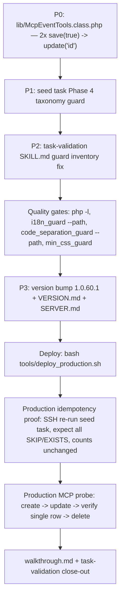

# Plan v1.0.60.1: Post–v1.0.60 Residual Defects — MCP `update_event`/`update_event_category` Row Duplication & Seed-Task Idempotency Hardening

**Target Domain:** `https://amedbulten.com`
**Repository:** `AF/Bulletin`
**Target Version:** `v1.0.60.1` (hotfix release)
**Date:** 2026-11-10
**Predecessor Version:** `v1.0.60` (`docs/plan/v1.0.60-mod-event-taxonomy-and-official-holiday-attribute-refactor-plan.md`) — **APPLIED, DEPLOYED, MIGRATED and INDEPENDENTLY VERIFIED** (release commit `471e3994` + follow-up `3a11f81c`)
**Target Executor:** Gemini 3.8 Flash (Deterministic Step-by-Step Blueprint)

**Skill Audit (per `.gemini/GEMINI.md`):** Checked all mounted skills before authoring. Relevant: `task-validation` (quality gates close the execution; walkthrough artifact). Not relevant and why: `kevrast`/`kevtemen`/`kevkolin`/`kevanger`/`kevseo` (no news draft, fact-check, dossier, or SEO-copy work), `admin-mobile-check`/`impeccable`/`taste-skill`/`frontend-theme` (no UI/theme design work — the only template touched is none), `github-release` (no Git-tag parity task; version bump is config/docs only), `lang-refactor` (no language-key renames), `i18n-guard` (no new UI strings are introduced by this hotfix), `module-modernization-check` (no module modernization audit).

---

## 1. Supersession Note — Prior Revision of This Plan Was Based on False Premises

The prior revision of this document (same day) asserted **F1: "v1.0.60 was never implemented, deployed, or migrated"**. That assertion was built on incorrect information supplied by the operator. A full re-audit on 2026-11-10 (local repo + production HTTP + production DB via MCP) confirms v1.0.60 is fully live. Every prior finding resolves as follows:

| Old ID | Old Claim | Verified Reality (2026-11-10 evidence) |
| :-: | :--- | :--- |
| F1 | v1.0.60 never applied | **FALSE.** Commit `471e3994` implements all plan sections; production: `?v=1.0.60` assets; MCP `list_event_categories` → **11** categories (ids/names/seos match plan §3 exactly); `list_events` → **71** records with holiday attributes; `list_redirects` → event-category 301 rules present. |
| F2 | Every event detail 301s to bare hub | **FIXED by v1.0.60 R15.** `GET /tr/event/2027_YKS_1_Oturum_Temel_Yeterlilik_Testi_TYT` → **200**; `sync()` present in both `PublicHelperTrait::findItemBySeoOrIdStrict()` and `mod_event_helper::event()`; sitemap sample of 5 URLs → all 200. |
| F3 | Zero 2026 coverage | **FIXED by v1.0.60 Phase 5.** `10 Kasım … 2026` live with `is_today: true` on 2026-11-10 (calendar JSON + homepage `status-today` badge); `24 Kasım Öğretmenler Günü 2026`, Regaip Kandili 2026, 3–4 Aralık 2026 records present. |
| F4 | R4/R11 defects unverifiable | **FIXED and VERIFIED.** R4: calendar JSON `2026-11` shows `10 Kasım 2026` with `is_today: true` (active all day) and no agenda duplication; R11: detail page JSON-LD emits `"startDate": "2027-06-19T10:15:00+03:00"` (strict ISO-8601 with offset); `2026 Ramazan Bayramı` multi-day span `2026-03-20T00:00:00+03:00` → `2026-03-22T23:59:59+03:00` correct. |

Do not re-execute any part of v1.0.60. This revision remediates the defects that the verified state actually exposes (§2).

---

## 2. Findings (evidence-backed, production-verified on 2026-11-10 post-verification session)

| ID | Severity | Finding | Evidence |
| :-: | :-: | :--- | :--- |
| **N1** | **CRITICAL** | **MCP `update_event` INSERTS a duplicate row instead of updating.** Every call to `update_event` clones the target record under a new auto-increment id and leaves the original untouched. The tool then answers `{"updated": true}` with the ORIGINAL id, masking the corruption. Consequences: duplicate `seo` rows (no unique index on `mod_event.seo` — only plain `idx_event_lang_seo`), ambiguous `findItemBySeoOrIdStrict` resolution (`limit(1)` with no deterministic order), duplicate `eventSitemap.xml` URLs, and a Google Indexing ping for a state that was never persisted. | Live probe: `update_event(id=49 "2027 Kurban Bayramı", holiday_duration=4.5)` returned `updated: true` but `get_event` read back `4.0`; recount revealed duplicates ids **73–76** (4 clones across 4 probe calls). Clones deleted (`delete_event` 73–76), count restored to **71**, `eventSitemap.xml` restored to **71** URLs — verified. Root cause: [`lib/McpEventTools.class.php:533`](file:///home/malpersaz/Desktop/projects/htdocs/AF/Bulletin/lib/McpEventTools.class.php#L533) calls `$model->save(true)`; `ORM::save()` ([`lib/Orm/Orm.php:280-313`](file:///home/malpersaz/Desktop/projects/htdocs/AF/Bulletin/lib/Orm/Orm.php#L280-L313)) **always builds an INSERT** (`db_insert`, AI key excluded → new id). Every sibling MCP tool class uses `$model->update('id')` for updates (e.g. `McpNewsTools.class.php:1015`, `McpPublicationTools.class.php:619`, `McpPageTools.class.php:675`); a repo-wide scan shows `McpEventTools` is the **only** class whose update functions contain zero `update('id')` calls. Latent since v1.0.13 (`86d93c4b`); v1.0.60 §4.5.4 extended `updateEvent` with the 3 holiday fields but preserved the broken persistence call. Production exposure so far: only this audit's probes (created and cleaned within the same session; net DB delta zero). |
| **N2** | **CRITICAL (latent, same root cause)** | **MCP `update_event_category` duplicates rows the same way.** A category clone is worse than an event clone: `mod_event_category` rows are id-stable parents referenced by `mod_event.category_id`, menu sync, ACL inheritance, and gallery bridges; a duplicate with an identical `seo` corrupts the taxonomy tree. Not probed live (cleanup of a category clone risks cascading bridge/menu side effects); proven statically — identical `save(true)` misuse at [`lib/McpEventTools.class.php:691`](file:///home/malpersaz/Desktop/projects/htdocs/AF/Bulletin/lib/McpEventTools.class.php#L691), and N1's live proof of the shared code path. | Code inspection: `updateEventCategory()` loads by id, syncs, mutates, then `if (!$model->save(true))` — insert semantics identical to N1. Admin surface is unaffected: `mod/mod_event/index.php:589` correctly uses `$updateModel->update('id')`. |
| **N3** | **HIGH (operational hazard)** | **`tasks/seed_mod_event_taxonomy_v1060.php` Phase 4 is not idempotent against the CURRENT database and a re-run corrupts ~44 rows.** Phase 4 blindly runs `UPDATE mod_event ... WHERE id IN (7,19)` / `IN (8,9,11,12,20,22,23,24)` / `IN (1,3,5,13,15,17)` / `IN (2,4,6,14,16,18)` / `BETWEEN 25 AND 44`. Those ids were written for the pre-migration table; today's live ids are shifted (holiday cycle occupies ids 29–52; v1.0.60 Phase-5 memorial/religious/professional seeds occupy low ids 1–28; exams 53–72). A re-run would force the 16 holiday records at ids 29–44 into `category_id = 5, is_official_holiday = 'n'` and turn id 7 (`Cahit Sıtkı Tarancı'yı Anma Günü 2027`) into a 3.0-day religious holiday. Phases 1–3 and 5 are already guarded (column existence checks, `ON DUPLICATE KEY`, seo-existence skip) — only Phase 4 is destructive. The script ships to production (`seed_` prefix bypasses `.deployignore:43`), so the hazard sits one SSH command away. | `sed` of Phase 4 (raw id-range UPDATEs, no predicate beyond ids); MCP live id↔name↔category mapping captured in the 2026-11-10 audit (71 records enumerated). |
| **N4** | **LOW (agent-side hazard, no code change)** | **MCP tools accept and silently ignore unknown arguments.** The audit passed `start_after`/`start_before` to `list_events`; the tool ignored both and returned the unfiltered set while reporting success. An agent can believe a filter was applied. Documented here; strict schema rejection is a cross-cutting MCP-bridge change owned by the v1.0.61 hardening plan (`lib/McpCrudToolsBase.class.php` component) — do NOT fix incidentally here. | Probe: `list_events({start_after, start_before})` returned all 71 records; schema (`xd://mcp__amed_bulletin_list_events`) defines no such keys. |
| **N5** | **LOW (tooling parity)** | **`task-validation` skill references a non-existent guard**, and `i18n_guard.py`'s default mode is a false-green on a clean tree. (a) `.agents/skills/task-validation/SKILL.md` step 1 instructs running `comment-guard` / `tools/comment_guard.py` — no such file exists in `tools/` (verified: i18n, code-separation, min-css, module-boundary, audit tools only). (b) `python3 tools/i18n_guard.py` on a clean git tree audits **0 files** and prints a success banner; released-code audits must pass `--path <files>` or `--all`. | `ls tools/`; live run: "Files Audited: 0 / No modified files detected". |
| — | Non-findings | Intentional or out of scope, listed to prevent re-litigation: the **4 redirect rows** (`events/Bayramlar` AND `tr/events/Bayramlar` → `Milli_Bayramlar`, same pair for `Resmi_Tatil`) are seeded deliberately by the script's `$redirects` map with `ON DUPLICATE KEY` — defensive coverage for unprefixed inbound URLs, not duplication debt. The repo-wide **652 code-separation violations across 143 legacy admin templates** predate v1.0.60 (every v1.0.60-touched file passes with 0 violations). The 10 Kasım 2026 `status-today` acceptance check is date-bound by design; after 2026-11-10 it correctly becomes a past event. | |

---

## 3. Remediation Plan

### 3.1 P0 — Fix MCP update persistence (N1 + N2)

**File:** [`lib/McpEventTools.class.php`](file:///home/malpersaz/Desktop/projects/htdocs/AF/Bulletin/lib/McpEventTools.class.php)

**Change 1 — `updateEvent()` (~Line 533):** replace

```php
        $model->updated_at = date('Y-m-d H:i:s');
        if (!$model->save(true)) {
            throw new McpToolException("Failed to update event record #{$id}.");
        }
```

with the sibling-tool update idiom (mirror of `McpNewsTools.class.php:1015-1017`):

```php
        $model->updated_at = date('Y-m-d H:i:s');
        if (!$model->update('id')) {
            throw new McpToolException("Failed to update event record #{$id}.");
        }
```

**Change 2 — `updateEventCategory()` (~Line 691):** replace

```php
        if (!$model->save(true)) {
            throw new McpToolException("Failed to update event category record #{$id}.");
        }
```

with:

```php
        if (!$model->update('id')) {
            throw new McpToolException("Failed to update event category record #{$id}.");
        }
```

**Why this is safe:**
- `ORM::update('id')` builds a full-row `db_update` over all hydrated columns (`lib/Orm/Orm.php:316-378`) — the exact field set `save()` would have inserted, minus the auto-increment key, keyed on the synced primary key. This is byte-for-byte the pattern every other MCP domain tool already uses in production.
- Response construction is untouched: both functions already re-fetch via `getEvent(['id' => $id])` / `getEventCategory(['id' => $id])`, which now returns the genuinely updated row.
- `createEvent()` (line 424) and `createEventCategory()` (line 632) MUST keep `save(true)` — they are genuine inserts. Do not touch them.
- Blast radius: exactly two call sites in one file; no router, model, or schema change.

**DO NOT call `update_event` or `update_event_category` for any purpose (including editorial work in other sessions) until this fix is deployed.**

### 3.2 P1 — Make seed Phase 4 re-run safe (N3)

**File:** [`tasks/seed_mod_event_taxonomy_v1060.php`](file:///home/malpersaz/Desktop/projects/htdocs/AF/Bulletin/tasks/seed_mod_event_taxonomy_v1060.php)

**Change:** wrap the five Phase-4 id-range UPDATEs in a taxonomy-applied guard. Immediately after the `[Phase 4]` echo line, insert:

```php
// Guard: skip destructive id-range reclassification when the v1.0.60 taxonomy is
// already populated. Production ids shifted after the post-v1.0.60 re-seeding, so
// the historical id map (1..44) no longer identifies the rows it was written for.
$db->fetch_array("SELECT COUNT(*) AS c FROM `mod_event` WHERE `category_id` IN (8, 9, 10, 11)");
$guardRow = $db->toArray()[0] ?? ['c' => 0];
$taxonomyApplied = ((int) $guardRow['c']) > 0;

if ($taxonomyApplied) {
    echo " -> [SKIP] New-taxonomy categories (8-11) already populated; id-range reclassification skipped (protects re-seeded data).\n";
} else {
```

…then the five original `UPDATE` statements and their five `echo` lines follow unchanged, and the block closes with a new `}` before the Phase 5 separator comment. Indent the five statements/echoes one level (4 spaces) inside the `else`.

**Rationale (boring by design):** the guard makes the already-executed migration provably inert on re-run without rewriting working SQL. Categories 8–11 are populated if and only if v1.0.60 (or a later seed) has run, which is exactly the state in which the historical id map is invalid. A future from-scratch rebuild starts with an empty/diverged table where the guard is false and the original logic applies.

### 3.3 P2 — Tooling parity (N5)

1. **`.agents/skills/task-validation/SKILL.md`:** in step 1, delete the `comment-guard` bullet (the tool does not exist in this repository). Replace the `i18n-guard` bullet with: *"Run `i18n-guard` (`python3 tools/i18n_guard.py --path <touched files>` or `--all`; a bare run audits only dirty git files and reports success on a clean tree)."*
2. Execution checklists in this plan (§4) already use the corrected invocations.

### 3.4 P3 — Version bump & documentation parity

1. `config/site.config.php` line 62 and `config/site.config.example.php`: `$site['version'] = '1.0.60';` → `'1.0.60.1';`
2. `docs/SERVER.md`: update the documented version reference to `1.0.60.1`.
3. `docs/VERSION.md`: insert a new entry **between** `## v1.0.61 (Planned)` and `## v1.0.60 (2026-11-10)` (descending chronological order preserved; the config parser already skips `(Planned)` headings):

```markdown
## v1.0.60.1 (2026-11-10)
- **MCP Event Tool Update-Path Row Duplication Hotfix & Seed-Task Idempotency Guard (`lib/McpEventTools.class.php`, `tasks/seed_mod_event_taxonomy_v1060.php`, `.agents/skills/task-validation/SKILL.md`)**:
  - Fixed `update_event` and `update_event_category` persisting via `ORM::save()` (INSERT semantics), which cloned the target row under a new id on every call and answered `updated: true` against the untouched original. Both now persist via `ORM::update('id')`, the idiom used by every other MCP domain tool. Defect latent since v1.0.13; live production exposure was limited to the 2026-11-10 verification probes (4 clones created and deleted in-session; net DB delta zero, sitemap parity 71/71 re-verified).
  - Guarded `tasks/seed_mod_event_taxonomy_v1060.php` Phase 4 (historical id-range reclassification) behind a taxonomy-applied check so a re-run on the post-migration database can no longer reclassify 16 live holiday records into `Sınavlar` or convert memorial records into religious holidays. Phases 1-3/5 were already idempotent.
  - Corrected the task-validation skill's guard inventory (removed non-existent `comment-guard`; documented `i18n_guard --path` requirement for clean-tree audits).
```

4. Update `walkthrough.md` with the v1.0.60.1 execution results.

---

## 4. Ordered Execution Checklist



1. **Apply P0** (§3.1, two one-line changes; create functions untouched).
2. **Apply P1** (§3.2 guard block; re-indent the five UPDATEs into the `else`).
3. **Apply P2** (§3.3 skill-doc fix).
4. **Quality gates:** `php -l lib/McpEventTools.class.php tasks/seed_mod_event_taxonomy_v1060.php`; `python3 tools/i18n_guard.py --path lib/McpEventTools.class.php`; `python3 tools/code_separation_guard.py --path lib/McpEventTools.class.php`; `python3 tools/min_css_guard.py`. (No `.twig`/lang files change in this release; `comment-guard` does not exist — see N5.)
5. **Apply P3** (§3.4 version/docs bump).
6. **Deploy:** `bash tools/deploy_production.sh` (ships the fixed tool class and the hardened `seed_` task; rsync covers both paths).
7. **N3 idempotency proof on production:** run the seed once via SSH (`ssh -o BatchMode=yes ssh-w02232db@w02232db.kasserver.com "php /www/htdocs/w02232db/amedbulten.com/tasks/seed_mod_event_taxonomy_v1060.php"`). **Expected output:** Phase 1 all "already exists", Phase 4 `[SKIP] New-taxonomy categories (8-11) already populated`, Phase 5 all `[EXISTS] ... Skipping`, `0 inserted`. Then assert via MCP: `list_events` total **71**, holiday-filtered total **24**, `list_event_categories` **11** — unchanged.
8. **N1 live probe on production (post-deploy):**
   1. `create_event` probe: `name: "v1.0.60.1 MCP Update Probe"`, `lang: "tr"`, `category_id: 5`, `is_official_holiday: "y"`, `holiday_duration: 1.5`, `is_recurring: "y"`, `start_date: "2027-12-31 09:00:00"`, `end_date: "2027-12-31 23:59:59"`, plus `summary` (95–240 chars) and `subject` (≤115 chars) satisfying the admin validators.
   2. `get_event` → assert the three holiday fields round-trip (`y` / `1.5` / `y`).
   3. `update_event` on the probe id: `holiday_duration: 2.0`, `is_recurring: "n"`, `name: "v1.0.60.1 MCP Update Probe Renamed"`.
   4. `list_events({search: "v1.0.60.1 MCP Update Probe"})` → assert **exactly 1** result, **same id**, values `2.0` / `n` / renamed (this is the assertion that failed pre-fix with 2 rows).
   5. `delete_event` probe id → assert `list_events` total returns to **71** and `eventSitemap.xml` returns to **71** `<loc>` entries.
9. **N2 same-value probe (no data change):** `update_event_category({id: 5})` with only `description` set to its current value → assert `list_event_categories` still returns **11** categories and id 5 is unchanged.
10. **Close-out:** update `walkthrough.md`; version sanity: `curl -s https://amedbulten.com/tr/ | grep -o 'v=1\.0\.60\.1' | head -1`.

**Acceptance summary:** single-row MCP updates (event + category), seed re-run provably inert, version `1.0.60.1` live, all gates green, production counts 71/11/24 stable before and after every step.
