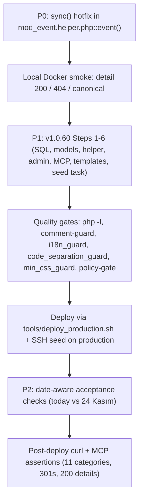

# Plan v1.0.60.1: `amedbulten.com` Production Health Audit — Negative Findings & Remediation (Post–v1.0.60 Claimed Application)

**Target Domain:** `https://amedbulten.com`
**Repository:** `AF/Bulletin`
**Target Version:** `v1.0.60.1` (hotfix + execution-completion release)
**Date:** 2026-11-10
**Predecessor Version:** `v1.0.60` (`docs/plan/v1.0.60-mod-event-taxonomy-and-official-holiday-attribute-refactor-plan.md` — **claimed applied, actually not applied**; see F1)
**Audit Scope:** Full production health verification of the event surface (`/tr/events`, `/tr/event/{seo}`, category pages, redirects, sitemaps, MCP bridge DB state, calendar JSON, homepage agenda) plus control probes on news/legal/sitemap surfaces.
**Target Executor:** Gemini 3.8 Flash (Deterministic Step-by-Step Blueprint)

**Skill Audit (per `.gemini/GEMINI.md`):** Checked all mounted skills before this audit. Relevant: `task-validation` (quality gates must close the execution) and `i18n-guard` (R14 language-key parity during v1.0.60 execution). Not relevant and why: `kevrast`/`kevtemen`/`kevkolin`/`kevanger`/`kevseo` (no news draft, fact-check, dossier, or SEO-copy work in a health audit), `admin-mobile-check`/`impeccable`/`taste-skill`/`frontend-theme` (no UI design or theme work), `github-release` (no release parity task), `lang-refactor` (no key renames), `module-modernization-check` (no module modernization audit), `task-validation` applies only to the remediation executor, not to this read-only audit.

---

## 1. Negative Findings (evidence-backed, production-verified on 2026-11-10)

| ID | Severity | Finding | Evidence (production unless noted) |
| :-: | :-: | :--- | :--- |
| **F1** | **CRITICAL** | **v1.0.60 was never implemented, deployed, or migrated.** The refactor exists only as a plan document; production and local both still run `v1.0.59`. All 14 plan risks (R1–R14) remain open. | Local: `git status` clean of code changes (docs only); `grep is_official_holiday` matches **only** `docs/`; `templates/amed/index/mod_event/sections/` contains only the 8 pre-v1.0.60 templates (all 6 new section templates absent); `tasks/seed_mod_event_taxonomy_v1060.php` does not exist; `config/site.config.php` resolves `1.0.59`; `docs/VERSION.md` lists v1.0.60 as "In Progress / Planning Phase". Production: HTML assets carry `?v=1.0.59`; `GET /tr/events/Genel_Tatiller` → **404**; `GET /tr/events/Milli_Bayramlar` → **404**; `GET /tr/events/Resmi_Tatil` → **200** (`<title>Resmi Tatil - Amed Bülten</title>`, no 301); `GET /tr/events/Bayramlar` → **200** (no 301); MCP `list_event_categories` → **7** categories (id 6 = `Resmi Tatil`, id 7 = `Bayramlar`; ids 8–11 absent); MCP `list_events` → **44** records (ids 1–44, all created 2026-11-10 00:48–00:55 by the two earlier seeding plans, none carrying holiday attributes); MCP `list_redirects` → 72 rules, **zero** event-category redirects. |
| **F2** | **CRITICAL** | **Every event detail URL 301-redirects to the bare hub — the event detail surface has been dead since v1.0.47.** Found events redirect; only nonexistent slugs 404 correctly. This independently invalidates the entire `eventSitemap.xml` (all 44 URLs) and every homepage agenda link, and blocks the v1.0.60 acceptance test (detail-page JSON-LD, holiday badge). | `curl -sI /tr/event/2027_YKS_1_Oturum_Temel_Yeterlilik_Testi_TYT` → `301 Location: https://amedbulten.com/tr/event/`; identical bare-hub 301 for `/tr/event/35` (numeric id), `/tr/event/detail/{seo}`, and Turkish-char slugs (`2027_Yılbaşı_Resmi_Tatili`, `29_Ekim_Cumhuriyet_Bayramı_2027`, `2027_Ramazan_Bayramı`); `/tr/event/nonexistent-slug-xyz` → 404 (not-found path works). `/tr/eventSitemap.xml` lists 44 `/tr/event/{seo}` URLs — **all** redirect; homepage `home.html` contains 155 `event-agenda` hrefs to the same dead URLs. **Reproduced locally** (Docker `localhost:8080`, same v1.0.59 code): fresh `mod_event` row → `/tr/event/Test_Event_Probe` → `301 → /tr/event/`. **Root cause:** [`mod/index/helper/mod_event.helper.php:608`](file:///home/malpersaz/Desktop/projects/htdocs/AF/Bulletin/mod/index/helper/mod_event.helper.php#L608) calls `findItemBySeoOrIdStrict()`, which leaves the row in `$model->_result` **without hydrating model properties**; `event()` never calls `->sync()` — unlike `mod_news.helper.php:187`, `mod_publication.helper.php:90`, `mod_page.helper.php:30`, which all call `sync()` after lookup. Therefore `$eventModel->seo` is `null`, the strict canonical check at line 641 (`(string)$eventModel->seo !== $cleanSeo`) is always true, and the canonical redirect collapses to `Location: /event/` + empty slug. Regression introduced in `dea7f281` (v1.0.47); latent until events existed. Control: `/tr/news/{multibyte-slug}` → **200** (news path syncs). |
| **F3** | **MEDIUM** | **Zero event coverage for the audit date and the entire rest of 2026.** No record exists between 2026-10-29 and 2027-01-01: 10 Kasım (today), 24 Kasım Öğretmenler, 3–4 Aralık, 10 Aralık Regaip Kandili are all unseeded Phase 5 items of v1.0.60. | MCP `list_events`: closest upcoming = `2027_Yılbaşı_Resmi_Tatili` (52 days out); homepage agenda's first item is 2027 Yılbaşı; `/tr/event-calendar/json` → `{"year":2026,"month":11,"events":[]}`. Consequence: v1.0.60 §6 Step 7's "10 Kasım active TODAY with `status-today`" acceptance check is only executable on 2026-11-10 and silently rots after midnight Europe/Istanbul. |
| **F4** | **MEDIUM** | **Two v1.0.60-designed defects are confirmed still live in the deployed v1.0.59 code and currently unverifiable end-to-end because of F2:** (a) R4 — `_cleanEventRow()` sets `is_upcoming = ($startTs >= $now)` and `_event_agenda()` re-fetches today's events in the past-backfill query (same-day events vanish/mislabel and can duplicate once November 2026 events exist); (b) R11 — `event.twig` emits JSON-LD `startDate`/`endDate` as MySQL datetimes (no ISO-8601 `T`/offset), the Google Search Console "Invalid ISO 8601 dateTime" warning class. | Code inspection of production-equivalent v1.0.59 tree: `mod_event.helper.php:48-92` (`is_upcoming`), `:870-903` (agenda double-fetch), `templates/amed/index/mod_event/event.twig:66-91` (raw `d.start_date` in JSON-LD). JSON-LD cannot be observed live because detail pages redirect (F2). |

Non-findings are intentionally omitted (negative-only report per commission). No positive result in this audit offsets F1–F4.

---

## 2. Remediation Plan

### 2.1 P0 — Hotfix F2 (execute FIRST; one line, unblocks all event verification)

**File:** [`mod/index/helper/mod_event.helper.php`](file:///home/malpersaz/Desktop/projects/htdocs/AF/Bulletin/mod/index/helper/mod_event.helper.php#L608-L638)

**Change:** after the not-found block returns (immediately after line 638 `}`, before the strict canonical comparison at line 641), hydrate the model exactly like the news helper:

```php
        $eventModel->sync();
```

This mirrors `mod_news.helper.php:185-187` (`gRo(); if ($news->getSize() !== 0) { $news->sync(); ... }`). `sync()` copies `_result` into all declared `events_model` properties (`seo`, `id`, `acl_id`, `category_id`, `video`, `gallery_id`, …), which the remainder of `event()` reads.

**Safety:** `findItemBySeoOrIdStrict` has exactly one caller (this line — verified by repo grep), so blast radius is a single call site. Non-found paths (ASCII fallback, `_404()`) are untouched.

**Verification (production, after deploy):**
1. `curl -sI https://amedbulten.com/tr/event/2027_YKS_1_Oturum_Temel_Yeterlilik_Testi_TYT` → `200` (ASCII slug).
2. `curl -sI "https://amedbulten.com/tr/event/2027_Ramazan_Bayramı"` → `200` (multibyte slug; canonical `Location` may legitimately 301 only if slug casing/encoding differs from DB).
3. `curl -sI https://amedbulten.com/tr/event/nonexistent-slug-xyz` → `404`.
4. `curl -s .../tr/event/... | grep '"@type": "Event"'` → JSON-LD block present.
5. Local Docker pre-deploy smoke: re-insert a probe row, assert `200` on `/tr/event/{seo}`, then delete the row.

### 2.2 P1 — Complete F1: execute v1.0.60 end-to-end (no design changes needed)

Execute [`docs/plan/v1.0.60-...-refactor-plan.md`](file:///home/malpersaz/Desktop/projects/htdocs/AF/Bulletin/docs/plan/v1.0.60-mod-event-taxonomy-and-official-holiday-attribute-refactor-plan.md) §6 Steps 1–7 verbatim. Ordering constraints added by this audit:

1. **Merge P0 (F2 fix) into the same release train** before `tools/deploy_production.sh` runs, otherwise Step 7's detail-page verification cannot pass.
2. Keep the task filename `tasks/seed_mod_event_taxonomy_v1060.php` — `.deployignore:43` still excludes `tasks/migrate_*` (verified present), so a `migrate_*` name will silently never ship (v1.0.60 R7).
3. Run the seed on production via SSH exactly as specified in v1.0.60 §6 Step 7, then verify with MCP: `list_event_categories` → 11 categories; `list_events` → 44 reclassified + 27 new records; `list_redirects` → `tr/events/Resmi_Tatil` → `tr/events/Genel_Tatiller` and `tr/events/Bayramlar` → `tr/events/Milli_Bayramlar` (301).
4. Post-deploy HTTP assertions:
   - `/tr/events` → 200 rendering the 6 new civic sections (no Twig `LoaderError`).
   - `/tr/events/Resmi_Tatil` → 301 → `/tr/events/Genel_Tatiller`; `/tr/events/Bayramlar` → 301 → `/tr/events/Milli_Bayramlar`.
   - `/tr/events/Anma_Günleri`, `/tr/events/Mesleki_Günler`, `/tr/events/Önemli_Günler_ve_Haftalar`, `/tr/events/Dini_Günler_ve_Bayramlar` → 200.
   - `/tr/eventSitemap.xml` URLs → sample of 5 returns 200 (proves F2 fix survived the refactor).

### 2.3 P2 — F3 verification-matrix adjustment

- If execution completes on **2026-11-10** (Europe/Istanbul): keep the original check — `10_Kasım_Atatürkü_Anma_Günü_2026` shows `status-today` on `/tr/` and `/tr/events/Anma_Günleri`.
- If execution completes **after 2026-11-10**: replace the today-badge assertion with `is_upcoming` on `24_Kasım_Öğretmenler_Günü_2026` (next seeded 2026 event, 14 days out) plus presence of its `/tr/event/{seo}` detail page (P0) in `eventSitemap.xml`. Do not backdate the 10 Kasım record's dates; it is a past event the moment execution slips.

### 2.4 P3 — F4 confirmations (no new work; closed by P1)

- R4 fix = v1.0.60 §4.3.1 (`_cleanEventRow` today-window logic) + §4.3.4 (`_event_agenda` `COALESCE(end_date, start_date)` + `id NOT IN` exclusion). After seeding, verify on a same-day event that it appears exactly **once** in the homepage agenda and never in the past-backfill set.
- R11 fix = v1.0.60 §4.3.1 (`schema_start_date`/`schema_end_date` via `date('c')`) + §4.4.3 (`event.twig` JSON-LD swap). After P0, assert `"startDate":"2026-11-10T09:05:00+03:00"` pattern on the 10 Kasım (or next) detail page.

---

## 3. Ordered Execution Checklist



1. Apply P0 (`$eventModel->sync();`), run local Docker smoke (§2.1.5), delete probe row.
2. Execute v1.0.60 §6 Steps 1–6 unchanged (all file specs already authored).
3. Run the full `task-validation` gate suite (comment-guard, `python3 tools/i18n_guard.py`, code-separation-guard, min-css-guard, policy-gate); update `walkthrough.md`.
4. Deploy and run the production seed (§2.2.2–2.2.3).
5. Execute §2.2.4 HTTP assertions + §2.3 date-aware acceptance + §2.4 confirmations.
6. Bump version to `1.0.60.1` in `config/site.config.php`, `config/site.config.example.php`, `docs/SERVER.md`, and add the `## v1.0.60.1 (2026-11-10)` entry to `docs/VERSION.md` (fold the unfinished v1.0.60 "In Progress" entry into the release note).
