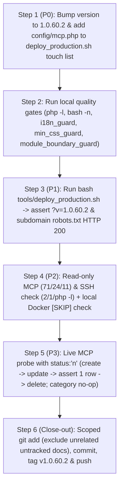

# Plan v1.0.60.2: Subdomain Crawlability, Asset `.htaccess` Hardening, Deploy OPcache Fix & Live MCP Verification

**Target Domain:** `https://amedbulten.com` (`https://static.amedbulten.com`, `https://assets.amedbulten.com`)
**Repository:** `AF/Bulletin`
**Target Version:** `v1.0.60.2`
**Date:** 2026-11-10
**Predecessor Version:** `v1.0.60.1` (commit `2ab603ac`, tag `v1.0.60.1` — already committed, pushed to GitHub, and deployed to production)
**Target Executor:** Gemini Flash (Deterministic Step-by-Step Blueprint)

---

## 1. Current State Summary

1. **`v1.0.60.1` (`2ab603ac`) is already live on production (`amedbulten.com`):**
   - `lib/McpEventTools.class.php` already persists via `$model->update('id')` in `updateEvent()` (line 533) and `updateEventCategory()` (line 691).
   - `tasks/seed_mod_event_taxonomy_v1060.php` already includes the Phase 4 idempotency guard (`SELECT id FROM mod_event WHERE category_id IN (8, 9, 10, 11) LIMIT 1`).
2. **Scope of `v1.0.60.2`:**
   - **Subdomain `robots.txt` Crawlability (`static/robots.txt`, `templates/robots.txt`):** Allow-all `robots.txt` (`User-agent: *` / `Allow: /`) for `static.amedbulten.com` and `assets.amedbulten.com` (already present in the local working tree and synced to the server).
   - **Asset `.htaccess` CORS/CORP & Script Execution Hardening (`static/.htaccess`, `templates/.htaccess`):** Expanded `<FilesMatch>` to cover image extensions (`ico|webp|jpe?g|png|gif|svg`) with `Access-Control-Allow-Origin "*"` and `Cross-Origin-Resource-Policy "cross-origin"`, plus `<FilesMatch "\.(?i:php[0-9]?|phtml|phar|pl|py|cgi|sh|twig)$">` execution/download denial in `templates/.htaccess` (already present in the local working tree and synced to the server).
   - **Deploy Script OPcache Revalidation Fix (`tools/deploy_production.sh`):** Add `${REMOTE_DOCROOT}config` and `${REMOTE_DOCROOT}mcp.php` to the `find ... -exec touch {} +` command on line 66 so `config/site.config.php` and `mcp.php` immediately revalidate in OPcache upon deploy.
   - **Read-Only Production Verification & Local Docker Seed Guard Proof:** Verify live MCP counts (`71` events, `24` official holidays, `11` categories), verify deployed PHP artifacts via read-only SSH (`grep -c` and `php -l`), and verify the Phase 4 `[SKIP]` output against the local Docker container only.
   - **Live MCP Update Persistence Probes (Draft-Isolated):** Execute a live `create_event` (with `status: "n"`) → `update_event` → single-row assertion → `delete_event` round-trip and a no-op `update_event_category` probe against `amed-bulletin` MCP.

---

## 2. Open & Deferred Items Inventory

| ID | Status | Item | Disposition |
| :-: | :-: | :--- | :--- |
| **U1** | **RESOLVED** | Production `v1.0.60.1` deployment (`McpEventTools.class.php` `update('id')` and guarded `seed_mod_event_taxonomy_v1060.php`). | Already live on `amedbulten.com`; verified via SSH & HTTP. |
| **U2** | **IN SCOPE (P2)** | Seed-task idempotency & taxonomy state verification. | Execute read-only MCP/SSH checks on production and run the seed script **only on local Docker** to capture Phase 4 `[SKIP]`. **Never run the seed script on production.** |
| **U3** | **IN SCOPE (P3)** | Live MCP `update_event` and `update_event_category` single-row persistence probes. | Execute with `status: "n"` on `create_event` so no `URL_UPDATED` ping is sent to Google Indexing API. |
| **U4** | **DEFERRED (`v1.0.61`)** | MCP tools silently ignore unknown filter arguments (e.g. `start_after`, `start_before` in `list_events`). | Owned by `v1.0.61` (`lib/McpCrudToolsBase.class.php`). **Do not modify in `v1.0.60.2`.** |
| **U5** | **DEFERRED (`v1.0.61`)** | `McpEventTools` lacks `registerSlugRedirectIfChanged()`, `syncCategoryMenuOnUpdate()`, and draft-default `status: 'n'` on `create_event`. | Owned by `v1.0.61` alongside U4. **Do not modify in `v1.0.60.2`.** |

---

## 3. Deterministic Step-by-Step Execution Plan

### Step 1 (P0) — Version Bump to `1.0.60.2` & Deploy Script OPcache Fix

> **Note:** `.deployignore` excludes `docs/` and `*.md` from production deployments, so production resolves `$site['version']` exclusively from the hardcoded fallback on line 62 of `config/site.config.php`. Both `docs/VERSION.md` and the config fallbacks must be updated together.

1. **[`config/site.config.php`](file:///home/malpersaz/Desktop/projects/htdocs/AF/Bulletin/config/site.config.php#L62) (line 62):**
   Change:
   ```php
   $site['version'] = '1.0.60.1';
   ```
   To:
   ```php
   $site['version'] = '1.0.60.2';
   ```

2. **[`config/site.config.example.php`](file:///home/malpersaz/Desktop/projects/htdocs/AF/Bulletin/config/site.config.example.php#L62) (line 62):**
   Change:
   ```php
   $site['version'] = '1.0.60.1';
   ```
   To:
   ```php
   $site['version'] = '1.0.60.2';
   ```

3. **[`docs/SERVER.md`](file:///home/malpersaz/Desktop/projects/htdocs/AF/Bulletin/docs/SERVER.md#L3) (line 3):**
   Change:
   ```markdown
   - **Version:** v1.0.60.1 (2026-11-10)
   ```
   To:
   ```markdown
   - **Version:** v1.0.60.2 (2026-11-10)
   ```

4. **[`tools/deploy_production.sh`](file:///home/malpersaz/Desktop/projects/htdocs/AF/Bulletin/tools/deploy_production.sh#L66) (line 66):**
   Add `${REMOTE_DOCROOT}config` and `${REMOTE_DOCROOT}mcp.php` to the `find` command so OPcache revalidates `config/site.config.php` and `mcp.php` on every deploy.
   Change:
   ```bash
       ssh -o BatchMode=yes "${SERVER_USER}@${SERVER_HOST}" "rm -rf ${REMOTE_DOCROOT}cache/twig/* 2>/dev/null || true; find ${REMOTE_DOCROOT}lib ${REMOTE_DOCROOT}mod ${REMOTE_DOCROOT}tasks ${REMOTE_DOCROOT}index.php ${REMOTE_DOCROOT}init.php -name '*.php' -exec touch {} + 2>/dev/null || true; chmod 640 ${REMOTE_DOCROOT}config/*.local.php ${REMOTE_DOCROOT}data/*.json ${REMOTE_DOCROOT}data/*.sqlite 2>/dev/null || true"
   ```
   To:
   ```bash
       ssh -o BatchMode=yes "${SERVER_USER}@${SERVER_HOST}" "rm -rf ${REMOTE_DOCROOT}cache/twig/* 2>/dev/null || true; find ${REMOTE_DOCROOT}config ${REMOTE_DOCROOT}lib ${REMOTE_DOCROOT}mod ${REMOTE_DOCROOT}tasks ${REMOTE_DOCROOT}index.php ${REMOTE_DOCROOT}init.php ${REMOTE_DOCROOT}mcp.php -name '*.php' -exec touch {} + 2>/dev/null || true; chmod 640 ${REMOTE_DOCROOT}config/*.local.php ${REMOTE_DOCROOT}data/*.json ${REMOTE_DOCROOT}data/*.sqlite 2>/dev/null || true"
   ```

5. **[`docs/VERSION.md`](file:///home/malpersaz/Desktop/projects/htdocs/AF/Bulletin/docs/VERSION.md):**
   Insert `## v1.0.60.2 (2026-11-10)` immediately between the `## v1.0.61 (Planned)` block and `## v1.0.60.1 (2026-11-10)` documenting:
   - Subdomain `robots.txt` crawlability (`static/robots.txt`, `templates/robots.txt`) for `static.amedbulten.com` and `assets.amedbulten.com`.
   - `static/.htaccess` and `templates/.htaccess` CORS (`Access-Control-Allow-Origin: "*"`) and CORP (`Cross-Origin-Resource-Policy: "cross-origin"`) expansion for image formats (`ico|webp|jpe?g|png|gif|svg`), plus script/template direct-access denial (`php|phtml|phar|pl|py|cgi|sh|twig`) in `templates/.htaccess`.
   - `tools/deploy_production.sh` OPcache `touch` coverage extended to `config/` and `mcp.php`.
   - Live MCP `update_event` (draft-isolated `status: "n"`) and `update_event_category` single-row update persistence verification, read-only SSH artifact verification, and local Docker Phase 4 `[SKIP]` idempotency verification.

---

### Step 2 — Run Local Quality Gates

Run the following verification commands and confirm zero errors:

```bash
php -l config/site.config.php
php -l config/site.config.example.php
bash -n tools/deploy_production.sh
python3 tools/i18n_guard.py --path config/site.config.php
python3 tools/min_css_guard.py
python3 tools/module_boundary_guard.py
```

---

### Step 3 (P1) — Deploy `v1.0.60.2` to Production

Execute the production deployment script:

```bash
bash tools/deploy_production.sh
```

Immediately verify the live version string and asset subdomain `robots.txt` endpoints:

```bash
curl -s https://amedbulten.com/tr/ | grep -o 'v=1\.0\.60\.2' | head -1
curl -sI https://static.amedbulten.com/robots.txt | head -n 5
curl -sI https://assets.amedbulten.com/robots.txt | head -n 5
```

**Expected:**
- `v=1.0.60.2` returned from `https://amedbulten.com/tr/`.
- `HTTP/2 200` returned from both `static.amedbulten.com/robots.txt` and `assets.amedbulten.com/robots.txt`.

---

### Step 4 (P2) — Read-Only Production Verification & Local Docker Seed Guard Proof

> **STRICT RULE:** Do **NOT** run `tasks/seed_mod_event_taxonomy_v1060.php` via SSH on production. Phases 2 and 3 of that script execute `DROP VIEW IF EXISTS events` and overwrite `mod_event_category` rows 6–11.

1. **Read-Only MCP Counts on Production (`amed-bulletin` MCP):**
   - Call `list_events({})` → assert `total === 71`.
   - Call `list_events({is_official_holiday: "y"})` → assert `total === 24`.
   - Call `list_event_categories({})` → assert `total === 11`.

2. **Read-Only SSH Artifact & Syntax Verification on Production (Zero DB Writes):**
   ```bash
   ssh -o BatchMode=yes ssh-w02232db@w02232db.kasserver.com "grep -c \"update('id')\" /www/htdocs/w02232db/amedbulten.com/lib/McpEventTools.class.php; grep -c 'protects re-seeded data' /www/htdocs/w02232db/amedbulten.com/tasks/seed_mod_event_taxonomy_v1060.php; php -l /www/htdocs/w02232db/amedbulten.com/lib/McpEventTools.class.php; php -l /www/htdocs/w02232db/amedbulten.com/tasks/seed_mod_event_taxonomy_v1060.php"
   ```
   **Expected output:**
   - `2`
   - `1`
   - `No syntax errors detected in /www/htdocs/w02232db/amedbulten.com/lib/McpEventTools.class.php`
   - `No syntax errors detected in /www/htdocs/w02232db/amedbulten.com/tasks/seed_mod_event_taxonomy_v1060.php`

3. **Local Docker Seed Guard Proof (Off-Production Only):**
   Run the seed script inside the `bulletin_app` container (PHP 8.5.12; repo bind-mounted at `/var/www/html` — `docker-compose.yml:6,11`; this stack's containers are `bulletin_app`/`bulletin_web`/`bulletin_db`/`bulletin_pma`, so a `--filter "name=php"` selector matches nothing and must not be used):
   ```bash
   docker exec bulletin_app php /var/www/html/tasks/seed_mod_event_taxonomy_v1060.php
   ```
   Preconditions verified 2026-11-10 — the local Docker DB (database `bulletin` in `bulletin_db`) mirrors the post-migration state: **31** events in categories 8–11 (taxonomy applied → the Phase 4 guard fires), **71** events total, **11** categories. If any precondition has drifted, stop and record the deviation; do not force the proof.
   Assert output contains `-> [SKIP] New-taxonomy categories (8-11) already populated; id-range reclassification skipped (protects re-seeded data).` and `0 inserted, 27 skipped`.

---

### Step 5 (P3) — Live MCP Update Persistence Probes on Production (`status: "n"` Isolated)

1. **`update_event` Single-Row Persistence Probe:**
   1. Call `amed-bulletin` MCP `create_event` with **`status: "n"`** (mandatory to prevent firing a `URL_UPDATED` notification to Google Indexing API):
      - `name`: `"v1.0.60.2 MCP Update Probe"`
      - `lang`: `"tr"`
      - `category_id`: `5`
      - `status`: `"n"`
      - `is_official_holiday`: `"y"`
      - `holiday_duration`: `1.5`
      - `is_recurring`: `"y"`
      - `start_date`: `"2027-12-31 09:00:00"`
      - `end_date`: `"2027-12-31 23:59:59"`
      - `subject`: `"v1.0.60.2 MCP tekil satır güncelleme doğrulama testi ve resmi tatil öznitelik kontrolü"`
      - `summary`: `"Bu kayıt v1.0.60.2 sürümünde MCP update_event aracının yeni satır kopyalamadan mevcut kaydı yerinde güncellediğini doğrulamak amacıyla oluşturulmuş geçici test kaydıdır."`
   2. Call `get_event` on the returned probe `id` → assert `status === "n"`, `is_official_holiday === "y"`, `holiday_duration == 1.5`, `is_recurring === "y"`.
   3. Call `update_event` on the probe `id` with:
      - `holiday_duration`: `2.0`
      - `is_recurring`: `"n"`
      - `name`: `"v1.0.60.2 MCP Update Probe Renamed"`
   4. Call `list_events({search: "v1.0.60.2 MCP Update Probe"})` → assert **exactly 1** result, **same `id`**, `status === "n"`, `holiday_duration == 2.0`, `is_recurring === "n"`, `name === "v1.0.60.2 MCP Update Probe Renamed"`.
   5. Call `delete_event` on the probe `id` → assert `list_events({})` total returns to **71** and `curl -s https://amedbulten.com/tr/eventSitemap.xml | grep -c '<loc>'` returns **71**.

2. **`update_event_category` No-Op Persistence Probe:**
   1. Call `get_event_category({id: 5})` and note its exact current `description`.
   2. Call `update_event_category({id: 5, description: "<exact current description>"})`.
   3. Call `list_event_categories({})` → assert total remains **11** (no duplicate category row created) and category `#5` is unchanged.

---

### Step 6 (Close-Out) — Stage Scoped Files, Commit, Tag `v1.0.60.2` & Push

> **STRICT RULE:** Do **NOT** use `git add -A` or `git add .`. Unrelated untracked work (`docs/layouts/` and `docs/plan/x-video-embed-mod-video-embed-provider-plan.md`) must remain untracked and excluded from this commit.

Before staging, update `walkthrough.md` with the Step 3–5 verification outputs (live `?v=1.0.60.2`, subdomain `robots.txt` statuses, MCP counts, SSH artifact check results, Docker `[SKIP]` proof, probe round-trip results).

1. Stage **only** the `v1.0.60.2` files:
   ```bash
   git add \
     static/robots.txt \
     templates/robots.txt \
     static/.htaccess \
     templates/.htaccess \
     tools/deploy_production.sh \
     config/site.config.php \
     config/site.config.example.php \
     docs/SERVER.md \
     docs/VERSION.md \
     walkthrough.md \
     docs/plan/v1.0.60.2-production-health-negative-findings-and-remediation-plan.md
   ```
2. Verify staged files via `git status -sb`.
3. Commit, tag `v1.0.60.2`, and push to GitHub:
   ```bash
   git commit -m "Release v1.0.60.2: Subdomain robots.txt, asset .htaccess CORS/CORP & script-denial hardening, deploy OPcache fix, and MCP verification"
   git tag v1.0.60.2
   git push origin main
   git push origin v1.0.60.2
   ```

---

## 4. Execution Flowchart


