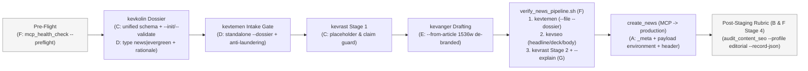

# Plan v1.0.61: Editorial Pipeline Tooling Hardening — Environment Identity, Environment-Agnostic Rubric, Dossier Contracts & Draft-Time Diagnostics

**Target Domain:** `https://amedbulten.com`  
**Repository:** `AF/Bulletin`  
**Target Version:** `v1.0.61`  
**Target Surface:** `lib/McpServer.class.php`, `lib/McpCrudToolsBase.class.php`, `lib/Mcp{News,Publication,Page,Announcement}Tools.class.php`, `mcp.php`, `.htaccess`, `tasks/mcp_smoke.php`, `tools/audit_content_seo.py`, `tools/mcp_health_check.py`, `tools/verify_news_pipeline.sh`, `.agents/skills/{kevanger,kevkolin,kevrast,kevtemen,kevseo}/`, `tests/fixtures/editorial/`  
**Date:** 2026-11-10  
**Architecture Standard:** Amed Framework Core (Strict Code Separation, MCP Bridge Non-Bypass Contract, Deterministic Editorial Gates, Wikipedia-style `legacy_seo`, `AGENTS.md` Priority Rules 1–9)  
**Predecessor Version:** `v1.0.60.4` (`docs/VERSION.md`)  
**Origin:** Retrospective of the 2026-11-10 kevanger production run (BBC health feature → draft `mod_news#108`), which surfaced seven friction points; this plan implements the hardened remediation package. The conversational language protocol clarification (dangling `AGENTS.md` Rule 8 reference) is **explicitly out of scope** per editorial decision.

---

## 1. Executive Summary & Component Map

The 2026-11-10 run completed all gates (kevrast Stage 1/2 PASSED, kevseo PASSED, draft staged to production), but consumed ~8 tool calls on production/local environment archaeology and left the 100-point rubric unapplied to the persisted production record. v1.0.61 hardens the editorial pipeline so that:

1. **Environment identity is carried by the data, not by documentation** (Stripe test/live key prefix pattern).
2. **Every verification gate runs identically against local and production records** (12-factor dev/prod parity).
3. **Contracts are declared as schemas, not inferred from source code** (OpenAPI/JSON Schema pattern).
4. **Content-type policy (`news` vs `evergreen`) is encoded, not overridden ad hoc** (content-type-aware workflow, as in Arc XP / Gutenberg).
5. **Draft-time feedback precedes gate execution** (LSP-style diagnostics instead of run-then-fix).
6. **Code and documentation integrity is strictly preserved** in 100% English across all touched scripts, exceptions, CLI messages, and documentation per `AGENTS.md` Rules 2 and 6.

| # | Component | Primary Files | Modern Practice Inspiration |
| :-: | :--- | :--- | :--- |
| A | MCP Response Environment Identity | `lib/McpServer.class.php`, `mcp.php`, `lib/McpCrudToolsBase.class.php`, `tasks/mcp_smoke.php` | Stripe key prefixes, AWS SDK region labels |
| B | Environment-Agnostic 100-Point Rubric (`--record-json`, `--profile`) | `tools/audit_content_seo.py`, `lib/McpCrudToolsBase.class.php` | 12-factor dev/prod parity, editorial calibration |
| C | Dossier JSON Schema + `--init-dossier` & `--validate-dossier` | `.agents/skills/kevkolin/scripts/dossier.schema.json`, `source_catalog.py`, `verify_facts_and_links.py` | OpenAPI / JSON Schema validation messages |
| D | Content-Type-Aware Freshness Gate (`news` / `evergreen`) & Anti-Laundering | `check_freshness.py`, `.agents/skills/{kevtemen,kevkolin,kevanger}/SKILL.md` | Arc XP / Gutenberg content-type workflows |
| E | Single-Command De-Branded Image Intake (`--from-article`) | `.agents/skills/kevanger/scripts/process_news_image.py` | srcset-aware media pipelines, SSRF hardening |
| F | Executable Pre-Flight (`mcp_health_check.py`) + 4-Stage Verification Chain | `tools/mcp_health_check.py`, `tools/verify_news_pipeline.sh`, `kevseo/scripts/audit_seo.py` | pre-commit / husky single-entry verification |
| G | `kevrast --explain` Draft-Time Diagnostics | `.agents/skills/kevrast/scripts/verify_facts_and_links.py` | LSP edit-time diagnostics, html-proofer |



### Cross-Cutting Code & Documentation Language Mandate (`AGENTS.md` Rules 1, 2, 6, 8, 9)

1. **`AGENTS.md` Rule 2 (English in Documentation & Skills)**:
   - All documentation in `/docs/` and skill guides in `.agents/skills/*/SKILL.md` must be written strictly in English.
2. **`AGENTS.md` Rule 6 & Quality Guards (`comment-guard`, `policy-gate`)**:
   - Every file touched as part of this release must be sanitized of non-English comments, `argparse` help strings, exception messages, and diagnostic outputs.
   - All CLI messages, help descriptions, and diagnostic outputs in `verify_facts_and_links.py` and `check_freshness.py` are standardized to 100% English.
   - Regex patterns and string arrays that parse Turkish news HTML content (`CITATION_PHRASE_RE`, `MONTHS_TR`, `RE_REL_*`, `ENTITY_STOPWORDS`, `SOFT_404_TITLE_RE`) are domain data patterns for auditing Turkish records (`record.lang = 'tr'`) and remain preserved.
3. **Rule Reference Cleanup**:
   - Correct stale comment references citing "AGENTS.md Rule 2" for inline styles in `tools/audit_content_seo.py:383`, `lib/McpCrudToolsBase.class.php:415`, and `.agents/skills/kevseo/SKILL.md:39` to **`AGENTS.md Rule 1`** (`Strict Code Separation Mandate`).
   - Correct stale comment reference citing "AGENTS.md Rule 10" in `.agents/skills/kevanger/SKILL.md:109` to **`AGENTS.md Rule 9`** (`URL Generation Parity / Wikipedia Style`). Leave `kevanger/SKILL.md:22` untouched per §9.1 scope exclusion.

---

## 2. Component A: MCP Response Environment Identity

**Problem (run evidence):** MCP responses carry no environment signal; the pipeline could not distinguish production writes from the stale local Docker copy (`db: bulletin`, max `mod_news.id` = 88) without manual archaeology. Documentation alone (`v1.0.60` Component 7) decays; response-level identity does not. Furthermore, `lib/McpCrudToolsBase.class.php` does not build JSON-RPC envelopes—`lib/McpServer.class.php` does. Directly adding an `environment` property to `result` violates the MCP `CallToolResult` schema and remains invisible to LLM agents reading `content[0].text`.

**[MODIFY] `lib/McpServer.class.php`:**
- Implement `McpServer::resolveEnvironment(): array` mirroring the configuration precedence in `resolveServerName()`:
  1. Environment variable `getenv('AF_MCP_ENVIRONMENT')` (if non-empty string).
  2. Untracked local configuration override `$site['mcp_environment']` in `config/site.config.local.php` (protected on deployment by `tools/deploy_production.sh:47`).
  3. Dynamic host classification from `$_SERVER['HTTP_HOST']` (stripping port, fallback to `parse_url($site['address'], PHP_URL_HOST)`):
     - `amedbulten.com` or `*.amedbulten.com` → `'production'`
     - `localhost`, `127.0.0.1`, `::1`, `[::1]`, `bulletin_app`, `*.local`, `*.test`, `*.pinggy.link` → `'development'`
     - Any other host → `'staging'` or `'unknown'` (never silently alias unrecognized hosts).
  4. Query actual site status from `SELECT site_status FROM mod_settings LIMIT 1` cached per request with fallback `'unknown'`, returning `'open' | 'closed' | 'unknown'` (never fictional `'online'`).
- Structure the environment metadata object:
  ```json
  {
    "name": "production",
    "endpoint_host": "amedbulten.com",
    "site_status": "open"
  }
  ```
- Dual placement:
  1. Attach `'_meta' => ['environment' => $envMeta]` on `handleInitialize()`, `handleToolsCall()` (success), and error `CallToolResult` envelopes in `dispatch()` and `executeToolDirect()` (100% compliant with MCP `Result._meta` specification).
  2. Inject `$payload['environment'] = $envMeta;` in `McpServer::handleToolsCall()` right before encoding `content[0].text` and setting `structuredContent` so LLM agents whose host runtime strips outer protocol metadata receive environment identity in their tool call output.
- Emit HTTP header `X-MCP-Environment: production|development` across:
  - `McpServer::sendCorsHeaders()` (and append `X-MCP-Environment` to `Access-Control-Expose-Headers`).
  - `McpServer::sendJson()`.
  - `McpServer::sendEmptyStatus()`.
  - [mcp.php](file:///home/malpersaz/Desktop/projects/htdocs/AF/Bulletin/mcp.php) shutdown and catch blocks.

**[MODIFY] `tasks/mcp_smoke.php`:**
- Remediate the pre-existing broken assertions on line 378 where a 145-character summary was passed to `create_news`, violating the `90..120` deck character constraint introduced in `v1.0.52`. Change `$longSummary145` to a valid 105-character deck summary, and add a dedicated negative test asserting that `145` characters throws `McpToolException`.
- Add assertions verifying `_meta.environment`, `structuredContent.environment`, `content[0].text` `environment`, and in-process host switching (`localhost:8080` → `development`, `amedbulten.com` → `production`).
- **Safety Rule**: `tasks/mcp_smoke.php` executes live mutations on `mod_settings` and `mod_news`, and is excluded from deployment by `.deployignore:41`. It MUST run strictly inside the local Docker development container (`bulletin_app`), never against production!

**Acceptance criteria:**
1. `get_news`, `list_news`, and `create_news` responses include the `environment` object in both `_meta` and `$payload` (`content[0].text` and `structuredContent`); production host always yields `production`.
2. HTTP response header `X-MCP-Environment` is returned on all `mcp.php` endpoints and exposed in CORS headers.
3. `docker exec bulletin_app php tasks/mcp_smoke.php` passes with zero failures.
4. Zero change to tool argument schemas — purely additive and backward-compatible.

---

## 3. Component B: Environment-Agnostic 100-Point Rubric (`--record-json`, `--profile`)

**Problem (run evidence):** `tools/audit_content_seo.py` fetches records exclusively via `docker exec bulletin_app php` (local dev DB), so production-staged records (e.g. `mod_news#108`) could never receive the persisted-record rubric. Furthermore, standard domain `get_*` tools omit `lang_status` and `mod_faq` rows, leading to silent 4-point rubric deductions and bypassed FAQ language checks. In addition, standard daily news articles without HTML `<table>` elements and FAQ items score `82/100 < 85 (FAILED)` under the default long-form curator profile.

**[MODIFY] `lib/McpCrudToolsBase.class.php` & `lib/Mcp{News,Publication,Page,Announcement}Tools.class.php`:**
- Add `protected function getRecordAuditMeta(string $modName, int $recordId, string $lang): array` returning:
  - `lang_status`: `'y'` or `'n'` from table `lang`.
  - `faq_count`: integer count of active FAQs in `mod_faq` for this entity.
  - `faq_items`: array of `['id' => ..., 'question' => ..., 'answer' => ...]`.
- Additively enrich `getNews()`, `getPublication()`, `getPage()`, and `getAnnouncement()` return payloads with these audit metadata fields.

**[MODIFY] `tools/audit_content_seo.py`:**
- New argument: `--record-json PATH` (or `-` for stdin). Reject when combined with `--id` or `--slug` (`exit 2`).
- Implement robust 6-shape JSON envelope unwrapping in `load_record_from_json()`:
  1. Unwrap JSON-RPC `result` (check for and reject errors with `exit 2`).
  2. Parse `structuredContent` or `content[0].text`.
  3. Reject paginated `list_*` payloads (`"items"` without `"item"`).
  4. Preserve outer metadata (`environment`, `lang_status`, `faq_count`, `faq_items`).
  5. Unwrap `record = data["item"] if isinstance(data.get("item"), dict) else data`.
  6. Support optional `--faqs-json PATH` fallback for captured FAQ lists.
- Support `--lang-status {y,n}` with precedence: CLI flag > `payload['lang_status']` > fallback `'y'` (with explicit informational warning). If `--lang` is provided, assert `record['lang'] == args.lang`.
- Add `--profile {curator,editorial}` (default: `curator` for strict backward compatibility with existing tests and local records like `--module mod_news --id 88` scoring `58/100`):
  - `--profile editorial` (used by `verify_news_pipeline.sh` and newsroom workflows):
    - Zone 1 (6 pts): Substantive 5N1K opening `<p>` (`80..450` characters, no `<h1>`), `<strong>` lead bolding optional.
    - Zone 2 (11 pts): `>= 3 <h2>` and `0 <h1>` (7 pts, `<h3>` optional) + structured `<ul>/<ol>` OR `>= 2` authoritative `<a href>` source links (4 pts).
    - Zone 3 (8 pts): `<blockquote>` OR semantic `<table>` OR verified photo attribution block (`<p><strong>Fotoğraf: ...</strong></p>` or `<p><strong>Wêne: ...</strong></p>`).
    - Category 3 Summary: Enforce `90 <= summary_len <= 120` matching `McpCrudToolsBase::assertSummaryLength()`.
    - Zone 4 (15 pts): Valid Wikipedia-style `seo` slug (6 pts) + `>= 2` authoritative source/contextual links (9 pts when `faq_count == 0`, or 5 + 4 when `mod_faq` rows are attached).
- Update `.agents/skills/kevanger/SKILL.md:97` to document `90–120` characters clearly.

**Acceptance criteria:**
1. `mod_news#108` (captured via MCP `get_news`) evaluated with `--record-json /tmp/news_108.json --profile editorial` achieves `>= 85/100 (PASSED)`.
2. Local `--id 88 --profile curator` scores identical to pre-change baseline (`58/100`).
3. No network calls to `mcp.php` and no credential access anywhere in `audit_content_seo.py`.

---

## 4. Component C: Unified Dossier JSON Schema, `--init-dossier` & `--validate-dossier`

**Problem (run evidence):** Three conflicting dossier schemas exist across `source_catalog.py --new-dossier` (which emitted `source_evidence`, crashing `kevrast`), `kevkolin/SKILL.md`, and `verify_facts_and_links.py`. An empty skeleton from `--init-dossier` cannot pass live Stage 1 HTTP audits without real URLs. Furthermore, when `claims` is empty, `audit_dossier()` falls back to using the URL string itself as citing text, causing false R3 number mismatches on digits inside URLs.

**[CREATE] `.agents/skills/kevkolin/scripts/dossier.schema.json`:**
- JSON Schema (draft 2020-12):
  - Top-level `type: "object"`, required: `["sources"]`.
  - Properties: `topic` (or `event`), `slug`, `created` (or `date`), `type` (enum `["news", "evergreen"]`, default `"news"`), `evergreen_rationale` (string), `contradictions` (array), `sources` (array, `minItems: 1`).
  - Per-source required: `url` (URI matching `^https?://[^/\s]+/.+`), `role` (enum `["primary", "supplementary", "historical"]`). Optional: `outlet`, `claims` (array of strings), `pub_date`.
  - Constraint: At least one source must have `role == "primary"`.

**[MODIFY] `.agents/skills/kevkolin/scripts/source_catalog.py`:**
- Update `create_dossier_template()` (`lines 129–144`) so `--new-dossier` emits the canonical unified `sources` schema instead of `source_evidence`.

**[MODIFY] `.agents/skills/kevrast/scripts/verify_facts_and_links.py`:**
- Add `--init-dossier <path>`: Writes a clean skeleton with one primary entry using `https://example.com/REPLACE_WITH_PRIMARY_URL` (refusing to overwrite without `--force`) and exits 0.
- Add `--validate-dossier <path>`: Performs offline structural validation against the schema without network requests.
- Stage 1 enforcement: When running live Stage 1 (`--dossier <path>`), detect placeholder URLs (`example.com` or `REPLACE_WITH_PRIMARY_URL`) and fail fast with an actionable English error: `sources[0].url: placeholder URL must be replaced with real source URL before running Stage 1`.
- Fix `audit_dossier()` (`line 376`): When `claims` is empty, do NOT pass `url` as `citing_text` (pass `None`), preventing URL digits like `3030` in `cq2e9v3030gyo` from triggering false R3 digit mismatches.
- Standardize all CLI help, error messages, and exceptions to 100% English.

**[CREATE] `tests/fixtures/editorial/`:**
- Commit deterministic offline fixtures (`sample_news_dossier.json`, `sample_evergreen_dossier.json`, `sample_draft.html`) to replace ephemeral `/tmp/` files in automated checks. Note that `tests/` is already excluded from production deployment by `.deployignore:35`.

**Acceptance criteria:**
1. `source_catalog.py --new-dossier` produces a file validated cleanly by `verify_facts_and_links.py --validate-dossier`.
2. `--init-dossier` skeleton passes `--validate-dossier` but fails live Stage 1 with a clear placeholder error.
3. Malformed dossiers fail fast with named-field English error messages.
4. Committed test fixtures validate cleanly.

---

## 5. Component D: Content-Type-Aware Freshness Gate (`news` / `evergreen`) & Anti-Laundering

**Problem (run evidence):** `kevtemen`'s same-day gate is fail-closed, blocking legitimate evergreen explainers (e.g. health, historical, cultural guides) that have no time-bound news peg. In addition, `check_freshness.py` currently exits `2` when `--dossier` is passed standalone without `--file`, and ignores `--dossier` on positional URL targets. Furthermore, `kevanger/SKILL.md` instructed running `check_freshness.py` before `kevkolin` research, deadlocking evergreen stories before they can be classified.

**[MODIFY] `.agents/skills/kevtemen/scripts/check_freshness.py`:**
- Support standalone `--dossier <path>` intake mode (evaluating all primary sources from the dossier when neither `--file` nor positional targets are passed).
- Apply dossier `role_map` and `type` rules when positional target URLs are passed alongside `--dossier`.
- Content-type handling:
  - If `type == "evergreen"`:
    - Same-day publication date check is bypassed with an explicit notice: `PASSED (EVERGREEN)`.
    - Every primary URL is recorded in `delegated_liveness_urls` for mandatory `kevrast` Stage 1 HTTP 200 verification.
    - Anti-laundering checks:
      1. Require `evergreen_rationale` (`>= 20` characters) in the dossier.
      2. If `--file` or `--text` is provided, assert that all draft `<a href>` links exist in the dossier `sources` array. Unlisted links trigger a hard `BLOCKED`.
      3. Scan draft prose and dossier claims for relative breaking-news temporal markers (`bugün`, `dün`, `bu sabah`, `az önce`, `son dakika`). If present in an evergreen piece, trigger `BLOCKED (evergreen_temporal_peg_violation)`.
  - If `type == "news"` (or field is omitted): Strictly enforce same-day freshness (Europe/Istanbul) exactly as today.
- Standardize all CLI help, exceptions, and status output strings to 100% English.

**[MODIFY] `.agents/skills/kevtemen/SKILL.md`, `.agents/skills/kevkolin/SKILL.md`, and `.agents/skills/kevanger/SKILL.md` §2:**
- Align intake workflow with the architecture diagram: Intake builds the `kevkolin` dossier skeleton (setting `type: "news" | "evergreen"` based on editorial genre) and executes `check_freshness.py --dossier "$DOSSIER_PATH"`.
- Explicitly state that `kevanger` may not reclassify content mid-pipeline to bypass freshness checks.

**Acceptance criteria:**
1. A valid evergreen dossier with rationale passes `check_freshness.py --dossier` with status `PASSED (EVERGREEN)`.
2. An evergreen draft containing unlisted links or breaking-news markers (`son dakika`, `dün`) is `BLOCKED`.
3. A stale breaking-news story typed `"news"` remains strictly `BLOCKED`.

---

## 6. Component E: Single-Command De-Branded Image Intake (`--from-article`)

**Problem (run evidence):** Image intake required manual CDN URL manipulation (e.g. hand-substituting `480` to `1024` in BBC image paths) and payload-shape translation. Modern news websites (e.g. Next.js BBC) serve placeholder images at `IMG[0]`, lack `src` on lazy-loaded images, and serve watermarked social cards (`branded_news` at 1024px JPEG) on `og:image` while clean, unbranded 1536px WebP images exist in `<article>` `<picture>/`. Furthermore, exit code non-zero for informational warnings (`upscaled: true`) aborts shell pipelines (`set -euo pipefail`).

**[MODIFY] `.agents/skills/kevanger/scripts/process_news_image.py`:**
- Mutually exclusive arguments: `--input` (`-i`) and `--from-article URL`.
- Enforce mandatory attribution: Require either `--source <non-empty string>` or `--representative` (`-r`). Reject empty source without `-r` with `exit 2` (fixing the silent `"Fotoğraf: Temsili"` misattribution bug).
- Modern DOM candidate extraction in `--from-article`:
  1. Fetch article HTML with browser User-Agent (`verify_facts_and_links.py:32–35`) and bounded read (`MAX_HTML_BYTES = 2 MB`).
  2. Use stdlib `html.parser.HTMLParser` to collect candidates from `<article>` / `<main>` lead `<picture><source srcset>` and ``, JSON-LD `NewsArticle.image`, and `og:image`.
  3. Filter out placeholders (`grey-placeholder`, `.svg`, `1x1`, avatars, logos, icons).
  4. Parse `srcset` width descriptors (e.g. `1536w` → `1536`) and density descriptors.
  5. Rank candidates by verified dimensions: Prefer unbranded `>= 1200w` lead `<article>` hero images (e.g. BBC `1536×864` `cpsprodpb` WebP) over watermarked `1024×576` `branded_news` `og:image` social cards.
- Network & Image Security Hardening:
  - SSRF guard: Restrict schemes strictly to `http://` and `https://`. Use custom redirect handler validating that every hop resolves to public IP addresses (rejecting private, loopback, and link-local ranges per `ipaddress`).
  - Verified TLS (`ssl.create_default_context()`).
  - Image size bounds: `MAX_IMAGE_DOWNLOAD_BYTES = 15 MB`, `Image.MAX_IMAGE_PIXELS = 40_000_000`.
  - Apply `ImageOps.exif_transpose(img)` before center-cropping to `16/9` (1200×675).
  - Hard WebP compression guarantee: Step quality down to 25 if needed to ensure `size_bytes <= 100 * 1024`.
- Exit code contract:
  - Exit `0` whenever a valid WebP image is produced. If original candidate width was `< 1200px`, set `"status": "WARNING"`, `"upscaled": true`, `"warnings": [...]`, and emit an English warning to `stderr` without failing the pipeline. Provide opt-in `--strict-min-width` to exit `1` if upscaling is disallowed.
  - Output contract: Emit flat fields plus `mcp_image_payload: {"image": {"data_base64": "...", "mime": "image/webp"}}`, `source_candidate_url`, `source_candidate_width`, and `source_candidate_height`. Update module docstring to match.

**Acceptance criteria:**
1. Running `--from-article https://www.bbc.com/news/articles/cq2e9v3030gyo --source "Getty Images"` extracts the clean `1536×864` unbranded variant (`upscaled: false`) and produces a `<= 100 KB` WebP at 1200×675 with exit `0`.
2. `mcp_image_payload.image` feeds directly into MCP `create_news` without transformation.
3. Images requiring upscaling produce `upscaled: true` and exit `0` with a warning on `stderr`.

---

## 7. Component F: Executable Pre-Flight (`mcp_health_check.py`) & 4-Stage `verify_news_pipeline.sh`

**Problem (run evidence):** Verification scripts were hand-chained without a single entrypoint, `kevtemen` was omitted from pre-staging checks in previous plan drafts, `audit_seo.py` silently ignored failed headline lengths (`line 154`), and `tools/mcp_health_check.py` currently fails with 4 live errors on the active workspace.

**[MODIFY] `tools/mcp_health_check.py`:**
- Fix Defect 1 (Bridge Discovery): Auto-discover the active bridge script from `.gemini/settings.json`, falling back to `~/.gemini/antigravity/bin/amed_bulletin_mcp.py` then `~/.gemini/antigravity-cli/bin/amed_bulletin_mcp.py`. In Stage 3, skip secondary CLI checks gracefully if only one bridge exists.
- Fix Defect 2 (Stage 6 Schema Sync): Align `create_news` assertion with the `v1.0.58` server schema (`image` is optional on server, `nullable == False`, `required == False`).
- Fix Defect 3 (Stage 7 `.well-known` Alignment): Allow `^/\.well-known/(oauth-authorization-server|oauth-protected-resource)$` before `<FilesMatch "^\.">` in root `.htaccess`, or scope Stage 7 so Bearer API key pre-flight checks do not fail on Apache dotfile rules.
- Fix Defect 4 (Security): Redact API key strings in output (print `authenticated: true (key present)` without key prefixes).
- Add `--preflight` / `--json` mode: Runs fast bridge auto-discovery, ping/discover, and asserts `X-MCP-Environment` and active environment identity in 1 HTTP round-trip.

**[MODIFY] `.agents/skills/kevseo/scripts/audit_seo.py`:**
- Fix lines 150–155 so `h_status != "PASSED"` (headline `< 40` or `> 70` characters) or empty summary causes `audit_seo.py` to fail with `exit 1`.

**[CREATE] `tools/verify_news_pipeline.sh`:**
- Single executable bash entrypoint (`chmod +x`, `set -euo pipefail`).
- Arguments: `--draft <FILE_PATH>` (or `--draft-json <FILE_PATH>`), `--dossier <FILE_PATH>`, `--headline <STR>`, `--summary <STR>`, optional `--seo <STR>`, optional `--record-json <FILE_PATH>`, optional `--profile <curator|editorial>`.
- Chained execution stages:
  1. `kevtemen`: `python3 .agents/skills/kevtemen/scripts/check_freshness.py --file "$DRAFT_FILE" --dossier "$DOSSIER_FILE"`
  2. `kevseo`: `python3 .agents/skills/kevseo/scripts/audit_seo.py --file "$DRAFT_FILE" --headline "$HEADLINE" --summary "$SUMMARY" ${SEO_SLUG:+--seo "$SEO_SLUG"}`
  3. `kevrast`: `python3 .agents/skills/kevrast/scripts/verify_facts_and_links.py --file "$DRAFT_FILE" --dossier "$DOSSIER_FILE" --explain`
  4. Post-staging (when `--record-json` is provided): `python3 tools/audit_content_seo.py --module mod_news --profile "${PROFILE:-editorial}" --record-json "$RECORD_JSON" --lang-status "${LANG_STATUS:-y}"`
- Prints clean PASS/FAIL status per stage and exits non-zero immediately on the first failure. Update `kevanger/SKILL.md` §1, §6, and §7 to use this chain.

**Acceptance criteria:**
1. `python3 tools/mcp_health_check.py --preflight` exits `0` and reports the active endpoint and environment name.
2. `tools/verify_news_pipeline.sh` passes end-to-end against the committed editorial test fixtures.
3. A draft with an invalid headline length or unlinked attribution fails fast at the appropriate stage.

---

## 8. Component G: `kevrast --explain` Draft-Time Diagnostics

**Problem (run evidence):** R3 anchoring rules and R4 attribution requirements had to be reverse-engineered from source code. `_find_citing_block()` checked only the *first* `<p>` tag referencing a URL, missing hallucinated numbers in later paragraphs, while multi-link paragraphs could trigger conflicting number requirements. Furthermore, error reports were previously proposed in Turkish, violating `AGENTS.md` Rule 6.

**[MODIFY] `.agents/skills/kevrast/scripts/verify_facts_and_links.py`:**
- Add normalized-URL in-memory page cache `self._page_cache: Dict[str, Dict[str, Any]]` inside `KevrastAuditor` keyed by `self.norm_url(url)`, ensuring `<= 1` HTTP GET per unique URL across both `audit_draft()` and `--explain`.
- Implement `--explain` diagnostic analysis across all paragraphs (`1`-based `[P1]..[Pn]`):
  1. R4 unlinked attribution: Detect matched citation phrases lacking `<a href>` and name the exact phrase.
  2. R4 dossier containment: Identify any `<a href>` link absent from the dossier.
  3. R1/R2 link health: Surface precision and liveness failures attributed to the specific paragraph.
  4. R3 claim anchoring: Audit **every** paragraph citing a source URL (resolving the first-paragraph-only blind spot). Report exact missing figures and entity names. If a paragraph cites multiple sources, detect multi-link variance collisions and recommend splitting sources across separate `<p>` tags.
- 100% English formatting:
  - Text format: `[P3] [R3_MISSING_NUMBER] Figure(s) ['18', '24'] not found on linked target <url> ("<60-char snippet>...") -> Move figure to paragraph citing its source, fix link, or remove claim.`
  - Structured JSON format (`--explain --json`): Populate `diagnostics: [{paragraph_index, snippet, code, severity, url, detail, remediation}]`.
- Advisory-only: `--explain` enriches diagnostics without altering existing PASSED/BLOCKED criteria. Exit codes remain unchanged.

**Acceptance criteria:**
1. Running `--explain` on a draft with an unlinked citation phrase and mismatched numbers pinpoints each issue with paragraph index and actionable English remediation.
2. Clean drafts report zero diagnostic warnings and return `PASSED`.
3. Total network requests with `--explain` equal standard Stage 2 audit (cache verification).

---

## 9. Out of Scope (Explicit)

1. **Conversational language protocol clarification** (the dangling `AGENTS.md` Rule 8 reference vs. kevanger's Kurmanji reporting rule) — excluded by editorial decision on 2026-11-10.
2. **Local Docker ↔ production DB synchronization** — introduces record-shadowing confusion; local remains a disposable development fixture.
3. **Direct production DB access from audit tooling** — violates the MCP bridge non-bypass contract; Component B achieves parity through the bridge instead.
4. **CI server / hosted pipeline** — the `verify_news_pipeline.sh` chain (Component F) provides single-command verification without infrastructure.

---

## 10. Deployment & Versioning

1. Components B–G are repository-local (tools, skills, and fixtures): standard release flow, no remote database operations.
2. Component A ships with the production deploy of v1.0.61 (`lib/` + `mcp.php` headers + `.htaccess` allow rule).
3. **Pre-Deploy Local Smoke Check**: Run `docker exec bulletin_app php tasks/mcp_smoke.php` inside the local Docker development container.
4. **Post-Deploy Production Smoke Check**: Run `python3 tools/mcp_health_check.py --preflight` and a live MCP read call (`list_site_settings` / `get_news`) through the active bridge, asserting `environment.name === "production"` and `X-MCP-Environment: production`. Do NOT run `tasks/mcp_smoke.php` against production!
5. **Skill Parity Synchronization**: Update skill files across all 5 editorial skills (`kevanger`, `kevkolin`, `kevtemen`, `kevrast`, `kevseo`) in the same release.
6. **Framework Version Parity**: Synchronize version `1.0.61` across all four canonical files:
   - `config/site.config.php`
   - `config/site.config.example.php`
   - `docs/SERVER.md`
   - `docs/VERSION.md` (transition header from `(In Progress)` to `(2026-11-10)` at release finalization).

---

## 11. Verification & Quality Guard Protocol

1. **Syntax & Compilation Validation**:
   - `php -l lib/McpServer.class.php`
   - `php -l lib/McpCrudToolsBase.class.php`
   - `php -l lib/McpNewsTools.class.php`
   - `php -l lib/McpPublicationTools.class.php`
   - `php -l lib/McpPageTools.class.php`
   - `php -l lib/McpAnnouncementTools.class.php`
   - `php -l mcp.php`
   - `php -l tasks/mcp_smoke.php`
   - `python3 -m py_compile tools/audit_content_seo.py tools/mcp_health_check.py .agents/skills/kevkolin/scripts/*.py .agents/skills/kevrast/scripts/*.py .agents/skills/kevtemen/scripts/*.py .agents/skills/kevanger/scripts/*.py .agents/skills/kevseo/scripts/*.py`
   - `bash -n tools/verify_news_pipeline.sh`
2. **Quality Guard Suite Execution**:
   - `python3 tools/i18n_guard.py --path lib/McpCrudToolsBase.class.php`
   - `python3 tools/code_separation_guard.py`
   - `python3 tools/module_boundary_guard.py --all`
   - `python3 tools/min_css_guard.py`
   - Policy-gate English check: Scan touched `.py`, `.sh`, `.php`, `SKILL.md`, and `docs/` files to verify zero non-English strings remain in code comments, CLI help, or exception messages.
3. **Automated Test Fixture Execution**:
   - Execute `tools/verify_news_pipeline.sh` against committed editorial test fixtures under `tests/fixtures/editorial/`.
   - Run `tools/audit_content_seo.py --module mod_news --id 88 --profile curator` to verify backward compatibility.

---

## 12. Sign-off

**Prepared by:** Antigravity Coding Assistant (Flash & Carbon multi-agent architectural team)  
**Commissioned by:** Amed Bülten Editorial Board & Yayın Kurulu  
**Scope Accepted:** Components A–G (hardening package complete; conversational language protocol item excluded per §9.1)  
**Baseline Version:** `v1.0.60.4`  
**Target Release:** `v1.0.61`  
**Date:** 2026-11-10  
**Status:** Implemented & Verified (v1.0.61)  
