# Plan v1.0.61: Editorial Pipeline Tooling Hardening — Environment Identity, Environment-Agnostic Rubric, Dossier Contracts & Draft-Time Diagnostics

**Target Domain:** `https://amedbulten.com`
**Repository:** `AF/Bulletin`
**Target Version:** `v1.0.61`
**Target Surface:** `tools/`, `.agents/skills/{kevanger,kevkolin,kevrast,kevtemen,kevseo}/`, `lib/McpCrudToolsBase.class.php`, `tasks/mcp_smoke.php`
**Date:** 2026-11-10
**Architecture Standard:** Amed Framework Core (Strict Code Separation, MCP Bridge Non-Bypass Contract, Deterministic Editorial Gates, Wikipedia-style `legacy_seo`)
**Predecessor Version:** `v1.0.60` (`docs/plan/v1.0.60-mod-event-taxonomy-and-official-holiday-attribute-refactor-plan.md`)
**Origin:** Retrospective of the 2026-11-10 kevanger production run (BBC health feature → draft `mod_news#108`), which surfaced seven friction points; this plan implements the agreed remediation package. The conversational language protocol clarification (dangling `AGENTS.md` Rule 8 reference) is **explicitly out of scope** per editorial decision.

---

## 1. Executive Summary & Component Map

The 2026-11-10 run completed all gates (kevrast Stage 1/2 PASSED, kevseo PASSED, draft staged to production), but consumed ~8 tool calls on production/local environment archaeology and left the 100-point rubric unapplied to the persisted production record. v1.0.61 hardens the editorial pipeline so that:

1. **Environment identity is carried by the data, not by documentation** (Stripe test/live key prefix pattern).
2. **Every verification gate runs identically against local and production records** (12-factor dev/prod parity).
3. **Contracts are declared as schemas, not inferred from source code** (OpenAPI/Pydantic pattern).
4. **Content-type policy (`news` vs `evergreen`) is encoded, not overridden ad hoc** (content-type-aware workflow, as in Arc XP / Gutenberg).
5. **Draft-time feedback precedes gate execution** (LSP-style diagnostics instead of run-then-fix).

| # | Component | Files | Modern practice inspiration |
| :-: | :--- | :--- | :--- |
| A | MCP Response Environment Identity | `lib/McpCrudToolsBase.class.php`, `tasks/mcp_smoke.php` | Stripe key prefixes, AWS SDK region labels |
| B | Environment-Agnostic 100-Point Rubric (`--record-json`) | `tools/audit_content_seo.py` | 12-factor dev/prod parity |
| C | Dossier JSON Schema + `--init-dossier` | `.agents/skills/kevkolin/scripts/dossier.schema.json`, kevrast verifier | OpenAPI / Pydantic validation messages |
| D | Content-Type-Aware Freshness Gate (`news` / `evergreen`) | kevkolin + kevtemen + kevanger SKILL.md, `check_freshness.py` | Arc XP / Gutenberg content-type workflows |
| E | Single-Command Image Intake (`--from-article`) | `.agents/skills/kevanger/scripts/process_news_image.py` | srcset-aware media pipelines |
| F | Executable Pre-Flight + `verify-news` Chain | `tools/mcp_health_check.py`, `tools/verify_news_pipeline.sh`, kevanger SKILL.md §1 | pre-commit / husky single-entry verification |
| G | `kevrast --explain` Draft-Time Diagnostics | `.agents/skills/kevrast/scripts/verify_facts_and_links.py` | LSP edit-time diagnostics, html-proofer |

```mermaid
flowchart LR
    PF["Pre-Flight<br/>(F: mcp_health_check --bridge)"] --> K1
    K1["kevkolin Dossier<br/>(C: schema + --init-dossier<br/>D: type news|evergreen)"] --> KT
    KT["kevtemen Gate<br/>(D: evergreen → EVERGREEN PASS)"] --> KS1["kevrast Stage 1"]
    KS1 --> KG["kevanger Drafting<br/>(E: --from-article image)"] --> KSEO["kevseo audit_seo"]
    KSEO --> KS2["kevrast Stage 2<br/>(G: --explain pre-run hints)"] --> ST["create_news (MCP → production)"]
    ST --> PA["Post-Staging Audit<br/>(B: --record-json rubric<br/>A: environment field in response)"]

    style PF fill:#f5f5f5,stroke:#888
    style PA fill:#f5f5f5,stroke:#888
```



---

## 2. Component A: MCP Response Environment Identity

**Problem (run evidence):** MCP responses carry no environment signal; the pipeline could not distinguish production writes from the stale local Docker copy (`db: bulletin`, max `mod_news.id` = 88) without manual archaeology. Documentation alone (v1.0.60 Component 1) decays; response-level identity does not.

**[MODIFY] `lib/McpCrudToolsBase.class.php`** (and any sibling response composers, e.g. `lib/McpNewsTools.class.php`):
- Every `tools/call` JSON-RPC result envelope gains a top-level metadata block:
  ```json
  "environment": {
    "name": "production",
    "endpoint_host": "amedbulten.com",
    "site_status": "online"
  }
  ```
- Derive `name` from the served host (`amedbulten.com` → `production`; `localhost`/Docker host → `development`), with an explicit override constant at the top of the class so misrouted hosts are impossible to mistake.
- Additionally emit HTTP header `X-MCP-Environment: production|development` on `mcp.php` responses for transport-level visibility.

**[MODIFY] `tasks/mcp_smoke.php`:**
- Re-pin the smoke contract: assert every tool response contains `environment.name` and that the expected value matches the configured host.

**Acceptance criteria:**
1. `get_news`/`list_news`/`create_news` responses include the `environment` block; production host always yields `production`.
2. `tasks/mcp_smoke.php` fails if the field is missing.
3. Zero change to tool argument schemas — additive only, no client breakage.

**Deployment note:** This is the only component touching production PHP; ships with the v1.0.61 release deploy. Until deployed, kevanger SKILL.md §1 keeps the documented environment truth from v1.0.60.

---

## 3. Component B: Environment-Agnostic 100-Point Rubric (`--record-json`)

**Problem (run evidence):** `tools/audit_content_seo.py` fetches records exclusively via `docker exec bulletin_app php` (local dev DB), so production-staged records (e.g. `mod_news#108`) could never receive the persisted-record rubric — the strongest post-staging check silently degraded to a manual `get_news` eyeball pass.

**[MODIFY] `tools/audit_content_seo.py`:**
- New argument: `--record-json PATH` (or `-` for stdin). When present, `fetch_record_via_php()` is bypassed entirely; the record is parsed from the MCP `get_news` JSON envelope (accept both the bare item object and the `{"item": {...}}` / `structuredContent` wrappers).
- New optional argument: `--lang-status y|n` (default `y`), replacing the DB-sourced `lang_status` lookup that is unavailable outside the local database; documented in `--help` as an operator-supplied value for bridge-sourced records.
- The not-found RuntimeError hint added in v1.0.60 (Component 2) is extended with the new invocation: pipe `get_news` output into `--record-json`.

**Usage pattern (agent-side, no bridge bypass — the API key is never handled):**
```bash
# agent captures get_news JSON via the mounted MCP tool, then:
python3 tools/audit_content_seo.py --module mod_news --record-json /tmp/news_108.json --lang-status y
```

**Acceptance criteria:**
1. `mod_news#108` (fetched via MCP `get_news`) scores the full 100-point rubric and reports the same structural checks (language purity, metadata sync, code separation) as local records.
2. Local `--id`/`--slug` paths behave identically to v1.0.60 (regression-guarded by `--module mod_news --id 88`).
3. No network calls to `mcp.php` and no credential access anywhere in the script.

---

## 4. Component C: Dossier JSON Schema + `--init-dossier` Template

**Problem (run evidence):** The dossier contract (`sources[].url/role/claims`, role vocabulary `primary|supplementary|historical`) existed only inside `verify_facts_and_links.py`; the drafting session had to read verifier source to infer it (2 extra file reads, risk of drift between producer kevkolin and consumer kevrast).

**[CREATE] `.agents/skills/kevkolin/scripts/dossier.schema.json`:**
- JSON Schema (draft 2020-12): required `sources` array; per-source required `url` (uri), `role` (enum `primary|supplementary|historical`), optional `claims` (array of strings); optional top-level `slug`, `topic`, `created` (date), and `type` (enum `news|evergreen`, Component D).
- Constraint rules mirrored from R4/R5: at least one `primary` source.

**[MODIFY] `.agents/skills/kevrast/scripts/verify_facts_and_links.py`:**
- `--init-dossier <path>`: writes a minimal valid skeleton (one empty primary/supplementary entry each) and exits 0.
- `load_dossier()` performs structural validation against the schema rules (stdlib implementation — field-by-field checks with named-field Turkish/English error messages, e.g. `sources[1].role: "kaynak" geçersiz — primary|supplementary|historical olmalı`); optional `jsonschema` acceleration if the package is importable, never a hard dependency.

**Acceptance criteria:**
1. `--init-dossier` emits a dossier that immediately passes Stage 1 structural validation.
2. Malformed dossiers (bad role tag, missing url, non-array sources) fail fast with named-field errors instead of downstream TypeErrors.
3. The 2026-11-10 dossier (`/tmp/dossier_gece_atistirma.json`) validates cleanly under the new loader.

---

## 5. Component D: Content-Type-Aware Freshness Gate (`news` / `evergreen`)

**Problem (run evidence):** kevtemen's same-day gate is documented as absolute and fail-closed, yet evergreen explainers (health/lifestyle files with no news peg) legitimately fail it; the 2026-11-10 run required an explicit user override — policy friction that should be encoded, not negotiated.

**[MODIFY] `.agents/skills/kevkolin/SKILL.md`** (dossier contract): mandate the top-level `type` field — `"type": "news"` (default when absent, for strictness) or `"type": "evergreen"` — defined at research intake from the source's editorial genre, not from staleness convenience.

**[MODIFY] `.agents/skills/kevtemen/scripts/check_freshness.py`:**
- In `--dossier` role-aware mode: when `type == "evergreen"`, the same-day gate passes with an explicit `PASSED (EVERGREEN)` notice that still requires every `primary` URL to pass kevrast liveness (delegated, not skipped) — the gate stops policing *freshness*, not *verification*.
- `"type": "news"` (and absent type) behavior is byte-for-byte identical to today.

**[MODIFY] `.agents/skills/kevtemen/SKILL.md` + `.agents/skills/kevanger/SKILL.md` §2:** one-paragraph update each: evergreen classification lives in the dossier `type` field and MUST be set from the source genre at intake; kevanger may not reclassify mid-pipeline (no staleness laundering).

**Acceptance criteria:**
1. The 2026-11-10 BBC dossier re-run with `"type": "evergreen"` passes the gate without any user override.
2. A same-day-stale dossier typed `news` still BLOCKs exactly as before (regression guard).
3. ` EVERGREEN` passes list the delegated kevrast liveness requirement in their output.

---

## 6. Component E: Single-Command Image Intake (`--from-article`)

**Problem (run evidence):** Image intake required manually upgrading the BBC CDN URL pattern (480px → 1024px by hand-guessed path substitution), a `curl` availability probe, and a payload-shape mismatch on first parse; the 1024px source was then upscaled to the 1200px pipeline minimum.

**[MODIFY] `.agents/skills/kevanger/scripts/process_news_image.py`:**
- New argument: `--from-article URL`. When given (mutually exclusive with `--input`):
  1. Fetch the article HTML (same UA/TLS policy as kevrast).
  2. Extract image candidates: `og:image`, `og:image:secure_url`, `` variants, first content ``; resolve relative URLs.
  3. Probe candidates (HEAD, then content-length tie-break) and select the widest variant ≥ `TARGET_WIDTH`; if none qualify, pick the widest available and emit an explicit `upscaled: true` warning in the JSON payload.
- Output contract unchanged and now documented in `--help`: both the flat fields and `mcp_image_payload.image` (the exact MCP `image` argument object) remain stable; add `source_candidate_width` for provenance.
- `--source` remains mandatory for attribution; `--representative` path untouched.

**Acceptance criteria:**
1. `--from-article https://www.bbc.com/news/articles/cq2e9v3030gyo --source "Getty Images"` selects the 1024px variant with zero manual URL surgery and produces a ≤100 KB WebP at 1200×675.
2. `mcp_image_payload.image` feeds `create_news` without any shape translation (verified against a throwaway MCP draft create/delete cycle in local dev).
3. Articles with only small images produce a payload with `upscaled: true` and a non-zero exit advisory (informational, not failure).

---

## 7. Component F: Executable Pre-Flight + Single-Command Verification Chain

**Problem (run evidence):** The environment truth was prose (in SKILL.md) — discovered only after a failed audit; and every session hand-chains four scripts (audit_seo → verify_facts_and_links → record audit) in slightly different orders.

**[MODIFY] `.agents/skills/kevanger/SKILL.md` §1 (pre-flight):** mandate the executable check before any MCP write:
```bash
python3 tools/mcp_health_check.py --bridge ~/.gemini/antigravity-cli/bin/amed_bulletin_mcp.py
```
`tools/mcp_health_check.py` already reads the bridge script's live `ENDPOINT`/`API_KEY` configuration (`--bridge`), so the printed endpoint is the *executed* truth, not the documented one. Documentation drift now fails the pre-flight instead of the post-staging audit.

**[CREATE] `tools/verify_news_pipeline.sh`:**
- Single-entry chain with staged exit codes:
  1. `kevseo/scripts/audit_seo.py` (headline/deck/content/seo)
  2. `kevrast/scripts/verify_facts_and_links.py --text --dossier` (Stage 2)
  3. optional `--record-json <get_news output>` → `tools/audit_content_seo.py` (post-staging rubric)
- Arguments: `--draft`, `--dossier`, `--headline`, `--summary`, `--seo`, optional `--record-json`; `set -euo pipefail`; prints one PASS/FAIL line per stage and exits non-zero on the first failure.
- kevanger SKILL.md §6/§7 updated to reference the chain as the preferred invocation (individual scripts remain valid).

**Acceptance criteria:**
1. Running the chain against the 2026-11-10 draft/dossier (and `get_news#108` output for stage 3) passes end-to-end.
2. A deliberately broken draft (unlinked attribution phrase) fails at stage 2 with the kevrast report.
3. `mcp_health_check.py --bridge` output names `https://amedbulten.com/mcp.php` as the active endpoint without any manual grep.

---

## 8. Component G: `kevrast --explain` Draft-Time Diagnostics

**Problem (run evidence):** R3 anchoring rules (digits vs entity matching), citation-phrase link requirements (`söyledi`, `araştırmasına göre`, …), and dossier containment had to be reverse-engineered from the verifier source and satisfied by hand-placement (e.g. `18-24` kept only in the BBC-citing paragraph). Errors surface only after a full gate run — run-then-fix instead of lint-as-you-write.

**[MODIFY] `.agents/skills/kevrast/scripts/verify_facts_and_links.py`:**
- New flag `--explain` (composable with `--text/--file --dossier`, works alongside Stage 2):
  - Splits the draft into paragraphs; for each `<p>` reports:
    1. attribution phrase present without an `<a href>` (R4),
    2. digits in paragraph not present on the linked target page (R3, against a per-run fetched-page cache shared with the main audit — no double network traffic),
    3. entities in paragraph missing from the target page,
    4. URLs absent from the dossier (containment).
  - Output format: `[P3] ❌ "18-24" hedef sayfada yok → sayıyı taşıyın, linki düzeltin veya iddiayı çıkarın` (one numbered, actionable line per finding, paragraph index + first 60 chars).
- Purely advisory rendering mode: `--explain` never changes the PASSED/BLOCKED verdict; it augments the report body. Exit codes unchanged.

**Acceptance criteria:**
1. On a draft containing an unlinked `haberine göre` paragraph and a number mismatch, `--explain` names both paragraphs precisely.
2. On the clean 2026-11-10 draft, `--explain` reports zero findings and the audit still returns PASSED.
3. Total network fetch count with `--explain` equals the plain Stage 2 run (cache proof).

---

## 9. Out of Scope (Explicit)

1. **Conversational language protocol clarification** (the dangling `AGENTS.md` Rule 8 reference vs. kevanger's Kurmanji reporting rule) — excluded by editorial decision on 2026-11-10.
2. **Local Docker ↔ production DB synchronization** — introduces record-shadowing confusion; local remains a disposable dev fixture.
3. **Direct production DB access from audit tooling** — violates the MCP bridge non-bypass contract; Component B achieves parity *through* the bridge instead.
4. **CI server / hosted pipeline** — the `verify_news_pipeline.sh` chain (Component F) provides single-command verification without infrastructure.

---

## 10. Deployment & Versioning

1. Components B–G are repository-local (tools + skills): standard release flow, no production data operations.
2. Component A ships with the production deploy of v1.0.61 (`lib/` + `mcp.php` header) and is smoke-verified via `tasks/mcp_smoke.php` immediately after deploy.
3. Framework version parity at release: bump `1.0.61` across `config/site.config.php`, `config/site.config.example.php`, `docs/SERVER.md`, and `docs/VERSION.md` (move the `docs/VERSION.md` entry from `(Planned)` to dated `(YYYY-MM-DD)`), per the github-release parity protocol.
4. Skill documentation updates (kevanger §1/§6/§7, kevtemen, kevkolin) land in the same release so pipeline docs and tooling never diverge.

## 11. Verification & Release Protocol

1. `python3 -m py_compile` across every modified Python script; `php -l` on Component A files.
2. Regression: `tools/audit_content_seo.py --module mod_news --id 88` (local) unchanged; kevrast Stage 1/2 on the 2026-11-10 dossier/draft still PASSED.
3. Component-wise acceptance criteria in §2–§8 executed and recorded in the release notes.
4. `tasks/mcp_smoke.php` green on production after deploy (Component A assertion).
5. Version bump + `docs/VERSION.md` dating completes the release.

---

## 12. Sign-off (İmza)

**Prepared by:** omp coding assistant — model `zai/glm-5.3`, acting editor for the Amed Bülten editorial pipeline
**Commissioned by:** Amed Bülten Yayın Kurulu (user directive, 2026-11-10: "7. madde dışında hepsini… v1.0.61 versiyonunda geliştirilmek üzere bir plan hazırla ve imzala")
**Scope accepted:** Components A–G; language protocol item excluded (§9.1)
**Date:** 2026-11-10
**Signature:** `omp/glm-5.3/2026-11-10/v1.0.61-editorial-pipeline-tooling-hardening`
