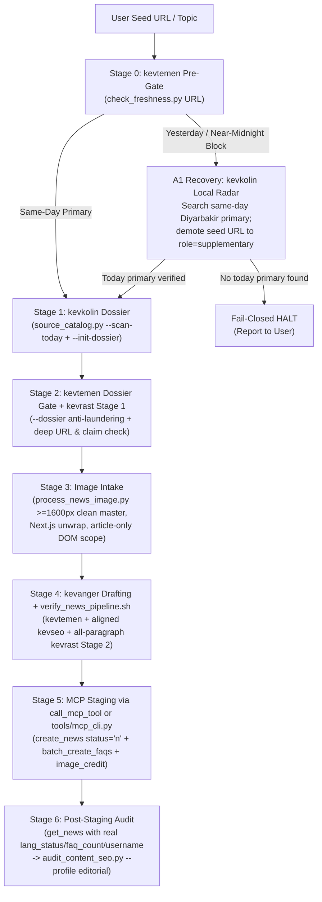

# Plan v1.0.63: Kevanger Editorial Pipeline, MCP Server & ORM Remediation and Enhancement Blueprint

**Target Domain:** `https://amedbulten.com`  
**Repository:** `AF/Bulletin`  
**Target Version:** `v1.0.63 (Planned)`  
**Predecessor Version:** `v1.0.62` (`docs/VERSION.md`, `config/site.config.php`)  
**Target Surface:** `.agents/skills/{_shared,kevanger,kevtemen,kevkolin,kevrast,kevseo}/`, `tools/{mcp_cli.py,mcp_health_check.py,verify_news_pipeline.sh,audit_content_seo.py}`, `lib/{McpServer,McpCrudToolsBase,McpNewsTools,McpFaqTools,McpHeadlineTools,McpPublicationTools,McpPageTools,McpAnnouncementTools,McpAttachmentTools,McpDocumentTools,McpMenuTools,McpPopupTools,McpRedirectTools,McpSettingsTools,McpSliderTools,McpSurveyTools}.class.php`, `lib/Orm/Orm.php`, `mod/{mod_news,mod_faq,mod_faq_mod}/`, `templates/amed/index/mod_news/news.twig`, `docker/nginx/prod.conf`, `tasks/mcp_smoke.php`, `docs/CODE_QUALITY_AGENT_STRATEGY.md`  
**Date:** 2026-11-11  
**Architecture Standard:** Amed Framework Core (Strict Code Separation, MCP Bridge Non-Bypass Contract, Fail-Closed Editorial Gates, Wikipedia-style `legacy_seo`, `AGENTS.md` Priority Rules 1–9)  
**Origin:** Live multi-agent editorial execution against `https://rudaw.net/turkish/categories/turkey/1287295` (*"Diyarbakır" category staging request on `amedbulten.com`*), consolidated with all unfixed follow-ups and live production addenda from `docs/plan/x-kevtemen-fetcher-429-header-hardening-plan.md` (§6 Fetcher Follow-Ups, §7 `mod_faq` Staging Friction on News `#128`, and §8 Antigravity HUB `v2.31` Editorial Run on News `#129`), plus a full-stack audit of the five `kev*` skills, `amed-bulletin` MCP bridge, Amed Framework `ORM` / `Adapter_Mysqli` layer, `mod_news`, and Nginx production routing.

---

## 1. Executive Summary & Architectural Overview

On `2026-11-11` (`Europe/Istanbul`), the editorial swarm executed a live intake run for `https://rudaw.net/turkish/categories/turkey/1287295` (*"Diyarbakır’ın en büyük parkında çalışmalar yüzde 80 tamamlandı"*). `kevtemen` (`check_freshness.py`) legitimately **BLOCKED** the run with exit code `1` because the source article carries `<meta property="article:published_time" content="2026-11-10 23:13:00"/>` (`+03:00` Erbil/Istanbul — published 47 minutes before midnight on the previous calendar day). Per `kevtemen` policy, drafting and CMS staging halted cleanly without bypassing the gate.

However, the live diagnostic probes on `1287295`, the live production addenda from News `#128` and News `#129` (`docs/plan/x-kevtemen-fetcher-429-header-hardening-plan.md`), and the accompanying codebase audit uncovered **six live execution bottlenecks/defects (Section A)** and **six systemic framework/MCP/skill defects and capability gaps (Section B)** — including two silent data-corruption/exception bugs inside the Amed Framework MCP layer (`ORM::where_*` filter clobbering across 15 MCP tool classes and `Adapter_Mysqli` `mysqli_result::fetch()` fatal errors swallowed inside `catch (\Throwable)` blocks) and a critical Next.js `/_next/image` photo-hijack bug in `process_news_image.py`.

### Priority & Severity Matrix

| ID | Layer | Component / Defect | Severity | Impact Summary |
| :-: | :--- | :--- | :---: | :--- |
| **A1** | `kevtemen` + `kevkolin` | Near-midnight calendar cutoff (`23:13`) & missing Same-Day Local Primary discovery workflow | High | Blocks overnight local stories even when same-day (`11.11.2026`) Diyarbakır follow-ups exist, because `kevtemen` forbids follow-up discovery |
| **A2** | Swarm + MCP Bridge | Sub-agent MCP sandbox block (`server amed-bulletin is not allowed in this context`) | High | Deadlocks multi-agent (`@researcher`/`@drafter`/`@verifier`) workflows that cannot invoke `call_mcp_tool` directly |
| **A3** | `kevanger` Image Intake | Next.js `/_next/image` query-stripping collision & `<main>` sidebar photo hijack on `1287295` | **Critical** | `process_news_image.py` collapsed 54 Next.js images into 1 URL and selected an unrelated sidebar article's photo over the real Diyarbakır park `og:image` |
| **A4** | `kevtemen` (`check_freshness.py`) | Disabled TLS verification, ISO-8601 `.000Z` timezone loss, Next.js RSC / sidebar `<time>` false-pass & duplicate `--file`+`--dossier` audit lines | **Critical** | MITM exposure; UTC `21:00–23:59Z` stories with `.000Z` false-block; undated/stale pages with sidebar `<time>` or nav `"Bugün"` can fail-open (`PASSED`); repeated `href`s emit duplicate `[OK]`/`[INFO]` lines |
| **A5** | `kevanger` + `kevtemen` | Stage-0 URL pre-gate vs Stage-2 `--dossier` gate documentation & CLI ordering contradiction | Medium | Agents waste research tokens before checking the seed URL or skip Stage-2 dossier anti-laundering checks |
| **A6** | Nginx + `mcp_health_check.py` | `docker/nginx/prod.conf` `location ~ /\.` returns HTTP 403 on `/.well-known/oauth-*` | Medium | v1.0.61 patched Apache `.htaccess` only; production Nginx still blocks RFC 8414 / RFC 9728 endpoints while Stage 7 masks the 403 |
| **B1** | `lib/Orm/Orm.php` + 15 MCP Classes | Sequential `$model->where_*()` calls overwrite `$this->_where` instead of `AND`-chaining | **Critical** | Proven live on News `#128` (`list_faqs` returned 18 cross-record items instead of 6); multi-parameter MCP filters silently drop all earlier `WHERE` clauses! |
| **B2** | `lib/McpServer.class.php` + `lib/McpCrudToolsBase.class.php` | Raw `$db->query()->fetch()` throws `Error` on `Adapter_Mysqli` (swallowed by `catch`) + `McpHeadlineTools` `TypeError` | **Critical** | `environment.site_status` is permanently `'unknown'`; `get_news` always returns `lang_status: 'n'` and `faq_count: 0`, breaking `audit_content_seo.py` |
| **B3** | `lib/McpNewsTools.class.php` + `McpFaqTools.class.php` | Root-category (`root='y'`) bypass, explicit `seo` bypass, missing `username`/`category_name` & dual envelope docs in `get_news`, `mod_faq` batching & `list_faq_modules` / `include_answer` gaps | High | Articles can be staged into invisible root containers, verifiers cannot confirm `habermerkezi`, and FAQ staging/auditing costs `2N` round-trips without module discovery |
| **B4** | `kevrast` (`verify_facts_and_links.py`) + `dossier.schema.json` | First-paragraph-only verdict bug, `script` number pollution, substring `n in t` false-pass, R2 vendor download/release rejection, R3 Turkish morphology + cross-lang anchoring, incomplete R4 attribution lexicon & shared HTTP cache/backoff | **Critical** | Hallucinations in 2nd+ paragraphs pass; legitimate vendor `/download` pages & English primary docs fail R2/R3; unlinked `"analize göre"` / `"paylaşılan bilgilere göre"` evade R4 |
| **B5** | `process_news_image.py` + `mod_news` + `news.twig` | `1200×675` → `1280×720` / `1200×1200` double lossy upscale, missing `image_alt` / `image_credit` DB columns & `<figcaption>` | High | Discover `16:9` (`1280×720`) and `1:1` (`1200×1200`) variants suffer upscaling + double WebP compression; photo credits pollute `articleBody` |
| **B6** | `kevkolin` + `kevseo` + Docs | Static `source_catalog.py` (no RSS/sitemap radar), `audit_seo.py` vs `audit_content_seo.py` rubric drift, stale `AGENTS.md` rule numbers | Medium | Manual search overhead for Diyarbakır news; drafts passing `audit_seo.py` can fail post-staging `audit_content_seo.py` |



### Cross-Cutting Repository Compliance (`AGENTS.md` Rules 1–9)

1. **Rule 1 (Strict Code Separation)**: All template changes (`templates/amed/index/mod_news/news.twig`) use external CSS classes in theme stylesheets — zero inline `style` attributes or `script` blocks.
2. **Rule 2 & Rule 6 (100% English Code, Comments, Skills & `/docs/`)**: All new/modified PHP, Python, Bash, SQL, `SKILL.md`, and `/docs/` files MUST remain strictly in English. Domain regex literals matching Turkish source text (`MONTHS_TR`, `CITATION_PHRASE_RE`, Turkish case-suffix tables) are data patterns operating on `lang='tr'` content and must be documented with English comments.
3. **Rule 3 (Workspace Isolation)**: Every tool, script, and test operates strictly inside `/home/malpersaz/Desktop/projects/htdocs/AF/Bulletin`.
4. **Rule 9 (Wikipedia-Style URL Parity)**: Slug generation preserves original alphabet casing and characters (`ç, ğ, ı, İ, ö, ş, ü, ê, î, û`) with underscores (`_`) via `McpCrudToolsBase::makeSeo()` (`self::makeSeo()`).

---

## 2. Section A — Live Execution Errors, Gate Outcomes & Friction Log (`rudaw.net/.../1287295`)

### A1. Near-Midnight Publication Cutoff (`23:13+03:00`) & Missing Same-Day Local Primary Recovery Path

#### Live Run Evidence
- **Command executed**: `python3 .agents/skills/kevtemen/scripts/check_freshness.py "https://rudaw.net/turkish/categories/turkey/1287295"`
- **Exit status**: `1` (`Status: BLOCKED | Today: 11.11.2026`)
- **Diagnostic output**: `https://rudaw.net/turkish/categories/turkey/1287295 -> 10.11.2026 (structured: 2026-11-10 23:13:00)`
- **Ground truth**: Rudaw published *"Diyarbakır’ın en büyük parkında çalışmalar yüzde 80 tamamlandı"* at `2026-11-10 23:13:00` (`+03:00`), 47 minutes before midnight (`~13h 16m` old at the `12:29+03:00` run).

#### Root Cause & Workflow Friction
`check_freshness.py` (`lines 256, 375`) enforces strict calendar-date equality (`dt.date() == today_dt.date()`) in `Europe/Istanbul`. That fail-closed calendar rule functioned as designed on the single URL. However, `.agents/skills/kevtemen/SKILL.md:34` instructs the agent: *"STOP EVERYTHING. Do not research, do not summarize, do not paraphrase, do not draft, do not call `create_news`."*

Meanwhile, `check_freshness.py` (`lines 360-386`) and `kevkolin/scripts/dossier.schema.json` (`lines 42-49`) **already support** `role: "supplementary"` background sources dated prior to today **provided at least one `role: "primary"` source is published today (`11.11.2026`)**! Because `kevtemen/SKILL.md:34` forbids even checking whether Diyarbakır Metropolitan Municipality (`diyarbakir.bel.tr`) or local Amed agencies (`amidahaber.com`, `tigrishaber.com`, `guneydoguekspres.com`, `cegamedya.com`) published a same-day (`11.11.2026`) statement or follow-up on the exact same park project, legitimate morning coverage of late-night municipal announcements is dead-ended prematurely.

#### Remediation Blueprint
1. **[MODIFY] `.agents/skills/kevtemen/SKILL.md` & `.agents/skills/kevanger/SKILL.md`**:
   - Preserve the strict fail-closed calendar rule (`Europe/Istanbul` today) with **zero manual override**, unless the editorial board explicitly opts into a bounded rolling window flag in the future.
   - Introduce a tightly bounded **"Same-Day Primary Discovery Attempt"** rule when a user-supplied seed URL fails Stage 0 solely because it was published in the late evening of `yesterday` (`>= 20:00 Europe/Istanbul`):
     - Permitted action: Run **one** targeted `kevkolin` check across Tier-1 official/local `amed_diyarbakir` sources to verify whether an official or primary follow-up exists with `pub_date == today`.
     - If a verified same-day (`today`) primary article exists and passes `check_freshness.py`, promote that today-dated report to `role: "primary"` and demote the yesterday-evening seed URL to `role: "supplementary"` (explicitly annotated as background context).
     - If **no** `today` primary source exists, **HALT IMMEDIATELY** (`BLOCKED`) and report both the seed URL's timestamp and the absence of a same-day follow-up to the user. Never launder a yesterday story via unrelated today links (`kevtemen` anti-laundering contract remains mandatory).
2. **[MODIFY] `.agents/skills/kevtemen/scripts/check_freshness.py`**:
   - Emit structured near-midnight diagnostics in JSON/CLI output (`age_hours`, `is_yesterday_late_evening: true` when `18 <= pub_dt.hour <= 23` on `today - 1 day`) so agents can report exact age (`13.3h old, published 47m before midnight`) to the user instead of generic date strings.

---

### A2. Swarm Sub-Agent MCP Sandbox Deadlock (`server amed-bulletin is not allowed in this context`)

#### Live Run Evidence
During the `1287295` swarm run, worker `@researcher` attempted to inspect MCP resources via `list_resources(ServerName="amed-bulletin")` and received:
```text
Encountered error in tool execution: server amed-bulletin is not allowed in this context
```
Furthermore, swarm worker tool declarations omit `call_mcp_tool` entirely — only the top-level coordinator session holds direct MCP tool bindings. At the same time, `.agents/skills/kevanger/SKILL.md:11` rightly forbids bypassing the MCP bridge by reading `~/.gemini/antigravity/mcp_config.json` or crafting raw `curl` requests with extracted `Bearer` tokens.

#### Root Cause
There is currently no sanctioned, secret-opaque local CLI wrapper around the stdio bridge (`~/.gemini/antigravity/bin/amed_bulletin_mcp.py`) that workspace scripts or sub-agents can call safely without touching credentials or bypassing MCP protocol envelopes.

#### Remediation Blueprint
1. **[CREATE] `tools/mcp_cli.py`**:
   - Implement a sanctioned, read/stage-safe JSON-RPC stdio client that spawns `~/.gemini/antigravity/bin/amed_bulletin_mcp.py` as a child process (using `tools/mcp_health_check.py:182-270` `StdioBridgeSession` as the proven reference pattern).
   - **Zero Credential Exposure**: `tools/mcp_cli.py` never prints, logs, or accepts raw API keys or endpoint overrides; the child bridge reads its own host configuration internally.
   - **Editorial Safety Policy Gate inside `tools/mcp_cli.py`**:
     - Subcommands:
       - `python3 tools/mcp_cli.py call <tool_name> --args-json '<json>'` (or `--args-file /tmp/args.json`)
       - `python3 tools/mcp_cli.py get-record --module mod_news --id <id> --out /tmp/record.json` (pipes directly into `tools/audit_content_seo.py --record-json`)
     - Hard-block unsafe mutations at the CLI boundary when `--editorial-safe` (default) is active:
       - Reject `delete_*` tools completely.
       - On `create_news` / `update_news` / `create_faq` / `update_faq`, assert `status == "n"` (hard-abort if `"y"` or omitted on `update_*` status publish attempts) and assert `username == "habermerkezi"` on `create_news`.
     - Verify `environment.name` (`production` vs `development`) in the returned `_meta` / payload and print it on `stderr` on every invocation.
2. **[MODIFY] `.agents/skills/kevanger/SKILL.md` (`lines 9-12`)**:
   - Explicitly document the two sanctioned execution paths: (a) native `call_mcp_tool` on `amed-bulletin` when available in the agent context, or (b) `python3 tools/mcp_cli.py` via the official stdio bridge when running inside swarm workers or `verify_news_pipeline.sh` post-staging checks — while keeping raw HTTP / `mcp_config.json` credential extraction strictly forbidden.

---

### A3. Critical Bug in `process_news_image.py`: Next.js `/_next/image` Query-Collision & Sidebar Photo Hijack on `1287295`

#### Live Run Evidence
Running a read-only diagnostic probe of `.agents/skills/kevanger/scripts/process_news_image.py --from-article "https://rudaw.net/turkish/categories/turkey/1287295" --source "Rûdaw"` revealed a **wrong-article image hijack**:
- Raw extractor found **56 candidates**, including the true Diyarbakır park photograph in `<meta property="og:image">` (`https://images.rudaw.net/images/asset/news/20261110231457_ntySv-eo.jpg`, score `1024`).
- After `rank_candidates()`, **54 of the 56 candidates vanished**, leaving only **2 unique candidates**, and the winning candidate (`score = 4340`) was:
  `https://rudaw.net/_next/image?url=https%3A%2F%2Fimages.rudaw.net%2Fimages%2Fasset%2Fnews%2F20261111111822_kavac%C4%B1.jpg&w=3840&q=75` (`900×652`) — **an unrelated news photo from sidebar ticker story `1287310`!**

#### Root Cause (`process_news_image.py:145-195, 279-307`)
Three compounding bugs in `.agents/skills/kevanger/scripts/process_news_image.py` caused this failure:
1. **Query-Stripping Deduplication Collision (`line 303`)**:
   ```python
   u = c["url"].split("?")[0].rstrip("/")
   ```
   On Next.js websites (`rudaw.net`, modern Turkish/Kurdish media), every `` and `srcset` entry points to `/_next/image?url=<encoded_origin_url>&w=3840&q=75`. Stripping `?.*` turns **every single image on the page** (hero image, sidebar thumbnails, related cards, author avatars) into the identical key `https://rudaw.net/_next/image`, collapsing 54 distinct photos into whichever single candidate scored highest!
2. **`<main>` Container Over-Inclusion (`lines 148, 152, 294`)**:
   `_CandidateExtractor` tracks `self._in_article_or_main > 0` across **both** `<article>` and `<main>`, and awards `+500` (`in_article` bonus) to every image inside `<main>`. On Rudaw (and most Next.js layouts), `<main>` wraps the two-column grid containing **both** the primary article and the *"Son Haberler"* / *"İlgili Haberler"* `<aside>` / sidebar!
3. **Next.js `3840w` `srcset` Descriptor Inflation (`lines 176-185, 286-291`)**:
   Next.js `next/image` automatically emits responsive `srcset` descriptors up to `3840w` regardless of the underlying source file's true pixel width (`900px`). Because `rank_candidates()` sets `score = max(width_hint, 1024 if meta else 600)`, a `900px` sidebar thumbnail with `3840w` + `<main>` bonus receives `3840 + 500 = 4340`, crushing the genuine `og:image` (`1024`)!

#### Remediation Blueprint
1. **[MODIFY] `.agents/skills/kevanger/scripts/process_news_image.py`**:
   - **Add `unwrap_cdn_image_url(url: str) -> str` before filtering/ranking**:
     - Detect Next.js `/_next/image?url=...` (and `/_vercel/image?url=...`, WordPress Photon `i0.wp.com`, Cloudflare `/cdn-cgi/image/.../https://...`). Extract and `urllib.parse.unquote()` the inner `url` query parameter (resolving relative paths against the page origin and re-validating via `validate_public_url()`).
     - Deduplicate in `rank_candidates()` on the **canonical unwrapped image URL** (preserving distinguishing query parameters such as `?id=` or signed asset tokens when no inner URL exists, stripping only known resize params `w`, `q`, `width`, `height`, `fit`, `auto`).
   - **Separate `<article>` vs `<main>` DOM Scoping & Exclude Secondary Containers**:
     - Track `<article>` depth separately from `<main>` depth (`in_primary_article` vs `in_main`), and track exclusion depth for `<aside>`, `<nav>`, `<footer>`, `<header>` (outside `<article>`), and any element whose `class` or `id` matches `(sidebar|related|recommend|most-read|popular|son-haber|benzer|widget|ticker|footer|comment)`.
     - Award the `+600` primary-body bonus **only** to the first 1–2 figure/hero images inside the primary `<article>` outside excluded containers; penalize sidebar/related candidates by `-2000` (or drop them outright when an `og:image` or primary `<article>` image exists).
   - **Cross-Anchor `og:image` Identity Boost & `srcset` Cap**:
     - When an `<article>` ``/`srcset` candidate's unwrapped filename stem matches `og:image` / `twitter:image` (e.g., `20261110231457_ntySv-eo.jpg`), boost its score by `+2000` so the highest-resolution variant of the verified hero photo always wins.
     - Cap unverified `srcset` `width_hint` on `/_next/image` / `/_vercel/image` URLs to `1200` unless corroborated by explicit `` attributes or `og:image:width`.
   - **HTTP Header Hardening (`lines 116-135`)**:
     - Send browser-grade `Accept: text/html,application/xhtml+xml,*/*;q=0.8` + `Accept-Language: tr,en;q=0.8` when fetching `--from-article` HTML, and send `Accept: image/avif,image/webp,image/apng,image/*,*/*;q=0.8` + `Referer: <article_origin>/` when fetching image binaries to prevent hotlink/WAF HTTP 403/429 rejections.

---

### A4. Live Defects Uncovered in `kevtemen` (`check_freshness.py`) During the `1287295` Inspection

Inspecting Rudaw's `1287295` HTML payload against `.agents/skills/kevtemen/scripts/check_freshness.py` exposed four latent security and accuracy bugs that did not mask `1287295` only because `<meta property="article:published_time">` happened to lack fractional seconds:

1. **Disabled TLS Certificate Verification & Missing SSRF Guard (`lines 34-36`)**:
   - `_SSL_CTX = ssl.create_default_context(); _SSL_CTX.check_hostname = False; _SSL_CTX.verify_mode = ssl.CERT_NONE` disables TLS verification entirely (unlike `verify_facts_and_links.py:103` and `process_news_image.py:112`), and `fetch_html()` lacks `validate_public_url()` SSRF protection against `127.0.0.1` / `169.254.169.254` / RFC1918 addresses.
2. **ISO-8601 Fractional-Second Timezone Drop (`lines 50-52, 81-106`)**:
   - `RE_ISO` (`lines 50-52`) is `r"(\d{4})-(\d{2})-(\d{2})(?:[T ](\d{2}):(\d{2})(?::(\d{2}))?(Z|[+-]\d{2}:?\d{2})?)?"`.
   - When a CMS emits milliseconds (`2026-11-10T23:13:00.000Z` — standard in Next.js, Arc XP, Strapi, Ghost, and WordPress REST), the regex matches up to `:00` and leaves `.000Z` unmatched (`m.group(7) is None`)!
   - `_from_iso_match()` (`lines 100-106`) / `_apply_tz()` (`lines 81-97`) then treats `tz` as empty and calls `_mk_naive_istanbul(naive)` (`+03:00`) instead of `UTC`, shifting `2026-11-10T23:13:00.000Z` (`2026-11-11 02:13+03:00`, **today!**) back to `2026-11-10 23:13+03:00` (**yesterday -> false BLOCK!**).
3. **Next.js RSC `script` Payload & Sidebar `<time>` Fail-Open Vulnerability (`lines 49, 64, 148-215`)**:
   - `TAG_RE = re.compile(r"<[^>]+>")` (`line 64`) strips HTML tags via `text = TAG_RE.sub(" ", html)` (`line 160`) **without removing `script` or `style` element bodies**. On `rudaw.net/.../1287295`, the inline Next.js Flight payload (`self.__next_f.push(...)`) embeds `"date":"11-11-2026"` from sidebar ticker articles!
   - Furthermore, `RE_TIME_TAG` (`lines 49, 148-158`) shares **Priority `1`** with `RE_META_PUB` (`article:published_time`) and `RE_LD_PUB`, while `RE_DOT`/`RE_TR_LONG` (`lines 161-176`) scan full unstripped `text` at Priority `2` (`RE_URLPATH` is Priority `3` at `lines 178-186`), and `extract_pub_date()` (`line 214`) selects:
     ```python
     best = min(candidates, key=lambda c: (c[0], -c[1].timestamp()))
     ```
     Sorting by `-c[1].timestamp()` picks the **newest** timestamp among equal-priority candidates! If a stale article page contains a `"Son Haberler"` sidebar using `<time datetime="2026-11-11T12:00:00+03:00">` (Priority `1`), or omits `article:published_time` so Priority `2` scans unstripped `script`/sidebar text containing `"11.11.2026"`, **`check_freshness.py` will FAIL-OPEN and return `PASSED` on an old article!**
4. **Bare `"Bugün"` Navigation Word False-Open (`lines 62, 201-202`)**:
   - `RE_TODAY = re.compile(r"\bbugün\b", re.I)` (`line 62`) scans the entire `text` (`lines 201-202`, Priority `4`) including `<header>`/`<nav>`/sidebar links. Any undated page (without Priority `1–3` matches) containing a navigation link *"Bugün"* or *"Bugün Hava Durumu"* resolves to `now` (`PASSED`)!
5. **Duplicate Audit Lines & Repeated Network GETs in `--file` + `--dossier` Mode (`lines 406-433, 484-491`; Live Run Evidence from News `#129`, `x-kevtemen-fetcher-429-header-hardening-plan.md` §8.4)**:
   - `draft_hrefs = HREF_RE.findall(draft)` (`line 406`) returns **every anchor occurrence** in the HTML body without URL deduplication, and `for href in draft_hrefs:` (`lines 411-433`) appends a separate entry to `checks` (and executes a fresh live `fetch_html()` network request for every `primary` link!) per occurrence.
   - Observed live on News `#129`: pre-staging re-check printed the primary CellCog `[OK]` line **3 times** and each supplementary source `[INFO]` line **twice**, wasting HTTP round-trips (risking edge `429` throttling) and cluttering gate diagnostics.

#### Remediation Blueprint (`[MODIFY] .agents/skills/kevtemen/scripts/check_freshness.py`)
1. Remove `CERT_NONE` / `check_hostname = False`; enforce verified default SSL context + shared `validate_public_url()` SSRF guard via `.agents/skills/_shared/editorial_http.py` (while strictly preserving the VentureBeat `Accept: text/html,application/xhtml+xml,*/*;q=0.8` + `Accept-Language: tr,en;q=0.8` header set applied in `check_freshness.py:219-223`).
2. Update `RE_ISO` to capture optional fractional seconds `(?:[.,]\d{1,9})?` before `(Z|[+-]\d{2}:?\d{2})?` (or parse with `datetime.fromisoformat()` after normalizing `Z` -> `+00:00`).
3. Strip `script`, `style`, `noscript`, `<nav>`, `<header>`, `<footer>`, and `<aside>` element blocks **before** scanning `<time>` tags or visible byline text (preserving `application/ld+json` blocks separately for structured JSON-LD parsing, restricted to `@type` in `{"NewsArticle", "Article", "ReportageNewsArticle", "BlogPosting", "WebPage"}` whose `url`/`@id` matches the target URL or primary `mainEntityOfPage`).
4. Separate priority tiers strictly:
   - Priority `1`: `<meta property="article:published_time">`, `<meta name="pubdate|publishdate|datePublished|DC.date.issued">`, and main-entity JSON-LD `datePublished`. (When multiple Priority 1 values exist for the main article, prefer the **earliest** `datePublished`, never `dateModified` or the newest timestamp on the page).
   - Priority `2`: `<time datetime="...">` **inside `<article>`** (excluding `<aside>`/related cards).
   - Priority `3`: Explicit date-labeled visible bylines (`Yayınlanma Tarihi:`, `Giriş:`, etc.) within the `<article>` header.
   - Remove standalone `\bbugün\b` (`RE_TODAY`) unless immediately preceded/followed by an explicit timestamp (`Bugün, 11:45` / `Yayınlanma: Bugün 09:30`) inside the `<article>` byline zone.
5. **Deduplicate `draft_hrefs` & `checks` by Normalized URL (`lines 406-433, 253-276`)**:
   - Group `draft_hrefs` (and `args.targets`) by normalized URL (`norm = href.strip().rstrip("/")`) *before* `fetch_html()` so each unique URL is fetched and evaluated **at most once**, recording `citation_count: int` (`e.g., cited 3x`). If both positional `targets` and `draft_hrefs` reference the same URL, merge them keeping the **strictest outcome** (`unreachable` > `dated (same_day=False)` > `undated` > `dated (same_day=True)` > `skipped_role` / `evergreen_delegated`).

---

### A5. `kevanger` vs `kevtemen` Stage-0 / Stage-2 Gate-Order Documentation Contradiction

#### Root Cause
- `.agents/skills/kevanger/SKILL.md:13` states: *"Gate Execution Order: Always run: `kevtemen` (same-day freshness gate) -> `kevkolin` -> `kevrast` Stage 1..."*
- Yet `.agents/skills/kevanger/SKILL.md:30-32` (`Step 2 — Research & Intake Verification`) instructs agents to build the `kevkolin` dossier **first** and only shows `check_freshness.py --dossier "$DOSSIER_JSON"`.
- Conversely, if an agent only runs `check_freshness.py "$SEED_URL"` at Stage 0 and skips `check_freshness.py --dossier "$DOSSIER_JSON"` after `kevkolin`, supplementary/primary role rules and evergreen anti-laundering (`check_freshness.py:310-398`) are bypassed until `verify_news_pipeline.sh` runs at the end of drafting!

#### Remediation Blueprint
- **[MODIFY] `.agents/skills/kevanger/SKILL.md` & `.agents/skills/kevtemen/SKILL.md`**:
  - Explicitly codify the two-pass freshness gate:
    1. **Stage 0 (Seed URL Pre-Gate, zero token waste)**: When the user supplies URL(s), run `python3 .agents/skills/kevtemen/scripts/check_freshness.py "$SEED_URL"` *before* building a dossier (triggering A1 Local Primary Discovery only if near-midnight yesterday).
    2. **Stage 2 (Dossier Gate, anti-laundering)**: Immediately after `kevkolin` writes `$DOSSIER_JSON`, run `python3 .agents/skills/kevtemen/scripts/check_freshness.py --dossier "$DOSSIER_JSON"` *before* `kevrast` Stage 1 and drafting.

---

### A6. Production Nginx vs Apache `.htaccess` Drift on `/.well-known/oauth-*` Discovery Endpoints

#### Live Run Evidence
Executing `python3 tools/mcp_health_check.py` during this audit passed 24 checks (`environment.name = "production"`, `v1.0.62`), but Stage 7 printed:
```text
[PASS] .well-known/oauth-authorization-server reachable -> HTTP 403 (dotfile rule active prior to v1.0.61 .htaccess deployment; non-blocking for stdio bridge)
[PASS] .well-known/oauth-protected-resource reachable -> HTTP 403 (dotfile rule active prior to v1.0.61 .htaccess deployment; non-blocking for stdio bridge)
```
Production is already at **`v1.0.62`**, yet `/.well-known/*` still returns `HTTP 403`!

#### Root Cause (`docker/nginx/prod.conf:84-88` vs `.htaccess:28`)
Plan `v1.0.61` added `RewriteCond %{REQUEST_URI} !^/\.well-known/(oauth-authorization-server|oauth-protected-resource|llms\.txt)$` to `.htaccess:28` (Apache), which is only used in local/Apache environments. Production runs **Nginx** (`docker/nginx/prod.conf`), where lines `84-88` enforce:
```nginx
location ~ /\. {
    deny all;
    access_log off;
    log_not_found off;
}
```
Because Nginx evaluates regex `location ~ /\.` against `/.well-known/...` unless preempted by `location ^~ /.well-known/`, every RFC 8414, RFC 9728, ACME, and `/.well-known/llms.txt` request on `amedbulten.com` is hard-denied with `403 Forbidden`, and `tools/mcp_health_check.py:534-540` masks the regression behind a stale warning message.

#### Remediation Blueprint
1. **[MODIFY] `docker/nginx/prod.conf` (insert above `location ~ /\.` at line 84)**:
   ```nginx
   location ^~ /.well-known/ {
       try_files $uri /index.php?$query_string;
   }
   ```
   (Or scope explicitly to `location ~ ^/\.well-known/(oauth-authorization-server|oauth-protected-resource|llms\.txt|acme-challenge/)` before `location ~ /\.`).
2. **[MODIFY] `tools/mcp_health_check.py` (`lines 530-558`)**:
   - After Nginx deployment, require `HTTP 200` + valid JSON issuer metadata on `/.well-known/oauth-authorization-server` and `/.well-known/oauth-protected-resource` in full health-check mode (converting `HTTP 403` from a masked pass into a real failure).

---

## 3. Section B — Systemic Framework, MCP Server & `kev*` Pipeline Improvements

### B1. CRITICAL ORM / MCP Defect: Sequential `$model->where_*()` Calls Silently Overwrite `$this->_where` Across 15 MCP Tool Classes

#### Root Cause (`lib/Orm/Orm.php:111-125` & `lib/Database/Database.php:603-623`)
In Amed Framework's `ORM` and `Database` classes:
- `ORM::__call('where_lang', ['tr'])` delegates to `ORM::_call_where()` (`lib/Orm/Orm.php:121`), which calls `$this->where($where)`.
- `Database::where($arg)` (`lib/Database/Database.php:606`) executes:
  ```php
  $this->_where = Dbuilder::where($arg);
  ```
  It **replaces** `$this->_where` instead of appending via `$this->addWhere()` (`lib/Database/Database.php:619`)!

Across **15 MCP domain tool classes**, filter methods chain multiple `$model->where_*()` (or `$model->where_*()` followed by `$model->where(...)`) calls sequentially under the false assumption that they combine with `AND`:

| File | Method & Lines | Broken Filter Chain (Only Last Active Filter Survives!) |
| :--- | :--- | :--- |
| `lib/McpNewsTools.class.php` | `applyNewsFilters` (`1252-1272`) | `where_category_id()` -> `where_lang()` -> `where_status()` -> `where_show_on_homepage()` -> `where_seo()` -> `where('name LIKE ...')` |
| `lib/McpCrudToolsBase.class.php` | `applyCategoryFilters` (`355-370`) | `where_lang()` -> `where_root()` -> `where_seo()` -> `where("(name LIKE ... OR seo LIKE ...)")` |
| `lib/McpFaqTools.class.php` | `applyFaqFilters` (`443-460`) | `where_mod_name()` -> `where_vid()` -> `where_lang()` -> `where_status()` -> `where('question LIKE ...')` |
| `lib/McpPublicationTools.class.php` | `applyPublicationFilters` (`922-942`) | `where_category_id()` -> `where_lang()` -> `where_status()` -> `where_deck()` -> `where_slider()` -> `where('name LIKE ...')` |
| `lib/McpPageTools.class.php` | `applyPageFilters` (`786-810`) | `where_lang()` -> `where_seo()` -> `where_parent_id()` -> `where_root()` -> `where_status()` -> `where_deck()` -> `where("(name LIKE ... OR seo LIKE ... OR title LIKE ...)")` |
| `lib/McpAnnouncementTools.class.php` | `applyAnnouncementFilters` (`383-397`) | `where_lang()` -> `where_status()` -> `where_deck()` -> `where('name LIKE ...')` |
| `lib/McpAttachmentTools.class.php` | `applyAttachmentFilters` (`429-445`) | `where_mod_name()` -> `where_vid()` -> `where('ext LIKE ...')` -> `where('original_name LIKE ...')` |
| `lib/McpDocumentTools.class.php` | `applyDocumentFilters` (`555-566`) | `where_lang()` -> `where_status()` -> `where('name LIKE ...')` |
| `lib/McpHeadlineTools.class.php` | `applyHeadlineFilters` (`398-409`) | `where_lang()` -> `where_status()` -> `where('name LIKE ...')` |
| `lib/McpMenuTools.class.php` | `listMenuItems` (`387-398, 420-431`) | `where_lang()` -> `where_parent_id()` -> `where_status()` -> `where('name LIKE ...')` |
| `lib/McpPopupTools.class.php` | `applyPopupFilters` (`527-538`) | `where_lang()` -> `where_status()` -> `where('name LIKE ...')` |
| `lib/McpRedirectTools.class.php` | `applyRedirectFilters` (`385-394`) | `where_status_code()` -> `where("(old_url LIKE ... OR new_url LIKE ...)")` |
| `lib/McpSettingsTools.class.php` | `listCookieDeclarations` (`1356-1365`) & `listAffiliations` (`1532-1556`) | `where_lang()` -> `where_category()`; `where_is_active()` -> `where('(name LIKE ... OR url LIKE ...)')` |
| `lib/McpSliderTools.class.php` | `applySliderFilters` (`607-621`) | `where_lang()` -> `where_status()` -> `where_target()` -> `where('name LIKE ...')` |
| `lib/McpSurveyTools.class.php` | `applySurveyFilters` (`555-566`) | `where_lang()` -> `where_status()` -> `where('question LIKE ...')` |

*(Note: Newer classes `lib/McpEventTools.class.php:731` and `lib/McpVideoTools.class.php:1854` already switched to `$model->addWhere(...)`, confirming `addWhere()` is the intended conjunctive API.)*

#### Live Production Proof (News `#128` A/B Reproduction, `x-kevtemen-fetcher-429-header-hardening-plan.md` §7.1) & Impact on `kevanger`
1. **Verified Live A/B Evidence on News `#128` (`list_faqs`, IDs `28–33`)**:
   - Calling `list_faqs({"vid": 128})` alone executed only `$model->where_vid(128)` -> returned **6 items (`total: 6`, only `vid = 128`)**.
   - Calling `list_faqs({"mod_name": "mod_news", "vid": 128, "lang": "tr", "limit": 50})` executed `where_mod_name('mod_news')` (clobbered) -> `where_vid(128)` (clobbered!) -> `where_lang('tr')` (sole survivor!) -> returned **18 items spanning host records `vid` `5, 10, 24, 81, 82, 128`** across all Turkish FAQs!
2. Calling `list_news_categories(lang: "tr", root: "n", search: "Diyarbakır")` drops `lang="tr"` and `root="n"`, returning structural root or Kurdish/Zazaki categories whose name/SEO matches!
3. Calling `list_news(category_id: 4, lang: "tr", status: "n")` drops `category_id` and `lang`!

#### Remediation Blueprint
1. **[MODIFY] `lib/McpCrudToolsBase.class.php`**:
   - Add two safe, reusable protected helpers on `McpCrudToolsBase`:
     - `protected function addEqFilter(object $model, string $column, string|int $value): void` — validates `$column` against `/^[a-zA-Z_][a-zA-Z0-9_]*$/` and calls `$model->addWhere(is_int($value) ? "{$column} = {$value}" : "{$column} = '" . \Obuilder::cc((string) $value) . "'")`.
     - `protected function addLikeSearchFilter(object $model, array $columns, string $rawSearch): void` — escapes quotes via `\Obuilder::cc()`, builds a parenthesized `(` . implode(` OR `, ...) . `)` clause, and appends it via `$model->addWhere(...)` so multi-column `OR` clauses remain safely parenthesized inside the `AND` chain.
2. **[MODIFY] All 15 `lib/Mcp*Tools*.class.php` files listed above**:
   - Replace sequential `$model->where_*()` + `$model->where(...)` calls inside every filter method (`apply*Filters`, `listMenuItems`, `listCookieDeclarations`, `listAffiliations`) with `$this->addEqFilter(...)` and `$this->addLikeSearchFilter(...)` (leave legacy `ORM::_call_where` untouched so existing frontend/admin controllers relying on reset semantics do not regress).
3. **[MODIFY] `tasks/mcp_smoke.php`**:
   - Add explicit regression assertions verifying conjunctive multi-parameter filtering on:
     - `list_faqs(mod_name: 'mod_news', vid: <id>, lang: 'tr')` vs `list_faqs(vid: <id>)` (exact item-set & `total` equality, directly guarding the News `#128` regression) plus `list_faqs(mod_name: 'mod_news', vid: 999999, lang: 'tr')` (`total === 0`),
     - `list_news(category_id, lang, status)`, and `list_news_categories(lang, root, search)`.

---

### B2. CRITICAL `Adapter_Mysqli` Swallowed Fatal Error in `McpServer::resolveEnvironment()` & `McpCrudToolsBase::getRecordAuditMeta()`, Plus `McpHeadlineTools` `TypeError`

#### Root Cause (`lib/McpServer.class.php:136-138`, `lib/McpCrudToolsBase.class.php:789-810`, `lib/Database/Adapter/Mysqli.php:66`)
Plan `v1.0.61` introduced raw PDO-style calls into two core MCP methods:
1. `lib/McpServer.class.php:136-139`:
   ```php
   $db = Load::lib('Database');
   if ($db && method_exists($db, 'query')) {
       $row = $db->query("SELECT site_status FROM mod_settings LIMIT 1")->fetch();
   ```
2. `lib/McpCrudToolsBase.class.php:789-810`:
   ```php
   $db = Load::lib('Database');
   if ($db && method_exists($db, 'query')) {
       $safeLang = addslashes($lang);
       $langRow = $db->query("SELECT status FROM lang WHERE seo = '{$safeLang}' LIMIT 1")->fetch();
       ...
       $safeMod = addslashes($modName);
       $faqRes = $db->query("SELECT id, question, answer FROM mod_faq WHERE mod_name = '{$safeMod}' AND vid = {$recordId} AND lang = '{$safeLang}' AND status = 'y'");
       if ($faqRes && method_exists($faqRes, 'fetchAll')) { ... }
       elseif ($faqRes && method_exists($faqRes, 'fetch')) { ... }
   ```
In Amed Framework, `Load::lib('Database')` returns `Database` backed by `Adapter_Mysqli` (`lib/Database/Adapter/Mysqli.php`), whose `query(string $sql)` (`line 66`) returns a native PHP `mysqli_result` object:
- **`mysqli_result` has neither `->fetch()` nor `->fetchAll()`** (only `fetch_assoc()` / `fetch_all()`).
- Line `138` in `McpServer.class.php` and line `792` in `McpCrudToolsBase.class.php` immediately throw `Error: Call to undefined method mysqli_result::fetch()`, which is silently swallowed by `catch (\Throwable)`.
- Even if line `792` did not throw, lines `799` and `805` check `method_exists($faqRes, 'fetchAll')` and `method_exists($faqRes, 'fetch')` — both evaluate to `false` on `mysqli_result`, leaving `$faqItems = []` and `$faqCount = 0`!
- Observed live consequences:
  - `McpServer::resolveEnvironment()` **always** returns `"site_status": "unknown"` (verified live on production during `mcp_health_check.py`).
  - `McpCrudToolsBase::getRecordAuditMeta()` **always** returns fallback defaults `['lang_status' => 'n', 'faq_count' => 0, 'faq_items' => []]` on **every `get_news`, `get_publication`, `get_page`, and `get_announcement` response**!
  - Consequently, running `python3 tools/audit_content_seo.py --record-json /tmp/staged_news.json --profile editorial` against a real MCP `get_news` payload falsely fails `lang_status == 'n'` (critical violation) and scores `0/10` on FAQs even when `tr` is active and 6 FAQs exist!

Additionally:
- **Draft FAQ Blindness (`lib/McpCrudToolsBase.class.php:798`)**: Even once fixed, `AND status = 'y'` in `getRecordAuditMeta()` excludes staged draft FAQs (`status = 'n'`) attached to a staged draft news article (`status = 'n'`). Because `kevanger` stages both the news item and its FAQs with `status = 'n'` before running post-staging `audit_content_seo.py`, `faq_count` would still read `0` for drafts!
- **Type Bug in `lib/McpHeadlineTools.class.php:284, 341`**: `createHeadline()` and `updateHeadline()` call `$this->assertContentMatchesLang($lang, ['name' => $name])`, passing an `array` to `McpCrudToolsBase::assertContentMatchesLang(string $lang, string $name, ...)` (`line 204`), which throws a fatal `TypeError` whenever a headline is created or updated via MCP!

#### Remediation Blueprint
1. **[MODIFY] `lib/McpServer.class.php` (`lines 134-153`)**:
   - Replace `$db->query(...)->fetch()` with the canonical Amed Framework `Database` pattern already used in `McpCrudToolsBase::getSiteLanguageMap()` (`lines 143-145`): `$db = Load::lib('Database'); $db->fetch_array("SELECT site_status FROM mod_settings LIMIT 1"); $rows = $db->toArray();`.
2. **[MODIFY] `lib/McpCrudToolsBase.class.php` (`lines 780-822`)**:
   - Replace both `$db->query(...)` blocks with `$db = Load::lib('Database'); $db->fetch_array(...); $rows = $db->toArray();` (escaping `$lang` and `$modName` via `Obuilder::cc()` instead of `addslashes()`, and ordering FAQs by `sort_order ASC, id ASC`).
   - Accept optional `string $recordStatus = 'y'` in `getRecordAuditMeta(string $modName, int $recordId, string $lang, string $recordStatus = 'y')`:
     - When `$recordStatus === 'y'`, count/load only published FAQs (`status = 'y'`).
     - When `$recordStatus === 'n'` (staged draft), include draft and published FAQs (`status IN ('y', 'n')`) in `faq_items` / `faq_count` while also exposing `faq_published_count` and `faq_draft_count` so `audit_content_seo.py --profile editorial` accurately scores staged drafts prior to publication.
3. **[MODIFY] `lib/McpHeadlineTools.class.php` (`lines 284, 341`)**:
   - Fix `$this->assertContentMatchesLang($lang, $name);` (passing `string $name`, matching `McpNewsTools.class.php:723`).
4. **[MODIFY] `tasks/mcp_smoke.php`**:
   - Assert `environment.site_status !== 'unknown'` (`in_array(..., ['open', 'closed'], true)`), assert `get_news` returns `lang_status === 'y'` for active `tr` records, and add a `create_headline` / `delete_headline` smoke test.

---

### B3. `McpNewsTools` & `McpFaqTools` Hardening: Root-Category Guard, Mandatory `makeSeo()`, Enriched `get_news` Attribution & Batch FAQs

#### Root Causes Verified in `lib/McpNewsTools.class.php` & `mod/mod_news/`
1. **Structural Root Category Bypass (`lib/McpNewsTools.class.php:710, 871` vs `mod/mod_news/validator/add.validator.php:273`)**:
   - Admin validator `validateCategoryRelation()` explicitly rejects categories where `$categoryRow['root'] === 'y'` (`mod_news_error_category_not_selectable`), and both the public frontend (`mod/index/helper/mod_news.helper.php:139`: `where("... root='n'")`) and admin form (`mod/mod_news/index.php:83`) hide `root = 'y'` containers.
   - `McpNewsTools::createNews()` (`line 710`) and `updateNews()` (`line 871`) call `$this->assertRecordMatchesLang('mod_news_category', $categoryId, $lang, 'Category')` (`McpCrudToolsBase.class.php:263`), which verifies existence and language match (`$record->lang === $lang`) via `$this->loadRecordById(...)`, **but never checks `($record->root ?? 'n') === 'y'`** — allowing an agent to stage news into a structural root container where it becomes invisible on the website!
2. **Explicit `seo` Slug Normalization Bypass (`lib/McpNewsTools.class.php:725-734, 894-906`)**:
   - `if ($seo === '') { $seo = self::makeSeo($name, $lang); }` (`lines 726-728, 896-898`) only normalizes when `seo` is omitted. If an agent passes an explicit `seo` containing spaces, colons, quotation marks, Turkish combining dot `i\u0307`, or lowercase-hyphenated slugs, `McpNewsTools` writes it straight into `mod_news.seo` without running `self::makeSeo(...)` (unlike `mod/mod_news/validator/add.validator.php:142` which enforces `Filter::makeSeo($name, 'legacy_seo')`).
3. **Missing Author `username` & `category_name` in `get_news` (`lib/McpNewsTools.class.php:670-686`)**:
   - `create_news` resolves `username: "habermerkezi"` into numeric `user_id` (`resolveAuthorId()`, `lines 1184-1212`), while `getNews()` (`line 672`) calls `$this->loadRecordByIdOrSeo('mod_news', $args, 'News')` against the base `mod_news` table instead of joining/enriching from `newses` (`mod/mod_news/model/newses.model.php`).
   - As a result, `get_news` returns `"user_id": 2` and `"category_id": 4` **without** `"username": "habermerkezi"`, `"category_name": "Diyarbakır"`, or `"category_seo": "Diyarbakır"` — preventing `@verifier` and `audit_content_seo.py` from verifying `kevanger`'s mandatory `habermerkezi` attribution and category placement from `get_news` alone!
4. **`mod_faq` Batching, Module Discoverability & Answer Verification Gaps (`lib/McpFaqTools.class.php:18-294, 474-477` & `mod/mod_faq_mod/model/mod_faq_mod.model.php`; Live Run Evidence from News `#128`, `x-kevtemen-fetcher-429-header-hardening-plan.md` §7.2)**:
   - **Single-item `create_faq`**: Staging 6 FAQs on News `#128` required 6 sequential MCP round-trips (whereas `McpMenuTools::batchUpdateMenuItems` at `lib/McpMenuTools.class.php:331` already establishes the atomic `batch_*` precedent).
   - **Missing `list_faq_modules` Bridge Discovery**: `McpFaqTools::assertEntity()` (`lines 474-477`) validates `$bridgeModel = $this->freshModel('mod_faq_mod'); $bridgeModel->exists_mod_name($modName)`, yet `McpFaqTools` has no counterpart to `McpGalleryTools::listGalleryModules()` (`lib/McpGalleryTools.class.php:247, 636-661`), forcing callers to guess valid `mod_faq_mod` host identifiers (`id, name, mod_name, mod_key, mod_value`).
   - **Answer Body Omitted in `list_faqs` (`lines 255-264`)**: `listFaqs()` hardcodes `$model->select('id, lang, mod_name, vid, question, sort_order, status, created_at, updated_at')`, omitting `answer`. Verifying 6 staged FAQ answers on News `#128` required 6 additional `get_faq` round-trips!
5. **Single-Record Envelope Asymmetry Across MCP `get_*` Tools (`lib/McpNewsTools.class.php:684-685, 846-854` vs `lib/McpPageTools.class.php:473-478`; Live Note from News `#129`, `x-kevtemen-fetcher-429-header-hardening-plan.md` §8.5)**:
   - `getPage()`, `getAnnouncement()`, `getFaq()`, `getHeadline()`, etc. return a pure wrapper `['item' => $row, ...]`, and `createNews()` (`lines 846-854`) returns metadata plus nested `'item' => $this->getNews(...)['item']`.
   - By contrast, `getNews()` (`lines 684-685`) and `getPublication()` (`McpPublicationTools.class.php:352-353`) execute `$row['item'] = $row; return $row;` — returning a hybrid flat record that embeds a self-copy under `'item'`. While `audit_content_seo.py:114-119` handles both shapes, undocumented envelope variance across `get_*` tools confuses external MCP consumers.
6. **Duplicate Story Staging Risk (`lib/McpNewsTools.class.php:732, 902`)**:
   - `McpNewsTools` only checks exact `(seo, lang)` collisions via `$this->recordSeoExists('mod_news', $seo, $lang)`. Two agents covering the same Diyarbakır event from slightly different headlines will create duplicate drafts unless a near-duplicate headline/date precheck exists.

#### Remediation Blueprint
1. **[MODIFY] `lib/McpNewsTools.class.php`**:
   - **Enforce Leaf/Selectable Category Check**: After `$this->assertRecordMatchesLang('mod_news_category', $categoryId, $lang, 'Category')` in `createNews()` and `updateNews()` (or by returning the loaded `ORM` record from `assertRecordMatchesLang`), reject categories with `((string) ($cat->root ?? 'n')) === 'y'` with a clear actionable error listing selectable child categories (`root = 'n'`).
   - **Always Normalize `seo` via `self::makeSeo()`**: Run `$seo = self::makeSeo($seo !== '' ? $seo : $name, $lang);` in both `createNews()` and `updateNews()` (and strip `U+0307` combining dot above inside `McpCrudToolsBase::makeSeo()` so decomposed Unicode never leaks into URLs).
   - **Enrich `getNews()` Response & Document Canonical `item` Envelope**: Include resolved `username`, `author_fullname`, `category_name`, and `category_seo` alongside `user_id` and `category_id` in `get_news` (ensuring `$row['item']` is populated *after* all enrichments, excluding recursive self-nesting, and documenting in tool descriptions across `McpNewsTools` / `McpPublicationTools` / `McpPageTools` / `McpAnnouncementTools` that `payload.item` + top-level `{lang_status, faq_count, faq_items}` is the canonical single-record contract while preserving top-level flat fields on `get_news` / `get_publication` for backward compatibility).
   - **Add `check_duplicate_news` Tool (or `duplicate_warnings` in `create_news`)**: Query `mod_news` within the last 48 hours (`same lang`) using normalized title token overlap (Jaccard `>= 0.55`) and return existing matching draft/published IDs before creating a duplicate story.
2. **[MODIFY] `lib/McpFaqTools.class.php`**:
   - **Add `batch_create_faqs`**: Accepts `(mod_name, vid, lang, status='n', replace_existing_drafts=false, items=[{question, answer, sort_order?}, ...])` (`maxItems: 25`, matching `self::FAQ_MAX_PER_ENTITY`), validating `assertEntity()`, `requireActiveLang()`, `assertContentMatchesLang()`, intra-batch + DB `assertQuestionUnique()`, and `assertEntityCeiling()` **before** inserting any row so a batch never half-commits, auto-incrementing `sort_order` from `nextEntitySortOrder()`.
   - **Add `list_faq_modules` Tool**: Read-only counterpart to `McpGalleryTools::listGalleryModules()` (`lib/McpGalleryTools.class.php:247, 636-661`), querying `$this->freshModel('mod_faq_mod')` (`select('id, name, mod_name, mod_key, mod_value')`, optional `search`, `limit`, `offset`, guarded by `$this->assertPermission('mod_faq', 'list')` or `mod_faq_mod:list`) so agents can discover registered FAQ host modules dynamically.
   - **Add Optional `include_answer: bool` (default `false`) to `list_faqs`**: When `!empty($args['include_answer'])`, append `, answer` to `$model->select(...)` in `listFaqs()` (`line 261`) so verifiers can audit all 6 FAQ questions and answers for a host `vid` in a **single** MCP round-trip instead of `1 + N` calls!
3. **[ROADMAP — Minor Schema Extension] Secondary Category / Tag Support**:
   - `mod_news` currently has a single `category_id` column (`mod/mod_news/mod_news.sql:5`). A Diyarbakır municipal economy or health story naturally belongs primarily to `"Diyarbakır"` *and* secondarily to `"Ekonomi"` or `"Sağlık"`. Plan a lightweight `mod_news_category_rel (news_id, category_id, is_primary)` junction table (keeping `mod_news.category_id` synchronized as primary for backward compatibility) + `secondary_category_ids: int[]` in `McpNewsTools`.

---

### B4. Deep Hardening of `kevrast` (`verify_facts_and_links.py`) & `dossier.schema.json`: Closing Hallucination Loopholes, R2/R3/R4 Precision & Cross-Language Anchoring

Code inspection of `.agents/skills/kevrast/scripts/verify_facts_and_links.py` (`809` lines) and live evidence from `docs/plan/x-kevtemen-fetcher-429-header-hardening-plan.md` (§6 & §8.1–8.3, Antigravity HUB `v2.31` News `#129` run) uncovered **four false-pass (hallucination/attribution leak)** bugs and **five false-positive (URL precision, cross-language, and Turkish linguistics)** friction sources:

#### Hallucination & Attribution Leaks (False Passes)
1. **First-Paragraph-Only Verdict Bug (`lines 270-277, 346-350` vs `400-498`)**:
   - `audit_draft()` calls `_find_citing_block(u, text)` (`line 348`), which returns **only the first `<p>`** (`_paragraphs()`, `line 267`) containing `u`!
   - If a draft links `rudaw.net/.../1287295` in Paragraph 1 (clean) and links the same URL again in Paragraph 5 with a **fabricated number (`%95`) or fabricated official's name**, `audit_draft()` never checks Paragraph 5 and **exits `0` (`Status: PASSED`)** — even though `--explain` (`lines 400-498`) iterates all paragraphs and emits `[R3_MISSING_NUMBER] ERROR`!
2. **Unstripped `script` / `style` Source Number Pollution (`lines 90-91, 220-224`)**:
   - `strip_tags(target_html)` removes `<...>` tags without removing `script` or `style` element bodies. Next.js / Webpack bundles contain thousands of numeric literals (`10`, `25`, `80`, `100`, `2026`, chunk IDs, CSS pixel widths), allowing hallucinated numbers in the draft to accidentally match JavaScript/CSS constants on the source page!
3. **Substring Number Matching (`line 224`)**:
   - `if not any(n == t or n in t for t in target_nums):` allows any short hallucinated integer (e.g., `12`, `28`, `87`, `95`) to pass if those digits appear anywhere inside the article's URL ID (`1287295`), timestamp, or phone number!
4. **Incomplete R4 Turkish Attribution Lexicon (`verify_facts_and_links.py:47-53` vs `kevanger/SKILL.md:42`; Live Run Evidence from News `#129`, `x-kevtemen-fetcher-429-header-hardening-plan.md` §8.3)**:
   - `CITATION_PHRASE_RE` (`lines 47-51`) matches `haberine göre|aktarılan bilgilere göre|bilgilerine göre|verdiği bilgiye göre|raporuna göre|anketine göre|araştırmasına göre|açıklamasına göre|ifadesine göre|verilerine göre|bulgularına göre|söyledi|açıkladı`.
   - Remarkably, `.agents/skills/kevanger/SKILL.md:42` itself instructs journalists to write *"$A tarafından **paylaşılan bilgilere göre** ..., ancak $B **kaynağında** ..."*, which `CITATION_PHRASE_RE` **misses**! Likewise, on News `#129`, paragraphs led by *"yayımlanan **analize göre**"* and *"GitHub'daki **sürüm notlarına göre**"* (plus common editorial forms `bloguna göre`, `duyurusuna göre`, `belgesine göre`, `dokümantasyonuna göre`, `aktardığına göre`, `bildirdiğine göre`, `aktarıldığı üzere`, `kaynağında ... vurgulanıyor/belirtiliyor`) would evade R4 without raising `R4_UNLINKED_ATTRIBUTION` if their `<a href>` were omitted!

#### False-Positive Blocks (R2 Vendor Pages, R3 Cross-Language Sources & Turkish Morphology)
5. **R2 Rejects Authoritative Single-Segment Vendor/Product Pages (`verify_facts_and_links.py:166-184`; Live Run Evidence from News `#129`, `x-kevtemen-fetcher-429-header-hardening-plan.md` §8.1)**:
   - `classify_precision(url)` (`lines 177-183`) rejects **every** single-segment URL (`len(segments) <= 1`) lacking `QUERY_ID_PARAMS` or `FLAT_ARTICLE_RE` (`\d+[a-z]?\.html?$`) as `kind: "section_front"`.
   - On News `#129`, user-supplied primary vendor evidence `https://antigravity.google/download` (HTTP 200, publishing exact release binary `2.31.0`) was hard-blocked in Stage 1 (`precision:FAIL/section_front`), forcing the drafter to drop the official download page!
6. **R3 Has Zero Cross-Language Entity Anchoring for Non-Turkish Primary Docs (`verify_facts_and_links.py:217-250, 544-550`; Live Run Evidence from News `#129`, `x-kevtemen-fetcher-429-header-hardening-plan.md` §8.2)**:
   - On News `#129`, citing official English documentation `https://antigravity.google/docs/swarm` (`role: "supplementary"`) with Turkish dossier claims failed Stage 1:
     `R3 anchoring error: entities (Koordinatör, İşçiler, Üye) in citing paragraph not found on target page` — because `anchoring()` (`lines 233-246`) searches Turkish proper-cased words verbatim inside English HTML whenever the claim has no 2+ digit number, forcing an artificial detour through a secondary blog!
7. **Turkish Agglutinative Proper-Noun Suffixes Without Apostrophes (`lines 205-215, 233-246`)**:
   - Under official TDK orthography, institutional proper nouns do **not** take apostrophes before case suffixes (*Diyarbakır Büyükşehir **Belediyesine*** vs *Belediyesi*, *İçişleri **Bakanlığına*** vs *Bakanlığı*, *Dicle **Üniversitesinde*** vs *Üniversitesi*, *Diyarbakır **Valiliğinden*** vs *Valiliği*). `extract_entities()` (`line 212`) only splits on `'` / `’`, triggering false `R3_MISSING_ENTITY` blocks.
8. **Python `re.I` Broken on Turkish `İ` / `I` / `ı` (`line 236`)**:
   - `re.search(r"\b" + re.escape(e) + r"\b", target, re.I)` fails on uppercase `İ` (`U+0130`) vs `i` and `I` vs `ı` (`U+0131`) for entities such as *İçişleri*, *İBB*, *İran*, *Irak*.
9. **Written Turkish Numerals & Multi-Paragraph Quote Attribution (`lines 47-53, 219-225, 360-366`)**:
   - Source prose writing `"yüzde seksen"` vs draft `"%80"` fails R3 numeric anchoring, while bare quote verbs (`söyledi`, `açıkladı`) inside `CITATION_PHRASE_RE` flag follow-up quote paragraphs even when the speaker and source link were already anchored in the immediately preceding paragraph.

#### Remediation Blueprint (`[MODIFY] .agents/skills/kevrast/scripts/verify_facts_and_links.py`, `.agents/skills/kevkolin/scripts/dossier.schema.json` & `.agents/skills/_shared/editorial_http.py`)
1. **Unify Verdict & Diagnostics Across ALL Paragraphs (`verify_facts_and_links.py:266-277, 345-350`)**:
   - Expand `_paragraphs()` to capture `<p>`, `<blockquote>`, and `<li>` blocks, and replace `_find_citing_block()` (singular) with `_find_all_citing_blocks(url, text) -> List[Tuple[int, str]]` so `audit_draft()` validates R3 claims in **every** citing block — guaranteeing 100% parity between `--explain` `ERROR` diagnostics and the exit code.
2. **Clean Article Text Extraction & Exact Numeric Normalization (`lines 90-95, 187-232`)**:
   - Strip `script`, `style`, `noscript`, `svg`, `<nav>`, `<footer>`, and `<aside>` element bodies from `target_html` before extracting `target_nums` and `target_plain` (retaining `og:title`, `og:description`, and JSON-LD `articleBody`/`description`).
   - Remove substring `or n in t` (`line 224`)! Normalize numbers structurally (`80.000` / `80,000` / `80 bin` -> `80000`; `%80` / `yüzde 80` / `yüzde seksen` -> `80%`; Turkish number words `bir..on`, `yirmi..doksan`, `yüz`, `bin`, `milyon`, `milyar`) and require exact normalized token equality.
3. **Tight, Anti-Laundering R2 Exception for Authoritative Single-Segment Product/Release Pages (`classify_precision`, `lines 166-184`, & `dossier.schema.json:50-80`)**:
   - Keep news/media rubric fronts (`/turkish`, `/news`, `/world`, `/ekonomi`, `/spor`, `/gundem`, `/turkey`, `/kategori`, `/category`, `/tag`, `/author`) **unconditionally `FAIL/section_front`**.
   - Allow single-segment vendor/institutional authoritative endpoints matching a tight slug allowlist (`SINGLE_SEGMENT_PRODUCT_SLUGS = {"download", "downloads", "releases", "changelog", "security", "pricing", "status", "docs", "manifesto", "about"}`) **ONLY when BOTH conditions hold**:
     1. The source's dossier `role` is `"supplementary"` (or optional `"product"` / `page_kind: "product_doc"` in `dossier.schema.json`, never a standalone `news` primary rubric front unless backed by a dated release feed), **AND**
     2. Post-fetch R1/R3 inspection confirms the fetched HTML is **not** an article-index feed (`<article>` count `<= 2`) and anchors at least one concrete semantic version string (`\bv?\d+\.\d+(?:\.\d+)?\b`, e.g., `2.31.0`) or verbatim `source_anchors` token!
4. **Verifiable Cross-Language R3 Anchoring via Dossier `source_lang` + `source_anchors` (`dossier.schema.json:57-78` & `verify_facts_and_links.py:217-250, 332-350, 544-550`)**:
   - Extend `dossier.schema.json` `sources[*]` with optional:
     - `"source_lang"`: `string` (`"tr" | "en" | "ku" | "ar" | "de" | "fr"`, default `"tr"`), and
     - `"source_anchors"`: `array` of `{ "source_term": "Coordinator", "tr_term": "Koordinatör" }` (min 3 chars each, max 12 pairs) or verbatim `quotes: string[]`.
   - In `KevrastAuditor.anchoring()`, when `source_lang != "tr"` and `source_anchors` are declared on that dossier source:
     - **Two-Sided Verification (Zero Trust / Zero Hallucination)**: For a pair `(source_term, tr_term)` to count as anchored, `source_term` MUST exist verbatim on the fetched foreign `target_html` **AND** `tr_term` (stemmed via `tr_fold`) MUST appear in the Turkish `citing_text`! Thus an agent cannot invent fake `source_anchors` absent from the English/Kurdish page, nor cite unrelated claims in the Turkish paragraph — cleanly solving `https://antigravity.google/docs/swarm` (`Coordinator` <-> `Koordinatör`, `Workers` <-> `İşçiler`, `Member` <-> `Üye`) without routing through secondary blogs!
5. **Turkish Unicode Case-Folding (`tr_fold`) & Institutional Stemmer (`lines 205-246`)**:
   - Add `tr_fold(text: str) -> str`: `unicodedata.normalize("NFC", text).replace("İ", "i").replace("I", "ı").lower()`.
   - Add deterministic Turkish institutional suffix normalization (`belediyesine|belediyesinde|belediyesinden|belediyesinin` -> `belediyesi`, plus `bakanlığı*`, `valiliği*`, `üniversitesi*`, `müdürlüğü*`, `başkanlığı*`, `mahallesi*`, `ilçesi*`).
6. **Expand R4 `CITATION_PHRASE_RE` Lexicon & Separate Bare Speech Verbs (`lines 47-53, 358-366, 407-419`)**:
   - Expand `OUTLET_ATTRIBUTION_RE` (strictly requiring `<a href>` **in the same paragraph**, `ERROR` if missing) to cover all `kevanger` patterns:
     - `(?:haberine|aktardığına|bildirdiğine|paylaştığına|duyurduğuna|analize|analizine|bloguna|raporuna|anketine|araştırmasına|açıklamasına|ifadesine|verilerine|bulgularına|sürüm notlarına|dokümantasyonuna|belgesine|kayıtlarına)\s+göre`
     - `(?:aktarılan|paylaşılan|verilen|yayımlanan|yayınlanan)\s+bilgilere\s+göre|verdiği\s+bilgiye\s+göre|bilgilerine\s+göre`
     - `(?:aktarıldığı|bildirildiği|belirtildiği|kaydedildiği)\s+üzere`
     - `\bkaynağında\b|\bkaynaklarına\s+göre\b`
     - English equivalents: `according to|reported by`.
   - Move bare direct-speech verbs (`dedi|söyledi|açıkladı|ifade etti|belirtti|told reporters|stated that`) into `SPEECH_ATTRIBUTION_RE`: require `<a href>` in either the current paragraph **or** the immediately preceding paragraph when continuing a multi-paragraph quote from an already-linked speaker.
7. **Shared Hardened HTTP Layer with Normalized URL Cache & `Retry-After` Backoff (`.agents/skills/_shared/editorial_http.py`; Consolidating `x-kevtemen-fetcher-429-header-hardening-plan.md` §4 & §6)**:
   - Extract a single shared Python stdlib transport module imported by `check_freshness.py`, `verify_facts_and_links.py`, `process_news_image.py`, and `source_catalog.py`:
     - Preserves the proven VentureBeat / `kevrast` header set (`User-Agent` + `Accept: text/html,application/xhtml+xml,*/*;q=0.8` + `Accept-Language: tr,en;q=0.8`) across all HTML fetchers so header drift can never recur.
     - Enforces verified `ssl.create_default_context()` + `validate_public_url()` SSRF guard on initial URL and every HTTP `301/302/307/308` redirect hop.
     - Implements **`Retry-After`-aware bounded retry (`max_retries = 2`)** on transient HTTP `429` / `503` / `502` responses (parsing integer seconds or HTTP-date in `Retry-After`, capped at `15s` per retry, with jittered `2s` / `5s` fallback when header is absent).
     - Implements an in-memory + optional short-TTL (`/tmp/af_editorial_http_cache/`, `TTL = 600s`, keyed on `sha256(normalized_url)`) response cache shared across `kevtemen` -> `kevrast` Stage 1 -> `verify_news_pipeline.sh` (`kevtemen` + `kevrast` Stage 2), cutting 4 redundant live GETs per source URL down to **1 GET**!

---

### B5. Media Pipeline & `mod_news` Visual Schema Modernization: Eliminating Double-Encode Upscaling & Adding Native `image_alt` / `image_credit`

#### Root Causes Verified Across `process_news_image.py`, `McpNewsTools.class.php` & `news.twig`
1. **Double Lossy Re-Compression & Upscaling (`process_news_image.py:56-57` vs `lib/McpNewsTools.class.php:10-15`, `lib/McpCrudToolsBase.class.php:628-634`)**:
   - `process_news_image.py` center-crops the downloaded photo down to **`1200×675` (`16:9`)** and compresses it iteratively until `< 100 KB` WebP (`quality` down to `45`).
   - Then `create_news` passes that `1200×675` WebP into `McpCrudToolsBase::storeUploadedImage()` (`Load::mod('image')->_resize($sizes)`) using `McpNewsTools::NEWS_IMAGE_SIZES`:
     - `'/' => ['width' => 1280, 'height' => 720, 'option' => 'cover', 'quality' => 80]` -> **Upscales `1200×675` -> `1280×720`** and re-encodes lossy WebP a second time!
     - `'/4x3' => ['width' => 1200, 'height' => 900, 'option' => 'cover', 'quality' => 80]` -> **Upscales height `675 -> 900`** while chopping `300px` off the already cropped width (`1200 -> 900`)!
     - `'/1x1' => ['width' => 1200, 'height' => 1200, 'option' => 'cover', 'quality' => 80]` -> **Upscales height `675 -> 1200` (`1.78x` vertical stretch/crop)** from an already cropped `16:9` strip!
2. **No Dedicated `image_alt` or `image_credit` Columns in `mod_news` (`mod/mod_news/mod_news.sql`, `templates/amed/index/mod_news/news.twig:160-177, 411-417`)**:
   - `news.twig:414` renders `<div class="detail-hero">` with `alt="{{ d.name }}"` and no `<figcaption>`, while `news.twig:160-177` emits Schema.org `ImageObject` entries with only `url`, `width`, `height` (no `caption` or `creditText`).
   - To compensate, `.agents/skills/kevanger/SKILL.md:78` forces agents to append `<p><strong>Fotoğraf: ... (Arşiv / Temsili)</strong></p>` at the bottom of `mod_news.content` (`articleBody`), mixing image metadata into article prose and word-count metrics!

#### Remediation Blueprint
1. **[MODIFY] `.agents/skills/kevanger/scripts/process_news_image.py`**:
   - Change the handoff mode for MCP upload (`--mode master`, default for `--from-article`):
     - Perform bottom/corner watermark inspection + minimal clean crop **on the full-resolution source** without pre-flattening to `675px` height!
     - Export a high-resolution clean master (`max_width = 1920`, preserving natural `4:3` / `3:2` / `16:9` aspect ratio as long as `width >= 1200`, WebP `quality = 90` or lossless PNG intermediate `< 1.5 MB`) so `Load::mod('image')->_resize(self::NEWS_IMAGE_SIZES)` generates crisp, single-pass `1280×720` (`/`), `1200×900` (`/4x3`), and `1200×1200` (`/1x1`) Discover crops directly from full vertical image data!
     - Retain `--mode inline-16x9` (`1280×720`, `< 100 KB`) for secondary inline `<figure>` images inside `articleBody`.
   - Expand edge watermark detection heuristics (`lines 320-385`) to inspect both bottom-right/bottom-left bars AND top-right corner bugs common on regional agencies (`Rûdaw`, `AA`, `İHA`, `DHA`, `MA`, `WAAR`, `K24`), logging exact crop percentages in the JSON manifest (`--json-report`).
2. **[MODIFY] `mod/mod_news/mod_news.sql`, `mod/mod_news/model/newses.model.php`, `lib/McpNewsTools.class.php` & `templates/amed/index/mod_news/news.twig`**:
   - Add nullable columns `image_alt VARCHAR(255) DEFAULT NULL` and `image_credit VARCHAR(255) DEFAULT NULL` to `mod_news` (exposed in `newses` view, admin mobile form, and `create_news` / `update_news` / `get_news` MCP tools).
   - Update `templates/amed/index/mod_news/news.twig` (using external theme CSS classes only, `AGENTS.md` Rule 1):
     - Upgrade `.detail-hero` (`lines 411-417`) to `<figure class="detail-hero">`, render `alt="{{ d.image_alt|default(d.name) }}"` on the hero ``, and render `<figcaption class="news-hero-caption">{{ d.image_credit }}</figcaption>` when `d.image_credit` is non-empty.
     - Populate `"caption"` and `"creditText"` inside the JSON-LD `NewsArticle.image` `ImageObject` array (`lines 160-177`) for Google News / Google Images attribution compliance.

---

### B6. `kevkolin` Local News Radar (`--scan-today`), `kevseo` / `audit_content_seo.py` Rubric Alignment & `AGENTS.md` Rule Reference Cleanup

#### Root Causes
1. **Static `source_catalog.py` (`kevkolin/scripts/source_catalog.py`)**:
   - Currently prints hardcoded domain lists (`VERIFIED_SOURCES`) or writes an empty dossier skeleton. Agents spend 6–12 web-search calls manually hunting for same-day Diyarbakır URLs and hand-copying publication dates.
2. **Pre-Staging (`audit_seo.py`) vs Post-Staging (`audit_content_seo.py`) Rubric Mismatch**:
   - `.agents/skills/kevseo/scripts/audit_seo.py` (`224` lines) treats `0 <h2>` headings as a non-blocking `WARNING` (`line 176`), allows `<h4>` without `<h3>`, silently skips `--headline` and `--summary` checks when omitted (`lines 152-153`), and does not validate `description` or dual-field synchronization (`description == summary`).
   - Consequently, a draft can exit `0` (`PASSED`) in `verify_news_pipeline.sh` Stage 2 (`audit_seo.py`), get staged to production via `create_news`, and then **fail** Stage 4 (`tools/audit_content_seo.py --profile editorial` at `lines 395-418`, which strictly requires `summary` `90–120` chars, `description == summary` (`desc_synced`), `>= 3 <h2>`, `350–700` words, and `3–6` FAQs for `>= 90/100`)!
3. **Residual Stale `AGENTS.md` Rule Number References**:
   - `.agents/skills/kevseo/SKILL.md:39` and `.agents/skills/kevseo/scripts/audit_seo.py:63` still cite `"AGENTS.md Rule 2"` for inline CSS/JS (actually **`AGENTS.md Rule 1`**).
   - `mod/mod_news/validator/add.validator.php:141` cites `"AGENTS.md Rule 10"` for Wikipedia-style `legacy_seo` (actually **`AGENTS.md Rule 9`**).
   - `docs/CODE_QUALITY_AGENT_STRATEGY.md:16, 20` cites `"AGENTS.md Rule 7"` for English code/comments (actually **`AGENTS.md Rule 6`**).

#### Remediation Blueprint
1. **[MODIFY] `.agents/skills/kevkolin/scripts/source_catalog.py`**:
   - Add RSS / Atom / Google News Sitemap feed URLs to `VERIFIED_SOURCES` entries (especially `amed_diyarbakir` and `regional_and_middle_east`: `amidahaber.com`, `tigrishaber.com`, `guneydoguekspres.com`, `cegamedya.com`, `rudaw.net/turkish`, `bianet.org`, `aa.com.tr`, `diyarbakir.bel.tr`).
   - Add `--scan-today [--category amed_diyarbakir] [--query "park"] [--json]`: fetches live RSS/news-sitemap XML feeds via `editorial_http.py`, filters `<pubDate>` / `<news:publication_date>` strictly to `today` (`Europe/Istanbul`), and outputs verified deep URLs + exact timestamps ready to seed `--init-dossier` (also directly powering the **A1** near-midnight recovery check!).
2. **[MODIFY] `.agents/skills/kevseo/scripts/audit_seo.py` & `tools/verify_news_pipeline.sh`**:
   - Require `--headline`, `--summary`, and `--description` in `verify_news_pipeline.sh` mode (`--strict-editorial`):
     - Enforce `headline` `40–70` chars (matching `kevanger/SKILL.md:46` and `McpCrudToolsBase::assertHeadlineLength()`), `summary` strictly `90–120` chars (matching `McpCrudToolsBase::assertSummaryLength()` and `audit_content_seo.py:397`), and `description == summary` (`90–120` chars, matching `audit_content_seo.py:411` `Meta Description Sync`).
     - Enforce `>= 3 <h2>` (`audit_content_seo.py --profile editorial` parity), forbid heading level jumps (`<h2>` -> `<h4>`), and warn on paragraphs exceeding 5 sentences or 90 words (`kevseo/SKILL.md` §1.3).
3. **[MODIFY] Rule Reference Synchronization**:
   - Update `.agents/skills/kevseo/SKILL.md:39` & `.agents/skills/kevseo/scripts/audit_seo.py:63` -> `AGENTS.md Rule 1`.
   - Update `mod/mod_news/validator/add.validator.php:141` -> `AGENTS.md Rule 9`.
   - Update `docs/CODE_QUALITY_AGENT_STRATEGY.md:16, 20` -> `AGENTS.md Rule 6`.

---

## 4. Phased Implementation Roadmap & Verification Protocol

To minimize blast radius and maintain strict production parity (`AGENTS.md` Rules 3 & 4), execute this blueprint in four ordered phases under release **`v1.0.63`**:

### Phase 1 — Critical MCP, ORM Filter & Nginx Fixes (Backend & Infra)
1. Fix `McpServer::resolveEnvironment()` and `McpCrudToolsBase::getRecordAuditMeta()` (`Load::lib('Database')` `fetch_array()` + `toArray()` + draft FAQ visibility) (**B2**).
2. Fix `McpHeadlineTools` `assertContentMatchesLang` string argument (**B2**).
3. Refactor filter methods (`apply*Filters()`, `listMenuItems()`, `listCookieDeclarations()`, `listAffiliations()`) across all 15 `lib/Mcp*Tools*.class.php` classes to use `addEqFilter()` and parenthesized `addLikeSearchFilter()` via `$model->addWhere(...)` (**B1**).
4. Harden `McpNewsTools` (`root !== 'y'` leaf-category check after `assertRecordMatchesLang`, mandatory `self::makeSeo()` + `U+0307` strip, enriched `get_news` `username`/`category_name` + canonical `item` envelope docs, `check_duplicate_news`) and extend `McpFaqTools` with `batch_create_faqs`, `list_faq_modules`, and `list_faqs(include_answer: bool)` (**B3**).
5. Add `location ^~ /.well-known/` before `location ~ /\.` in `docker/nginx/prod.conf` and tighten Stage 7 in `tools/mcp_health_check.py` (**A6**).

### Phase 2 — Shared HTTP Client & Editorial Gate Hardening (`kevtemen` & `kevrast`)
1. Create `.agents/skills/_shared/editorial_http.py` (verified TLS, `validate_public_url()` SSRF guard on initial + redirect hops, VentureBeat-compatible `Accept`/`Accept-Language` headers, `Retry-After` bounded backoff `max=2` for `429`/`503`, and normalized-URL disk/memory response cache) (**A4, B4**).
2. Patch `check_freshness.py`: verified SSL + SSRF guard, ISO-8601 fractional-second `(?:[.,]\d+)?` timezone preservation, `script`/`style`/`<aside>`/`<nav>` element stripping before `<time>` and text scans, earliest main-entity `datePublished` selection, removal of bare nav `\bbugün\b` false-pass, normalized-URL deduplication of `--file` + `--dossier` check lines, and near-midnight diagnostics (**A1, A4**).
3. Patch `verify_facts_and_links.py` & `dossier.schema.json`: `_find_all_citing_blocks()` all-paragraph verdict parity, `script`/`style` element stripping before R3, exact normalized numeric matching (removing `n in t`), tight R2 allowlist + version-anchor check for single-segment vendor pages (`/download`, `/releases`, `/changelog`), two-sided `source_lang` + `source_anchors` cross-language R3 anchoring, `tr_fold()` Turkish case-folding + institutional suffix stemmer (`Belediyesine` -> `Belediyesi`), expanded `OUTLET_ATTRIBUTION_RE` (`analize göre`, `sürüm notlarına göre`, `paylaşılan bilgilere göre`, `aktarıldığı üzere`, `kaynağında`) vs `SPEECH_ATTRIBUTION_RE` separation (**B4**).

### Phase 3 — Image Pipeline, `mod_news` Media Credits & Swarm CLI Wrapper
1. Patch `process_news_image.py`: unwrap `/_next/image` & CDN proxy URLs before deduplication, scope `+600` bonus strictly to primary `<article>` while excluding `<aside>`/sidebar/related containers, cap Next.js `3840w` inflation, boost `og:image` stem match, and add `--mode master` (`>= 1200px` unflattened clean master for `Load::mod('image')->_resize(self::NEWS_IMAGE_SIZES)`) (**A3, B5**).
2. Add `image_alt` and `image_credit` to `mod_news`, `newses` view, `McpNewsTools`, and `templates/amed/index/mod_news/news.twig` (`<figcaption>` + JSON-LD `ImageObject.creditText`) (**B5**).
3. Create `tools/mcp_cli.py` (`--editorial-safe` stdio wrapper) so swarm sub-agents and `verify_news_pipeline.sh` can execute sanctioned read/draft-stage MCP calls without `call_mcp_tool` context blocks or raw credential access (**A2**).

### Phase 4 — `kevkolin` Radar, `kevseo` Alignment, Skill Docs & Regression Suite
1. Add `--scan-today` RSS/sitemap local news discovery to `kevkolin/scripts/source_catalog.py` (**A1, B6**).
2. Align `kevseo/scripts/audit_seo.py` (`--strict-editorial`) with `tools/audit_content_seo.py --profile editorial` (`summary` `90–120` chars, `description == summary`, `>= 3 <h2>`, heading hierarchy) and synchronize all `SKILL.md` guides (**A1, A2, A5, B6**).
3. Fix stale `AGENTS.md` rule number references across `kevseo`, `add.validator.php`, and `docs/CODE_QUALITY_AGENT_STRATEGY.md` (**B6**).

### Pre-Completion Validation Checklist (`task-validation` Contract)
1. **Syntax & Unit Checks**:
   - `php -l lib/McpServer.class.php lib/McpCrudToolsBase.class.php lib/McpNewsTools.class.php lib/McpFaqTools.class.php lib/McpHeadlineTools.class.php lib/McpMenuTools.class.php lib/McpRedirectTools.class.php tasks/mcp_smoke.php`
   - `python3 -m py_compile tools/mcp_cli.py tools/mcp_health_check.py tools/audit_content_seo.py .agents/skills/_shared/editorial_http.py .agents/skills/kevtemen/scripts/check_freshness.py .agents/skills/kevrast/scripts/verify_facts_and_links.py .agents/skills/kevanger/scripts/process_news_image.py .agents/skills/kevkolin/scripts/source_catalog.py .agents/skills/kevseo/scripts/audit_seo.py`
   - `bash -n tools/verify_news_pipeline.sh`
2. **Editorial & MCP Regression Fixtures (`tests/fixtures/editorial/` & `tasks/mcp_smoke.php`)**:
   - Add regression tests for: (a) `2026-11-10T23:13:00.000Z` UTC -> `2026-11-11 02:13+03:00` (`PASSED`), (b) stale article with sidebar `<time datetime="today">` + RSC `"date":"today"` (`BLOCKED`), (c) `--file` + `--dossier` draft citing primary URL 3x emitting 1 deduplicated `[OK]` audit line (`citation_count: 3`), (d) Next.js `/_next/image` HTML fixture asserting hero `og:image` beats `3840w` sidebar thumbnail, (e) multi-paragraph draft with hallucinated number in Paragraph 4 citing a valid Paragraph 1 URL (`BLOCKED`), (f) single-segment vendor `/download` page with concrete `2.31.0` version passing R2 while `/turkish` rubric front fails R2 (`BLOCKED`), (g) English doc page with two-sided `source_lang: "en"` + `source_anchors` (`Coordinator` <-> `Koordinatör`) passing R3 while unanchored foreign claims fail, (h) unlinked `"analize göre"` / `"paylaşılan bilgilere göre"` paragraphs caught by R4 (`BLOCKED`), (i) Turkish agglutinative entity *"Diyarbakır Büyükşehir Belediyesine"* matching *"Diyarbakır Büyükşehir Belediyesi"* (`PASSED`), and (j) `tasks/mcp_smoke.php` verifying `list_faqs(mod_name, vid, lang)` conjunctive parity (News `#128` repro), `list_faq_modules`, `list_faqs(include_answer: true)`, and `batch_create_faqs`.
3. **Container & Production Verification**:
   - Local Docker only: `docker exec bulletin_app php tasks/mcp_smoke.php` (never run against production).
   - Post-deploy read-only verification: `python3 tools/mcp_health_check.py` (asserting `environment.site_status === "open"` and HTTP 200 on `/.well-known/oauth-*`).
4. **Repository Quality Guards**:
   - `python3 tools/i18n_guard.py --path <all touched files>`
   - `python3 tools/code_separation_guard.py`
   - `python3 tools/module_boundary_guard.py --all`
   - `python3 tools/min_css_guard.py`
   - Synchronize `1.0.63` across `config/site.config.php`, `config/site.config.example.php`, `docs/SERVER.md`, and `docs/VERSION.md` upon implementation completion (`github-release` skill).
