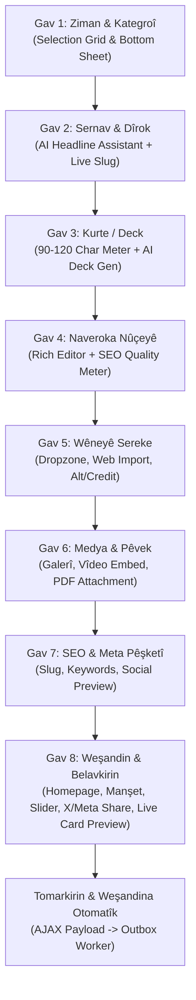

# Plan v1.0.68: Modernîzekirina Rûpela Nûçeyan (mod_news/add), Tevlibûna Amûran & Pîvanên Taste Skill UI/UX

**Armanc:** Rûpela lêkirina nûçeyan (`http://localhost:8080/tr/mod_news/add`) ya di Bulletin CMS de bê nûjenkirin da ku bikarhêner bikaribin hemû taybetiyên nûçeyan (galerî, dosye, vîdeo, manşet, slider, tevnên civakî, metadata, AI) bi hêsanî û bi sêwiraneke berbiçav (Taste Skill & Super Polish) li ser telefona desta (Phone-Only) bi rê ve bibin.  
**Guherto:** `v1.0.68`  
**Guhertoya Berê:** `v1.0.67` / `v1.0.66`  
**Pelên Armanc:**  
- `templates/admin/mod_news/add.twig`  
- `templates/admin/mod_news/edit.twig`  
- `templates/admin/partials/wizard_content.twig` (an `templates/admin/mod_news/wizard.twig`)  
- `templates/admin/assets/js/mod_news.js`  
- `templates/admin/assets/css/mod_news.css`  
- `templates/admin/assets/js/script.js` (parastina lihevhatinê an veqetandina wizardê mod_news)  
- `mod/mod_news/index.php`  
- `mod/mod_news/lang/{en,tr,ku,ckb,ar,fa,de,fr,ru,sv,zza}.php`  

---

## 1. Analîza Rûpelê & Kêmasiyên Amûran (Amûrên Kêm Kîjan In?)

Dema bikarhêner diçe `http://localhost:8080/tr/mod_news/add`, pergal bi rêya shell-a loaderê wizardekê vedike (`templates/admin/partials/wizard_content.twig` ku ji bo tevahiya modulên naverokê hevpar e). Lê belê di vê beşa lêkirinê de ji bo nûçeyan (`mod_news`) gelek kêmasiyên sereke hene:

### 1.1. Kêmasiyên Têkiliyên Medya û Modulan (Media & Relations Deficit)
Di bingeha daneyan (`mod_news`) de qadên girîng hene lê di rûpela lêkirinê (`add`) de bi tevahî hatine veşartin an jî bi sifir/vala (`gallery_id=0, file_id=0, video='', acl_id=0`) bi awayekî sabit (hardcoded) têne şandin:
1. **Galerî (`gallery_id`)**: Nûçeyek nikare ji bo xwe galeriya wêneyan hilbijêre an yekser biafirîne.
2. **Pel/Pêvek (`file_id` / mod_attachment)**: Bikarhêner nikare PDF, belge an pêvekên nûçeyê lê zêde bike.
3. **Vîdeo & Video Embed (`video`)**: Qada `video` a di mod_news de heye, lê di wizardê lêkirinê de tune ye; tenê piştî lêkirinê ji menuya context a lîsteyê dikare were girêdan.
4. **Destûra Gihîştinê (`acl_id`)**: Ji bo nûçeyên taybet (abonetî, gihîştina endaman) ti hilbijartin tune ye.

### 1.2. Kêmasiyên Weşan û Belavkirinê (Distribution & Placement Deficit)
1. **Zêdekirina Manşetê / Deck (`deck = y/n`)**: Di `edit.twig` de qerta hilbijartinê heye, lê di wizardê lêkirinê (`wizard_content.twig`) de `deck` bi `n` sabitkirî ye! Bikarhêner nikare dema nûçeyê dinivîse diyar bike ku ev nûçe 'deck' (manşeta pêşandî) ye an na.
2. **Hero Slider (`slider = y/n`)**: Di tabloyê de heye, lê di gava 8 (weşandin) de tenê `show_on_homepage` heye, amûra `slider` tune ye.
3. **Parvekirina Otomatîk a Medyaya Civakî (`social_channels[]`)**: Tevî ku di HTML-ya gava 8 de qertên x, facebook, instagram hatine danîn, di `templates/admin/assets/js/script.js` de di fonksiyona şandina AJAX-ê (`submitContentWizard`) de ev qad QET nayê berhevkirin (`formData.append('social_channels', ...)` tune ye)! Ango bikarhêner bifikire ku qertan nîşan dike, lê pergal wan bernade nav weşana civakî.

### 1.3. Kêmasiyên Amûrên Zîrekiya Çêkirî (AI Assistant)
Di rûpela serrastkirinê (`edit.twig`) de:
- `btnAiSuggestHeadlines` (pêşniyara sernavan ji nav naverokê)
- `btnAiGenerateDeck` (afirandina xulase/kurteya nûçeyê ji 90-120 tîpan)
hene. Lê belê di dema nûçeyê de çêdikin (`add`), ev amûr di wizardê de tune ne! Nivîskar dema nûçeyê dinivîse herî zêde di gava lêkirinê de hewcedarê pêşniyara sernav û kurteyê ye.

### 1.4. Kêmasiyên SEO û Pêşdîtinê (SEO & Real-time Preview)
Di wizardê de SEO bi temamî bi awayekî otomatîk ji sernav tê çêkirin (`makeSeoValue`), lê nivîskar nikare slug-a nûçeyê bibîne, nikare keywords an SEO meta bi destî destnîşan bike, û pêşdîtina Google SERP / WhatsApp / Twitter Card nabîne.

---

## 2. Çareseriyên Mîmarî (Ev Amûr Dê Çawa Çareser Bibin?)

Ji bo ku ev pirsgirêk li ser bingeheke paqij, zexm û li gorî pîvanên Amed Framework werin çareserkirin:

### 2.1. Veqetandina Wizard a mod_news (`mod_news_wizard`)
Niha `wizard_content.twig` ji aliyê `mod_publication` û `mod_page` ve jî tê parvekirin. Ji ber ku nûçe (`mod_news`) hewcedariyên taybet ên weşanê (manşet, slider, medya, tevnên civakî, AI, SEO) dixwaze:
- Di `templates/admin/mod_news/` de pergaleke modular an wizardeke xwerû ya 8-9 gavan tê rêxistinkirin.
- Ya jî `wizard_content.twig` bi şertê `` tê berfirehkirin û pêvajoya `mod_news.js` bi temamî şandina formê digire ser milê xwe.
- **Pêşniyara herî paqij:** Wekî çawa di `mod_event` de `mod_event_wizard.js` û `wizard_event.twig` hat çêkirin, ji bo nûçeyan jî `NewsWizardManager` tê çêkirin da ku `script.js` ya kevn nekeve nav şaşiyan û qadên `deck`, `slider`, `social_channels[]`, `gallery_id`, `file_id`, `video` hemû werin şandin.

### 2.2. Çareserkirina Entegrasyona Medyayê (Gallery, File, Video)
- Di gava nûçeyê de an di gava medyayê (Wêne) de:
  - **Pîlên Hilbijartinê yên M3**: Qertên "Pêvekirina Galeriyê", "Pêvekirina Belgeyê (PDF)", "Pêvekirina Vîdeoyê".
  - Bikarhêner dikare bi modalên sheet-ê (Bottom Sheet) ên xwerû yên Amed Framework vîdeo an galeriyê rasterast hilbijêre û id-ya wê bikeve nav hidden inputê.

### 2.3. Çareserkirina AI di Wizardê de
- Di Gava Sernavê (Step 3) de: Bişkoka `m3-ai-btn` a "Pêşniyara Sernavan" tê bicîhkirin.
- Di Gava Xulaseyê (Step 5) de: Bişkoka `m3-ai-btn` a "Xulaseya Zîrek Çêke" tê bicîhkirin.
- Ev amûr bi rêya endpointa amade ya `mod_news/ajax_ai_assist` dixebitin.

### 2.4. Çareserkirina Otomasyona Medyaya Civakî
- Di gava dawî de (Weşandin): Hemû kanalên hilbijartî (`social_channels[]`) û qada vebijarkî ya caption-a xwerû (`social_custom_caption`) dikevin nav `FormData`.
- Li ser backendê (`mod_news_mod::afterSave`), `NewsSocialShareService::enqueueForNews` vê yekê pêk tîne û dema nûçe tê weşandin yekser dikeve rêzê (outbox).

---

## 3. Pêdiviyên UI/UX: Taste Skill & Super Polish

Li gorî rêgezên **Taste Skill** (dijî "AI slop", pir paqij, zindî û tactile) û **Pîvana Admin Mobile-Only** a Amed Framework:

### 3.1. Rêgezên Tipografîk & Rîtmî (Spatial & Typographic Discipline)
- **44px+ Touch Targets**: Hemû bişkok, qertên hilbijartinê û kontrolên guhertinê li gorî tiliyên destan têne pîvandin (kêmanî 48px).
- **Rêjeya Reng û Berevaniyê (Contrast & Hierarchy)**: Ji sêwiranên boz û bêcan dûrketin; Material You / M3 bi rengê sereke (`#6750a4`), surface containers (`#f3edf7`, `#ece6f0`) û sînorên nazik (`outline-variant`).
- **Floating Labels & Micro-animations**: Dema bikarhêner binivîse, label bi nermî (cubic-bezier 0.4, 0, 0.2, 1) ber bi jor ve diçe; pîvana tîpan (char counter) bi zindî reng diguhere (kesk dema di navbera 90-120 de be, sor dema derbas bike).

### 3.2. Taybetmendiyên "Super Polish"
1. **Feedback-a Hestiyarî (Haptic & Visual Feedback)**:
   - Dema qertek tê tikandin (wek ziman, kategroî, manşet, tevnên civakî): `navigator.vibrate(15)` tê gazîkirin.
   - Nîşana `check-icon` bi lez û xweş tê pêşandan.
2. **Quality Meter (Pîvana Kalîteya Nûçeyê)**:
   - Di gava nivîsandina naverokê de (Step 6), pîvana kalîteyê ya zindî (jimara tîpan / 2,500, peyv, hejmara H2 sernavan) bi nîşanên "Baş", "Navîn", "Kêm" tê nîşandan.
3. **Pêşdîtina Kartê ya Zindî (Live News Card Preview)**:
   - Di gava dawî de berî weşandinê, qertek nûçeyê ya rastîn (wek li ser rûpela sereke ya `amedbulten.com` xuya dike) nîşan dide: Wêne, Sernav, Kategoriya bi reng, Dîrok û Kurte. Bikarhêner berî ku bişkoja Tomarkirinê bitikîne, tam dibîne bê wê nûçe çawa xuya bibe!

---

## 4. Mermaid Flowchart: Pêvajoya Wizard a Nûjenkirî (v1.0.68)

---

## 5. Plana Gav-bi-Gav a Bicihanînê (Implementation Steps)

1. **Step 1 - Berhevkirina Dîkşinêran (i18n Keys)**:
   - Zêdekirina hemû peyvên nû bo `mod/mod_news/lang/en.php` (û wergerandina bo `tr.php`, `ku.php`, hwd.) li gorî Prensîbên i18n Guard.
2. **Step 2 - Çêkirin/Nûjenkirina Şablonê (Add Wizard Template)**:
   - Ji nû ve sazkirina gavan di `templates/admin/partials/wizard_content.twig` an çêkirina `templates/admin/mod_news/wizard.twig`.
   - Bicîhkirina qertên Deck, Slider, Video, Gallery, File û kontrolên tora civakî.
   - Zêdekirina bişkokên alîkar ên AI di gava 2 û 3 de.
3. **Step 3 - JavaScript Controller (`templates/admin/assets/js/mod_news.js`)**:
   - Pêkanîna `NewsWizardManager` bi standardên Class-based, haptic feedback, berhevkirina tevahiya qadan di `FormData` de bêyî ku ti qad winda bibe.
   - Pêşdîtina zindî (Live Card Preview) li gava dawî.
4. **Step 4 - CSS / Taste Skill Styling (`templates/admin/assets/css/mod_news.css`)**:
   - Sêwirana qertên têkiliyê (video/gallery chips), styling-a pêşdîtina nûçeyê, anîmasyonên gavan û bersivdana 100% li ser ekranên mobîl.
5. **Step 5 - Kontrola Backend & Tests**:
   - Piştrastkirina `mod/mod_news/index.php` di dema qebûlkirina `add` de bi hemû qadan re.
   - Kontrolên ewlehiyê, parastina i18n, rêgezên koda veqetandî (`python3 tools/code_separation_guard.py`).
