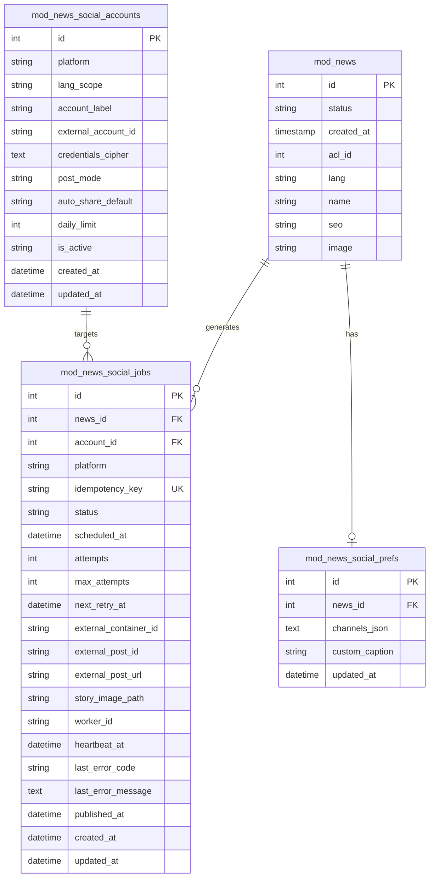
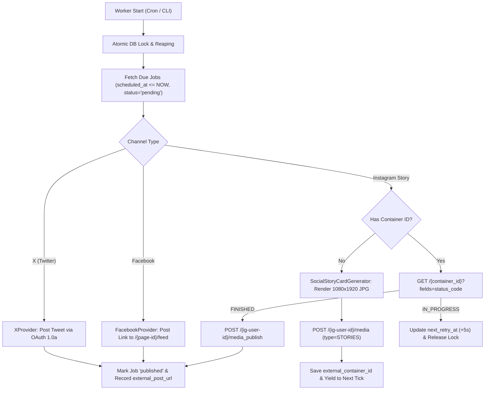

# Plan: `mod_news` Automated Social Sharing Architecture (X, Facebook Pages, Instagram Stories)

**Target Environment:** Local Docker stack (`bulletin_app` PHP 8.5.12, `bulletin_web` nginx 1.31.3, `bulletin_db` MySQL 8.0, database `bulletin`) & Host Linux (`PHP 8.5.4`)  
**Repository:** `AF/Bulletin` (`/home/malpersaz/Desktop/projects/htdocs/AF/Bulletin`)  
**Date:** 2026-11-11  
**Architecture Standards:** Amed Framework Core (Strict Code Separation, Phone-Only Admin Contract per `templates/admin/AGENTS.md` + `.agents/design/admin/DESIGN.md`, 100% English code/docs/DB columns, real i18n keys across all 11 locales, Wikipedia-style SEO URL preservation, Transactional Outbox pattern, zero autonomous sibling-repository access)  
**Status:** Planned / Architecture Specification  

---

## 0. Skills & Governance Statement (per `.gemini/GEMINI.md` & `AGENTS.md`)

| Skill / Guard | Relevance | Governance Requirement |
| :--- | :--- | :--- |
| `module-modernization-check` | **Governing Standard** | All new controllers and models must follow `BaseModuleController` and modern AF patterns. Shared-core files (e.g. `lib/BaseModuleController.class.php`) must remain untouched; all hooks are overridden within `mod/mod_news/index.php`. |
| `admin-mobile-check` | **Governing Standard** | All admin modifications under `templates/admin/mod_news/` and `templates/admin/partials/` must strictly adhere to the phone-only mobile viewport contract. |
| `i18n-guard` | **Governing Standard** | All new user-facing strings must have descriptive English keys in `en.php` and full 11-locale parity (`en, ku, tr, ar, ckb, de, fa, fr, ru, sv, zza`) with zero Twig default fallback strings. |
| `boundary-enforcer` | **Governing Standard** | No forbidden commercial or assessment modules (`mod_content`, `mod_product`, `mod_service`, etc.) may be referenced or imported. |
| `Strict Code Separation` | **Governing Standard** | No inline styles (`style="..."` or `<style>`) and no inline JavaScript (`onclick="..."` or `<script>`) in `.twig` or `.php` templates. All styles and scripts reside in external `.css` and `.js` bundles. |
| `Wikipedia-Style URLs` | **Governing Standard** | URLs must preserve original UTF-8 characters and casing, utilizing underscores instead of forced lowercase hyphenated slugs. |

---

## 1. Executive Summary & Problem Definition

### The Goal
Automatically publish news items created or approved in `mod_news` to:
1. **X (Twitter)** via API v2 (official tweet creation with large image link card preview).
2. **Facebook Pages** via Meta Graph API v27.0 (link feed post with high-resolution OpenGraph preview).
3. **Instagram Stories** via Meta Instagram Graph API v27.0 (branded 9:16 vertical visual story card at 1080x1920 sRGB JPEG).

### Why Synchronous Sharing in Admin HTTP Requests is Prohibited
Executing social network API calls synchronously inside the admin HTTP save request (`_add()` or `_edit()`) is strictly prohibited due to four fundamental failure modes:
1. **Extreme Latency & Gateway Timeouts:** Multi-layer 1080x1920 image rendering via `Imagick`, media uploads to X and Meta, Instagram media container status polling (`FINISHED`), and Facebook OpenGraph scrapes take between **8 to 25+ seconds**. This freezes the mobile admin UI and triggers Nginx/PHP-FPM `504 Gateway Timeout` errors.
2. **Double-Posting & Inconsistent State:** If saving an edit triggers synchronous API calls, every typo correction or status update would re-post the article to social media. Additionally, if X succeeds but Facebook times out, the entire database transaction could fail or leave channels out of sync.
3. **Premature OpenGraph Scraper Race Condition:** When a post is shared with a URL, Facebook and X immediately fetch the URL. If the database transaction has not fully committed or cache has not warmed, crawlers receive an HTTP 404 or incomplete HTML, permanently caching broken preview cards.
4. **Scheduled / Future News (`created_at > NOW()`):** In AF/Bulletin, `mod_news.created_at` represents the publication datetime. Articles scheduled for future publication cannot be shared immediately; they must be dispatched only after their scheduled time arrives.

### Solution: Transactional Outbox + CLI/Cron Background Worker
We implement a resilient **Transactional Outbox Queue** using dedicated database tables (`mod_news_social_jobs`, `mod_news_social_accounts`, and `mod_news_social_prefs`) paired with an asynchronous background worker (`tasks/social_share_worker.php` and `GET /cron/social`).

---

## 2. Platform Realities & API Specifications (2025/2026 Verified)

### A. X (Twitter) API v2
- **Endpoint:** `POST https://api.x.com/2/tweets`
- **Authentication:** **OAuth 1.0a User Context** (Consumer Key, Consumer Secret, Access Token, Access Token Secret with HMAC-SHA1 signature).
  - *Rationale:* OAuth 1.0a tokens never expire on a clock, eliminating the complex background token rotation and race conditions inherent in OAuth 2.0 PKCE single-use refresh tokens.
- **Pay-Per-Use Pricing Protection:**
  - X has deprecated the legacy Free write tier. New developer accounts operate on a prepaid credit pay-per-use model (~$0.015 for plain text/media, ~$0.200 per post containing a link).
  - *Requirement:* The system must support a configurable per-account `daily_limit` counter and an explicit global kill-switch to avoid accidental API credit exhaustion.
- **Link Card Preview vs. Native Media:**
  - **Mode A (Link Card - Recommended Default):** Post body formatted as `"<Headline>\n\n<Article_URL>"`, sent *without* `media_ids`. X scrapes the article's `twitter:card=summary_large_image` and `twitter:image` tags. Tapping anywhere on the large card takes the reader directly to the website (1-tap outbound traffic).
  - **Mode B (Native Media Attachment):** Uploads an image via `POST https://api.x.com/2/media/upload` and attaches `media_ids`. Note: Native media suppresses the clickable link card, requiring users to tap the plain text link in the tweet body.

### B. Facebook Pages (Meta Graph API v27.0)
- **Endpoint:** `POST https://graph.facebook.com/v27.0/{page-id}/feed`
- **Authentication:** **Meta Business Portfolio System User Access Token (SUAT)** with permissions `pages_manage_posts` and `pages_read_engagement`.
  - *Rationale:* System User Access Tokens generated within Meta Business Settings can be set to **Never expire**, remaining unaffected by human administrator password changes or 60-day OAuth token expirations.
- **Post Format:** Link feed post with parameters:
  - `message`: Headline or summary
  - `link`: Absolute canonical article URL (normalized via `Helper::sitemap_url()`)
  - `published`: `true`
  - Facebook automatically crawls OpenGraph metadata (`og:title`, `og:description`, `og:image`).

### C. Instagram Stories (Meta Instagram Graph API v27.0)
- **Prerequisites:** Instagram Professional (Business) account linked to the Meta Business Portfolio / Facebook Page.
- **Publishing Endpoints:**
  1. *Create Media Container:* `POST https://graph.facebook.com/v27.0/{ig-user-id}/media` with `media_type=STORIES` and `image_url=<Public_HTTPS_URL>`. Returns `{"id": "<container_id>"}`.
  2. *Poll Container Status:* `GET https://graph.facebook.com/v27.0/{container_id}?fields=status_code`. Poll every 3–5 seconds until `status_code === "FINISHED"`.
  3. *Publish Container:* `POST https://graph.facebook.com/v27.0/{ig-user-id}/media_publish` with `creation_id=<container_id>`.
- **Critical Limitations & Technical Workarounds:**
  1. **No Clickable Link Stickers via API:** Meta's official Graph API strictly prohibits adding interactive link stickers to Stories. Furthermore, Story posts do not have a text caption field.
  2. **JPEG Requirement:** Instagram Graph API strictly rejects `.webp` files (returns HTTP 400); it requires sRGB JPEG format under 8 MB.
  3. **Workaround Strategy (The 9:16 Branded Story Card + Bio Bridge):**
     - Dynamically generate a high-impact vertical 1080x1920 sRGB JPEG card using `\Imagick`.
     - Prominently feature a localized call-to-action on the card (e.g. *"Read full story via link in bio"* in Kurdish/Turkish).
     - Provide a dedicated, ultra-fast, mobile-first landing route (`/bio` and `/{lang}/bio`) displaying the latest Instagram-shared news items with matching thumbnails. When an Instagram user taps the profile's bio link, the story's corresponding article appears at the very top.

---

## 3. Image Processing & Visual Story Card Pipeline

### Runtime Extension Baseline
- Verification confirms that PHP extension `gd` is **not loaded** on the Linux host environment (`extension_loaded('gd') === false`), whereas **`imagick` (ImageMagick 7.1.2-18 Q16)** is fully loaded on both the host and Docker container (`bulletin_app`).
- Legacy `AmedResize` relies on GD and must not be used. The entire visual story pipeline must be built with native `\Imagick`, `\ImagickDraw`, and `\ImagickPixel`.

### Font Management & Multi-Language Support
To avoid reliance on inconsistent OS-level font installations across development and production environments, bundled TrueType fonts will be stored directly in the repository under:
`templates/base_static/fonts/social/`
- `NotoSans-Bold.ttf` (Latin, Cyrillic, Kurdish Kurmanji/Zazaki, Turkish, German, French, Swedish)
- `NotoSans-Regular.ttf`
- `NotoNaskhArabic-Bold.ttf` (Arabic, Kurdish Sorani, Persian RTL text shaping)

### 9:16 Story Card Composition Architecture (`lib/SocialStoryCardGenerator.class.php`)
The generator renders a `1080x1920` canvas adhering to Instagram's UI safe zones:
1. **Background Canvas (1080x1920):**
   - Source featured WebP image is loaded, aspect-fill scaled, cropped to 1080x1920, and processed with Gaussian blur (`blurImage(40, 20)`).
   - An overlay scrim is applied (`rgba(10, 12, 18, 0.74)`) for optimal contrast.
2. **Safe Zones (Critical for Instagram Mobile UI):**
   - Top `250px`: Kept clear of text (reserved for Instagram account header, avatar, and timestamp).
   - Bottom `320px`: Kept clear of critical text (reserved for Instagram's "Send message" reply bar).
3. **Branded Masthead (y: 260px):**
   - Brand logo (`static/mod_settings/logo.png`) and localized category badge pill.
4. **Hero Image Card (y: 360px):**
   - Featured image rendered as a sharp 16:9 box (`960x540px`) with `24px` rounded corners and a subtle drop shadow.
5. **Wrapped Multi-Line Headline (y: 960px):**
   - Article title (`d.name`), word-wrapped to a maximum of 4 lines using `NotoSans-Bold.ttf` (or Arabic font for RTL languages) at font size 44pt with clean line spacing.
6. **Call-To-Action (CTA) Pill (y: 1480px):**
   - Rounded pill displaying localized text:
     - Kurdish (Kurmanji): *"Nûçeyê di lînka profîlê de bixwîne"*
     - Turkish: *"Haberin detayları profildeki linkte"*
     - English: *"Read full article via link in bio"*
     - Plus domain branding badge (`domain.com/bio`).
7. **Storage & Cleanup:**
   - Saved as `static/mod_news/story/story_{news_id}_{md5_hash}.jpg` (publicly accessible via `{$site['iaddress']}mod_news/story/...`).
   - Automatically pruned by the background worker 72 hours after successful publishing to prevent disk bloat.

### High-Resolution OpenGraph JPEG (`1200x630`)
- Because social crawlers (X Twitterbot and Facebook externalhit) occasionally fail on WebP images, the service will also generate a companion `1200x630` JPEG version (`static/mod_news/og/{image_basename}.jpg`) exposed via `og:image` and `twitter:image`.

---

## 4. Database Schema Design

The schema is dual MySQL 8.0 (InnoDB, `utf8mb4`) and SQLite compatible. It avoids modifying the existing `newses` SQL view (`mod/mod_news/model/newses.model.php`), ensuring backward compatibility.

### Table 1: `mod_news_social_accounts`
Stores social media credentials and platform configuration.
- `id` (INT UNSIGNED AUTO_INCREMENT PRIMARY KEY)
- `platform` (VARCHAR(32) NOT NULL) — `'x'`, `'facebook'`, `'instagram_story'`
- `lang_scope` (VARCHAR(12) NOT NULL DEFAULT `'*'`) — `'*'` for all languages, or specific locale (`'ku'`, `'tr'`, `'en'`)
- `account_label` (VARCHAR(120) NOT NULL)
- `external_account_id` (VARCHAR(128) NULL) — Facebook Page ID or Instagram Business User ID
- `credentials_cipher` (TEXT NOT NULL) — Encrypted JSON payload (Consumer keys, SUAT tokens)
- `post_mode` (VARCHAR(32) NOT NULL DEFAULT `'link_card'`) — `'link_card'` or `'native_media'`
- `auto_share_default` (ENUM('y','n') NOT NULL DEFAULT `'y'`)
- `daily_limit` (INT UNSIGNED NOT NULL DEFAULT 50)
- `is_active` (ENUM('y','n') NOT NULL DEFAULT `'n'`)
- `created_at` (DATETIME NOT NULL)
- `updated_at` (DATETIME NOT NULL)

### Table 2: `mod_news_social_prefs`
Stores per-article sharing preferences selected by the editor during authoring.
- `id` (INT UNSIGNED AUTO_INCREMENT PRIMARY KEY)
- `news_id` (INT UNSIGNED NOT NULL UNIQUE)
- `channels_json` (TEXT NOT NULL) — JSON array of enabled account IDs
- `custom_caption` (VARCHAR(500) NULL)
- `updated_at` (DATETIME NOT NULL)

### Table 3: `mod_news_social_jobs`
Transactional outbox table tracking publishing execution, retries, and audit history.
- `id` (BIGINT UNSIGNED AUTO_INCREMENT PRIMARY KEY)
- `news_id` (INT UNSIGNED NOT NULL, INDEX)
- `account_id` (INT UNSIGNED NOT NULL, INDEX)
- `platform` (VARCHAR(32) NOT NULL)
- `idempotency_key` (VARCHAR(160) NOT NULL UNIQUE) — Format: `news:{news_id}:acct:{account_id}`
- `status` (VARCHAR(24) NOT NULL DEFAULT `'pending'`) — `'pending'`, `'processing'`, `'published'`, `'failed'`, `'cancelled'`, `'skipped'`
- `scheduled_at` (DATETIME NOT NULL, INDEX) — `MAX(NOW(), created_at) + 15 seconds`
- `attempts` (TINYINT UNSIGNED NOT NULL DEFAULT 0)
- `max_attempts` (TINYINT UNSIGNED NOT NULL DEFAULT 4)
- `next_retry_at` (DATETIME NULL, INDEX)
- `external_container_id` (VARCHAR(128) NULL) — Instagram container creation ID
- `external_post_id` (VARCHAR(128) NULL)
- `external_post_url` (VARCHAR(500) NULL)
- `story_image_path` (VARCHAR(255) NULL)
- `worker_id` (VARCHAR(64) NULL)
- `heartbeat_at` (DATETIME NULL)
- `last_error_code` (VARCHAR(64) NULL)
- `last_error_message` (TEXT NULL)
- `published_at` (DATETIME NULL)
- `created_at` (DATETIME NOT NULL)
- `updated_at` (DATETIME NOT NULL)

---

## 5. AF/Bulletin Codebase Integration Points

To preserve framework architecture (`lib/BaseModuleController.class.php` as an upstream shared-core asset), all lifecycle hooks are implemented directly within `mod/mod_news/index.php`.

### A. Lifecycle Hook Overrides in `mod_news_mod` (`mod/mod_news/index.php`)
1. **`afterSave($model)`:**
   - Invoked after a new news article is inserted.
   - Evaluates sharing eligibility:
     - Is `status === 'y'`?
     - Is `acl_id === 0`?
     - Does the category hierarchy permit public viewing (`_checkCategoryHierarchyPermission()`)?
   - If eligible, calculates `scheduled_at = MAX(NOW(), $model->created_at) + 15s` and inserts pending job rows into `mod_news_social_jobs` using `INSERT IGNORE` with the unique `idempotency_key`.
   - If `status === 'n'` (draft/staging), persists selections to `mod_news_social_prefs`.
2. **`afterUpdate($model, $id)`:**
   - Detects status transitions from draft (`'n'`) to published (`'y'`).
   - If transitioning to published, enqueues pending jobs based on `mod_news_social_prefs`.
   - Idempotency guarantee: already-published jobs (`status = 'published'`) are never re-enqueued on subsequent article updates.
3. **`toggleFlag('status', ...)` & `approve()`:**
   - Catches mobile toolbar quick-actions (e.g. eye toggle on `list.twig` or MCP approval) and triggers outbox enqueueing.
4. **`afterDelete($id)`:**
   - Cancels pending or queued jobs for the deleted article.

### B. URL Generation & Encoding (Wikipedia-Style)
In strict compliance with **`AGENTS.md` Rule 9**, URLs preserve original UTF-8 characters and casing, replacing spaces with underscores.
- Canonical URL Construction:
  `$rawUrl = rtrim($site['address'], '/') . '/' . $news['lang'] . '/news/' . $news['seo'];`
- RFC 3986 Path Segment Normalization:
  `$shareUrl = Helper::sitemap_url($rawUrl);`
  This guarantees that Kurdish/Turkish characters (`ş, î, ê, û, ç, ğ, ı, ö, ü`) are cleanly normalized without double-encoding, ensuring X and Meta scrapers resolve the target correctly.

---

## 6. Background Worker & Outbox Engine

### Worker Architecture (`tasks/social_share_worker.php`)
Modelled after `tasks/agent_worker.php`, supporting `--once`, `--daemon`, and `--limit=N`.

### Worker Lifecycle Rules
1. **Concurrency Control:**
   - Uses atomic row-level reservation:
     `UPDATE mod_news_social_jobs SET status='processing', worker_id=:wid, heartbeat_at=NOW() WHERE status='pending' AND scheduled_at <= NOW() AND (next_retry_at IS NULL OR next_retry_at <= NOW()) ORDER BY scheduled_at ASC LIMIT 5`
2. **Instagram Container Polling State Machine:**
   - Creating a container and waiting for processing must not block other worker tasks.
   - When a container is created, the worker persists `external_container_id`, sets `next_retry_at = NOW() + 5s`, and returns the job to `pending`.
   - On the next tick, the worker checks container status. If `FINISHED`, it proceeds to `/media_publish`.
3. **Failure Classification & Exponential Backoff:**
   - *Transient Errors (HTTP 429, 5xx, Network Timeout):*
     Increments `attempts` and calculates exponential backoff:
     `$delay = min(10800, pow(4, $attempts) * 60);` (e.g. 4m, 16m, 64m).
     If X returns HTTP 429, respects the `x-rate-limit-reset` header.
   - *Permanent Errors (HTTP 401/403 Invalid Credentials, Meta Error 190 Expired Token, depleted credit):*
     Immediately marks job as `'failed'` (`attempts = max_attempts`), records error diagnostics, and alerts administrators.
4. **Web Cron Support:**
   - Extends `cron_manager_helper::render()` (`mod/index/helper/cron_manager.helper.php`) by registering target `'social'` (`GET /cron/social`). Allows shared hosting environments without CLI access to trigger jobs securely using token authentication (`X-Cron-Token`).

---

## 7. Admin UI Contract (Phone-Only & Strict Code Separation)

All admin UI additions strictly comply with **`AGENTS.md` Rules 1, 5, and 6**:
- Views are designed exclusively for phone viewports (`templates/admin/`).
- Zero inline styles (`style="..."` or `<style>`) and zero inline scripts (`onclick="..."` or `<script>`).
- All styles live in `templates/admin/assets/css/mod_news.css` (and minified companion).
- All interactions live in `templates/admin/assets/js/mod_news.js`.

### UI Integration Touchpoints
1. **Add News Wizard (`templates/admin/partials/wizard_content.twig` - Step 8 "Publish"):**
   - Displays a `.selection-grid` containing touch-friendly platform `.selection-card` toggles (X, Facebook, Instagram Story) with icons and auto-share badges.
   - Handled via `data-action="toggle-social-channel"`.
2. **Edit News Form (`templates/admin/mod_news/edit.twig` - Card 4 "Publishing Decision"):**
   - Renders platform selection cards.
   - If jobs exist for the article, displays a compact status indicator:
     - **Pending / In Queue:** Yellow pill with countdown.
     - **Published:** Green pill with an outbound link to the live social post.
     - **Failed:** Red pill showing the sanitized error reason, accompanied by a touch-friendly *"Retry"* button (`data-action="retry-social-job"`).
3. **Channel Settings Panel (`mod_news_social_accounts`):**
   - Dedicated mobile-first management view for configuring accounts, testing connections via AJAX (`data-action="test-social-connection"`), setting daily limits, and masking API credentials.

---

## 8. Implementation Phases & Verification Checklist

### Phase 1: Database & Foundation
- [ ] Create migration script `installer/mod_news/sql/social_tables.sql` establishing the 3 tables.
- [ ] Implement `mod_news_social_accounts_model` and `mod_news_social_jobs_model`.
- [ ] Add `AMED_SOCIAL_SECRET_KEY` configuration handling with OpenSSL/Sodium encryption helper.
- [ ] Stage TrueType fonts in `templates/base_static/fonts/social/`.

### Phase 2: Service Layer & Image Pipeline
- [ ] Implement `lib/SocialStoryCardGenerator.class.php` using pure `\Imagick` + `\ImagickDraw`.
- [ ] Implement provider clients:
  - `lib/SocialProviders/XProvider.class.php` (OAuth 1.0a HMAC-SHA1).
  - `lib/SocialProviders/FacebookPageProvider.class.php` (Meta Graph API).
  - `lib/SocialProviders/InstagramStoryProvider.class.php` (Container + Publish flow).
- [ ] Implement `lib/NewsSocialShareService.class.php` (Outbox dispatch and state transitions).

### Phase 3: Controller Hooking & Bio Landing Bridge
- [ ] Add `afterSave()`, `afterUpdate()`, and `afterDelete()` overrides in `mod/mod_news/index.php`.
- [ ] Hook mobile list status toggle `toggleFlag()` in `mod/mod_news/index.php`.
- [ ] Register route `/bio` and `/{lang}/bio` in `config/url.config.php` and implement public landing template.

### Phase 4: Background Worker & Cron
- [ ] Implement CLI worker `tasks/social_share_worker.php`.
- [ ] Add target `'social'` to `cron_manager_helper` (`mod/index/helper/cron_manager.helper.php`).
- [ ] Test container status polling, retry backoff, and idempotent locking.

### Phase 5: Admin UI & Multi-Language Localization
- [ ] Update `templates/admin/partials/wizard_content.twig` (Step 8).
- [ ] Update `templates/admin/mod_news/edit.twig` (Card 4).
- [ ] Update `templates/admin/assets/js/mod_news.js` and `templates/admin/assets/css/mod_news.css`.
- [ ] Add all required English language keys to `mod/mod_news/lang/en.php`.
- [ ] Propagate translations to all 10 remaining locales (`ku, tr, ar, ckb, de, fa, fr, ru, sv, zza`).

### Phase 6: Quality Gates & Verification
- [ ] Run `python3 tools/code_separation_guard.py` (Verify zero inline styles/scripts).
- [ ] Run `python3 tools/min_css_guard.py` (Verify minified CSS parity).
- [ ] Run `python3 tools/i18n_guard.py --path mod/mod_news/` (Verify zero missing keys or non-English identifiers).
- [ ] Run `python3 tools/module_boundary_guard.py` (Verify zero forbidden module leaks).
- [ ] Run `php -l` on all created and modified PHP files.
- [ ] Verify phone-only admin layout rendering.
