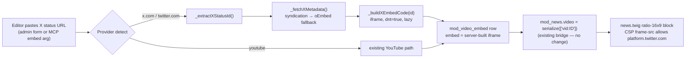

# Plan: X (Twitter) Video Embed Provider Support — `mod_video_embed` Provider Layer, CSP & Purifier Frame Policy

**Target Domain:** `https://amedbulten.com`
**Repository:** `AF/Bulletin`
**Version:** Unassigned (deliberate — version numbering deferred to release planning per editor request)
**Target Surface:** `docker/nginx/prod.conf`, `lib/Helper.class.php`, `mod/mod_video_embed/` (controller + validators + lang ×10), `lib/McpVideoTools.class.php`, `templates/admin/mod_video_embed/`, `templates/amed/index/mod_news/news.twig`
**Date:** 2026-11-10
**Architecture Standard:** Amed Framework Core (Strict Code Separation — no `<script>` in content; MCP Bridge Non-Bypass Contract; server-side embed construction over client-trusted iframe strings)
**Origin:** Editorial request to attach the X video post `https://x.com/claudeai/status/2119899459761131615` (Claude Fable 5.2 pre-release projects, verified video tweet, `created_at` 2026-11-09T21:06:31Z) to draft news `mod_news#109`. Current CMS cannot ingest X-hosted video.

---

## 1. Executive Summary & Component Map

`mod_news` → `mod_video_embed` attachment already works through serialized `vid:ID` keys (`BaseModuleController::serializeVideos`, admin picker `all_video()`, MCP `serializeVideoRefs`, frontend `indexBase::_mod_video()` → theme `video` context). The gaps are provider-level: `mod_video_embed`'s import pipeline is YouTube-hardcoded, the HTML purifier's iframe whitelist excludes X, the production CSP has no `frame-src` directive (blocking **all** third-party iframes, including existing YouTube embeds — a pre-existing bug), and X's official embed markup requires `widgets.js`, which violates both Strict Code Separation and the CSP `script-src` policy.

**Chosen approach: script-free X iframe.** X serves a first-party embed frame that needs no `widgets.js`:

```
https://platform.twitter.com/embed/Tweet.html?id=<status_id>&theme=light&dnt=true
```

Endpoint verification (2026-11-10, this environment):

| Endpoint | Result |
| :--- | :--- |
| `platform.twitter.com/embed/Tweet.html?id=2119899459761131615&theme=light&dnt=true` | **HTTP 200 `text/html`** — renderable as a plain iframe |
| `cdn.syndication.twimg.com/tweet-result?id=…&token=a` | **200 JSON** — `text`, `created_at`, `favorite_count`, media (`…/video/1`), preview assets → metadata source |
| `publish.twitter.com/oembed?url=…` | Empty from this network — keep as secondary fallback only |

| # | Component | Files | Change type |
| :-: | :--- | :--- | :--- |
| 1 | CSP `frame-src` directive (pre-existing iframe bug) | `docker/nginx/prod.conf:43` | [FIX] |
| 2 | Purifier `URI.SafeIframeRegexp` extension | `lib/Helper.class.php:391` | [MODIFY] |
| 3 | X provider layer (extract / build / fetch metadata) | `mod/mod_video_embed/index.php` | [MODIFY] |
| 4 | `duration` requirement relaxation for X source | `mod/mod_video_embed/validator/{add,edit}.validator.php`, `lib/McpVideoTools.class.php::requireDuration` | [MODIFY] |
| 5 | MCP server-side X URL → iframe construction | `lib/McpVideoTools.class.php` (`createVideoEmbed` / `updateVideoEmbed`) | [MODIFY] |
| 6 | Admin form parity (import button, live preview) | `templates/admin/mod_video_embed/{add,edit}.twig`, `templates/admin/assets/js/mod_video_embed_edit.js`, `templates/admin/partials/wizard_video_embed.twig` | [MODIFY] |
| 7 | Language strings for X import | `mod/mod_video_embed/lang/*.php` (10 languages) | [ADD] |
| 8 | News-detail render fallback link (optional polish) | `templates/amed/index/mod_news/news.twig:439-442` | [OPTIONAL] |



---

## 2. Non-Goals (Explicit)

1. **`mod_news` schema or bridge changes** — the `vid:ID` binding, admin picker, MCP `video` argument, and frontend `_mod_video()` fetch already support embedded videos end-to-end. Zero changes.
2. **`widgets.js`-based official embed markup** (blockquote + script) — violates Strict Code Separation (no inline/external scripts in content) and the CSP `script-src 'self' 'unsafe-inline'` policy. Rejected by design.
3. **`hero_slider.twig` embed URL whitelist parity** (`templates/amed/index/hero_slider.twig:26-29` whitelists youtube/vimeo/dailymotion) — sliders need autoplay/background semantics that X's frame does not offer; out of scope.
4. **`mod_popup` video enum extension** (`enum('url','youtube','vimeo','instagram')`) — unrelated surface; only revisit if a popup needs an X video.
5. **Version assignment** — deferred per editor request; this plan carries no version number.

---

## 3. Component 1: CSP `frame-src` Fix (Pre-Existing Bug)

**Problem (evidence):** `docker/nginx/prod.conf:43` sends:

```
Content-Security-Policy "default-src 'self'; script-src 'self' 'unsafe-inline'; style-src 'self' 'unsafe-inline'; img-src 'self' data: https:; font-src 'self'; connect-src 'self';"
```

No `frame-src`/`child-src` → falls back to `default-src 'self'` → every third-party iframe is blocked, **including YouTube embeds already stored in `mod_video_embed`**. This plan's X iframe cannot render until this ships.

**[FIX] `docker/nginx/prod.conf`:** append a `frame-src` directive:

```
frame-src https://www.youtube.com https://www.youtube-nocookie.com https://player.vimeo.com https://platform.twitter.com;
```

**Acceptance criteria:**
1. `curl -sI https://amedbulten.com | grep content-security-policy` shows the `frame-src` list after deploy.
2. An existing YouTube `mod_video_embed` record renders in a browser on production (regression check for the pre-existing bug).
3. No other directive weakened.

---

## 4. Component 2: Purifier Iframe Whitelist

**Problem (evidence):** `lib/Helper.class.php:391`:

```php
$config->set('URI.SafeIframeRegexp', '%^(https?:)?//(www\.youtube\.com/embed/|player\.vimeo\.com/video/)%');
```

Any X iframe pasted into a purified body field (`content` of news/publication/video_embed via `Helper::clear_html`) is stripped. The `embed` column itself is stored raw (admin-trusted), but body-content policy must stay consistent with what the theme is allowed to render.

**[MODIFY] `lib/Helper.class.php`:**

```php
$config->set(
    'URI.SafeIframeRegexp',
    '%^(https?:)?//(www\.youtube\.com/embed/|www\.youtube-nocookie\.com/embed/|player\.vimeo\.com/video/|platform\.twitter\.com/embed/)%'
);
```

(`youtube-nocookie` added for parity with hardened YouTube embeds.)

**Acceptance criteria:**
1. `Helper::clear_html('<iframe src="https://platform.twitter.com/embed/Tweet.html?id=1"></iframe>')` preserves the iframe.
2. Arbitrary hosts (e.g. `evil.example/embed/`) remain stripped.

---

## 5. Component 3: X Provider Layer in `mod_video_embed`

**Problem (evidence):** `mod/mod_video_embed/index.php` hardcodes YouTube: `_extractYouTubeId()` (watch / embed / shorts / live regexes), `_buildEmbedCode()` (YouTube iframe), `_fetchYouTubeMetadata()` (Data API → oEmbed → page scrape). The MCP `create_video_embed` schema says "Embed code or URL" but the handler stores the string verbatim — a pasted URL renders as plain text, not a frame.

**[MODIFY] `mod/mod_video_embed/index.php`:**

1. `_extractXStatusId($input): ?string` — accept post URLs and bare IDs:

   ```
   ~^(?:https?://)?(?:www\.|m\.)?(?:x|twitter)\.com/(?:#!/)?[A-Za-z0-9_]{1,15}/status(?:es)?/(\d{5,25})~i
   ```

2. `_buildXEmbedCode($statusId): string` — **server-side** iframe construction only:

   ```html
   <iframe width="550" height="640" style="max-width:100%" src="https://platform.twitter.com/embed/Tweet.html?id={ID}&theme=light&dnt=true&embedId=amedbulten&maxwidth=550" title="{name}" frameborder="0" allowfullscreen loading="lazy" referrerpolicy="strict-origin-when-cross-origin"></iframe>
   ```

   - `dnt=true` (Do Not Track) is a privacy requirement, not an option.
   - Fixed generous height: X frames resize internally; the news theme's `ratio-16x9` wrapper crops gracefully for video tweets.

3. `_fetchXMetadata($statusId): array` — chain, mirroring `_fetchYouTubeMetadata`'s degraded-success pattern:
   - **Primary:** `https://cdn.syndication.twimg.com/tweet-result?id={ID}&token=a` (verified working) → `text` (name/summary source, truncated to 255), `created_at` (prefill), `favorite_count` (description enrichment), media preview URL (thumbnail download through the existing image pipeline → `static/mod_video_embed/`).
   - **Fallback:** `https://publish.twitter.com/oembed?url=…&dnt=true` (blocked from this network at plan time; may work from the production host — degrade to manual entry, never hard-fail).
   - Duration: syndication `video_info` duration (ms) → `HH:MM:SS` when available; otherwise `00:00` (see Component 4).

4. Provider dispatch in the import AJAX: detect X first (`x.com|twitter.com` host match), else existing YouTube path. Response payload keeps the established shape (`embed`, `original`, `image`, `source: 'x'`, `duration_available`).

**Acceptance criteria:**
1. Admin import AJAX with `https://x.com/claudeai/status/2119899459761131615` returns a prefilled form: name (tweet text ≤255), `original` = tweet URL, `embed` = server-built iframe, thumbnail downloaded, duration `00:00` or measured.
2. YouTube import path unchanged (regression).
3. No `<script>` ever stored in `embed` (assert in validator).

---

## 6. Component 4: `duration` Requirement Relaxation

**Problem (evidence):** `mod_video_embed.duration` is `VARCHAR(8) NOT NULL`; admin validators require `sure` (`add.validator.php` L53-64, mirror in `edit.validator.php`); MCP `requireDuration()` (`lib/McpVideoTools.class.php` L1783-1791) enforces 5-8 chars. X metadata may not expose duration → editors are forced to invent one.

**[MODIFY]:**
- Admin `add`/`edit` validators: `duration` stays required, but X-sourced submissions may submit `00:00` (5 chars — passes the existing length rule; no schema change needed).
- MCP `requireDuration()`: unchanged signature; `createVideoEmbed`/`updateVideoEmbed` default to `00:00` when the resolved provider is X and no duration was supplied.

**Acceptance criteria:**
1. MCP `create_video_embed` with an X URL and no `duration` succeeds (`00:00` stored).
2. Non-X records keep the 5-8 char enforcement.

---

## 7. Component 5: MCP Server-Side X URL Construction

**Problem (evidence):** `createVideoEmbed()` stores `embed` verbatim; a bare URL would reach the theme as text. Client-supplied raw iframe strings also sit in a trusted column that renders `|raw`.

**[MODIFY] `lib/McpVideoTools.class.php`:**
- In `createVideoEmbed` / `updateVideoEmbed`, before storing: if `embed` (or `original`) matches the X status pattern, replace `embed` with the server-built iframe and set `original` to the canonical `https://x.com/<user>/status/<id>` URL. Purely additive detection — all other strings flow through unchanged.
- Update tool `description`/`embed` property text: "Embed code or URL (YouTube iframe/URL, or an X (Twitter) post status URL — the iframe is built server-side)".
- Optional `source` output field (`youtube|x|raw`) in the create response for pipeline logging.

**Acceptance criteria:**
1. `create_video_embed(embed: "https://x.com/claudeai/status/2119899459761131615", …)` stores a `platform.twitter.com/embed/Tweet.html` iframe, never the raw URL.
2. Client-supplied arbitrary iframes for non-X inputs behave exactly as before (no new trust boundary removed, no new one added).

---

## 8. Component 6: Admin Form Parity

**Problem (evidence):** `templates/admin/mod_video_embed/add.twig:115-118` + `edit.twig:114-129` render the embed textarea and `{{ d.embed|raw }}` preview; `assets/js/mod_video_embed_edit.js:323-328` fills fields from the import response; the wizard partial (`wizard_video_embed.twig:61-68`) duplicates the flow.

**[MODIFY]:**
- Import button label/hint accept X URLs (lang-driven — Component 7).
- Live preview already renders any iframe (`mod_video_embed.css:526-530`); the X frame appears once CSP on the site origin permits it (Component 1).

**Acceptance criteria:** preview shows the X frame on add/edit after Component 1 ships.

---

## 9. Component 7: Language Strings (10 Languages)

**[ADD] in `mod/mod_video_embed/lang/{ar,ckb,de,en,es,fr,ru,sv,tr,zza}.php`:**
- `import.button_x` / `import.hint_x` variants mirroring the existing `import.button` / `import.hint` keys (e.g. tr: "X'ten Getir" / "Başlık, açıklama ve kapak görselini otomatik doldurmak için bir X (Twitter) gönderi adresi yapıştırın.").
- Validation message reuse: existing `validator.required` strings cover the new paths; no new error codes.

---

## 10. Component 8 (Optional): News-Detail Fallback Link

**Evidence:** `templates/amed/index/mod_news/news.twig:439-442` already renders attached embeds inside `ratio-16x9`, injecting `loading="lazy"` + `title`. X video tweets render correctly in that wrapper.

**[OPTIONAL]:** append a small "X'te izle →" anchor (to `original` when present) under the frame — accessibility/no-JS fallback and referral path. Only if editorial wants it; not a blocker.

---

## 11. Verification Plan (News #109 Pilot)

1. **CSP:** header check (Component 1 acceptance) + YouTube embed regression.
2. **Purifier:** throwaway check: `Helper::clear_html()` keeps the X iframe, strips an unknown host.
3. **Provider:** admin import AJAX with the pilot URL → prefilled form → save.
4. **MCP:** `create_video_embed` with the bare X URL → stored `embed` contains `platform.twitter.com/embed/Tweet.html?id=2119899459761131615`; then `update_news(id: 109, video: "vid:<new_id>")`.
5. **Render:** browser check of the news #109 draft preview (admin session) — frame loads, no CSP console violations, lazy-loads.
6. **Editorial pipeline note:** kevrast/kevtemen cannot fetch `x.com` from this environment; the server-side metadata fetch at creation time doubles as the embed's liveness check. News body claims must keep anchoring to secondary sources (already the case for #109).

## 12. Rollout Order & Risk

| Order | Component | Risk | Notes |
| :-: | :--- | :--- | :--- |
| 1 | CSP fix (C1) | Low, immediate user-facing win | Fixes existing YouTube embed breakage; deploy header first |
| 2 | Purifier (C2) | Low | Additive regexp |
| 3 | Provider layer (C3) + lang (C7) | Medium | New external HTTP dependency (syndication) — reuse `_httpGetJson()` timeouts/caching pattern from `_fetchYouTubeMetadata` |
| 4 | Validators (C4) + MCP (C5) | Low | Mirrors admin parity contract |
| 5 | Admin parity (C6) + optional fallback (C8) | Low | Presentation only |

External-dependency risk: `cdn.syndication.twimg.com` and `platform.twitter.com` are undocumented-but-stable endpoints (used by react-tweet); if either changes, degradation is metadata/manual-entry only — rendering keeps working for stored frames.

---

**Signature:** `omp/glm-5.3/2026-11-10/x-video-embed-mod-video-embed-provider-plan`
