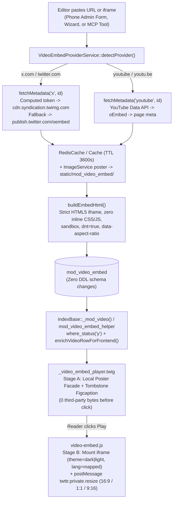

# Plan: X (Twitter) Video Embed Provider Architecture — Multi-Provider Layer, Privacy-First Facade, Mobile-First UX, Structured Data & Hardened Frame Policy

**Target Domain:** `https://amedbulten.com`
**Repository:** `AF/Bulletin`
**Version:** Unassigned (deliberate — version numbering deferred to release planning per editorial request)
**Target Surface:**
- Infrastructure & Core Security: `docker/nginx/prod.conf`, `lib/Helper.class.php`, `lib/VideoEmbedProviderService.class.php` `[NEW]`
- Backend Module & MCP: `mod/mod_video_embed/index.php`, `mod/mod_video_embed/validator/{add,edit}.validator.php`, `mod/mod_video_embed/lang/*.php` (11 locales), `lib/McpVideoTools.class.php`
- Phone-Only Admin Surface: `templates/admin/mod_video_embed/{add,edit}.twig`, `templates/admin/partials/wizard_video_embed.twig`, `templates/admin/layout.twig`, `templates/admin/assets/css/mod_video_embed.css`, `templates/admin/assets/js/mod_video_embed_edit.js`, `templates/admin/assets/js/script.js`
- Public Frontend, SEO & Multilingual Surface: `mod/index/indexBase.php`, `mod/index/helper/mod_video_embed.helper.php`, `mod/index/helper/legal.helper.php`, `mod/index/lang/*.php` (10 locales), `templates/amed/layouts/base.twig`, `templates/amed/partials/_video_embed_player.twig` `[NEW]`, `templates/amed/static/css/video-embed.css` `[NEW]`, `templates/amed/static/js/video-embed.js` `[NEW]`, `templates/amed/index/mod_news/news.twig`, `templates/amed/index/mod_publication/publication.twig`, `templates/amed/index/mod_event/event.twig`, `templates/amed/index/mod_video_embed/{video,videos,latest_videos}.twig`
**Date:** 2026-11-10
**Architecture Standard:** Amed Framework Core (`AGENTS.md` Rules #1–#9: Strict Code Separation — zero inline CSS/JS and zero third-party embed scripts; Phone-Only Admin Surface; Descriptive English i18n Keys; MCP Bridge Non-Bypass Contract; WCAG 2.2 AA; GDPR & KVKK Data Minimization)
**Origin:** Editorial request to attach the verified X video post `https://x.com/claudeai/status/2119899459761131615` (`created_at` `2026-11-09T21:06:31Z` = `2026-11-10T00:06:31+03:00` `Europe/Istanbul`, duration `47,666 ms` / `00:48`, aspect ratio `16:9`) to draft news `mod_news#109`, while establishing a durable, newsroom-grade multi-provider video embed architecture across `AF/Bulletin`.

---

## 1. Executive Summary & Architectural Pillars

`mod_news` (along with `mod_publication` and `mod_event`) already attaches embedded videos via serialized `vid:ID` references (`BaseModuleController::serializeVideos`, admin picker `all_video()`, MCP `serializeVideoRefs`, and frontend `indexBase::_mod_video()`). However, a full-stack audit uncovered critical gaps across provider ingestion, security headers, mobile rendering, structured data, and localization:

1. **Pre-Existing CSP Outage (`docker/nginx/prod.conf:43`):** Production `Content-Security-Policy` defines `default-src 'self'` with **no `frame-src` directive**, blocking all third-party iframes — including existing YouTube records in `mod_video_embed`.
2. **HTMLPurifier Override Bug (`lib/Helper.class.php:376-391`):** `Helper::clear_html()` sets `HTML.SafeIframe = true`, but manually overrides `HTML.AllowedElements` (line 376) and `HTML.AllowedAttributes` (line 377) **without `iframe`**, causing HTMLPurifier to strip iframes or discard required accessibility/security attributes, while `URI.SafeIframeRegexp` (line 391) excludes `platform.twitter.com` and `youtube-nocookie.com`.
3. **YouTube-Hardcoded Ingestion & MCP Gap (`mod/mod_video_embed/index.php`, `lib/McpVideoTools.class.php`):** `_extractYouTubeVideoId()` (line 1045) and `mod_video_embed_edit.js:164` reject X URLs (triggering a false invalid-YouTube modal on paste in admin), while `McpVideoTools::createVideoEmbed()` (line 1289) stores bare URLs verbatim as plain text and notifies a non-existent `/videos/embed/...` 404 route to Google Indexing API (lines 1370, 1391, 1479, 1507 instead of `/video/...` per `config/url.config.php:81`).
4. **Severe Mobile Clipping & Malformed HTML Bug (`news.twig:440-441`, `publication.twig:343-344`, `event.twig:229-230`, `video.twig:115-116`):** Wrapping `platform.twitter.com/embed/Tweet.html` inside Bootstrap `.ratio.ratio-16x9.overflow-hidden` crushes full X post cards (header + text + player + footer = `460px–780px`, frequently `1:1` or `9:16` vertical) into a **~181px-tall box on 360px phones**, clipping controls completely. Simultaneously, `v.embed|replace({'iframe': 'iframe loading="lazy" title="' ~ v.name ~ '"'})` corrupts closing tags (`</iframe loading="lazy"...>`) and breaks DOM attributes whenever headlines contain double quotes.
5. **Broken `VideoObject` JSON-LD & `00:00` Duration Regressions (`news.twig:237-251`, `video.twig:39-72`, `latest_videos.twig:54`):** `news.twig` points `VideoObject` for `mod_video_embed` items to `tools/videoResim` and `tools/videoFlv` (`mod/tools/index.php:349,412`), which query `mod_video` only and send `X-Robots-Tag: noindex, nofollow` (lines 403, 468); `uploadDate` lacks timezone offset; `video.twig` has zero `VideoObject` schema despite being listed in `videoSitemap.xml` (`mod/index/index.php:1235`); and unguarded `00:00` fallback durations cause Google Search Console `PT0S` errors and fake `00:00` UI badges.

### Five Engineering Pillars of This Plan

| Pillar | Design Choice | Outcome |
| :--- | :--- | :--- |
| **1. Effortless Editor & MCP Workflow** | Unified smart paste/input bar with instant provider pill, 1-tap phone clipboard button, 3-tap `mod_news` modal quick-attach, and 1-call MCP URL ingestion | Zero separate buttons; pasting any YouTube or X URL auto-fills title, provenance, real duration, SEO, and local cover image |
| **2. Best Modern Technology & Security** | Shared `VideoEmbedProviderService`, computed `react-tweet` syndication token, SSRF-hardened cURL, Redis/file caching, strict HTML5 `sandbox` iframe, zero `widgets.js`, zero inline CSS/JS | 100% `AGENTS.md` Rule #1 & `code_separation_guard.py` compliance; hardened CSP & HTMLPurifier |
| **3. Privacy-First Click-to-Load Facade** | Server-rendered first-party poster card (`static/mod_video_embed/`) + explicit user click-to-mount iframe + `window.postMessage` dynamic height sync | **0 bytes** fetched from X/YouTube before click (LCP/INP/CLS win + strict GDPR & KVKK Art. 9 compliance with `dnt=true`) |
| **4. World-Class Journalism & SEO** | Valid `VideoObject` JSON-LD on articles & watch pages, tombstone-resilient verbatim quote + local poster archival, WCAG 2.2 AA controls | Deleted/geo-walled X posts retain verified quote, `@handle`, timestamp, and cached keyframe; zero GSC schema warnings |
| **5. Mobile-First & Multilingual Excellence** | Adaptive `.video-embed-stage--x` container + `twttr.private.resize` listener (`16:9`, `1:1`, `9:16`), dark/light theme sync, phone-only admin cleanup, 11 admin / 10 public locales + RTL (`ar`, `ckb`) | Pixel-accurate X playback on 360px–430px phones without clipping, blinding white cards in dark mode, or BiDi handle scrambling |

### Component Map

| # | Component | Target Files | Action |
| :-: | :--- | :--- | :---: |
| 1 | Production CSP `frame-src` fix | `docker/nginx/prod.conf:43` | `[FIX]` |
| 2 | HTMLPurifier `iframe`, `time`, `bdi` & HTTPS host allowlist | `lib/Helper.class.php:373-402` | `[MODIFY]` |
| 3 | Shared multi-provider service, syndication token & SSRF-safe HTTP | `lib/VideoEmbedProviderService.class.php` | `[NEW]` |
| 4 | `mod_video_embed` controller, validators & duration rules | `mod/mod_video_embed/index.php`, `mod/mod_video_embed/validator/{add,edit}.validator.php` | `[MODIFY]` |
| 5 | MCP server-side URL ingestion, schema, auto-poster & indexing URL fix | `lib/McpVideoTools.class.php:416, 526-536, 1289-1523, 1783` | `[MODIFY]` |
| 6 | Phone-only admin UX, 1-tap paste & wizard Rule #1 remediation | `templates/admin/mod_video_embed/{add,edit}.twig`, `templates/admin/partials/wizard_video_embed.twig`, `templates/admin/layout.twig`, `templates/admin/assets/css/mod_video_embed.css`, `templates/admin/assets/js/{mod_video_embed_edit,script}.js` | `[MODIFY]` |
| 7 | Public facade player, `postMessage` resize, mobile & listing UX | `mod/index/indexBase.php:215-270`, `mod/index/helper/mod_video_embed.helper.php`, `templates/amed/partials/_video_embed_player.twig` `[NEW]`, `templates/amed/static/css/video-embed.css` `[NEW]`, `templates/amed/static/js/video-embed.js` `[NEW]`, `templates/amed/index/mod_news/news.twig`, `templates/amed/index/mod_publication/publication.twig`, `templates/amed/index/mod_event/event.twig`, `templates/amed/index/mod_video_embed/{video,videos,latest_videos}.twig` | `[NEW]` / `[MODIFY]` |
| 8 | `VideoObject` JSON-LD, OpenGraph & Tombstone Provenance | `templates/amed/index/mod_news/news.twig:63-106, 237-251`, `templates/amed/index/mod_video_embed/video.twig:25-72` | `[MODIFY]` |
| 9 | Localization (11 admin + 10 public), RTL `dir`/`bdi` & KVKK notice | `mod/mod_video_embed/lang/*.php` (11), `mod/index/lang/*.php` (10), `mod/index/helper/legal.helper.php`, `templates/amed/layouts/base.twig:2` | `[MODIFY]` |



---

## 2. Explicit Non-Goals

1. **Zero Database DDL Migration:** Existing `mod_video_embed` columns (`mod/mod_video_embed/mod_video_embed.sql`: `id`, `lang`, `category_id`, `name`, `original`, `duration`, `created_at`, `status`, `embed`, `content`, `title`, `keywords`, `description`, `image`, `acl_id`, `user_id`, `slider`) already store every required field cleanly. Aspect ratio and provider identifiers live as HTML5 `data-*` attributes on the server-built `<iframe>` in `embed`.
2. **Zero `mod_news` Bridge Changes:** Serialized `vid:ID` binding in `mod_news.video`, `mod_publication.video`, and `mod_event.video` works end-to-end without schema edits.
3. **No `widgets.js` Official X Script Markup:** X's `<blockquote class="twitter-tweet">` + `platform.twitter.com/widgets.js` architecture violates `AGENTS.md` Rule #1, breaks `script-src`, and injects heavy third-party tracking scripts on page load. Rejected by design.
4. **No Direct `video.twimg.com/*.mp4` Storage or Hotlinking:** X MP4 stream URLs carry short-lived CDN tokens that expire rapidly and create copyright/hotlink liability. Bulletin stores only the first-party poster image locally and renders playback through X's official `platform.twitter.com/embed/Tweet.html` player.
5. **Out-of-Scope Unrelated Surfaces:** `templates/amed/index/hero_slider.twig` background autoplay loops and `mod_popup` video enums remain unchanged unless separately requested.
6. **No Version Bump:** Version assignment is deferred per editorial request (`config/site.config.php` and `docs/VERSION.md` untouched).

---

## 3. Component 1: Production CSP `frame-src` Fix (`[FIX]`)

**Problem (verified):** `docker/nginx/prod.conf:43` currently emits:

```nginx
add_header Content-Security-Policy "default-src 'self'; script-src 'self' 'unsafe-inline'; style-src 'self' 'unsafe-inline'; img-src 'self' data: https:; font-src 'self'; connect-src 'self';" always;
```

Because neither `frame-src` nor `child-src` is declared, browsers fall back to `default-src 'self'`, blocking **every** external `<iframe>` on production — including existing YouTube embeds.

**Change (`docker/nginx/prod.conf:43`):** Append an explicit HTTPS `frame-src` allowlist while keeping `default-src`, `script-src`, `style-src`, and `connect-src 'self'` completely unweakened (requests inside the iframe execute under `platform.twitter.com`'s own document CSP, not the parent page's `connect-src`):

```nginx
add_header Content-Security-Policy "default-src 'self'; script-src 'self' 'unsafe-inline'; style-src 'self' 'unsafe-inline'; img-src 'self' data: https:; font-src 'self'; connect-src 'self'; frame-src 'self' https://www.youtube.com https://www.youtube-nocookie.com https://player.vimeo.com https://platform.twitter.com;" always;
```

**Acceptance Criteria:**
1. `curl -sI https://amedbulten.com | grep -i content-security-policy` includes `frame-src 'self' https://www.youtube.com https://www.youtube-nocookie.com https://player.vimeo.com https://platform.twitter.com;`.
2. Existing YouTube and new X embeds render with zero browser console CSP violations.

---

## 4. Component 2: HTMLPurifier Safe-Iframe & Provenance Element Policy (`[MODIFY]`)

**Problem (verified):** `lib/Helper.class.php:373-402` (`Helper::clear_html`) contains two defects:
1. Lines 376–377 explicitly set `$element` (`HTML.AllowedElements`) and `$attr` (`HTML.AllowedAttributes`) **without `iframe`**, `time`, or `bdi`. When `HTML.AllowedElements` is manually restricted, `HTML.SafeIframe = true` (line 388) fails to preserve `<iframe>` or strips modern accessibility/security attributes (`title`, `class`, `loading`, `allow`, `referrerpolicy`, `allowfullscreen`, `sandbox`). Similarly, `<time datetime="...">` and `<bdi dir="ltr">` in `mod_video_embed.content` provenance snapshots are stripped.
2. Line 391 restricts `URI.SafeIframeRegexp` to `%^(https?:)?//(www\.youtube\.com/embed/|player\.vimeo\.com/video/)%` (allowing insecure `http://` and omitting `youtube-nocookie.com` and `platform.twitter.com/embed/Tweet.html`).

**Change (`lib/Helper.class.php:373-402`):**
1. Append `,iframe,time,bdi` to `$element` and append **all** allowed iframe/provenance attributes to `$attr` (`HTML.AllowedAttributes` strips any attribute omitted from `$attr` even when registered on the definition): `,iframe.src,iframe.width,iframe.height,iframe.title,iframe.class,iframe.loading,iframe.allow,iframe.referrerpolicy,iframe.allowfullscreen,iframe.sandbox,iframe.data-provider,iframe.data-status-id,iframe.data-aspect-ratio,time.datetime,bdi.dir,span.dir`.
2. Configure custom HTML5 element/attribute definitions safely under `HTML 4.01 Transitional` (`Cache.DefinitionImpl` is already `null` on line 381) by setting `$config->set('HTML.DefinitionID', 'af-clear-html')` and `$config->set('HTML.DefinitionRev', 1)`, then inside `if ($def = $config->maybeGetRawHTMLDefinition())`:
   - Register `$def->addElement('time', 'Inline', 'Inline', 'Common', ['datetime' => 'Text'])` and `$def->addElement('bdi', 'Inline', 'Inline', 'Common', ['dir' => 'Enum#ltr,rtl,auto'])` (preventing HTMLPurifier unsupported-element PHP warnings under HTML 4.01 Transitional).
   - Register `$def->addAttribute('iframe', ...)` for `loading` (`Enum#lazy,eager`), `allow` (`Text`), `referrerpolicy` (`Text`), `allowfullscreen` (`Bool`), `sandbox` (`Text`), `data-provider` (`Text`), `data-status-id` (`Text`), and `data-aspect-ratio` (`Text`).
3. Tighten `URI.SafeIframeRegexp` to HTTPS-only exact provider paths:

```php
$config->set(
    'URI.SafeIframeRegexp',
    '%^https://(www\.youtube\.com/embed/|www\.youtube-nocookie\.com/embed/|player\.vimeo\.com/video/|platform\.twitter\.com/embed/Tweet\.html)%'
);
```

**Acceptance Criteria:**
1. `Helper::clear_html()` preserves `<iframe src="https://platform.twitter.com/embed/Tweet.html?id=2119899459761131615&amp;dnt=true" title="..." loading="lazy"></iframe>`, `<time datetime="2026-11-09T21:06:31Z">`, and `<bdi dir="ltr">@claudeai</bdi>`.
2. `Helper::clear_html()` strips `http://` iframes, non-`Tweet.html` paths on `platform.twitter.com`, arbitrary third-party hosts, inline event handlers, and `<script>` tags.

---

## 5. Component 3: Shared Multi-Provider Service (`lib/VideoEmbedProviderService.class.php` `[NEW]`)

Instead of duplicating regexes, cURL logic, and HTML string builders across `mod/mod_video_embed/index.php`, `lib/McpVideoTools.class.php`, and `mod/index/`, create `lib/VideoEmbedProviderService.class.php` `[NEW]` as the single source of truth.

### 5.1 Provider Detection & URL Normalization (`detectProvider`)

Accepts raw URLs, mobile/short links, or pasted `<iframe>` snippets (HTML-entity decoded first), stripping tracking query parameters (`?s=20&t=...`):
- **X / Twitter (`provider = 'x'`):**
  - `https://(www.|m.|mobile.)?(x|twitter).com/<handle>/status(es)?/<status_id>`
  - `https://(x|twitter).com/i/(web/)?status/<status_id>`
  - `https://platform.twitter.com/embed/Tweet.html?id=<status_id>`
  - Regex captures 5–25 digit snowflake `status_id` (`\d{5,25}`) and optional `handle` (`[A-Za-z0-9_]{1,15}`, excluding `/i/`). Canonicalizes `original` to `https://x.com/{handle_or_i}/status/{status_id}` (upgraded to `https://x.com/{user.screen_name}/status/{id_str}` once syndication JSON resolves).
- **YouTube (`provider = 'youtube'`):** Consolidates existing `_extractYouTubeVideoId()` (`mod/mod_video_embed/index.php:1045`) supporting `watch?v=`, `youtu.be/`, `shorts/`, `live/`, `embed/`, and `youtube-nocookie.com/embed/`.
- **Vimeo (`provider = 'vimeo'`):** Recognizes `vimeo.com/<digits>` and `player.vimeo.com/video/<digits>` for embed validation/enrichment parity.

### 5.2 Exact `react-tweet` Syndication Token Calculation (`computeXSyndicationToken`)

Hardcoding `token=a` on `cdn.syndication.twimg.com/tweet-result` is fragile under X CDN rate-limiting. `VideoEmbedProviderService` computes the deterministic base-36 `react-tweet` token (`((Number(id) / 1e15) * Math.PI).toString(36).replace(/(0+|\.)/g, '')`), bit-identical to V8 JavaScript across both pre-Snowflake IDs (`20` → `6dq1a2xwd93`, `1234567890` → `6iio5bzbwyw`) and modern Snowflake IDs (`2119899459761131615` → `54zuzapoqz5`, verified `HTTP 200 application/json`):

```php
public static function computeXSyndicationToken(string $statusId): string
{
    $num = ((float) $statusId / 1e15) * M_PI;
    if ($num <= 0.0 || !is_finite($num)) {
        return 'a';
    }
    while ($num < 1.0) {
        $num *= 36.0;
    }
    $intPart = (int) floor($num);
    $fracPart = $num - $intPart;
    $base36Int = base_convert((string) $intPart, 10, 36);
    $fracDigits = max(0, 11 - strlen($base36Int));
    $scale = 36 ** $fracDigits;
    $scaledFrac = (int) round($fracPart * $scale);
    if ($fracDigits > 0 && $scaledFrac >= $scale) {
        $intPart++;
        $base36Int = base_convert((string) $intPart, 10, 36);
        $scaledFrac = 0;
    }
    $base36Frac = $fracDigits > 0
        ? str_pad(base_convert((string) $scaledFrac, 10, 36), $fracDigits, '0', STR_PAD_LEFT)
        : '';

    return preg_replace('/(0+|\.)/', '', $base36Int . '.' . $base36Frac) ?: 'a';
}
```

### 5.3 Metadata Chain, Aspect Ratio & Tombstone-Resilient Provenance (`fetchMetadata`)

1. **Cache Layer (`lib/Cache.class.php:25-87` contract):** Set `Cache::$ttl = 3600;` and check `Cache::exists($cacheKey)` before calling `Cache::get($cacheKey)` (`$cacheKey = 'video_embed_meta_x_' . $statusId`), because in file-cache fallback mode `Cache::get()` does not evaluate expiry unless `Cache::exists()` runs first; store fetched DTOs via `Cache::set($payload, $cacheKey, 3600)` (note parameter order: `$data` first, `$key` second; uses `RedisCache` when enabled, file cache otherwise).
2. **Primary Endpoint:** `https://cdn.syndication.twimg.com/tweet-result?id={STATUS_ID}&token={TOKEN}&lang=en`
   - **Tombstone / Non-Video Guards:** If `__typename === 'TweetTombstone'` or HTTP 404, throws a typed `autofill.tombstone_error` exception for UI feedback. If the post contains only static photos or text without `video` / `mediaDetails[*].type === 'video'` (or `animated_gif`), surfaces `autofill.no_video_in_post`.
   - **Clean Headline & Description:** Expands `entities.urls`, strips trailing media `https://t.co/\S+` links, strips unsupported 4-byte emojis (`_stripEmojiAndUnsupportedChars` parity), and word-truncates `name` cleanly via `Helper::truncateWords($cleanText, 120)` (hard cap `255`) and `description` via `Helper::truncateWords($cleanText, 200)`.
   - **Measured Duration:** Reads `video.durationMs` or `mediaDetails[0].video_info.duration_millis` (e.g., `47666` ms → `48s` → `'00:48'`). Falls back to `'00:00'` **only** when duration milliseconds are absent or syndication is unreachable.
   - **Intrinsic Aspect Ratio:** Reads `video.aspectRatio` or `mediaDetails[0].video_info.aspect_ratio` (`[W, H]`) and normalizes to `'16:9' | '9:16' | '1:1' | '4:5'` (default `'16:9'`).
   - **High-Res First-Party Poster:** Extracts `video.poster` or `mediaDetails[0].media_url_https` (`https://pbs.twimg.com/...`) for local download into `static/mod_video_embed/` (`1280×720`) and `static/mod_video_embed/thumb/` (`640×360`) via `ImageService`.
   - **Tombstone-Proof `content_html` Snapshot:** Builds purified semantic HTML preserving journalistic provenance even if the X post is later deleted:

```html
<blockquote><p>"Full verbatim post text with expanded entity links"</p></blockquote>
<p><strong>Source:</strong> Claude (<bdi dir="ltr">@claudeai</bdi>) — X, <time datetime="2026-11-09T21:06:31Z">2026-11-10 00:06</time></p>
```

3. **Secondary Fallback:** `https://publish.twitter.com/oembed?url={CANONICAL_URL}&dnt=true&omit_script=true` — parses `author_name`, `author_url`, and stripped blockquote text if syndication fails. If both endpoints fail (network outage), returns a degraded partial DTO (`duration = '00:00'`, server-built `embed_html`, `is_partial = true`) so editors are never blocked from saving.

### 5.4 Strict Code Separation HTML5 Iframe Construction (`buildEmbedHtml` & `sanitizeOrRebuildEmbed`)

- **Zero inline `style="..."`**, **zero `frameborder="0"`**, **zero `<script>`** (`AGENTS.md` Rule #1 & `tools/code_separation_guard.py` verified):

```html
<iframe class="video-embed-frame video-embed-frame--x" width="550" height="620" src="https://platform.twitter.com/embed/Tweet.html?id=2119899459761131615&amp;theme=light&amp;dnt=true&amp;hideThread=true&amp;lang=tr" data-provider="x" data-status-id="2119899459761131615" data-aspect-ratio="16:9" title="Claude (@claudeai) — X video" allow="autoplay; encrypted-media; picture-in-picture; fullscreen" sandbox="allow-scripts allow-same-origin allow-popups allow-popups-to-escape-sandbox allow-presentation" loading="lazy" referrerpolicy="strict-origin-when-cross-origin" allowfullscreen></iframe>
```

- YouTube embeds generated by `buildEmbedHtml('youtube', ...)` are simultaneously modernized from `mod/mod_video_embed/index.php:1086` to remove obsolete `frameborder="0"`, add `class="video-embed-frame video-embed-frame--youtube"`, use privacy-enhanced `https://www.youtube-nocookie.com/embed/{VIDEO_ID}?rel=0`, and set escaped descriptive `title`.
- **Locale Mapping (`mapLocaleToXLang`):** Maps Bulletin's locales deterministically to X's supported UI chrome locales: `tr => tr`, `en => en`, `ar => ar`, `de => de`, `fr => fr`, `ru => ru`, `sv => sv`, `es => es`, and `ku => en`, `ckb => en`, `zza => en` (preventing Kurdish pages from showing mislabeled Turkish/Arabic inner X chrome while Bulletin's outer facade, buttons, and captions render natively in `ku`, `ckb`, and `zza`).
- **`sanitizeOrRebuildEmbed($embedInput, $originalUrl, $opts)`:** Whenever `embedInput` or `originalUrl` matches a registered provider URL or iframe, rebuilds the canonical server-side `<iframe>` from scratch. For custom embeds, parses via `DOMDocument` to enforce a single `<iframe>` matching the HTTPS allowlist (`youtube.com/embed/`, `youtube-nocookie.com/embed/`, `player.vimeo.com/video/`, `platform.twitter.com/embed/Tweet.html`), rejecting `<script>`, `javascript:`, `data:`, inline `on*=`, and inline `style=`.

### 5.5 SSRF & DoS Hardening on Outbound HTTP

Replaces the permissive cURL helper in `mod/mod_video_embed/index.php:1209-1268` (`20s` timeout, unrestricted redirect protocols, uncapped body size) with hardened outbound rules inside `VideoEmbedProviderService`:
1. `CURLOPT_PROTOCOLS => CURLPROTO_HTTPS`, `CURLOPT_REDIR_PROTOCOLS => CURLPROTO_HTTPS`, `CURLOPT_MAXREDIRS => 3`.
2. Strict hostname allowlist (`cdn.syndication.twimg.com`, `publish.twitter.com`, `pbs.twimg.com`, `www.googleapis.com`, `www.youtube.com`, `i.ytimg.com`) + pre-connect DNS check (`gethostbynamel`) rejecting private, loopback, link-local, and cloud-metadata IPs via `filter_var($ip, FILTER_VALIDATE_IP, FILTER_FLAG_NO_PRIV_RANGE | FILTER_FLAG_NO_RES_RANGE)`.
3. Fast fail timeouts so PHP-FPM workers never stall: `CURLOPT_CONNECTTIMEOUT => 3`, `CURLOPT_TIMEOUT => 6` (JSON) / `8` (thumbnails).
4. Streaming byte cap (`512 KB` JSON, `5 MB` images) + `getimagesizefromstring()` MIME verification (`image/jpeg`, `image/png`, `image/webp`) before passing thumbnails to `ImageService`.

---

## 6. Component 4: `mod_video_embed` Controller, Validators & Duration Rules (`[MODIFY]`)

1. **Controller Refactor (`mod/mod_video_embed/index.php`):**
   - Delegate `autofill_metadata()` (line 175), `_add()` (line 381), and `_edit()` (line 512) to `VideoEmbedProviderService`.
   - In `_add()` and `_edit()`, pass submitted `embed` and `original` through `VideoEmbedProviderService::sanitizeOrRebuildEmbed()` before saving so even direct form submissions without AJAX autofill convert bare URLs into clean server-built iframes.
   - Response JSON from `autofill_metadata()` preserves backward-compatible keys while adding `provider` (`'x' | 'youtube'`), `aspect_ratio` (`'16:9' | '9:16' | '1:1' | '4:5'`), `author_handle`, and `duration_available` (`bool`).
   - **Rule #6 Touched-File Cleanup (`mod/mod_video_embed/index.php:634`):** Replace legacy Turkish `echo 'HATA';` in `delete()` with `echo 'ERROR';` (matching `publish()`/`unpublish()` and `CODE_QUALITY_AGENT_STRATEGY.md`).
2. **Validators (`mod/mod_video_embed/validator/add.validator.php` & `edit.validator.php`):**
   - Keep `sure` (`duration`, `VARCHAR(8) NOT NULL`) required (5–8 chars `MM:SS` or `HH:MM:SS`), allowing `'00:00'` when X duration metadata is unavailable (zero schema changes required; frontend/JSON-LD guards in Components 7 & 8 suppress `'00:00'` from display and `VideoObject.duration`).
   - Add embed security validation via `VideoEmbedProviderService::sanitizeOrRebuildEmbed()` so any `<script>`, inline `style=`, inline `on*=`, or untrusted iframe host fails validation cleanly with a localized error message.

---

## 7. Component 5: MCP Server-Side Ingestion, Auto-Poster & Indexing Fix (`[MODIFY]`)

**Problem (verified):**
1. `lib/McpVideoTools.class.php::createVideoEmbed()` (line 1289) and `updateVideoEmbed()` (line 1383) store `embed` verbatim — passing `"https://x.com/claudeai/status/2119899459761131615"` stores a plain URL string instead of an iframe, and `requireDuration()` (line 1783) throws an exception if `duration` is omitted.
2. Lines **1370, 1391, 1479, and 1507** call `$this->notifyGoogleIndexing($model->lang . '/videos/embed/' . $id . '-' . Helper::legacy_seo($model->name), ...)` — `/videos/embed/...` is a **404 route**! The canonical route in `config/url.config.php:81` and `videoSitemap.xml` (`mod/index/index.php:1235`) is `/video/{id}-{seo}`.

**Changes (`lib/McpVideoTools.class.php`):**
1. **Server-Side Provider Resolution & Sanitization:** In `createVideoEmbed()` and `updateVideoEmbed()`, inspect `embed` and `original` via `VideoEmbedProviderService::detectProvider()`.
   - When an X or YouTube URL (or iframe) is detected:
     - Fetch cached provider metadata via `VideoEmbedProviderService::fetchMetadata($provider, $id, $lang)` whenever `duration`, `image`, `name`, `content`, or SEO fields are omitted.
     - Populate real `duration` (e.g. `'00:48'` from `durationMs` on pilot post `#2119899459761131615`), defaulting to `'00:00'` for X **only** if `duration` was omitted and syndication metadata had no duration.
     - **1-Call Auto-Poster Import:** When `image` argument is omitted and metadata exposes `thumbnail_url`, automatically download and process the cover image into `static/mod_video_embed/` (`self::EMBED_IMAGE_SIZES`) so MCP-created embeds always have a first-party poster for the facade and `VideoObject.thumbnailUrl`.
     - Rebuild `embed` via `VideoEmbedProviderService::buildEmbedHtml()` and set `original` to the canonical post URL (`https://x.com/claudeai/status/2119899459761131615`).
   - For raw custom iframes, enforce `VideoEmbedProviderService::sanitizeOrRebuildEmbed()` parity with admin validators.
2. **Tool JSON Schema & Validation (`lib/McpVideoTools.class.php:416, 526-536`):** Narrow `create_video_embed`'s JSON Schema `required` array (`lines 526-536`) from the 9-field list (`name`, `lang`, `category_id`, `duration`, `embed`, `content`, `title`, `keywords`, `description`) to `['lang', 'category_id', 'embed']` so 1-call URL ingestion passes MCP schema validation; inside `createVideoEmbed()`, run provider metadata enrichment first and then enforce non-empty validation on `name`, `duration`, `content`, `title`, `keywords`, and `description` (ensuring raw custom non-provider iframes still require all metadata fields). Update `embed` property description in both `create_video_embed` and `update_video_embed` to document server-built YouTube/X URL support, and include `provider` (`'x' | 'youtube' | 'vimeo' | 'custom'`) in returned `item` metadata.
3. **Fix Google Indexing Canonical Route (Lines 1370, 1391, 1479, 1507):** Replace `'/videos/embed/'` with `'/video/'` across create, update, and delete notifications.

---

## 8. Component 6: Effortless Editor UX & Phone-Only Admin Surface (`[MODIFY]`)

Per `AGENTS.md` Rule #5 (`templates/admin/` is strictly a **360px–430px phone-only** product surface) and `.agents/skills/admin-mobile-check/SKILL.md`:

### 8.1 Unified Smart Source Bar & 3-Tap Phone Workflow (`add.twig`, `edit.twig`, `mod_video_embed_edit.js`)

Note on existing codebase reality: `templates/admin/mod_video_embed/{add,edit}.twig` already uses debounced paste/input auto-detection (`mod_video_embed_edit.js:391-435`), **not** a separate import button. Adding a second "Import from X" button would add mobile clutter. Instead:

1. **Phone-First Smart Toolbar Above `#embedInput` (`add.twig:114-135`, `edit.twig:114-135`):**
   - Render a compact flex toolbar (`min-height: 44px`, wrap-safe at `360px`) containing:
     - **Live Provider Pill (`#embedProviderBadge`):** Updates instantly on paste/input (`Link / Embed` → `<i class="bi bi-twitter-x"></i> X` or `<i class="bi bi-youtube"></i> YouTube` or `Custom`).
     - **1-Tap Clipboard Paste Button (`#btnPasteClipboard`):** `min-height: 44px; min-width: 44px` M3 tonal pill calling `navigator.clipboard.readText()` (with graceful focus fallback if clipboard permission is denied) + a `44×44px` clear/re-sync icon button (`#btnClearEmbedSource`). Eliminates awkward long-press-paste inside a small textarea on phones.
     - **Collapsible Raw Code Toggle (`#btnToggleRawEmbed`):** Once a pasted URL expands into a server-built `<iframe>`, collapses `#embedInput` behind an optional toggle while displaying the clean canonical URL in `#originalInput` (keeping `<textarea name="embed" id="embedInput">` in DOM for form submission).
2. **Unified JS Detector (`templates/admin/assets/js/mod_video_embed_edit.js`, bump `?v=2.6` → `?v=2.7`):**
   - Replace `extractYouTubeVideoId()` (lines 164, 404, 432) with `detectVideoSource(input)` returning `{ provider: 'x' | 'youtube', id, cacheKey }`.
   - Remove the false 800ms invalid-YouTube warning modal when pasting an `x.com` or `twitter.com` URL (lines 413–418) and stop line 297 from overwriting `originalInput` with `https://www.youtube.com/watch?v=...` when `provider === 'x'`.
   - Silently populate `durationInput.value = data.duration || '00:00'` for X posts without popping up a blocking missing-duration alert.
   - Replace hardcoded English JS fallback strings (lines 71–97) and Twig `|default('Video Image')` (`add.twig:239`, `edit.twig:238`) with localized `data-i18n-*` attributes.
3. **3-Tap Quick-Attach from `mod_news` (`#modal-dynamic-body`):**
   - When an editor taps **Video → `+`** while editing a news draft on a phone (`mod_video_embed/add?target_module=mod_news&target_id=109`), Card 1 (`#embedCard`) sits above the fold: **Tap `Paste Link` → auto-fills all required fields + cover poster → Tap `Save`** (`< 5 seconds`, 3 taps total) and returns directly to `mod_news#109` with `vid:ID` attached.

### 8.2 Admin Mobile CSS & Touch-Target Fixes (`templates/admin/assets/css/mod_video_embed.css`, bump `?v=2.1` → `?v=2.2`)

1. **Fix Touch Target Violation (`.remove-img-btn`, lines 143–144):** Upgrade `width: 36px; height: 36px;` → `width: 44px; height: 44px; min-width: 44px; min-height: 44px;` (`admin-mobile-check` ≥44×44px mandate).
2. **Fix Squashed Admin X Preview (`.embed-preview`, line 81):** Keep `aspect-ratio: 16/9` for YouTube, and add `.embed-preview.is-provider-x` (`aspect-ratio: auto; min-height: 420px; max-height: 560px; overflow-y: auto; background: transparent;`) so X post cards render naturally on 360px–430px phone screens without clipping.

### 8.3 Full Code-Separation Remediation in `wizard_video_embed.twig` & `layout.twig`

`python3 tools/code_separation_guard.py --path templates/admin/partials/wizard_video_embed.twig` currently flags **22 pre-existing violations** (11 inline `onclick`/`onchange` handlers on lines 6, 11, 38, 53, 98, 123, 126, 162, 186, 187, 188 and 11 inline `style="..."` attributes on lines 16, 70, 86, 91, 95, 113, 114, 128, 140, 144, 188). Touching this file requires full cleanup:
1. Remove **all 22** inline `style="..."` and `on*=` attributes from `templates/admin/partials/wizard_video_embed.twig`; move layout spacing/state rules into external CSS classes and bind actions via delegated `data-wizard-action` listeners in `templates/admin/assets/js/script.js` (bump `?v=2.03` → `?v=2.04` in `templates/admin/layout.twig:289`).
2. Fix broken undefined language keys `lang.mod_video_embed.columns.*` → `lang.mod_video_embed.admin.columns.*` in `wizard_video_embed.twig:67,72,83,96,138,142,146` and `templates/admin/layout.twig:157-158`.
3. Wire Wizard Step 3 (`#videoEmbedInput`) to the unified `autofill_metadata` endpoint + hidden `autofill_image` input so Steps 4–7 prefill automatically on phone wizard paste.

---

## 9. Component 7: Public Mobile-First Facade Player, Dynamic Aspect-Ratio & Listing Fixes (`[NEW]` / `[MODIFY]`)

### 9.1 Fix `indexBase::_mod_video()` & `mod_video_embed_helper` Data Selection

1. **`mod/index/indexBase.php:245-270` (`_mod_video`):**
   - Add `where_status('y')` on both `mod_video` (line 247) and `mod_video_embed` (line 256) so unpublished records never render on live articles.
   - Expand `mod_video_embed` `select()` (line 255) from `'id, name, embed, image'` to `'id, name, original, duration, created_at, embed, content, description, image'`.
   - Enrich each embed row via `VideoEmbedProviderService::enrichVideoRowForFrontend($row, $this->site['lang'])`, exposing:
     - `is_embed` (`true`), `provider` (`'x' | 'youtube' | 'vimeo' | 'embed'`), `embed_src` (validated iframe `src` with mapped `lang=`), `aspect_ratio` (`'16:9' | '9:16' | '1:1' | '4:5'`), `author_handle` (extracted from `original`), `iframe_title` (escaped descriptive title), `has_valid_duration` (`true` iff parsed seconds > 0, excluding `''`, `'00:00'`, `'00:00:00'`), and `iso_duration` (`'PT48S'` or `''`).
2. **`mod/index/helper/mod_video_embed.helper.php` (`video()`, `videos()`, `normalizeVideoRow()`):**
   - Apply `enrichVideoRowForFrontend()` in `video()` (line 24) and `normalizeVideoRow()` (line 236).
   - Fix the pre-existing `/videos/{category_seo}` bug (lines 143–164) where `youtube_url` was extracted only in the `all` branch and omitted in category views.
   - On `/videos` (`templates/amed/index/mod_video_embed/videos.twig:125`): keep GLightbox (`data-bs-toggle="lightbox"`) for YouTube/Vimeo streams, and route X video cards cleanly to the canonical watch page `{{ site.saddress }}video/{{ video.id }}-{{ video.name|legacy_seo }}` (since GLightbox cannot play `Tweet.html` frames, and linking to `/video/{id}-{slug}` consolidates watch-page SEO equity).
3. **Guard Homepage Duration Badge (`templates/amed/index/mod_video_embed/latest_videos.twig:54`):**
   - Change `` to check `video.duration not in ['', '00:00', '00:00:00']` so fallback `00:00` durations never render a fake `00:00` pill on homepage cards.

### 9.2 Shared Facade Partial, Asset Registration & Adaptive Mobile Layout (`_video_embed_player.twig`, `video-embed.css`, `video-embed.js`)

Replace the broken `.ratio-16x9` + `v.embed|replace({'iframe': ...})|raw` blocks across the four detail templates while preserving local `mod_video` MP4 playback:
- In `templates/amed/index/mod_news/news.twig:439-442`, `templates/amed/index/mod_publication/publication.twig:342-345`, and `templates/amed/index/mod_event/event.twig:228-231` (where loop item is `v` inside ``): render ``.
- In `templates/amed/index/mod_video_embed/video.twig:115-117` (where context item is `d = ctx_get('d')` on line 3, and `mod_video_embed_helper::video()` lines 62–105 also serves local MP4 `mod_video` items with `d.is_local == true`): branch `` (retain the responsive `<div class="ratio ratio-16x9 mb-4">{{ d.embed|raw }}</div>` native HTML5 `<video>` container) ``.
- **Asset Registration (Strict Code Separation):** Register `<link rel="stylesheet" href="{{ site.taddress }}{{ site.app_template }}/static/css/video-embed.css?v={{ site.version }}">` inside `` and `<script src="{{ site.taddress }}{{ site.app_template }}/static/js/video-embed.js?v={{ site.version }}" defer></script>` (external script tag in head/footer block only) inside `` on `news.twig`, `publication.twig`, `event.twig`, and `video.twig`. **Never** place `<link>` or `<script>` tags inside `partials/_video_embed_player.twig` (which executes inside `` loops).

1. **Stage A — Zero-Network First-Party Poster Facade (Default Before Click):**
   - Renders semantic `<figure class="video-embed-card video-embed-card--{{ video_item.provider }}" id="video-{{ video_item.id }}" data-aspect-ratio="{{ video_item.aspect_ratio }}">`.
   - Displays locally hosted poster `{{ site.iaddress }}mod_video_embed/{{ video_item.image }}` (`loading="lazy" decoding="async"`, intrinsic CSS `aspect-ratio` matching `16/9`, `9/16`, `1/1`, or `4/5` with mobile `max-height: 75svh` cap for vertical clips → **zero CLS**).
   - Overlays provider badge (`bi-twitter-x` / `bi-youtube`), conditional duration badge (only when `video_item.has_valid_duration`), centered `64×64px` accessible play `<button type="button" class="video-embed-trigger" data-embed-src="{{ video_item.embed_src }}" data-provider="{{ video_item.provider }}" data-iframe-title="{{ video_item.iframe_title }}" data-aspect-ratio="{{ video_item.aspect_ratio }}" aria-label="...">`, and a concise privacy disclosure chip (`lang.index.mod_video_embed.external_media_notice_x`).
   - **Zero bytes** are requested from `platform.twitter.com`, `twimg.com`, or `youtube-nocookie.com` until the reader explicitly taps Play.
2. **Stage B — Activated Frame & Fixing the Mobile `ratio-16x9` Clipping Bug:**
   - **Never apply `.ratio-16x9.overflow-hidden` to X embeds.** When activated, `templates/amed/static/js/video-embed.js` `[NEW]` swaps the stage into `.video-embed-stage--x` (`width: 100%; max-width: 550px; margin-inline: auto; min-height: 480px;` in `templates/amed/static/css/video-embed.css` `[NEW]`).
   - **Script-Free `window.postMessage` Auto-Height (`twttr.private.resize`):** `platform.twitter.com/embed/Tweet.html` natively posts `{ "twttr.embed": { "method": "twttr.private.resize", "params": [{ "height": ... }] } }` to `window.parent` without `widgets.js`. `video-embed.js` checks `event.origin === 'https://platform.twitter.com'` and `event.source === iframe.contentWindow`, clamping height (`320`–`1100` px) and setting standard HTML `iframe.setAttribute('height', px)` (zero inline `style="..."` attributes!). Whether the X video is `16:9`, `1:1` square, or `9:16` vertical with multi-line copy, the card fits to the exact pixel on `360px–430px` phones with **zero clipping and zero internal scrollbars**.
   - **Dark/Light Theme & Focus Sync:** Reads `document.documentElement.getAttribute('data-bs-theme')` (`'dark'` or `'light'`) on mount and listens for `themeChanged` dispatched by `templates/amed/static/js/top-menu.js:65,75`, setting `theme=dark|light` and `dnt=true` on the iframe URL and moving focus cleanly to the player container for keyboard/screen-reader continuity.
3. **Always-Visible `<figcaption class="video-embed-caption">` (Tombstone & No-JS Resilience):**
   - Renders video title, `<bdi dir="ltr">@{{ video_item.author_handle }}</bdi>` attribution, and a touch-safe (`min-height: 44px`) external link `<a href="{{ video_item.original }}" target="_blank" rel="noopener noreferrer external">` (`lang.index.mod_video_embed.view_on_x`) so non-JS browsers and readers encountering a deleted/geo-restricted tweet always have direct provenance and the archived summary/quote.

---

## 10. Component 8: Publishing Standards, `VideoObject` JSON-LD & Editorial Provenance (`[MODIFY]`)

1. **Fix `VideoObject` JSON-LD on `templates/amed/index/mod_news/news.twig:237-251`:**
   - Branch `` vs local `mod_video` inside ``:
     - `"@id"`: `site.saddress ~ 'news/' ~ d.seo ~ '#video-' ~ v.id` (and link `"video": [{"@id": ...}]` from the `NewsArticle` JSON-LD object so Google News binds the video clip to the article).
     - `"thumbnailUrl"`: `[v.image is not empty ? (site.iaddress ~ 'mod_video_embed/' ~ v.image) : news_share_image]` — crawlable static image URL (**never** `tools/videoResim` which returns `noindex` and queries `mod_video` only).
     - `"uploadDate"`: `((v.created_at ?: d.created_at)|date('U'))|date('c')` — full ISO 8601 timestamp with timezone offset (`+03:00`), fixing Google Search Console's missing-timezone warning.
     - `"embedUrl"`: `v.embed_src` (omit `"contentUrl"` for third-party embeds; local `mod_video` keeps `"contentUrl"`).
     - `"duration"`: emitted **only when `v.iso_duration is not empty`** (`PT48S`, etc.; completely omitted when duration is `'00:00'`, preventing GSC invalid `PT0S` errors).
2. **Add Missing `VideoObject` JSON-LD on Canonical Watch Pages (`templates/amed/index/mod_video_embed/video.twig:39-72`):**
   - Emit complete `VideoObject` JSON-LD alongside `BreadcrumbList` (`name`, `description`, `thumbnailUrl`, ISO 8601 `uploadDate`, `embedUrl` for embeds / `contentUrl` for `d.is_local`, conditional `duration`, `inLanguage`, `publisher`) so every `/video/{id}-{slug}` URL in `videoSitemap.xml` (`mod/index/index.php:1235`) validates as a rich-result Google Video Watch Page.
3. **OpenGraph & Google Discover Card Policy (`news.twig:63-106`, `video.twig:25-37`):**
   - Keep `og:type="article"` and `twitter:card="summary_large_image"` on `news.twig` (preserving Google Discover `max-image-preview:large` CTR per `kevseo`; if `d.image` is empty and `video[0].image` exists, allow `news_share_image` to fall back to `static/mod_video_embed/{video[0].image}` before site logo).
   - Enhance `video.twig` with `og:image:width="1280"`, `og:image:height="720"`, `og:locale`, and conditional `og:video:url` / `og:video:secure_url` (`type="text/html"`).
4. **Editorial Pipeline Contract (`kevtemen` & `kevrast`):**
   - `kevtemen` same-day freshness (`Europe/Istanbul`) evaluates the X post's `created_at` when used as a primary news event (`2026-11-09T21:06:31Z` = `2026-11-10T00:06:31+03:00` Istanbul — passes same-day gate for `2026-11-10`).
   - Because `x.com` serves login walls to generic crawlers, prose factual claims inside `mod_news.content` remain anchored to crawlable primary/secondary URLs in the `kevkolin` dossier, while `VideoEmbedProviderService::fetchMetadata('x', ...)` verifies post liveness, author handle, timestamp, and video presence at `mod_video_embed` creation time.

---

## 11. Component 9: Multilingual (11 Admin / 10 Public), RTL & GDPR/KVKK Compliance (`[MODIFY]`)

1. **Admin Localization — All 11 Files (`mod/mod_video_embed/lang/{ar,ckb,de,en,es,fr,ku,ru,sv,tr,zza}.php`):**
   - *Fixes earlier plan omission of `ku.php` (Kurmanji) and non-existent `import.*` key prefix.*
   - Update existing `autofill.*` and `placeholder.original` values to provider-neutral copy covering both YouTube and X (Twitter), and add descriptive English keys under `autofill`:
     - `paste_button`, `clear_button`, `toggle_raw_code`, `provider_youtube`, `provider_x`, `provider_vimeo`, `provider_custom`, `tombstone_error`, `no_video_in_post`, `image_alt_fallback`.
2. **Public Localization — All 10 Files (`mod/index/lang/{ar,ckb,de,en,fr,ku,ru,sv,tr,zza}.php`):**
   - Add descriptive English keys under `$lang['index']['mod_video_embed']`:
     - `load_video`, `load_x_video`, `view_on_x`, `view_original_source`, `external_media_notice_x`, `external_media_notice_youtube`, `source_attribution`.
   - Replace pre-existing hardcoded non-English strings in `templates/amed/index/mod_video_embed/video.twig:84,128` and `videos.twig:96` with existing keys `lang.index.mod_video_embed.latest_videos.all_items`, `lang.index.publish_date` (`mod/index/lang/en.php:134`), and `lang.index.category_label` (`mod/index/lang/en.php:135`).
   - **Rule #6 Touched-File English Identifier & Comment Cleanup (`video.twig` & `videos.twig`):** Rename legacy Turkish Twig variables `kategoriler` / `kat` to `categories` / `category` in `video.twig:4,85` and `videos.twig:5,97`; rewrite the non-English HTML comments on `video.twig:77,94` in English (`<!-- Left Column: Categories -->`, `<!-- Right Column: Video Content -->`); and rename `sayfalama` / `sayfa` in `videos.twig:7-8,12,146-157` to `pagination = ctx_get('pagination')` and `page = ctx_get('page')` (which simultaneously fixes broken pagination on `/videos` by matching `mod_video_embed.helper.php:185,206`).
3. **RTL Layout & BiDi Isolation (`ar` Arabic & `ckb` Sorani Kurdish):**
   - **`templates/amed/layouts/base.twig:2`:** Add `dir="{{ site.lang in ['ar', 'ckb'] ? 'rtl' : 'ltr' }}"` on `<html>` so RTL cascade and Bootstrap logical utilities activate properly on `ar` and `ckb` routes.
   - Wrap `@handle`, `MM:SS` durations, and raw URLs inside `<bdi dir="ltr">` so handles never invert (`claudeai@`) in RTL articles.
   - Author `templates/amed/static/css/video-embed.css` exclusively with CSS logical properties (`margin-inline`, `padding-inline`, `inset-inline-end`, `border-inline-start`, `text-align: start`) and `@media (prefers-reduced-motion: no-preference)` guards.
4. **GDPR & KVKK Cookie-Policy Disclosure (`mod/index/helper/legal.helper.php`):**
   - Document click-to-load third-party embedded media (`platform.twitter.com` with `dnt=true`, `youtube-nocookie.com`) across all 10 public `/cookie-policy` locales, explaining that external frames transmit IP/browser metadata only after explicit user play interaction.

---

## 12. Verification Matrix & Pilot Rollout (`mod_news#109`)

1. **Automated Quality Guards (Mandatory Pre-Completion Gate):**
   - `php -l` across `lib/Helper.class.php`, `lib/VideoEmbedProviderService.class.php`, `lib/McpVideoTools.class.php`, `mod/mod_video_embed/index.php`, `mod/mod_video_embed/validator/*.php`, `mod/index/indexBase.php`, `mod/index/helper/mod_video_embed.helper.php`, `mod/index/helper/legal.helper.php`, and all 21 touched language files.
   - `python3 tools/code_separation_guard.py` → **0 violations** across all modified `.twig` and `.php` files (including remediated `wizard_video_embed.twig`).
   - `python3 tools/i18n_guard.py` & `python3 tools/module_boundary_guard.py` → **0 violations**, 100% key parity across all 11 admin and 10 public language files.
2. **Security & Sanitizer Checks:**
   - Verify `docker/nginx/prod.conf` `frame-src` syntax (`nginx -t` in container) and confirm `Helper::clear_html()` preserves `https://platform.twitter.com/embed/Tweet.html?id=2119899459761131615&dnt=true` while stripping `<script>`, `style="..."`, `http://`, and untrusted iframe origins.
   - Confirm `VideoEmbedProviderService` blocks loopback/RFC1918 IPs and enforces `512 KB` / `5 MB` outbound response caps.
3. **Provider & MCP Pilot (`mod_news#109`):**
   - Verify `VideoEmbedProviderService::computeXSyndicationToken('2119899459761131615') === '54zuzapoqz5'` and metadata fetch extracts duration `'00:48'`, aspect ratio `'16:9'`, `@claudeai` provenance, and local poster thumbnail in `static/mod_video_embed/`.
   - Call MCP `create_video_embed(embed: "https://x.com/claudeai/status/2119899459761131615", category_id: <cat>, lang: "tr")` → verify server-built HTML5 `<iframe>` (zero inline `style`, zero `frameborder`), auto-imported poster `image`, `duration = "00:48"`, and `/video/{id}-{seo}` indexing path; attach via `update_news(id: 109, video: "vid:<new_id>")`.
4. **Phone-Only Admin & Mobile Reader Viewport Checks (360×800 & 390×844):**
   - Admin (`360px` viewport): verify 1-tap **Paste Link**, provider pill, `.embed-preview.is-provider-x` unclipped card, `44×44px` `.remove-img-btn`, and cleaned 8-step phone wizard.
   - Public (`360px` & `390px` viewports, Light & Dark modes, `tr` LTR & `ar`/`ckb` RTL): verify zero network requests to `platform.twitter.com` before click, crisp facade poster, click-to-mount dark/light sync, `twttr.private.resize` pixel-exact height for `16:9`, `1:1`, and `9:16` X videos without clipping, valid `VideoObject` JSON-LD (with timezone `uploadDate` and no `PT0S`), and intact tombstone attribution link.

## 13. Rollout Order & Risk Mitigation

| Step | Component | Risk | Operational Notes |
| :-: | :--- | :---: | :--- |
| 1 | CSP `frame-src` fix (C1) + HTMLPurifier (C2) | Low | Immediately fixes pre-existing YouTube iframe blockage on production |
| 2 | `VideoEmbedProviderService` (C3) + Lang files (C9) | Low–Med | Cached (`3600s`) + SSRF-capped; degrades cleanly to `'00:00'` & manual fields if X syndication changes |
| 3 | `mod_video_embed` controller/validators (C4) + MCP (C5) | Low | Enforces unified server-side iframe construction & fixes `/video/` indexing route |
| 4 | Phone-only Admin UX & Wizard remediation (C6) | Low | Bumps `?v=2.2` CSS / `?v=2.7` JS / `?v=2.04` `script.js` cache-busters |
| 5 | Public Facade Player, `VideoObject` JSON-LD & RTL fixes (C7–C9) | Low | Zero third-party load before click; backward-compatible with all stored YouTube/Vimeo rows |

---

**Signature:** `agy/swarm-synthesized/2026-11-10/x-video-embed-mod-video-embed-provider-plan`
